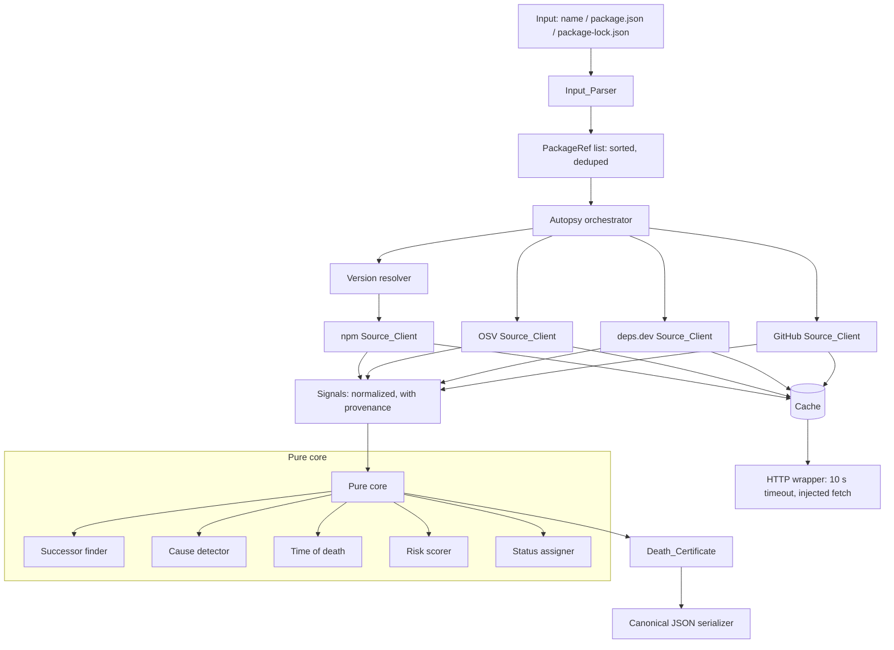
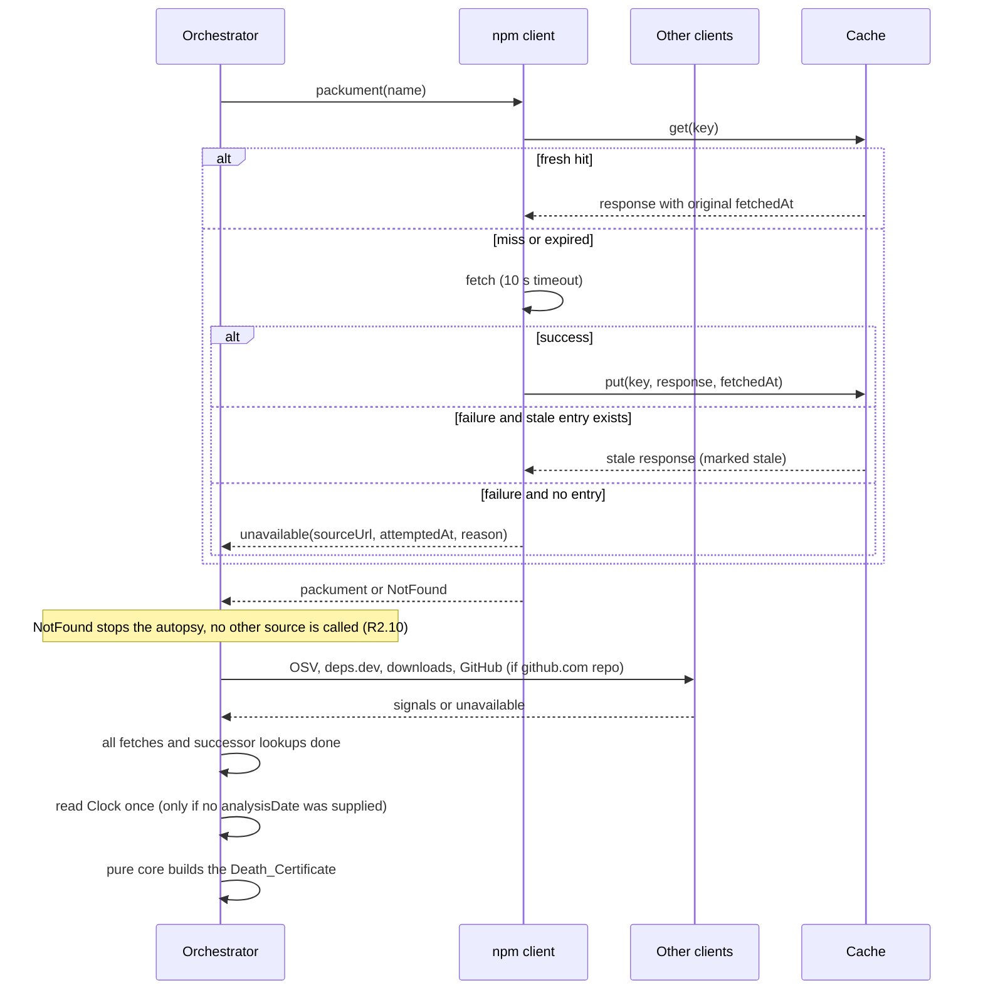

# Design Document

## Overview

The Autopsy Engine is a deterministic TypeScript library inside the Graveyard Shift Next.js project. It accepts a package name, a package.json, or a package-lock.json. It returns one Death Certificate per analyzed package. The engine calls four upstream data sources (npm registry and downloads API, OSV, deps.dev, GitHub REST API). It makes no LLM calls.

The design separates the engine into a pure core and a thin I/O shell:

- **Pure core**: input parsing, version resolution, successor extraction, cause detection, status assignment, risk scoring, certificate assembly, canonical serialization. These are plain functions of their arguments. They never read the clock, environment, or random numbers. Property-based tests target this layer.
- **I/O shell**: source clients, the cache, the HTTP wrapper. They take an injected `fetch`, an injected `Clock` (used only for Fetch_Date and cache age), and a config object. Tests inject recorded responses.

The Analysis_Date is an optional input of `runAutopsy`. When the caller supplies it, it is used as is and the orchestrator does not read the clock for it. When the caller omits it, the orchestrator reads the injected clock exactly once, after all source fetches for the run have completed (including successor lookups), and passes that value to the pure core. Apart from that single read, the clock is used only to stamp `fetchedAt` on responses that are actually fetched and to decide cache freshness. The pure core never reads the clock: it receives the Analysis_Date as an argument. Status, causes, Time_Of_Death and Risk_Score depend only on upstream data and the Analysis_Date (Requirement 10.2).

### Key design decisions

| Decision | Rationale |
|---|---|
| Pure core plus injected I/O | Makes determinism (R10) and fixture replay (R11) straightforward, and lets property tests run in memory well inside the 120 s budget (R12.7). |
| Provenance is attached when a response is wrapped, not when a Fact is built | A `SourceResponse` always carries `sourceUrl` and `fetchedAt`. A Fact is built from a response, so a Fact without provenance cannot be constructed except by an explicit omit path (R3.6). |
| Cache stores the original `fetchedAt` | A cache hit returns the stored response unchanged, so Fetch_Date is the original fetch time (R3.3). |
| Per-source tri-state results: `ok`, `empty`/zero value, `unavailable` | Distinguishes "reported zero" from "could not be retrieved" (R7.6, R7.10). |
| Risk_Score is a sum of non-negative weighted contributions, clamped to 0..100 | Non-negativity gives monotonicity (R8.3, R8.4) by construction. Clamping is the last step (R8.5). |
| Canonical JSON writer with a fixed key order | Byte-identical output (R10.3, R10.5) does not depend on object construction order. |
| `fast-check` for property tests, `vitest` as the runner | Both are idiomatic for TypeScript and Next.js. `fast-check` provides shrinking and seed reporting (R12.6). `semver` handles version precedence and ranges. |

### Research summary

- **npm registry packument** (`https://registry.npmjs.org/{name}`): provides `maintainers`, `time` (includes `created` and `modified` keys that must be excluded), `dist-tags.latest`, `versions[v].deprecated`, and `repository.url`. Per-version deprecation lives on the version object.
- **npm downloads API** (`https://api.npmjs.org/downloads/point/last-week/{name}`): returns `{ downloads }`.
- **OSV** (`POST https://api.osv.dev/v1/query` with `{package:{name,ecosystem:"npm"},version}`): returns `vulns[]` with `id`, `aliases`, `summary`, `severity`, and `affected[].ranges[].events[].fixed`.
- **deps.dev** (checked against the API docs at https://docs.deps.dev/api/v3/ and https://docs.deps.dev/api/v3alpha/ on 14 Nov 2026):
  - **Scorecard, v3 `GetProject`**: `GET https://api.deps.dev/v3/projects/{projectKey.id}`, for example `github.com%2Ffacebook%2Freact` (the project key is percent-encoded). The response field `scorecard.overallScore` is on a 0 to 10 scale. `scorecard` is present only when deps.dev holds a Scorecard for the project.
  - **Dependents, v3alpha `GetDependents`**: `GET https://api.deps.dev/v3alpha/systems/npm/packages/{name}/versions/{version}:dependents`, with the package name percent-encoded in the path. The response field `dependentCount` is used (the response also has `directDependentCount` and `indirectDependentCount`). The v3 API reference has no GetDependents method, so the earlier assumption that v3 offers `:dependents` was wrong. The docs state that dependent counts are available for npm and are indicative of relative popularity, because only public dependents are counted.
  - The dependents endpoint is an alpha API and may change. The Source_URL recorded for the dependents Fact is the v3alpha URL. If the v3alpha call fails or the response has no `dependentCount`, the dependent count is reported as unavailable with the reason and the attempted URL (R7.10).
- **GitHub REST** (`GET /repos/{owner}/{repo}`): provides `archived` and `pushed_at`. Unauthenticated requests are limited to 60 per hour, so the token is optional and the cache matters.

These endpoint shapes are from the public API documentation of each service. Exact response schemas will be pinned by the recorded fixtures, and each client validates responses with a schema (zod) so that an unparseable response becomes a typed failure instead of an exception (R11.6).

## Architecture



### Request flow for one package reference



**Orchestrator.** `runAutopsy` first collects all signals for all package references: packuments, OSV, deps.dev, downloads, GitHub and successor lookups. Only when every fetch for the run has completed does it determine the Analysis_Date. If the caller passed `analysisDate`, that value is used unchanged and the clock is not read for it. Otherwise the orchestrator calls `clock.now()` exactly once for the whole run and uses that value for every certificate. The pure core then builds the certificates from the signals and the Analysis_Date. Because the read comes after all fetches, in live runs every Fetch_Date is at or before the Analysis_Date. Cached responses have even earlier Fetch_Dates, so they also stay at or before it.

Different packages are analyzed independently. A failure for one package reference never aborts the others (R1.7, R1.11, R9.4, R11.6). The orchestrator deduplicates in-flight requests by Cache key, so a lockfile with up to 1,000 packages sends at most one upstream request per unique key (R9.9). Concurrency is bounded (default 8) to respect rate limits. Output order is determined by the sorted reference list, not by completion order.

### Module layout

```
src/engine/
  types.ts            // shared types and zod schemas
  parse/              // inputParser.ts, packageName.ts
  resolve/            // versionResolver.ts
  sources/            // http.ts, npm.ts, osv.ts, depsdev.ts, github.ts
  cache/              // cache.ts, cacheKey.ts
  core/               // successor.ts, causes.ts, timeOfDeath.ts, risk.ts, status.ts, certificate.ts
  serialize/          // canonicalJson.ts, deserialize.ts
  autopsy.ts          // orchestrator
scripts/recordFixtures.ts  // manual fixture recorder, run with `npm run fixtures:record` (needs network)
docs/engine-ordering.md  // documented ordering rules (R10.4)
tests/engine/{unit,property,fixtures,helpers}/   // helpers/replayFetch.ts serves the recorded fixtures
```

## Components and Interfaces

```ts
// Injected dependencies
interface Clock { now(): Date }                       // fetchedAt, cache age, and one read for the default Analysis_Date (orchestrator only, never the pure core)
interface EngineConfig {
  cacheTtlMs?: number;          // default 86_400_000; non-positive rejected, default used (R9.7, R9.8)
  githubToken?: string;         // from GITHUB_TOKEN
  requestTimeoutMs: 10_000;
  concurrency: number;
}
interface EngineDeps { fetch: typeof fetch; clock: Clock; cache: Cache }

// Entry point
function runAutopsy(
  input: EngineInput,           // { kind: 'name', name, version? } | { kind: 'package.json', text } | { kind: 'package-lock.json', text } | { kind: 'other', filename, text }
  config: EngineConfig,
  deps: EngineDeps,
  analysisDate?: Date,          // optional. If omitted, read once from deps.clock after all fetches complete (R3.1, R10.2)
): Promise<AutopsyRun>;

interface AutopsyRun {
  certificates: DeathCertificate[];   // ordered by ascending name (code-point), then version
  errors: AutopsyError[];             // per-reference errors (range unsatisfied, not found, parse failure)
  notes: string[];                    // e.g. "no packages found"
}
```

### Input_Parser

```ts
function parseInput(input: EngineInput): Result<{ refs: PackageRef[]; note?: string }, ParseError>;
interface PackageRef { name: string; spec: string | null }   // spec: exact version, range, or null (latest)
```

- Size limits: package.json at most 5 MB, package-lock.json at most 50 MB (R1.2, R1.3).
- Name validation: 1 to 214 characters, npm name rules (lowercase, URL-safe, optional `@scope/`).
- `package.json`: refs from `dependencies`, `devDependencies`, `optionalDependencies`, with the declared specifier.
- `package-lock.json`: supports `lockfileVersion` 2 and 3 (`packages` map) and falls back to the v1 `dependencies` tree. Each locked package yields its resolved version. The root entry (`""`) is skipped. Package names come from the `node_modules/` path suffix.
- Unsupported types (`yarn.lock`, `pnpm-lock.yaml`) and invalid JSON return `ParseError { inputType, reason }` with zero refs (R1.8).
- Output is sorted by name (code-point comparison, not locale), then version by semver precedence, with identical `(name, version)` pairs removed (R1.9). An empty result carries a "no packages found" note (R1.10).

### Version resolver

```ts
function resolveVersion(spec: string | null, published: string[], latestTag: string | null):
  Result<string, ResolveError>;
```

- `null` spec: the registry's `dist-tags.latest`. If the registry reports no published version, return an error naming the package (R1.4, R1.11).
- Exact version: used as is (R1.5).
- Range: `semver.maxSatisfying(published, range)`. `null` produces an error naming package and range (R1.6, R1.7).

### Source clients

All clients share `http.ts`, which applies the 10 s timeout through `AbortSignal.timeout`, consults the Cache, and returns:

```ts
type SourceResult<T> =
  | { status: 'ok'; value: T; provenance: Provenance[]; stale?: boolean }
  | { status: 'unavailable'; source: SourceName; attemptedUrl: string; attemptedAt: string;
      reason: string; rateLimitResetAt?: string }
  | { status: 'not-found'; source: SourceName; url: string };   // only meaningful for npm packument

interface Provenance { sourceUrl: string; fetchedAt: string }  // fetchedAt: UTC ISO 8601, second precision
```

`sourceUrl` is the URL the engine requested, before redirects (R3.2). It is at most 2,048 characters.

| Client | Fetches | Notes |
|---|---|---|
| npm | packument, downloads (last-week), existence lookup for successor candidates | Maintainers keep registry order. The `time` map drops `created`/`modified`. |
| OSV | vulnerabilities for `name@version` | Normalizes id, aliases, summary, severity, fixed versions. |
| deps.dev | Scorecard (v3 `GET /v3/projects/{projectKey.id}`, `scorecard.overallScore`), dependent count (v3alpha `GET /v3alpha/systems/npm/packages/{name}/versions/{version}:dependents`, `dependentCount`) | Scorecard only when the repository has one, score 0 to 10. The project key comes from the npm repository URL. Package names are percent-encoded in the path. The dependents Source_URL is the v3alpha URL. A failed v3alpha call or a missing `dependentCount` gives unavailable with the reason and attempted URL (R7.10). Docs: https://docs.deps.dev/api/v3/ and https://docs.deps.dev/api/v3alpha/ (verified 14 Nov 2026). |
| GitHub | `archived`, `pushed_at` | Only for `github.com` repository URLs, else skipped with a note (R2.12). Sends `Authorization: Bearer` only when a token is set. Otherwise it records "fetched without a token" (R2.6, R2.7). |

The token is passed only to the GitHub request headers. The HTTP wrapper redacts any occurrence of the token value from error messages and log lines. Cache keys and entries never contain headers (R2.8, R9.6).

A 403/429 response with rate-limit headers maps to `unavailable` with `rateLimitResetAt` taken from the header when present (R2.11).

### Cache

```ts
interface Cache {
  get(key: string): Promise<CacheEntry | undefined>;
  put(key: string, entry: CacheEntry): Promise<void>;
}
interface CacheEntry { body: string; status: number; fetchedAt: string }

function cacheKey(source: SourceName, url: string, query: Record<string,string>): string;
```

- `cacheKey` is the canonical JSON of `[source, url, sortedQueryPairs]`. It takes no credential argument. A change in any of the three parts changes the key (R9.5, R9.6).
- Freshness: `age = clock.now - fetchedAt`. `age <= ttl` is a hit with zero upstream requests (R9.1). Otherwise fetch and replace the entry (R9.2).
- On fetch failure with an expired entry, use it, mark derived Facts `stale: true`, leave the entry untouched (R9.3). With no entry, report the failure and store nothing (R9.4).
- Default store is an in-memory `Map`. A file-backed store can implement the same interface. A TTL that is not a positive finite number is rejected with an error and the 24 h default is used (R9.8).

### Pure core

```ts
// successor.ts
function extractCandidates(message: string): Candidate[];           // ordered by position
function findSuccessor(candidates: Candidate[], lookup: (name: string) => Promise<LookupResult>):
  Promise<{ successor?: string; lookups: LookupRecord[] }>;

// causes.ts
function detectCauses(s: CauseSignals, analysisDate: Date): CauseOfDeath[];

// timeOfDeath.ts
function timeOfDeath(time: Record<string,string>, analysisDate: Date):
  { timeOfDeath: string; daysSince: number } | { unavailable: true; reason: string };

// risk.ts
function computeRisk(input: RiskInput): RiskResult;

// status.ts
function assignStatus(i: { successor?: string; deprecation?: string; causes: CauseOfDeath[]; risk: number | undefined }):
  { status: Status } | { error: string };

// certificate.ts
function buildCertificate(signals: Signals, analysisDate: Date): DeathCertificate;
```

**Successor extraction.** `extractCandidates` scans the deprecation message for: (a) backtick-enclosed tokens, (b) the word after `use`, `check out`, `switch to`, `replaced by` (case-insensitive, whole-phrase match), and (c) the word before `instead`. Trailing punctuation is stripped from words. Candidates are sorted by start position in the message, ties broken by rule order (a, b, c). `findSuccessor` walks them in order. A candidate is skipped without lookup if it is in the Successor_Stoplist (case-insensitive) or is not a valid npm name. Otherwise it is looked up. A lookup that returns exists makes it the Successor. A not-found, error, timeout or rate limit skips it, and the failure is recorded (R4.3 to R4.7, R4.9). Each lookup, with its Source_URL, Fetch_Date and result, becomes a Fact (R4.2).

Checking the inflight message: "Do not use it." yields candidate `it` (after `use`), which is stoplisted and skipped. "Check out lru-cache" yields `lru-cache`, which exists. Because candidates are ordered by position, `it` is considered first and skipped, so `lru-cache` is selected (R4.8).

**Cause detection.** Causes are emitted in the fixed order `maintainer-gone`, `repo-archived`, `unpatched-cve`, `runtime-rot`, each at most once (R5.6):
- `maintainer-gone` when the maintainers list is known and empty.
- `repo-archived` when GitHub `archived` is true.
- `unpatched-cve` when the Open_Vulnerability list is non-empty.
- `runtime-rot` when whole days from Time_Of_Death to the Analysis_Date exceed 730 and either the last push is also older than 730 days or no push date is available.

An `unavailable` signal never produces a cause. "Exceeds" is strict (`> 730`).

**Open vulnerabilities.** A vulnerability is dropped only when OSV lists a fixed version greater than the analyzed version and that fixed version is published on npm. Otherwise it stays (R5.7, R5.8). Identifiers are sorted ascending (code-point) and deduplicated (R5.3).

**Time of death.** The latest parseable timestamp in the `time` map, excluding `created` and `modified`. `daysSince = max(0, floor((analysisDate - tod) / 86_400_000))` (R6.1 to R6.3). If there is no parseable entry, return unavailable with the reason "no release publish date was found" (R6.5).

**Risk scorer.** Fixed formula, documented in each certificate (R8.9). All contributions are non-negative integers. Unavailable Vital_Signs contribute 0 and are listed by name.

| Component | Points |
|---|---|
| Cause `maintainer-gone` | 20 |
| Cause `repo-archived` | 20 |
| Cause `unpatched-cve` | 25 |
| Cause `runtime-rot` | 15 |
| Open vulnerabilities | 5 per vulnerability, capped at 20 |
| Scorecard (when available) | `round((10 - score) * 2)`, so 0 to 20 |
| Dependents and downloads | 0 (informational, exposure not risk) |

`rawScore` is the sum of contributions. `riskScore = min(100, max(0, rawScore))`. The certificate lists each contribution and the formula weights/thresholds (R8.8, R8.9). Adding a vulnerability or a cause adds a non-negative term, so the score cannot decrease. The exception to guard against is the Scorecard term: it depends only on the Scorecard, which does not change when a vulnerability or cause is added in the property test. If no Vital_Signs are available and no causes exist, the score is 0 and the certificate states "no inputs were available" (R8.7).

**Status assignment.** In precedence order:
1. Successor found: `retired-with-successor` (regardless of causes).
2. Deprecation message exists and no successor: `dead`, with the full message recorded as a Fact.
3. At least one cause: `dead`.
4. Risk_Score missing or outside 0..100: no `dying`/`alive`, with an error on the certificate (R4.15).
5. Risk 40..100: `dying`. Risk 0..39: `alive`.

Exactly one Status is assigned, or the explicit error in step 4 (R4.13, R4.15).

### Serializer

`canonicalJson(cert)` writes keys in the fixed order declared in a single `CERTIFICATE_KEY_ORDER` table, recursively, and sorts every list by its documented rule (R10.4, R10.5). `deserialize(json)` validates with zod. Malformed JSON or a missing required field returns an error naming the field and no partial certificate (R10.7). Rules for list order are documented in `docs/engine-ordering.md`:

| List | Order | Tie-breaker |
|---|---|---|
| Certificates in a run | name, code-point | version by semver precedence, then version string |
| Causes | fixed: maintainer-gone, repo-archived, unpatched-cve, runtime-rot | none needed (unique) |
| Open vulnerabilities | id, code-point | first alias |
| Vulnerability aliases | code-point | none (unique) |
| Maintainers | registry order | index (stable) |
| Facts | by `key`, code-point | first provenance sourceUrl |
| Provenance entries in a Fact | sourceUrl, then fetchedAt | none |
| Risk contributions | fixed component order | none |
| Unavailable signs | name, code-point | none |

## Data Models

```ts
type Status = 'alive' | 'dying' | 'dead' | 'retired-with-successor';
type CauseOfDeath = 'maintainer-gone' | 'repo-archived' | 'unpatched-cve' | 'runtime-rot';
type SourceName = 'npm' | 'osv' | 'deps.dev' | 'github';

interface Provenance { sourceUrl: string; fetchedAt: string }  // exactly one URL and date per entry

interface Fact<T = unknown> {
  key: string;                 // e.g. "maintainers", "successor", "deprecation"
  value: T;
  provenance: Provenance[];    // 1..20 entries
  stale?: boolean;
}

type Maybe<T> =
  | { available: true; value: T }
  | { available: false; source: SourceName; attemptedUrl: string; attemptedAt: string;
      reason: string; rateLimitResetAt?: string };

interface Vulnerability { id: string; aliases: string[]; summary: string; severity?: string }

interface VitalSigns {
  maintainers: Maybe<string[]>;
  openVulnerabilities: Maybe<Vulnerability[]>;   // [] is distinct from unavailable
  scorecard: Maybe<number | null>;               // 0..10; null = deps.dev holds none (reported as unavailable with reason)
  dependents: Maybe<number>;                     // non-negative integer
  weeklyDownloads: Maybe<number>;                // non-negative integer
}

interface RiskContribution { component: string; points: number }
interface RiskBreakdown {
  contributions: RiskContribution[];
  rawScore: number;            // sum of contributions, before clamping
  formula: { weights: Record<string, number>; thresholds: Record<string, number> };
  unavailable: string[];       // names of unavailable Vital_Signs
  note?: string;               // "no inputs were available"
}

interface DeathCertificate {
  schemaVersion: 1;
  package: { name: string; version: string };
  analysisDate: string;                          // UTC ISO 8601
  status?: Status;                               // absent only with statusError
  statusError?: string;
  causes: CauseOfDeath[];
  openVulnerabilityIds: string[];
  timeOfDeath: Maybe<string> ;
  daysSinceDeath?: number;
  vitalSigns: VitalSigns;
  successor?: string;
  riskScore: number;                             // 0..100
  risk: RiskBreakdown;
  facts: Fact[];
  notes: {
    githubTokenUsed: boolean;
    githubSkippedReason?: string;
    omittedFacts: { key: string; reason: 'missing-provenance' }[];
  };
}

interface AutopsyError {
  package?: string; range?: string;
  kind: 'not-found' | 'range-unsatisfied' | 'no-version' | 'parse' | 'fixture-missing' | 'fixture-unparseable';
  message: string;
}
```

Notes on the model:
- Fetch_Date strings are `YYYY-MM-DDTHH:mm:ssZ` (second precision). The serializer truncates milliseconds.
- `scorecard` follows R7.9: when deps.dev has no Scorecard, the value is `available: false` with the reason "no scorecard".
- In live runs without an explicit `analysisDate`, the Analysis_Date is read after all fetches, so every Fetch_Date is at or before it. Fetch_Dates and the Analysis_Date are truncated to whole seconds the same way, and truncation is monotonic, so it cannot break the ordering. Cached facts have earlier Fetch_Dates and also stay at or before it.
- Fixture mode (R11) uses a `fetch` (`tests/engine/helpers/replayFetch.ts`) that serves only the recorded files and throws a typed error on any unrecorded URL. A missing or unparseable recording becomes an `AutopsyError` for that package, with no network fallback. Fixture tests inject a fixed Clock and a fixed `analysisDate`.
- A recorded fixture file is one JSON object with `cacheKey`, `sourceUrl`, `body`, `status` and `fetchedAt`. It is written from the Cache entry (`{ body, status, fetchedAt }`) and its key, never from a raw request object, so it holds no request headers, no Authorization header and no token. The Source_URL is the URL element of the cache key.
- The deps.dev dependents Fact has the v3alpha URL as its Source_URL (alpha API, may change). The Scorecard Fact has the v3 `GetProject` URL.

## Correctness Properties

*A property is a characteristic or behavior that should hold true across all valid executions of a system-essentially, a formal statement about what the system should do. Properties serve as the bridge between human-readable specifications and machine-verifiable correctness guarantees.*

Reflection results: the prework identified more than fifty testable criteria. These were merged where one property implies another. R8.2 is covered by R10.3. R1.5 and R1.6 share one resolver property. R1.2 and R1.3 share one structure but stay separate because the inputs differ. R3.1, R3.5 and R3.6 share one provenance property. R4.10 to R4.15 share one status property. R5.1 to R5.5 share one cause property. R5.7 and R5.8 share one vulnerability filtering property. R6.1 to R6.3 share one time-of-death property. R9.1 and R9.2 share one cache freshness property. R9.7 and R9.8 share one TTL property. R10.4 and R10.5 share one ordering property.

### Property 1: Name and version parse

*For any* valid npm package name (1 to 214 characters) and any exact semver version or semver range, parsing the name-with-version input yields exactly one package reference with that name and that version.

**Validates: Requirements 1.1**

### Property 2: Manifest parsing preserves entries

*For any* valid package.json (up to 5 MB) the parser yields one reference per entry in `dependencies`, `devDependencies` and `optionalDependencies` with the declared specifier, and *for any* valid package-lock.json (up to 50 MB) it yields one reference per locked package with its resolved version, in both cases after deduplication.

**Validates: Requirements 1.2, 1.3**

### Property 3: Parser output is sorted and deduplicated

*For any* input accepted by the parser, the reference list is in ascending order by name (code-point comparison) and then version (semver precedence), contains no two references with identical name and version, and parsing the same input again yields the same list.

**Validates: Requirements 1.9**

### Property 4: Invalid input is rejected

*For any* input that is not a valid package name, package.json or package-lock.json (including yarn.lock and pnpm-lock.yaml content and arbitrary strings), the parser returns an error naming the input type and a reason, and produces zero references.

**Validates: Requirements 1.8**

### Property 5: Version resolution

*For any* list of published versions and any spec, an exact version resolves to itself, and a range resolves to the highest published version satisfying it. When no published version satisfies the range, the result is an error naming the package and the range.

**Validates: Requirements 1.5, 1.6, 1.7**

### Property 6: Secret token never appears in output

*For any* token string and any run (including runs where sources fail and produce error messages), the token value does not appear in any certificate, log line, error message, cache key or cache entry.

**Validates: Requirements 2.8, 9.6**

### Property 7: Source failures degrade, not abort

*For any* subset of the four data sources failing (error, timeout or rate limit), the engine still produces a Death_Certificate. Each affected Vital_Sign is marked unavailable and records the source name, the attempted Source_URL, the time of the attempt and the failure reason. Unaffected Vital_Signs keep their values.

**Validates: Requirements 2.9, 2.11, 3.5, 7.4, 7.7, 7.9**

### Property 8: GitHub eligibility

*For any* repository URL string (or none), the GitHub client is called if and only if the URL is on github.com. Otherwise the GitHub Vital_Signs are unavailable and the certificate records that no github.com repository URL was available.

**Validates: Requirements 2.12**

### Property 9: Every fact carries valid provenance

*For any* Death_Certificate produced from generated source responses and Analysis_Date, every Fact has between 1 and 20 provenance entries. Each entry has an absolute Source_URL of 1 to 2,048 characters that is not whitespace-only and a Fetch_Date in UTC ISO 8601 format with second precision that is a valid calendar date and not later than the Analysis_Date. Any value lacking provenance is absent from the facts and listed in `omittedFacts`.

In live runs the same ordering holds by construction: the orchestrator reads the Analysis_Date after all fetches, so Fetch_Date <= Analysis_Date. Timestamps are truncated to whole seconds consistently, so truncation cannot break the ordering, and cached facts have earlier Fetch_Dates, so they remain <= Analysis_Date. The property test generates Fetch_Dates at or before the Analysis_Date, and the orchestrator unit test checks the live ordering with a fake Clock.

**Validates: Requirements 3.1, 3.4, 3.6, 12.4**

### Property 10: Cached facts keep their original fetch date

*For any* response stored in the Cache and any later read within the TTL, the Fact derived from it has a Fetch_Date equal to the original fetch time, regardless of the time of the read.

**Validates: Requirements 3.3**

### Property 11: Successor selection

*For any* deprecation message made of generated candidate words placed after the trigger phrases (`use`, `check out`, `switch to`, `replaced by`), before `instead`, or in backticks, and any generated map of which names exist on the registry (including lookup failures), the selected Successor is the first candidate by message position that is a valid npm name, is not in the Successor_Stoplist (case-insensitively), and exists. Stoplisted candidates are never looked up. If no candidate qualifies there is no Successor.

**Validates: Requirements 4.3, 4.4, 4.5, 4.6, 4.7, 4.9**

### Property 12: Status assignment

*For any* combination of successor presence, deprecation message presence, cause list and Risk_Score, exactly one outcome results. A Successor yields `retired-with-successor`. Otherwise a deprecation message or any cause yields `dead`. Otherwise a score of 40 to 100 yields `dying` and 0 to 39 yields `alive`. A missing or out-of-range score with no cause yields no status and an error. A deprecated package with no Successor also records the full message.

**Validates: Requirements 4.1, 4.10, 4.11, 4.12, 4.13, 4.14, 4.15**

### Property 13: Cause detection

*For any* generated signals and Analysis_Date, each cause is present if and only if its condition holds: `maintainer-gone` for an empty maintainer list, `repo-archived` for an archived flag, `unpatched-cve` for a non-empty Open_Vulnerability list, and `runtime-rot` when days since the last release exceed 730 and the last push is also older than 730 days or missing. The cause list is in the fixed order with no duplicates, and is empty when no condition holds.

**Validates: Requirements 5.1, 5.2, 5.3, 5.4, 5.5, 5.6, 5.9**

### Property 14: Open vulnerability filtering

*For any* set of OSV records, analyzed version and set of published versions, a vulnerability is excluded if and only if it lists a fixed version greater than the analyzed version that is published. The remaining identifiers are sorted ascending and contain no duplicates.

**Validates: Requirements 5.3, 5.7, 5.8**

### Property 15: Time of death

*For any* registry `time` map with generated timestamps and `created`/`modified` keys, and any Analysis_Date, the Time_Of_Death is the latest parseable timestamp among the keys other than `created` and `modified`. `daysSince` equals `max(0, floor(elapsed / 24h))`. If no entry is parseable, the time is unavailable and `daysSince` is omitted.

**Validates: Requirements 6.1, 6.2, 6.3, 6.5**

### Property 16: Vital signs normalization

*For any* generated upstream value or failure for each Vital_Sign, the report preserves registry order for maintainers, shows an empty list as empty (not unavailable), reports counts as non-negative integers with zero meaning the source reported zero, keeps the Scorecard in 0 to 10, includes the identifier, aliases (possibly empty), summary and optional severity for each vulnerability, and reports a failed or missing source as unavailable. Every certificate contains all five Vital_Signs.

**Validates: Requirements 6.4, 7.1, 7.2, 7.3, 7.5, 7.6, 7.8, 7.10**

### Property 17: Risk score range and accounting

*For any* causes and Vital_Signs (with any subset unavailable), the Risk_Score is an integer from 0 to 100, equals the raw sum of the listed contributions clamped to that range, unavailable Vital_Signs contribute 0 and are listed by name, and with no inputs and no causes the score is 0 with the "no inputs were available" note.

**Validates: Requirements 8.1, 8.5, 8.6, 8.7, 8.8**

### Property 18: Risk score monotonicity

*For any* autopsy inputs, adding one vulnerability not already present, or adding one cause not already present, leaves all other inputs unchanged and produces a Risk_Score greater than or equal to the previous score.

**Validates: Requirements 8.3, 8.4, 12.2**

### Property 19: Cache freshness and fallback

*For any* cache entry age, TTL and upstream outcome: an entry with age at most the TTL is used with zero upstream requests. A missing or older entry causes a fetch, and on success the entry is replaced with the new response and its Fetch_Date. On failure with an older entry, the old entry is used, its Facts are marked stale and the entry is unchanged. On failure with no entry, nothing is stored.

**Validates: Requirements 9.1, 9.2, 9.3, 9.4**

### Property 20: Cache key identity

*For any* two requests, the Cache keys are equal if and only if the Data_Source, resource URL and query parameters are all equal, and credentials never change the key.

**Validates: Requirements 9.5, 9.6**

### Property 21: TTL configuration

*For any* configured TTL, a positive finite duration is used as the TTL, and any other value is rejected with an error naming the TTL while the 24 h default is used.

**Validates: Requirements 9.7, 9.8**

### Property 22: One request per unique cache key

*For any* package-lock.json with up to 1,000 packages (including repeated names and versions), the number of upstream requests for each unique Cache key is at most one.

**Validates: Requirements 9.9**

### Property 23: Analysis is idempotent and byte-identical

*For any* generated package reference, source responses, Analysis_Date, configuration and Cache contents, analyzing twice yields serialized certificates that are byte-for-byte identical, and the results do not change when generated fetch latency or completion order changes.

**Validates: Requirements 8.2, 10.3, 11.7, 12.1**

### Property 24: Canonical ordering

*For any* Death_Certificate, the serialized keys follow the fixed key order regardless of the construction order of the object, and every list is sorted by its documented rule with a tie-breaker so that shuffling any list before serialization gives identical output.

**Validates: Requirements 10.4, 10.5**

### Property 25: Serialization round trip

*For any* valid Death_Certificate, deserializing its serialized JSON yields a certificate equal to the original in every field.

**Validates: Requirements 10.6, 12.3**

### Property 26: Invalid certificate JSON is rejected

*For any* serialized certificate with one required field removed, or any malformed JSON string, deserialization returns an error identifying the invalid or missing field and returns no partial certificate.

**Validates: Requirements 10.7**

## Error Handling

| Condition | Behavior | Requirement |
|---|---|---|
| Invalid input type or content | `ParseError` with input type and reason, zero refs | R1.8 |
| Empty manifest | Empty list plus "no packages found" note | R1.10 |
| Range matches no version | Error naming package and range, no certificate, other refs continue | R1.7 |
| Registry timeout or no versions (no spec) | Error naming package and reason, others continue | R1.11 |
| Package not in npm | `not-found` error, no other source called, no certificate | R2.10 |
| Source error or timeout (10 s) | Affected Vital_Signs unavailable with source, URL, time, reason | R2.9, R3.5 |
| Rate limit | Unavailable plus source name and reset time when given | R2.11 |
| No github.com repository | GitHub skipped, signs unavailable, reason recorded | R2.12 |
| Missing GITHUB_TOKEN | Unauthenticated requests, noted on certificate | R2.7 |
| Fact without provenance | Fact omitted, `omittedFacts` entry | R3.6 |
| Successor lookup failure | Candidate skipped, failure recorded | R4.9 |
| Invalid Risk_Score | No `dying`/`alive`, `statusError` set | R4.15 |
| Invalid cache TTL | Error reported, default used | R9.8 |
| Upstream failure with stale cache | Stale data used, Facts marked stale | R9.3 |
| Malformed certificate JSON | Error naming field, no partial result | R10.7 |
| Missing or unparseable fixture | Package fails with an error naming the package and response, no network fallback, others continue | R11.6 |

Errors are values (`Result` and `Maybe`), not exceptions, across the pure core. The HTTP wrapper catches every network and parse exception and converts it into `unavailable`. The wrapper redacts the token from all messages before they leave the module.

## Testing Strategy

### Why property-based testing applies

The pure core (parser, resolver, successor extraction, causes, status, risk, time of death, cache policy, serializer) is made of functions with clear inputs and outputs, large input spaces, and universal properties (round trips, idempotence, monotonicity, invariants). Property-based testing fits. It is not used for the HTTP layer itself, which is covered by recorded-fixture and example tests.

### Dual approach

**Property tests** (`fast-check` with `vitest`):
- Properties 1 to 26 above. Each property is implemented as a **single** property-based test.
- Each runs at least 100 cases (`numRuns: 100`). The test run fails if any case fails (R12.5).
- Each test has a comment tag: `Feature: autopsy-engine, Property {n}: {property text}`.
- On failure, `fast-check` reports the shrunk counterexample and the seed. The runner prints both, and the seed can be pinned with `FC_SEED` for reproduction (R12.6).
- Source responses are generated by arbitraries that build valid packuments, OSV records, deps.dev and GitHub payloads, with injected failure modes. The in-memory `fetch` fake and a fixed `Clock` keep each case fast. The full property suite must complete within 120 s (R12.7). Parser properties with large inputs use a reduced run count for the 5 MB and 50 MB size cases, with at least 100 runs for the rest.

**Unit and example tests**:
- Default Analysis_Date, with a fake Clock that counts reads and advances on each read: without `analysisDate` the clock is read exactly once for it, after the last fetch call completes, and every Fact Fetch_Date is at or before it. With an explicit `analysisDate` it is used unchanged and the clock is not read for it (R3.1, R10.2, R12.5).
- Fixture verdicts from recorded responses, with the replay `fetch` (`tests/engine/helpers/replayFetch.ts`) that serves only recorded files and throws a typed error on any unrecorded URL, plus a fixed Clock and a fixed `analysisDate` (R11.1 to R11.7):
  - ip@2.0.1 is `dead`, with `unpatched-cve` and CVE-2024-29415.
  - lodash.set@4.3.2 is `dead`, with `unpatched-cve` and CVE-2020-8203.
  - inflight@1.0.6 is `retired-with-successor` with Successor `lru-cache`, and `it` is never the Successor (R4.8).
  - A list of the three yields certificates ordered `inflight`, `ip`, `lodash.set`.
  - A missing recording fails only that package.
- Latest-version resolution when no version is given (R1.4), and empty manifests (R1.10).
- Source client examples: endpoint construction (including deps.dev: v3 `GetProject` for the Scorecard, v3alpha `:dependents` for dependents, percent-encoded scoped names), bearer header only with a token, unauthenticated note without one, registry 404 stops the autopsy, rate-limit reset time, redirect does not change the Source_URL (R2.1 to R2.7, R2.10, R2.11, R3.2).
- Successor lookup is recorded as a Fact (R4.2). Certificate includes the formula (R8.9).

**Smoke tests**:
- A network guard that fails the test run on any request to a non-recorded host, including any LLM service host (R10.1, R11.4).
- A lint rule banning `Date.now`, `new Date()` without arguments and `Math.random` in `src/engine/core` and `src/engine/serialize` (R10.2).
- Test-suite meta checks for R12 (property tests exist, minimum run count configured, seed reporting enabled).

**Fixtures**: recorded responses live in `tests/engine/fixtures/{ip,lodash.set,inflight}/` and are keyed by cache key. A human records them with `npm run fixtures:record` (`scripts/recordFixtures.ts`, run through `tsx` with `node --env-file=.env` semantics so `GITHUB_TOKEN` is read from `.env`). The script runs the engine once against the live APIs with the real `fetch` and real clock for ip@2.0.1, lodash.set@4.3.2 and inflight@1.0.6 (including the `lru-cache` existence lookup for inflight). It then writes every cache entry to a file holding only `cacheKey`, `sourceUrl`, `body`, `status` and `fetchedAt`. It uses `GITHUB_TOKEN` when set, never prints it, and never writes it, an Authorization header or any request header into a fixture, because it writes from cache entries, which hold no credentials by design. The script needs network, so it is run manually and never as part of the test run. Fixture tests use only the recorded files through the replay `fetch`.

A required credential scan test reads every file under `tests/engine/fixtures/` and fails if a file contains the value of `GITHUB_TOKEN` (when set in the environment) or the strings `Authorization` or `Bearer`. Figures in `docs/demo-packages.md` should be re-checked before the demo.
