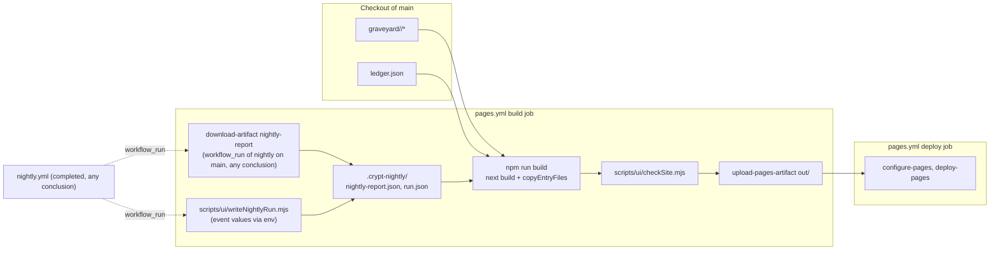
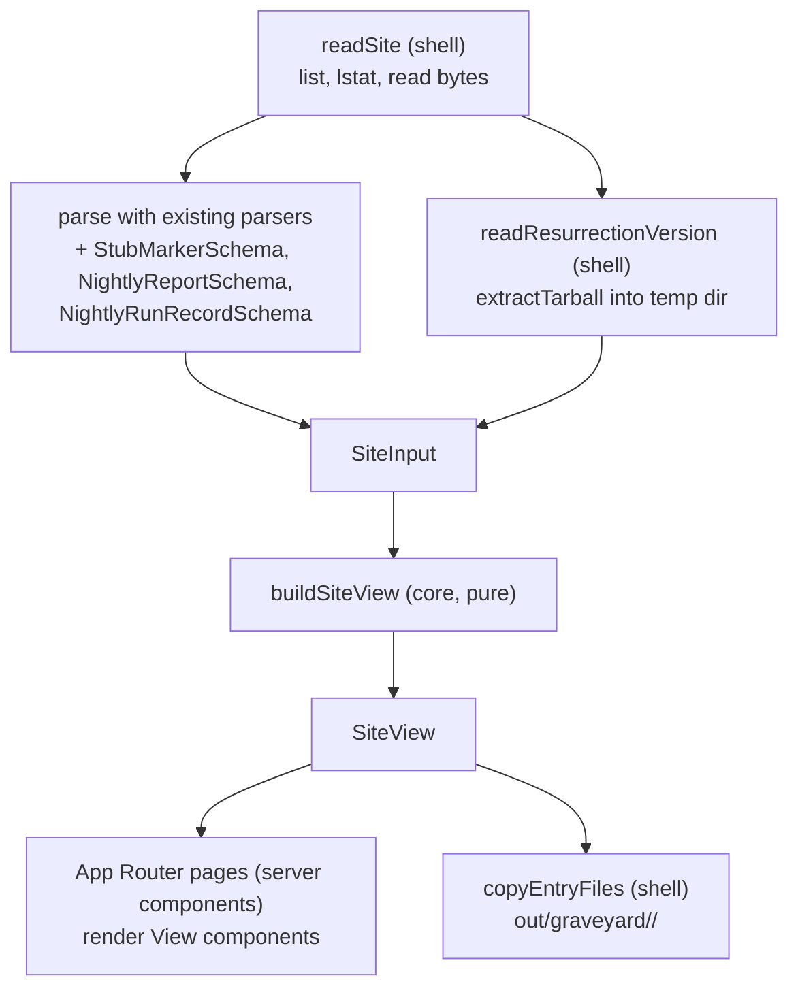

# Design Document: crypt-ui

## Overview

This design adds the Crypt_Site: a Next.js static export, deployed to GitHub Pages under `/graveyard-shift`, that shows the committed Graveyard_Directory. It is spec (c) of three and keeps the terms and requirement numbers of `resurrection-pipeline`, cited as "resurrection-pipeline R<n>.<m>". It changes nothing that CI produces or accepts. Two additive changes touch spec (a) modules: a `StubMarkerSchema` in `layout.ts` and a `NightlyReportSchema` in `nightlyReport.ts`, each next to the TypeScript type it describes (Requirement 2.2); no writer changes.

Guiding rule (requirements Introduction): the Site states only what its input files state. Every page is rendered at build time from a view model that a pure function builds from parsed files. Nothing is fetched, recomputed or inferred: the outcome comes from `proof-report.json` and `deriveEntryKind`, the stub label from `stub-run.json`, the commands from `verifyCommands`, the readings from `ledger.json` as typed, the nightly results from one validated artifact.

### Evidence this design relies on

Read from the repository on 2026-11-17 (no new measurement):

- Parsers and schemas: `deserialize` (`src/engine/serialize/deserialize.ts`, `DeathCertificateSchema` in `src/engine/types.ts`), `deserializeEligibilityRecord` (`src/pipeline/gravedigger/core/eligibility.ts`), `deserializeReport` (`src/proof/serialize/deserialize.ts`, `ProofReportSchema` in `src/proof/types.ts`), `parseDeltasFile` (`src/pipeline/harness/core/deltas.ts`), `parseHarnessFile` (`src/pipeline/harness/core/harnessFile.ts`), `parseLedger` (`src/pipeline/local/core/ledger.ts`). Each fails closed on `schemaVersion` other than 1 (`z.literal(1)`).
- Layout: `ENTRY_FILES`, `bundleName`, `deriveEntryKind`, `StubMarker`, `buildStubMarker` (`src/pipeline/undertaker/core/layout.ts`). The nightly reader accepts exactly one `*.tgz` per Resurrection_Entry (`src/pipeline/undertaker/shell/nightly.ts`); the publish step names it `resurrection.tgz` (`scripts/ci/lib/publishSteps.ts`, `PUBLISH_PATHS.tarballName`).
- Names: `supportedPackageNameProblem` (`src/pipeline/common/packageNames.ts`) accepts unscoped names matching `^[a-z0-9~-][a-z0-9._~-]*$` (at most 214 characters) and rejects `safe-eval` and `node-serialize`. Every accepted character is URL-unreserved, so `encodeURIComponent(name) === name` for every accepted name.
- Nightly: `NightlyReport`, `NightlyReportEntry`, `NightlyFact`, `NightlyCounts` (`nightlyReport.ts`), `NightlyResult`, `NIGHTLY_RESULT_ORDER`, `ToolVersions`, `ToolVersionField` (`nightlyClassify.ts`). No zod schema; no run time, run identifier or run address in the report. `DEFAULT_REASONS.verified` reads "Replay identical and attestations verified." and is also the reason of a non-alive Resurrection_Entry, which has no attestation; `buildNightlyReport` picks the default reason from `results[0]` only, and `NightlyEntryInput` has no Verdict field (`nightly.ts` knows the Verdict as `verdict` in `processEntry`, and passes a caller `reason` to `NightlyEntryInput` for other results). The user decided on 2026-11-17 to change that text in spec (a) without a new input field (Component 3).
- `verifyCommand` and `verifyCommands` (`src/pipeline/undertaker/core/verifyCommands.ts`) build `gh attestation verify <file> --repo subair99/graveyard-shift --predicate-type <PREDICATE_TYPE> --signer-workflow subair99/graveyard-shift/.github/workflows/resurrect.yml --format json`.
- `extractTarball(bytes, destDir, limits)` writes into an empty directory that the caller creates and returns the files with their bytes (`src/proof/shell/tarball/tarballExtractor.ts`); `packTarball` builds a reproducible tarball (used by the fixtures here).
- Workflows: pins `actions/checkout@3d3c42e5aac5ba805825da76410c181273ba90b1 # v7.0.1`, `actions/setup-node@949feb2413d6458794dcd2491c4babbbce0c15c1 # v7.1.0`, `actions/upload-artifact@cf430e030ddbb5b0abf93d22962f4752f3646cd9 # v7.0.2`, `actions/download-artifact@9000827ccba6bdab643e8b6fd33ac0654aef8333 # v8.0.2`. `nightly.yml` has `name: nightly` and uploads the artifact `nightly-report` (path `nightly-report.json`, `retention-days: 7`, `if: always()`). `tests/pipeline/unit/workflowLint.test.ts` applies the SHA-pin rule and the `timeout-minutes` rule to every `.github/workflows/*.yml`.
- Test setup: `vitest.config.mts` inline projects inherit the network guard; `BUDGET_SECONDS` in `tests/proof/helpers/budgetReporter.ts` holds the targets; `scripts/trace.ts` `SPECS` maps a tests directory to a spec; `eslint.config.mjs` `deterministicFiles` bans the clock and randomness in pure directories.

No number in this design is a measurement. The 60 s target of the project `ui` and the job timeouts are chosen values.

## Architecture

### Where the pieces run



The same `npm run build` and `checkSite.mjs` run in a new `ci.yml` job `site` on every push and pull request, without the Nightly_Input.

### Build-time data flow



`readSite` returns `Result<SiteInput, SiteReadError>`; any error fails the build (Requirement 2.5, 2.6, 2.10, 5.11). A Nightly_Run_Record that is present but not accepted becomes a warning and `nightly: null` (Requirement 12.6); an accepted record with a present but not accepted Nightly_Report becomes a warning and `{ run, report: null, reportState: "rejected" }` (Requirement 12.11).

### Core and shell, and why `src/ui/`

- `src/ui/core/` is pure (view model, link builders, link filter, label tables, theme data, run record schema). It is added to `deterministicFiles` in `eslint.config.mjs`.
- `src/ui/shell/` does the I/O (reading, tarball extraction into a temporary directory, copying).
- `src/ui/components/` holds the React components. Each is a synchronous function of view data, so tests render it with `renderToStaticMarkup` from `react-dom/server` (an existing dependency).
- `src/app/` holds only the App Router files, as Next.js requires. Each page awaits `loadSite()` and passes view data to a component.

The Site is a reader, not a fifth role, so it does not go under `src/pipeline/` (structure guideline: keep the four roles distinct). A top-level `src/ui/` follows the existing top-level layout (`src/engine/`, `src/proof/`, `src/pipeline/`) and its `core/` and `shell/` split.

### Routes and Site_Output

`next.config.mjs` sets `output: "export"`, `basePath: "/graveyard-shift"`, `trailingSlash: true`, `reactStrictMode: true`. Routes:

| Route file | URL | Output file |
|---|---|---|
| `src/app/page.tsx` | `/graveyard-shift/` | `out/index.html` |
| `src/app/crypt/page.tsx` | `/graveyard-shift/crypt/` | `out/crypt/index.html` |
| `src/app/crypt/[name]/page.tsx` | `/graveyard-shift/crypt/<package>/` | `out/crypt/<package>/index.html` |
| (copy step) | `/graveyard-shift/graveyard/<package>/<file>` | `out/graveyard/<package>/<file>` |

`crypt/[name]/page.tsx` exports `dynamicParams = false` and `generateStaticParams` returning `{ name }` for each entry, so no other dynamic route exists (Requirement 1.6). Amended 2026-11-18 after open question 5 (user-run), see Journal: Next.js 16 rejects an empty array under `output: "export"`, so `generateStaticParams` returns `staticParamsFor(view)` (`src/ui/core/staticParams.ts`): `[{ name: EMPTY_CRYPT_PARAM }]` when the site has no entry, the entry names only otherwise. `EMPTY_CRYPT_PARAM = "_empty"` (`src/ui/core/site.ts`); a leading underscore is never a valid npm package name (`supportedPackageNameProblem("_empty")` is non-null, tested), so no entry can have that name. The page renders `EmptyCryptView` for that parameter, only when the site has no entry; no other page links to `/crypt/_empty/`. Entry routes live under `crypt/` and downloads under `graveyard/`, so no package name can collide with a page.

Internal links are plain anchors built by `sitePath` (Component 2), not `next/link`. A plain anchor needs no client router, has no prefetch, and its `href` is exactly the built string, so the Base_Path, the trailing slash and names with a dot (`lodash.set`) need no Next.js behaviour. Next.js still emits its own same-origin scripts; Requirement 1.3 allows them and Requirement 8.7 keeps all content in the HTML.

## Components and Interfaces

### 1. Configuration and scripts

**`next.config.mjs`**: `{ reactStrictMode: true, output: "export", basePath: "/graveyard-shift", trailingSlash: true }`. A unit test imports the file and checks that `basePath` equals `BASE_PATH` of `src/ui/core/site.ts`, because the config cannot import TypeScript.

**`package.json` scripts** (no dependency change, Requirement 1.8):

- `"build": "next build && tsx scripts/ui/copyEntryFiles.ts"` (Site_Build = export, then Entry_File_Copy).
- `"start": "node scripts/ui/startNotice.mjs"`. The script writes to standard error, starts no server and exits with code 1 (Requirement 1.7). Its text: "`npm run start` does not serve the Crypt_Site. For development run `npm run dev` and open http://localhost:3000/graveyard-shift/. To preview a build, run `npm run build`, then serve the directory `out/` under the path `/graveyard-shift/` with any static file server."
- `dev`, `typecheck`, `lint` unchanged. `lint` already covers `src`, `tests`, `scripts`.

**`.gitignore`**: add `/out/` and `/.crypt-nightly/` (Requirement 11.5).

### 2. Pure core: `src/ui/core/`

**`site.ts`** (link builders, Requirement 4.10, 7.4, 7.5, 12.4)

```ts
export const BASE_PATH = "/graveyard-shift";
export const NIGHTLY_INPUT_DIR = ".crypt-nightly";
export const NIGHTLY_REPORT_FILE = "nightly-report.json";
export const NIGHTLY_RUN_FILE = "run.json";
export const LEDGER_PATH = "ledger.json";
export const GRAVEYARD_PATH = "graveyard";
/** "/graveyard-shift" + path; path starts with "/" and, for a page, ends with "/". */
export function sitePath(path: string): string;
export function entryRoute(name: string): string;           // /graveyard-shift/crypt/<enc(name)>/
export function downloadPath(name: string, file: string): string; // /graveyard-shift/graveyard/<enc(name)>/<enc(file)>
export function historyUrl(name: string): string;           // https://github.com/<REPO>/commits/main/graveyard/<enc(name)>
export function runUrl(runId: number): string;              // https://github.com/<REPO>/actions/runs/<runId>
```

`enc` is `encodeURIComponent`. The functions take only names that the reader accepted; they are not a validation step.

**`safeHref.ts`** (Requirement 7.2, 7.3)

```ts
/** The string itself when it is an absolute http(s) URL with a host and no control or whitespace character; otherwise null. */
export function safeHref(value: string): string | null;
```

Rules, in order: reject any code point below U+0021 or equal to U+007F, or any Unicode whitespace, anywhere in the string; require `/^https?:\/\//i` at the start (this rejects scheme-less, protocol-relative and other-scheme strings before any percent-decoding); require `new URL(value)` to succeed with `protocol` `http:` or `https:` and a non-empty `hostname`. The returned `href` is the input string, unchanged.

**`causes.ts`** (Requirement 4.2): the Cause_Label_Table and `causeView(code: string): { code: string; label: string | null }`. Labels, from autopsy-engine R5.1 to R5.5:

| Code | Label |
|---|---|
| `maintainer-gone` | the npm registry lists no maintainer |
| `repo-archived` | the GitHub repository is archived |
| `unpatched-cve` | at least one known vulnerability has no fix in a published version |
| `runtime-rot` | no release within the dormancy threshold, and no repository push within it or none recorded |

An unknown code gets `label: null` and is shown as itself. The certificate schema accepts only the four codes, so the fallback is for totality.

**`nightlyLabels.ts`** (Requirement 12.3, 12.5): `nightlyLabel(result: NightlyResult, verdict: Verdict | null): string`. The label is the Site's own text; the report's `reason` is shown together with it, as written, for every result, and not instead of it (decisions of 2026-11-17, second and third round). The label of `verified` depends on the Verdict so that the distinction between an attested and a non-attested entry does not rest on File_Text, and the non-alive label contains neither "verified" nor "attested" (Requirement 6.2).

| Result | Label |
|---|---|
| `verified`, Verdict `alive` | replay identical and all three attestations verified by the nightly run |
| `verified`, other Verdict | replay identical; no attestation for this Verdict |
| `replay-mismatch` | the replay produced a report that differs from the committed one |
| `tool-versions-changed` | the tool versions differ from the committed ones; the replay was not run |
| `attestation-failed` | an attestation did not verify, or fewer than three were found |
| `unexpected-attestation` | attestation bundles exist for an entry that is not alive |
| `new-advisory` | the nightly Coroner found an advisory that the committed certificate does not list |
| `not-resurrected` | not resurrected; nothing to replay or attest |
| `not-checked` | the check could not be completed |

**`entryFiles.ts`** (Requirement 2.5): `checkEntryFileNames(files: readonly string[]): Result<{ tarballName: string | null }, string>`. Accepted names: the values of `ENTRY_FILES`; at most one name matching `^[a-z0-9][a-z0-9._-]*\.tgz$`; and `bundleName(s)` for `s` in the tarball name, `ENTRY_FILES.proofReport` and `ENTRY_FILES.certificate`. Any other name is an error that names it. Whether a file is missing for the kind is checked by the reader after `deriveEntryKind`.

**`nightlyRun.ts`** (Requirement 12.2): `NightlyRunRecordSchema`, strict: `schemaVersion: z.literal(1)`, `runId: z.number().int().positive()`, `runStartedAt: UtcTimestampSchema`, `conclusion: z.string().regex(/^[a-z_]{1,32}$/)`, `headSha` and `buildSha: z.string().regex(/^[0-9a-f]{40}$/)`. Also `DOCUMENTED_CONCLUSIONS = ["success", "failure", "neutral", "cancelled", "skipped", "stale", "timed_out", "action_required"] as const` (the conclusion values listed for the `status` parameter of the REST endpoint "List workflow runs for a repository", https://docs.github.com/en/rest/actions/workflow-runs, read 2026-11-17; the response field `conclusion` itself is typed as string or null with no enum).

Schema decision for `conclusion`: the schema checks the shape only (lower-case ASCII letters and underscores, 1 to 32 characters) and does not require a documented value, so a value that GitHub adds later is accepted and shown as written; only `success` changes behaviour (Requirement 12.6 versus 12.10). A null or empty conclusion, or one of another shape, fails the shape check: `writeNightlyRun.mjs` writes no record, and the Site shows "No recent nightly result in this build." `DOCUMENTED_CONCLUSIONS` is used by tests and by the generators only, not by the reader. The conclusion is run-wide text from the event and is never the outcome of an entry (Requirement 12.9).

**`resurrectionVersion.ts`** (Requirement 2.10): `versionFromPackageJson(bytes: Uint8Array): Result<string, string>`: strict UTF-8 decode, `JSON.parse`, an object with a string `version` for which `semver.valid(version) === version`.

**`viewModel.ts`** (Requirement 3, 4, 5, 6, 12, 13): `buildSiteView(input: SiteInput): SiteView`, total over valid input. It calls `verifyCommands({ subjects, prefix: \`graveyard/${name}/\` })` for `alive` entries only, `causeView`, `nightlyLabel`, `safeHref` (to mark which strings become anchors) and the link builders. It reads no clock, does no I/O and takes every string it outputs from the input, from a fixed text of `texts.ts` or from these builders.

**`texts.ts`**: every fixed sentence of the pages (outcome definitions, role descriptions, the verification and replay sentences of Requirement 5.7 and 5.8, the stub sentence of resurrection-pipeline R23.12, "No recent nightly result in this build.", the template `nightlyNoReport(link, runStartedAt, conclusion)` of "The last nightly run (<run link>, <runStartedAt>) ended <conclusion> without a report." (Requirement 12.10; the three slots are filled only with `runUrl(runId)` and the record's strings), the template `nightlyReportRejected(link, runStartedAt, conclusion)` of "The last nightly run (<run link>, <runStartedAt>) ended <conclusion>; its report did not pass validation." (Requirement 12.11; same slots), the Attempts caption and note, the "not recorded" text). The honesty tests read this one module.

**`theme.ts`** (Requirement 8.2): `PALETTE` (named hex colours), `PAIRS` (each text or boundary colour with its background and its kind, `normal`, `large` or `component`) and `contrastRatio(a, b)` per WCAG 2.2 relative luminance.

### 3. Schemas added to spec (a) modules

**`src/pipeline/undertaker/core/layout.ts`**: `StubMarkerSchema = z.object({ schemaVersion: z.literal(1), mode: z.literal("stub"), label: z.literal("stub run") }).strict()`.

**`src/pipeline/undertaker/core/nightlyReport.ts`**: `NightlyReportSchema`, strict at every level: `repo: z.string()`, `ghVersion: z.string().nullable()`, `ghMinVersion: z.string()`, `counts: { total, checkable, notChecked }` (non-negative integers), `entries: z.array(...)` with `package: z.string()`, `results: z.array(z.enum(NIGHTLY_RESULT_ORDER)).min(1)`, `reason: z.string()`, `stub: z.boolean()`, `committedTools` (`{ node: string, fastCheck: string, reportSchema: int }` or `null`), `runningTools` (same object), `differingToolFields: z.array(z.enum(["node", "fastCheck", "reportSchema"]))`, `firstDiffPath: z.string().nullable()`, `facts: z.array({ text: z.string(), sourceUrl: SourceUrlSchema, fetchedAt: UtcTimestampSchema })`. `renderNightlyReportJson` is unchanged. A test checks that a built report round-trips through the schema (Property 12).

**Reason text of `verified`** (user decision 2026-11-17, third round; resurrection-pipeline R16.14 as amended for crypt-ui). This is a change to a spec (a) module, done as task 1 of this spec. `NightlyEntryInput` gets no new field:

- `nightlyReport.ts` exports `VERIFIED_REASON_ALIVE = "Replay identical and attestations verified."` and `VERIFIED_REASON_NOT_ALIVE = "Replay identical; no attestation expected."`. `DEFAULT_REASONS.verified` stays equal to `VERIFIED_REASON_ALIVE`, so `buildNightlyReport`, the existing `nightlyReport.test.ts` expected values and `p28`/`p29` stay unchanged; every other default reason is unchanged, and a caller-given `reason` still wins.
- `nightly.ts`, in `processEntry`, already reads the committed Verdict as `verdict` (`report === null ? null : report.verdict`) and computes the caller `reason` (only for `attestation-failed` and `not-checked` today) before it builds the `NightlyEntryInput`. When `results[0]` is `verified`, it passes `VERIFIED_REASON_ALIVE` when `verdict === "alive"` and `VERIFIED_REASON_NOT_ALIVE` otherwise as that `reason`.
- The report shape (`NightlyReportEntry`) is unchanged, so `NightlyReportSchema` needs no new field, and the committed nightly runs in the Journal keep their recorded text.
- Tests: `tests/pipeline/unit/nightly.test.ts` gains the new cases (an `alive` entry with an identical replay gets `VERIFIED_REASON_ALIVE`; a `restless` entry with an identical replay gets `VERIFIED_REASON_NOT_ALIVE`). `tests/pipeline/unit/nightlyReport.test.ts` gains only checks of the two exported constants (and that `DEFAULT_REASONS.verified` text equals `VERIFIED_REASON_ALIVE` through the built report); no existing expected value changes. `tests/pipeline/property/p28-nightly-classification.test.ts` and `p29-nightly-not-resurrected.test.ts` do not import `buildNightlyReport` (checked 2026-11-17) and are run once to confirm. The facts carry `SourceUrlSchema` and `UtcTimestampSchema` because `checkAdvisories` copies them from certificate provenance, which already passed those schemas.

### 4. Shell: `src/ui/shell/`

**`readSite.ts`**

```ts
export interface SiteFs {
  /** Sub-directory names, or null when the directory does not exist. */
  listDirs(dir: string): string[] | null;
  /** Every directory entry with its kind from lstat (no link is followed). */
  listEntries(dir: string): { name: string; kind: "file" | "directory" | "symlink" | "other" }[];
  /** File bytes, or null when the file does not exist. */
  readBytes(file: string): Uint8Array | null;
}
export interface SiteReadDeps {
  readonly root: string;            // repository root
  readonly fs: SiteFs;
  readonly resurrectionVersion: (tarball: Uint8Array) => Promise<Result<string, string>>;
  readonly warn: (line: string) => void;
}
export async function readSite(deps: SiteReadDeps): Promise<Result<SiteInput, SiteReadError>>;
```

Steps: list `graveyard/` (a missing directory gives zero entries, Requirement 1.6; any child of `graveyard/` that is not a directory, such as a symlink or a stray file, fails the read and names the path, because the layout has one directory per package and nothing else); for each directory in code-point order: check the name with `supportedPackageNameProblem`; reject any entry that is not a regular file (Requirement 5.11); `checkEntryFileNames`; parse `eligibility.json` and `deriveEntryKind`; parse `certificate.json` and compare `package.name`; for a Resurrection_Entry (every Verdict) parse `proof-report.json`, `deltas.json`, `harness.json`, require the tarball and read its version; parse `stub-run.json` when present; then compare the non-bundle file set with `planEntryFiles` of `layout.ts` (a missing or extra file fails; `.sigstore.json` bundles are not compared, Requirement 5.6 shows them); then parse `ledger.json`; then the Nightly_Input: no `run.json` gives `nightly: null` (a report without a record is ignored with a warning); a `run.json` that fails `NightlyRunRecordSchema` gives a warning and `nightly: null`; an accepted record with no `nightly-report.json` gives `{ run, report: null, reportState: "missing" }`; with a report that fails `NightlyReportSchema` or has `repo !== REPO`, a warning and `{ run, report: null, reportState: "rejected" }`; otherwise `{ run, report, reportState: "accepted" }`. Each error names the file, relative to the root, and the failing path as the parser reports it.

**`tarballVersion.ts`**: `readResurrectionVersion(bytes)`: `mkdtemp(join(tmpdir(), "crypt-tgz-"))`, `extractTarball(bytes, dir)` with `DEFAULT_EXTRACT_LIMITS`, find the `ExtractedFile` with `path === "package.json"`, `versionFromPackageJson(file.bytes)`, and `rm(dir, { recursive: true, force: true })` in `finally`. It reads only the returned bytes of `package.json` (Requirement 2.9). Using `extractTarball` unchanged keeps the proof engine module untouched; the cost is one temporary directory per Resurrection_Entry per build.

Amended 2026-11-18 (open question 5, user-run): the reader is unchanged. A directory named `_empty` is rejected by the name check, so the placeholder route cannot collide with an entry.

**`loadSite.ts`**: the production wiring, memoized per process: `readSite` with `node:fs` (`lstatSync`, `readdirSync`, `readFileSync`), `root = process.cwd()`, `warn` to `console.warn`; on error it throws an `Error` whose message is the `SiteReadError` text, which fails `next build`. Then `buildSiteView`. The pages import only `loadSite`.

**`copyEntryFiles.ts`**: `copyEntryFiles(view: SiteView, deps: { root, outDir, fs })`: for each entry and each file of `entry.files`, read the source bytes and write them to `out/graveyard/<package>/<file>` with the flag `wx` (an existing target is an error). It copies only `entry.files`, which the reader listed from the entry directory, so no other repository file is copied (Requirement 5.10).

### 5. Entry scripts: `scripts/ui/`

- **`copyEntryFiles.ts`**: runs `loadSite()` (the same validation as the pages) and `copyEntryFiles` into `out/`; exit 1 with the error on failure. Started by `npm run build` after `next build`.
- **`startNotice.mjs`**: Component 1.
- **`writeNightlyRun.mjs`** (Requirement 9.10, 12.2): dependency-free. Reads `GS_RUN_ID`, `GS_RUN_STARTED_AT`, `GS_CONCLUSION`, `GS_HEAD_SHA`, `GS_BUILD_SHA` from the environment, checks the shapes of `NightlyRunRecordSchema` with plain code, creates `.crypt-nightly/` when the download step did not, and writes `.crypt-nightly/run.json` (2-space JSON, final newline). It runs after the download step whatever that step's outcome. On a bad value it prints `::warning::` with the variable name (never the value) and writes nothing, exit 0, so the reader sees no record and shows the sentence of Requirement 12.6. A unit test checks that its checks agree with `NightlyRunRecordSchema` on generated values.
- **`checkSite.mjs`** (Requirement 10.5): dependency-free, imports only `node:` modules, run from the repository root after `npm run build`. Checks, each failure printed as one line, exit 1 when any:
  1. `out/index.html`, `out/crypt/index.html` and `out/crypt/<name>/index.html` exist for every directory `<name>` of `graveyard/`. Amended 2026-11-18 (open question 5, user-run): `out/crypt/_empty/index.html` exists when `graveyard/` has no entry and does not exist otherwise; any other page directory under `out/crypt/` without a matching entry fails. Amended 2026-11-18 after the first build (user-run): a page directory is a directory under `out/crypt/` that contains `index.html`; only those are matched against the entries and the `_empty` rule. A directory without `index.html` (Next.js writes `out/crypt/__next.crypt/` with only `__PAGE__.txt`) is not a page and is not matched; there is no ignore list. A missing `graveyard/` counts as zero entries (same rule as the Site's reader and the nightly); a `graveyard/` that exists but is not a directory fails, naming the path. With zero entries, `out/graveyard/` holds no file (a missing `out/graveyard/` passes).
  2. In every `out/**/*.html`: each `src` and `srcset` value, and the `href` of each `<link>`, is relative or starts with `/graveyard-shift/` (no scheme, no `//`); no `<iframe>`, `<object>`, `<embed>`, `<form>`, `<base>` or `<meta http-equiv="refresh">`; no attribute named `on*`; every `<a href>` is an absolute `http:` or `https:` URL, starts with `/graveyard-shift/`, or starts with `#`; every `<a target="_blank">` has `rel` containing `noopener` and `noreferrer`.
  3. In every `out/**/*.css`: no `@import` and no `url(` whose value has a scheme or starts with `//`.
  4. The set of files under `out/graveyard/` equals the set of files under `graveyard/`, and each pair has the same sha256 (`node:crypto`).
  JavaScript files are not scanned for URLs: the Next.js and React chunks contain URL strings as text (for example error links) and use same-origin `fetch` for their own data. The Site source is covered instead by the source scan of Requirement 10.6.

### 6. Components: `src/ui/components/`

All are server components without `"use client"` and without hooks; each takes view data only.

- **`SafeLink.tsx`**: `({ value, children? })`. When `safeHref(value)` is a string, renders `<a href={value} rel="noopener noreferrer">{children ?? value}</a>`; otherwise renders `{children ?? value}` as text. The only component that turns File_Text into an anchor. It sets no `target`.
- **`SiteLink.tsx`**: `({ href, children })` for links built by `site.ts`; external targets (the history and run links) also get `rel="noopener noreferrer"`.
- **`JsonText.tsx`**: `<pre><code>{JSON.stringify(value, null, 2)}</code></pre>` for JSON values (fact values, observed values, expected values, Demonstration args and Divergence details), in the key order of the file.
- **`Sources.tsx`**: provenance list (Source_URL as `SafeLink`, Fetch_Date as text, "stale", "first 20 of N sources", "no source was recorded").
- **`Labels.tsx`**: `OutcomeLabel` (text and a class per outcome; `not-resurrected` uses a neutral class), `PackageStatusLabel` (a different class family, Requirement 6.4), `StubLabel`.
- **Views**: `HomeView`, `CryptIndexView` (table with `caption`, nightly line of Requirement 3.10), `EntryView` composed of `CertificateSection`, `EligibilitySection`, `ProofSection` (alive, restless, inconclusive; restless and inconclusive put divergences, not-demonstrated deltas and harness errors first), `DeltasSection`, `VerificationSection` (alive only: bundle list, commands from the view model, the R13.12, R18.2 and R18.5 sentences), `DownloadsSection`, `NightlySection`, `AttemptsTable`, `HistoryLink`.
- **`EmptyCryptView.tsx`** (amended 2026-11-18): fixed text from `texts.ts` ("The crypt is empty. No package has been laid to rest yet.") and one plain anchor to the Crypt_Index; the page of the route `crypt/_empty/`.
- **`src/app/layout.tsx`**: `<html lang="en">`, skip link to `#main`, `<header>` with `<nav>` (home, Crypt), `<main id="main">`, imports `src/app/globals.css`. No `next/font` (it would download fonts at build time) and no remote asset.
- **`src/app/globals.css`**: system font stack, the `PALETTE` values as custom properties on `:root`, visible `:focus-visible` outline, `@media (prefers-reduced-motion: reduce)` that turns off every transition (the theme defines no animation), `pre { overflow-x: auto }` for long commands and hashes, no `@import`, no `url()`.

### 7. Pages workflow: `.github/workflows/pages.yml`

```yaml
# Crypt_Site build and deploy (crypt-ui spec; design Component 7).
#
# - Workflow-level `permissions: {}`. Job `build`: contents read, actions read (the nightly artifact).
#   Job `deploy`: pages write, id-token write. Nothing else anywhere.
# - The nightly artifact is downloaded only on workflow_run of a completed run of this repository's nightly
#   workflow on main (schedule or workflow_dispatch), whatever its conclusion; the run record carries the conclusion.
#   Event values reach the step through `env:`, never inside a `run:` string.
# - A push or a workflow_dispatch of this workflow builds without a download and without a run record; the Site then
#   shows "No recent nightly result in this build."
# - Node is pinned to 26.13.1 (PINNED_NODE_VERSION); a `node --version` step fails the job on a difference.
# - No package code of a resurrection and no language-model run here.

name: pages

on:
  push:
    branches: [main]
    paths:
      - "graveyard/**"
      - "ledger.json"
      - "src/app/**"
      - "src/ui/**"
      - "scripts/ui/**"
      - "next.config.mjs"
      - "package.json"
      - "package-lock.json"
      - ".github/workflows/pages.yml"
  workflow_run:
    workflows: [nightly]
    types: [completed]
  workflow_dispatch:

permissions: {}

concurrency:
  group: pages
  cancel-in-progress: false

jobs:
  build:
    if: >-
      github.event_name == 'push' ||
      github.event_name == 'workflow_dispatch' || (
        github.event_name == 'workflow_run' &&
        github.event.workflow_run.name == 'nightly' &&
        github.event.workflow_run.head_branch == 'main' &&
        github.event.workflow_run.head_repository.full_name == github.repository &&
        (github.event.workflow_run.event == 'schedule' || github.event.workflow_run.event == 'workflow_dispatch')
      )
    runs-on: ubuntu-24.04
    timeout-minutes: 15
    permissions:
      contents: read
      actions: read
    env:
      NEXT_TELEMETRY_DISABLED: "1"
    steps:
      - uses: actions/checkout@3d3c42e5aac5ba805825da76410c181273ba90b1 # v7.0.1
        with:
          persist-credentials: false
      - uses: actions/setup-node@949feb2413d6458794dcd2491c4babbbce0c15c1 # v7.1.0
        with:
          node-version: 26.13.1
      - name: Check Node version
        run: '[ "$(node --version)" = "v26.13.1" ] || { echo "unexpected Node version: $(node --version)"; exit 1; }'
      - run: npm ci
      - name: Download nightly report
        id: nightly
        if: github.event_name == 'workflow_run'
        continue-on-error: true
        uses: actions/download-artifact@9000827ccba6bdab643e8b6fd33ac0654aef8333 # v8.0.2
        with:
          name: nightly-report
          path: .crypt-nightly
          run-id: ${{ github.event.workflow_run.id }}
          github-token: ${{ github.token }}
      - name: Write nightly run record
        if: github.event_name == 'workflow_run'
        env:
          GS_RUN_ID: ${{ github.event.workflow_run.id }}
          GS_RUN_STARTED_AT: ${{ github.event.workflow_run.run_started_at }}
          GS_CONCLUSION: ${{ github.event.workflow_run.conclusion }}
          GS_HEAD_SHA: ${{ github.event.workflow_run.head_sha }}
          GS_BUILD_SHA: ${{ github.sha }}
        run: node scripts/ui/writeNightlyRun.mjs
      - run: npm run build
      - run: node scripts/ui/checkSite.mjs
      - uses: actions/upload-pages-artifact@fc324d3547104276b827a68afc52ff2a11cc49c9 # v5.0.0
        with:
          path: out

  deploy:
    needs: build
    runs-on: ubuntu-24.04
    timeout-minutes: 10
    permissions:
      pages: write
      id-token: write
    environment:
      name: github-pages
      url: ${{ steps.deployment.outputs.page_url }}
    steps:
      - uses: actions/configure-pages@45bfe0192ca1faeb007ade9deae92b16b8254a0d # v6.0.0
      - id: deployment
        uses: actions/deploy-pages@368f82528645a54fb793d4d04e342629a3f51346 # v5.0.1
```

Notes:

- `configure-pages` runs in the deploy job, which already holds `pages: write`, so the build job needs no Pages permission. The Base_Path is fixed in `next.config.mjs`, so its outputs are not used.
- The token reaches `download-artifact` through `with:`, not a `run:` string (Requirement 9.7). The step is `continue-on-error: true` (Requirement 9.11). Its inputs are the ones the user read in `action.yml` at `9000827ccba6bdab643e8b6fd33ac0654aef8333` (2026-11-17): `name: nightly-report`, `path: .crypt-nightly`, `github-token` (required when downloading from another workflow run) and `run-id` from the event. `repository` keeps its default (`github.repository`) and `digest-mismatch` keeps its default (`error`), so an artifact whose digest does not match fails the step and the build continues without the Nightly_Report.
- The run record step runs on every `workflow_run` build, after the download step and whatever its outcome, so a run that ended before the upload still reaches the Site with its conclusion (Requirement 9.10, 12.10).
- `if:` on `build` allows `push` and `workflow_dispatch` of `pages.yml` itself (`github.event_name == 'workflow_dispatch'`; these builds have no download step, no run record and no Nightly_Input, so the Site shows "No recent nightly result in this build."), and for `workflow_run` it runs on every completed run of the workflow named `nightly` (any conclusion, user decision 2026-11-17) and skips a run of another branch, of another head repository (a fork) or started by another event; `deploy` is then skipped through `needs`. GitHub starts `workflow_run` only for workflows of the same repository; the name, repository, branch and event guards are a second check.
- The three Pages action pins are the user's pasted results of 2026-11-17 (Action pins section; Journal "2026-11-17: crypt-ui Pages action pins (user-run)").

### 8. `ci.yml` job `site`

Added after `test-windows`, with a comment that it is the build check of crypt-ui Requirement 10.5:

```yaml
  site:
    runs-on: ubuntu-24.04
    timeout-minutes: 15
    env:
      NEXT_TELEMETRY_DISABLED: "1"
    steps:
      - uses: actions/checkout@3d3c42e5aac5ba805825da76410c181273ba90b1 # v7.0.1
      - uses: actions/setup-node@949feb2413d6458794dcd2491c4babbbce0c15c1 # v7.1.0
        with:
          node-version: 26.13.1
      - name: Check Node version
        run: '[ "$(node --version)" = "v26.13.1" ] || { echo "unexpected Node version: $(node --version)"; exit 1; }'
      - run: npm ci
      - run: npm run build
      - run: node scripts/ui/checkSite.mjs
```

It uses the exact Pinned_Node_Version (the other `ci.yml` jobs use `26`) so that it builds what the Pages_Workflow builds. Workflow-level `permissions: contents: read` of `ci.yml` stays.

### 9. Tests, trace, lint and documentation wiring

- **`vitest.config.mts`**: `defineProject({ test: { name: "ui", include: ["tests/ui/**/*.test.ts"], testTimeout: 60000 } })`. Inline projects inherit the network guard.
- **`tests/proof/helpers/budgetReporter.ts`**: `ui: 60` in `BUDGET_SECONDS`, with the comment "A target, not a measurement".
- **`scripts/trace.ts`**: `{ name: "crypt-ui", requirements: ".kiro/specs/crypt-ui/requirements.md", testsDir: "tests/ui" }` in `SPECS`, and the header-syntax sentence gains "`tests/ui` is crypt-ui". Uncited criteria (for example 9.8, 9.9, 11.8) get entries in `docs/traceability-gaps.json`.
- **`eslint.config.mjs`**: `"src/ui/core/**/*.ts"` in `deterministicFiles`.
- **`.kiro/steering/structure.md`**: `src/ui/core/`, `src/ui/shell/`, `src/ui/components/`, the new `src/app/` files, `scripts/ui/*`, `tests/ui/`, `.github/workflows/pages.yml`, the `site` job, `out/`, `.crypt-nightly/`, the project `ui`, the trace mapping.
- **`.kiro/steering/tech.md`** "Commands": the new `build` and `start` behaviour, `npx vitest run --project ui` (target 60 s).
- **`PREEXISTING.md`**: the three Pages actions with license and source URL (each is MIT-licensed according to its repository; the task checks the `LICENSE` file of each repository at the pinned tag before writing the entry). No npm library.
- **`README.md`**: quick start lines for `npm run dev`, `npm run build` and the preview; the sentence of Requirement 11.6 about the Site's inputs; in "Ledger and credits", the sentence "The credit meter shows credits used (the user's statement, 2026-11-17)." with no figure (Requirement 11.9). The "Live demo" line stays "coming soon" (Requirement 9.9).

## Data Models

### SiteInput (output of `readSite`, input of `buildSiteView`)

```ts
interface EntryInput {
  name: string;                         // directory name, accepted by supportedPackageNameProblem
  files: string[];                      // entry file names, code-point order
  kind: EntryKind;                      // deriveEntryKind
  certificate: DeathCertificate;
  eligibility: EligibilityRecord;
  report: ProofReport | null;           // Resurrection_Entry only
  deltas: DeltasFile | null;            // Resurrection_Entry only
  harness: HarnessFile | null;          // Resurrection_Entry only; parsed for validation, not rendered
  stubMarker: StubMarker | null;        // present iff "stub-run.json" is in files
  tarballName: string | null;
  resurrectionVersion: string | null;   // Resurrection_Entry only
}
interface NightlyInput { report: NightlyReport; run: NightlyRunRecord }
interface SiteInput { entries: EntryInput[]; ledger: Ledger; nightly: NightlyInput | null }
```

### SiteView (output of `buildSiteView`)

```ts
type Outcome = "alive" | "restless" | "inconclusive" | "not-resurrected";

interface EntryView {
  name: string;
  route: string;                        // entryRoute(name)
  kind: EntryKind;
  outcome: Outcome;                     // verdict, or "not-resurrected"
  outcomeLabel: string;                 // "alive" | "restless" | "inconclusive" | "not resurrected"
  verdict: Verdict | null;              // null iff kind is "not-resurrected"
  stub: boolean;                        // stubMarker !== null
  originalVersion: string;              // certificate.package.version
  analysed: string;                     // certificate.analysisDate, as written
  causes: { code: string; label: string | null }[];
  resurrectionVersion: string | null;
  certificate: DeathCertificate;        // rendered field by field
  eligibility: EligibilityRecord;
  report: ProofReport | null;
  deltas: DeltasFile | null;
  bundles: { subject: string; file: string; present: boolean }[]; // alive only, three rows
  unexpectedBundles: string[];          // *.sigstore.json in a non-alive entry
  verifyCommands: string[];             // alive only, from verifyCommands
  downloads: { file: string; href: string }[]; // every entry file, downloadPath
  historyUrl: string;
  attempts: AttemptRow[];
  nightly: NightlyEntryView;
}
interface AttemptRow {
  date: string; mode: "local" | "stub"; version: string;
  exitCode: string;                     // String(exitCode) for local, "not recorded" for stub
  creditBefore: string; creditAfter: string; // as typed for local, "not recorded" for stub
}
type NightlyEntryView =
  | { kind: "none-in-build" }           // R12.6: no accepted record, or success without a report
  | { kind: "ended-without-report" }    // R12.10: accepted record, conclusion not "success", no report
  | { kind: "report-rejected" }         // R12.11: accepted record, report present but not accepted, any conclusion
  | { kind: "no-line" }                 // accepted report, no entry for this package
  | { kind: "results"; results: { code: NightlyResult; label: string }[];
      reason: string;                   // the report's reason as written, for every result (decision 2026-11-17)
      facts: NightlyFact[]; firstDiffPath: string | null };
interface NightlyRunView {
  runId: number; runUrl: string; runStartedAt: string; conclusion: string;
  headSha: string; buildSha: string; commitsDiffer: boolean;
  state: "results" | "ended-without-report" | "report-rejected" | "none-in-build";
  sentence: string | null;              // nightlyNoReport(...) for "ended-without-report", nightlyReportRejected(...) for "report-rejected"
}
interface SiteView { entries: EntryView[]; nightlyRun: NightlyRunView | null } // null when no record is accepted
```

`SiteInput.nightly` is `{ run: NightlyRunRecord; report: NightlyReport | null; reportState: "accepted" | "missing" | "rejected" } | null` (Component 4, `readSite`). The state table of `buildSiteView`:

| Record | Report | Conclusion | `nightlyRun.state` | Entry nightly view |
|---|---|---|---|---|
| none or rejected | any | any | (`nightlyRun` null) | `none-in-build` |
| accepted | accepted | any | `results` | `results` or `no-line` |
| accepted | missing | not `success` | `ended-without-report` | `ended-without-report` |
| accepted | missing | `success` | `none-in-build` | `none-in-build` |
| accepted | rejected | any | `report-rejected` | `report-rejected` |

A rejected report (present but failing the schema or `repo`) shows `nightlyReportRejected(...)` of Requirement 12.11 whatever the conclusion, with the build warning. It does not use the sentence of Requirement 12.10, which says "without a report" and would be false for a present but unreadable one, and it does not use "No recent nightly result in this build.", which stays for the case without an accepted record and for `success` without a report.

The nightly `stub`, `counts`, `ghVersion`, `ghMinVersion`, `committedTools`, `runningTools` and `differingToolFields` are not copied into the view (Requirement 12.9; `differingToolFields` is a list of field names that the label of `tool-versions-changed` already covers).

### NightlyRunRecord (`.crypt-nightly/run.json`)

```json
{
  "schemaVersion": 1,
  "runId": 1234567890,
  "runStartedAt": "2026-11-18T03:17:42Z",
  "conclusion": "failure",
  "headSha": "<40 lower-case hex>",
  "buildSha": "<40 lower-case hex>"
}
```

The values above are an illustration of the shape, not a recorded run.

### Site_Output layout

```
out/
  index.html                      home page
  crypt/index.html                Crypt_Index
  crypt/<package>/index.html      Entry_Page, one per entry
  graveyard/<package>/<file>      Entry_File_Copy, byte for byte
  _next/...                       Next.js same-origin assets
  404.html                        Next.js default
```

### Fixture_Graveyard (`tests/ui/fixtures/`)

`tests/ui/fixtures/README.md` states that every file is test data and no entry is real. Layout: `graveyard/` with `alive-fixture`, `restless-fixture`, `inconclusive-fixture`, `retired-fixture` (Not_Resurrected_Entry with a Successor), `stub-fixture` (Stub_Marker), `lodash.set` (a Resurrection_Entry whose JSON files are fixture copies with the package name `lodash.set`), `hostile-fixture`; `ledger.json` with local and stub rows for several of them; `nightly/` with a valid report and run record (conclusion `success`), a run record with the conclusion `failure` and no report, a run record with an undocumented but well-formed conclusion, a report with another `repo`, and a malformed report. Directory names equal the certificate `package.name` and pass `supportedPackageNameProblem`, so the hostile strings sit in the free-text fields, not in names. Tarballs and bundle files are written into a temporary copy of the fixture at test time (`packTarball` from a `package.json` text; bundle files are placeholder JSON, since the Site never parses them), so no binary file is committed under `tests/ui/`. One reader test also runs `readSite` read-only over the repository root, which covers the three committed entries.

## Correctness Properties

*A property is a characteristic or behavior that should hold true across all valid executions of a system-essentially, a formal statement about what the system should do. Properties serve as the bridge between human-readable specifications and machine-verifiable correctness guarantees.*

Reflection: the stub criteria (2.4, 6.5, 13.5) are one property. The outcome criteria of the index, the not-resurrected page, the bundle list and the commands (3.5, 3.8, 4.8, 5.5, 5.6, 6.2) are one model-based property over the view model. The honesty criteria about numbers, dates and sources (3.9, 6.1, 6.3, 6.7, 6.8, 12.9) are one "every output string comes from somewhere known" property. The link criteria (4.10, 7.4, 7.5, 12.4) are one property over the builders. The nightly criteria 12.1, 12.3 and 12.5 to 12.8 are one property over `buildSiteView`. Fixed texts, page structure, workflow files, the contrast table, source scans and docs are example tests. The Site_Check_Script is checked by the `site` job in CI, not by a property.

### Property 1: Safe_Link renders an anchor exactly for absolute http(s) URLs

*For any* string drawn from a generator that mixes arbitrary Unicode strings, valid `http` and `https` URLs, the same URLs in mixed letter case, with leading, trailing or embedded whitespace and control characters (including NUL, TAB, LF and DEL), percent-encoded schemes, `javascript:`, `data:`, `vbscript:`, `file:` and `blob:` URLs, scheme-less and protocol-relative strings, and markup, the static markup of `SafeLink` contains an `<a` element if and only if `safeHref` returns the string, and every such anchor has `href` equal to the escaped string and `rel="noopener noreferrer"`; otherwise the markup contains no `<a` and its unescaped text equals the string.

**Validates: Requirements 7.2, 7.3, 7.6**

### Property 2: File_Text renders as inert text

*For any* string, the static markup of a text node, a `JsonText` block and a table cell rendered from that string contains no `<` or `>` character that came from the string, and unescaping the markup's text content returns the string (or `JSON.stringify(value, null, 2)` for `JsonText`).

**Validates: Requirements 7.1, 7.5**

### Property 3: Every string in the view comes from an input, a fixed text or a link builder

*For any* generated SiteInput (entries of every kind and Verdict, any ledger, with or without an accepted Nightly_Input), every string leaf of the derived fields of the SiteView (all fields except the parsed `certificate`, `eligibility`, `report` and `deltas`, which are copies of the input) is a string of the input, `String` of an integer of the input, a fixed text of `texts.ts`, `causes.ts` or `nightlyLabels.ts`, an output of `verifyCommands`, or an output of the `site.ts` builders; no derived field holds the nightly `counts`, `stub` or `ghVersion`; and every date in the view equals the input string it came from.

**Validates: Requirements 3.9, 6.1, 6.3, 6.7, 6.8, 12.9**

### Property 4: Outcome, Verdict and verification fields follow the entry kind and Verdict

*For any* generated EntryInput with any file set, `outcome` is `not-resurrected` if and only if `kind` is `not-resurrected`; `verdict` is null exactly then and otherwise equals `report.verdict`; `verifyCommands` equals `verifyCommands({ subjects: [tarball, proof report, certificate], prefix: "graveyard/<name>/" })` when the Verdict is `alive` and is empty otherwise; `bundles` has three rows with `present` equal to membership of `bundleName(subject)` in `files` when the Verdict is `alive` and is empty otherwise; `unexpectedBundles` lists exactly the `*.sigstore.json` names of a non-alive entry; `resurrectionVersion` is null for a Not_Resurrected_Entry; and the outcome label of a non-alive entry contains none of the words "resurrected", "alive", "success", "verified" or "attested" except the label "not resurrected" of a Not_Resurrected_Entry.

**Validates: Requirements 3.5, 3.8, 4.8, 5.5, 5.6, 6.2**

### Property 5: The stub flag comes only from the Stub_Marker

*For any* generated SiteInput in which the Ledger `mode` values and the nightly `stub` values are chosen independently of the entries, the `stub` of every EntryView is true if and only if its `files` contain `stub-run.json`.

**Validates: Requirements 2.4, 6.5, 13.5**

### Property 6: Entry order and view data are deterministic

*For any* set of fixture entries listed by the fake file system in any order, `readSite` followed by `buildSiteView` returns the entries in ascending code-point order of the name, and two runs over the same files give SiteViews with equal canonical JSON.

**Validates: Requirements 2.7, 2.8**

### Property 7: The reader fails closed on any invalid entry

*For any* valid Fixture_Graveyard and any one mutation drawn from {remove a file that the kind requires, replace a file with malformed JSON, set `schemaVersion` to an integer other than 1, add a file with a name outside the accepted set, turn a file into a directory or a symbolic link, rename the directory to a name that `supportedPackageNameProblem` rejects, make the directory name differ from the certificate `package.name`, corrupt `ledger.json`, corrupt the tarball or its `package.json`}, `readSite` returns an error whose text contains the entry directory (or `ledger.json`) and the file; and *for any* unmutated fixture it returns a SiteInput.

**Validates: Requirements 2.5, 2.6, 2.10, 5.11**

### Property 8: Built links have their fixed form

*For any* name accepted by `supportedPackageNameProblem`, any accepted entry file name and any positive integer run identifier, `entryRoute(name)` is `/graveyard-shift/crypt/<name>/`, `downloadPath(name, file)` is `/graveyard-shift/graveyard/<name>/<encodeURIComponent(file)>`, `historyUrl(name)` is `https://github.com/subair99/graveyard-shift/commits/main/graveyard/<name>`, `runUrl(id)` is `https://github.com/subair99/graveyard-shift/actions/runs/<id>`, each passes through `decodeURIComponent` back to its parts, and `safeHref` accepts the two `https` links.

**Validates: Requirements 4.10, 7.4, 7.5, 12.4**

### Property 9: The Attempts rows are the matching Ledger entries as typed

*For any* valid Ledger and any package name, the `attempts` of the entry are the Ledger entries whose `package` equals the name, in Ledger order; each row's `date`, `mode` and `version` equal the entry's values; a `local` row's `creditBefore` and `creditAfter` equal the typed text and its `exitCode` equals `String(exitCode)`; a `stub` row holds "not recorded" in those three fields; and the list is empty when no entry matches.

**Validates: Requirements 6.6, 13.1, 13.2, 13.4, 13.6**

### Property 10: The nightly view follows the run record, the report state and the conclusion

*For any* SiteInput with `nightly` null, every entry's nightly view is `none-in-build` and `nightlyRun` is null; *for any* accepted run record (with a conclusion drawn from `DOCUMENTED_CONCLUSIONS` and from other strings of the schema's shape) and any report state, `nightlyRun.runUrl` equals `runUrl(runId)`, `nightlyRun.conclusion` equals the record's string, `commitsDiffer` is true if and only if `headSha` differs from `buildSha`, and the state follows the table of Data Models: with an accepted report, an entry without a report line gets `no-line` and an entry with a line gets its `results` in report order, each with `nightlyLabel(code, verdict)` (the non-alive `verified` label contains neither "verified" nor "attested"), `reason` equal to the report text for every result including `verified`, and the report's facts unchanged; with a missing report and a conclusion other than `success`, every entry gets `ended-without-report` and `nightlyRun.sentence` equals `nightlyNoReport(runUrl(runId), runStartedAt, conclusion)`; with a missing report and `success`, every entry gets `none-in-build`; with a rejected report (whatever the conclusion), every entry gets `report-rejected` and `nightlyRun.sentence` equals `nightlyReportRejected(runUrl(runId), runStartedAt, conclusion)`.

**Validates: Requirements 12.1, 12.2, 12.3, 12.5, 12.6, 12.7, 12.8, 12.10, 12.11**

### Property 11: Cause labels are total and keep the code

*For any* string, `causeView(code)` returns `code` unchanged and the Cause_Label_Table label when the code is one of the four Cause_Of_Death codes, and `label: null` otherwise.

**Validates: Requirements 4.2**

### Property 12: The new schemas accept what the writers write

*For any* generated `NightlyReportInput`, `NightlyReportSchema` parses `JSON.parse(renderNightlyReportJson(buildNightlyReport(input)))` to a value deep-equal to the built report; `StubMarkerSchema` parses `buildStubMarker()`; and *for any* set of five environment values (run identifier, run start time, conclusion, head commit, build commit), `writeNightlyRun.mjs` writes a record if and only if `NightlyRunRecordSchema` accepts the record built from them, and the written record parses to that record.

**Validates: Requirements 2.2, 12.2**

### Property 13: Copied entry files are byte-identical and complete

*For any* generated graveyard tree (one to four entries, each with one to eight files of random bytes, including empty files and bytes that are not UTF-8), `copyEntryFiles` into an empty output directory produces under `graveyard/` exactly the same set of relative paths as the source, each with the same sha256, and writes no other file.

**Validates: Requirements 5.10**

### Property 14: The Resurrection_Version is the valid semver of the tarball's package.json

*For any* generated `package.json` text (valid JSON with a generated `version` string, a non-string `version`, no `version`, or text that is not JSON) packed with `packTarball`, `readResurrectionVersion` returns the `version` if and only if it is a string with `semver.valid(version) === version`, returns an error otherwise, and leaves no temporary directory behind.

**Validates: Requirements 2.9, 2.10**

## Error Handling

Decision 2026-11-18 (user): a missing or extra `*.sigstore.json` bundle is shown on the Entry_Page and is not a build failure (Requirement 5.6 unchanged). The same decision applies to the bundle list of Component 4 (`readSite.ts`). The process scan is widened: the identifier `process` is not used at all in `src/ui/**` and `src/app/**`; `scripts/ui/**` uses only the named `process.<member>` accesses listed in `tests/ui/unit/sourceScan.test.ts`.

The build fails closed on committed input and degrades only on the uncommitted nightly input. Every message names the file relative to the repository root and the failing path as the parser reports it, and prints no environment value.

| Where | Condition | Behaviour |
|---|---|---|
| `readSite` | `graveyard/` missing or has no directory | zero entries; the Crypt_Index shows the empty-state sentence; no error (R1.6) |
| | directory name rejected by `supportedPackageNameProblem`, or not equal to the certificate `package.name` | error `graveyard/<dir>: <reason>`; build fails (R2.6) |
| | an entry item is a directory, symbolic link or other non-regular file | error naming the item; no link is followed; build fails (R5.11) |
| | a file name outside the accepted set, or more than one `.tgz` | error naming the file; build fails (R2.5) |
| | `deriveEntryKind` error, or a file the kind requires is missing | error with the `deriveEntryKind` message or `<file>: file is missing`; build fails (R2.5) |
| | an `alive` resurrection entry has no tarball | error naming the entry and the missing file; build fails; `buildEntryView` is not changed for it (user decision 2026-11-17) |
| | malformed JSON or parser failure (including `schemaVersion` other than 1) in any entry file | error `<file>: <path>: <message>` from the parser; build fails (R2.5; Q9) |
| | `extractTarball` error, no `package.json`, not JSON, invalid `version` | error with the `ExtractError` `kind` and `reason` or the version problem; temporary directory removed; build fails (R2.10) |
| | `ledger.json` missing or failing `parseLedger` | error with `describeLedgerFailure`; build fails (R2.5) |
| | `run.json` unparsable or failing `NightlyRunRecordSchema`, or a report without a record | warning naming the file and path; `nightly: null`; pages show "No recent nightly result in this build."; build continues (R12.6) |
| | accepted record, report unparsable, failing `NightlyReportSchema` or `repo` not `REPO` | warning naming the file and path; `reportState: "rejected"`; pages show "The last nightly run (<link>, <time>) ended <conclusion>; its report did not pass validation."; build continues (R12.11) |
| | accepted record, no report | no warning; conclusion `success`: the R12.6 sentence; any other conclusion: the R12.10 sentence with run link, start time and conclusion |
| `loadSite` | any `readSite` error | throws, which fails `next build` and the build job; the previous Pages deployment stays (R9.5) |
| `copyEntryFiles` | read or write failure, or an existing target | exit 1 naming the file; build job fails (R5.10) |
| `writeNightlyRun.mjs` | a missing or malformed event value | `::warning::` naming the variable, not the value; no file written; exit 0 (R12.6) |
| `checkSite.mjs` | any check fails | one line per problem; exit 1; the Pages artifact is not uploaded (R9.5, R10.5) |
| Pages_Workflow | triggering run not of `nightly`, not on `main`, of another head repository, or started by another event | `build` and `deploy` skipped (R9.10) |
| | artifact download fails (expired, missing, digest mismatch, run ended before the upload) | `continue-on-error`; the run record step still runs; build without the Nightly_Report (R9.11, R12.10) |
| `startNotice.mjs` | always | notice on standard error; exit 1; no server (R1.7) |

## Threat Model

Scope: the Site is static HTML built from repository files and one artifact of this repository's nightly run. The adversary of interest is text inside those files: a certificate summary, a deprecation message, a delta case source, a nightly reason, a typed ledger reading. The controls keep that text inert in the visitor's browser and keep the Pages job from gaining power.

| Threat | Controls | Residual risk |
|---|---|---|
| Markup or script in File_Text | React text rendering only; no `dangerouslySetInnerHTML` or other sink (source scan); Hostile_Fixture markup test (R7.1, R7.8) | A future component that bypasses the view model is caught only by the scans and review. |
| Hostile URLs in sources | `safeHref` allows only absolute `http(s)` with no control or whitespace character; `rel="noopener noreferrer"`; no `target` (R7.2, R7.3) | An `https` link to a hostile site is still a link; the Site shows the committed source as written. |
| Names shaping routes or links | Names accepted by `supportedPackageNameProblem` only (URL-unreserved characters), equal to the certificate name; file names from a fixed set; links built only by `site.ts` (R2.6, R7.4) | None known within the accepted name set. |
| Tampered nightly artifact | Downloaded only from a completed run of this repository's `nightly` workflow on `main` (schedule or dispatch, any conclusion) by its event run identifier; `digest-mismatch: error` (default); validated by `NightlyReportSchema` and `repo === REPO`; rendered as text; never the outcome of an entry (R9.10, R12.1, R12.9) | A wrong but schema-valid report is shown as that run's result, with a link to the run for checking. |
| Malicious tarball | `extractTarball` limits and path checks; temporary directory; only `package.json` bytes read; no code run (R2.9) | Extraction cost is bounded by `DEFAULT_EXTRACT_LIMITS` per entry. |
| Pages job power | `permissions: {}` at the top; build has `contents: read`, `actions: read`; deploy has `pages: write`, `id-token: write`; no secret; event values via `env:` (R9.2, R9.7) | `npm ci` runs the install scripts of the project's own dependencies in the build job, as in `ci.yml`. |
| Stale "verified" after a failing nightly | The Pages_Workflow runs on every completed nightly run on `main`, any conclusion (user decision 2026-11-17); the run record carries the conclusion; a failing run with its report shows its failing results and the conclusion; a run without a report that did not succeed shows "ended <conclusion> without a report" (R9.10, R12.3, R12.10) | A nightly run that never completes (or a Pages run that fails) leaves the previous deployment in place; the page then shows the older run with its link and start time. |

## Testing Strategy

Property-based testing applies: the link filter, the escaping, the view model, the reader with a fake file system, the link builders, the schemas and the copy step are pure or pure given fakes. Library: fast-check (existing dev dependency). Each property test runs at least 100 iterations (`numRuns: 100`), carries the tag comment `// Feature: crypt-ui, Property <n>: <title>`, and implements one design property in one test. Seeds replay through `FC_SEED`. Pages are tested as static markup of the view components (`renderToStaticMarkup`); the Next.js build is not run inside vitest (decision Q12) but in the `ci.yml` job `site` with the Site_Check_Script. Test files are `*.test.ts` (the form `scripts/trace.ts` lists) and render components with `createElement`, so no `.tsx` test file is needed.

### Test files (new files under `tests/ui/`, each with a `// Requirements:` header, Requirement 10.7)

| File | Kind | Covers |
|---|---|---|
| `unit/config.test.ts` | example; `next.config.mjs` vs `BASE_PATH`, `output`, `trailingSlash`; `package.json` scripts and dependency names; `startNotice.mjs` as a child (exit 1, stderr text) | 1.2, 1.7, 1.8 |
| `unit/readSite.test.ts` | example; fixture via fake fs and the real repository root read-only; recording fs for 1.1; empty and missing graveyard; nightly warning path | 1.1, 1.6, 2.1, 2.3, 2.9, 12.6 |
| `unit/homeIndex.test.ts` | example; markup of `HomeView` and `CryptIndexView`, including the nightly line for each state of the Data Models table (results with conclusion, ended without a report, report rejected, none in build) | 3.1 to 3.4, 3.6, 3.7, 3.10, 6.9, 12.10 |
| `unit/entryPage.test.ts` | example; markup of `EntryView` for every fixture kind (alive, restless, inconclusive, retired, stub, `lodash.set`), `statusError`, unavailable values, stale and omitted facts, provenanceTotal | 4.1, 4.3 to 4.7, 4.9, 5.1 to 5.4, 5.7 to 5.9, 6.4, 8.4, 8.5, 13.3 |
| `unit/hostile.test.ts` | example; every page from the Fixture_Graveyard incl. Hostile_Fixture; the Requirement 7.8 conditions | 7.6, 7.7, 7.8, 10.4 |
| `unit/sourceScan.test.ts` | example; `src/ui/**`, `src/app/**`, `scripts/ui/**`: sinks of 7.1, `fetch`, `XMLHttpRequest`, `WebSocket`, `EventSource`, `sendBeacon`, `document.cookie`, `localStorage`, `"use client"`, `process.env` (outside `writeNightlyRun.mjs`), `style=`, `target=`; only `tarballVersion.ts` imports `extractTarball`; no `gh attestation verify` text outside `verifyCommands`; imports of 11.3; no `z.object` in `src/ui/shell/` | 1.3, 1.5, 2.1, 5.5, 7.1, 7.6, 7.7, 8.7, 10.6, 11.2, 11.3 |
| `unit/theme.test.ts` | example; `globals.css` `:root` values equal `PALETTE`; every pair of `PAIRS` meets its ratio; focus outline pair; no light scheme; reduced-motion block | 8.1, 8.2, 8.3, 8.6 |
| `unit/pagesWorkflow.test.ts` | example; parsed `pages.yml` and the `ci.yml` job `site`: triggers and paths, permissions per job, pins (40-hex, and the three Pages pins equal to the Journal values), Node pin and check step, `NEXT_TELEMETRY_DISABLED`, download only under `workflow_run`, the `build` `if:` with the name, branch, head repository and event guards and no conclusion condition, the run record step without a condition on the download outcome and with `GS_CONCLUSION`, `continue-on-error`, event values only in `env:`, concurrency, no `secrets.`, no upload of `.crypt-nightly` | 1.4, 9.1 to 9.7, 9.10 to 9.12, 10.5 |
| `unit/docs.test.ts` | example; `structure.md` paths exist, `.gitignore` lines, README phrases (11.6, 11.9, "Live demo: _coming soon_"), `PREEXISTING.md` entries, trace mapping and budget entry | 9.9, 10.8, 10.9, 11.1, 11.4 to 11.6, 11.9 |
| `unit/requirementsHeader.test.ts` | example; every `tests/ui/**/*.test.ts` has the header | 10.7 |
| `property/p01-safe-link.test.ts` | property | Property 1 |
| `property/p02-escaping.test.ts` | property | Property 2 |
| `property/p03-view-values.test.ts` | property | Property 3 |
| `property/p04-outcome.test.ts` | property, model-based | Property 4 |
| `property/p05-stub-flag.test.ts` | property | Property 5 |
| `property/p06-order.test.ts` | property, fake fs | Property 6 |
| `property/p07-fail-closed.test.ts` | property, fake fs plus temp dirs for links where supported | Property 7 |
| `property/p08-links.test.ts` | property | Property 8 |
| `property/p09-attempts.test.ts` | property | Property 9 |
| `property/p10-nightly-view.test.ts` | property | Property 10 |
| `property/p11-causes.test.ts` | property | Property 11 |
| `property/p12-schemas.test.ts` | property; `writeNightlyRun.mjs` run in-process through its exported check function and once as a child | Property 12 |
| `property/p13-copy.test.ts` | property, temp dirs | Property 13 |
| `property/p14-resurrection-version.test.ts` | property, `packTarball` and temp dirs | Property 14 |

All files belong to the vitest project `ui` (target 60 s, a target and not a measurement). The criteria 9.8 (Pages setting), 11.7 (no change to `graveyard/` and `ledger.json`, checked in review), 11.8 (Journal entry) and 8.8's 320 px layout are manual and get `docs/traceability-gaps.json` entries.

### Who runs what (Requirement 10.10)

- The executing agent runs `npm run typecheck`, `npm run lint`, and one test file at a time with `npx vitest run <path>`, once per change.
- The user runs: "Ready for you to run: `npx vitest run --project ui`", then `npm run build` followed by `node scripts/ui/checkSite.mjs`, then `npm test` and `npm run trace`.
- Manual tasks: enabling Pages with the source "GitHub Actions"; one `workflow_dispatch` of `pages.yml` and one run after a nightly run, with the page address recorded in the Journal by the user (Requirement 9.8, 11.8).

## Action pins (Q13)

No SHA or version is guessed here. `actions/checkout`, `actions/setup-node` and `actions/download-artifact` reuse their existing pins (Evidence). The three Pages actions use the tags and SHAs that the user read on 2026-11-17 (user-run; Journal "2026-11-17: crypt-ui Pages action pins (user-run)"):

| Action | Tag | Commit SHA | `uses:` line |
|---|---|---|---|
| `actions/configure-pages` | `v6.0.0` | `45bfe0192ca1faeb007ade9deae92b16b8254a0d` | `uses: actions/configure-pages@45bfe0192ca1faeb007ade9deae92b16b8254a0d # v6.0.0` |
| `actions/upload-pages-artifact` | `v5.0.0` | `fc324d3547104276b827a68afc52ff2a11cc49c9` | `uses: actions/upload-pages-artifact@fc324d3547104276b827a68afc52ff2a11cc49c9 # v5.0.0` |
| `actions/deploy-pages` | `v5.0.1` | `368f82528645a54fb793d4d04e342629a3f51346` | `uses: actions/deploy-pages@368f82528645a54fb793d4d04e342629a3f51346 # v5.0.1` |

The commands the user ran (network, `gh` logged in; read-only). First the latest release tag, then the commit of that tag:

```
gh api repos/actions/configure-pages/releases/latest --jq .tag_name
gh api repos/actions/configure-pages/commits/<tag> --jq .sha
gh api repos/actions/upload-pages-artifact/releases/latest --jq .tag_name
gh api repos/actions/upload-pages-artifact/commits/<tag> --jq .sha
gh api repos/actions/deploy-pages/releases/latest --jq .tag_name
gh api repos/actions/deploy-pages/commits/<tag> --jq .sha
```

`<tag>` is the output of the line above it. Each pin is written as `uses: actions/<repo>@<sha> # <tag>`.

`PREEXISTING.md` entries for the three actions are written by the workflow task, after the agent has read each repository's `LICENSE` file at the pinned tag (for example `https://github.com/actions/configure-pages/blob/v6.0.0/LICENSE`). If the agent cannot fetch a `LICENSE` file, it stops and asks the user to read it; no license is written from memory or from this design.

## Decisions

- Location: `src/ui/core/`, `src/ui/shell/`, `src/ui/components/`; `src/app/` thin (Architecture).
- Internal links: plain anchors from `site.ts`, not `next/link` (Architecture, Routes).
- Base path: `basePath` only; no `assetPrefix`. `basePath` covers the Next.js assets; download and internal links get the prefix from `sitePath` (Component 2).
- Nightly run time and run link: from the `workflow_run` event (Nightly_Run_Record), not from the report, which has neither (Component 5).
- A present but invalid Nightly_Input degrades to the "no recent nightly result" sentence with a build warning; committed input fails the build (Error Handling). The report is not a committed file, and the user's decision names "without a valid report" as the condition for the sentence.
- `configure-pages` in the deploy job, so the build job needs no Pages permission (Component 7).
- `extractTarball` used unchanged into a temporary directory; no read-only extractor added to the proof engine (Component 4).
- Ledger rows matched by package name only, all versions, with a version column (Requirement 13.1).
- `ledger.json` added to the Pages_Workflow paths, because Q3 makes it an input (requirements, Q14).
- `ci.yml` `site` job uses `26.13.1` with the version check, unlike the other `ci.yml` jobs (Component 8).

### Decisions 2026-11-17, second round (user)

- Stale results (closes open question 1): the Pages_Workflow runs on every completed nightly run on `main`, any conclusion, guarded on the workflow name `nightly`, the head branch `main`, the head repository and the triggering event (`schedule` or `workflow_dispatch`). The Nightly_Run_Record gains `conclusion` (shape-checked, shown as written; Component 2 `nightlyRun.ts`). The run record step runs whatever the download outcome. A valid report shows its results and the conclusion; no report after a run that did not succeed shows "The last nightly run (<link>, <time>) ended <conclusion> without a report."; otherwise "No recent nightly result in this build." (Component 7, Data Models state table, Property 10, Threat Model).
- Reason text (closes open question 2): spec (a) gives `verified` the default reason "Replay identical; no attestation expected." for a non-alive entry and keeps "Replay identical and attestations verified." for an alive one; the mechanism of the change was settled in the third round (below). The amendment of resurrection-pipeline R16.14 and its design carries the note "Amended 2026-11-17 for crypt-ui (user decision)". The code and test change is task 1 of this spec. The Site shows the reason for every result and keeps a Verdict-dependent label for `verified` (Component 2 `nightlyLabels.ts`).
- Action pins: the user's pasted tags and SHAs replace the placeholders (Action pins section; Component 7). The "placeholders fail lint on purpose" wording is removed.
- `download-artifact` (closes open question 3): the user read `action.yml` at `9000827ccba6bdab643e8b6fd33ac0654aef8333` on 2026-11-17. The inputs include `name`, `path`, `github-token` (required when downloading from a different workflow run), `repository` (default `github.repository`), `run-id` (default `github.run_id`) and `digest-mismatch` (default `error`). The design passes `name`, `path`, `github-token` and `run-id` from the event and keeps the defaults of `repository` and `digest-mismatch` (Component 7 notes).

### Decisions 2026-11-17, third round (user)

- Verified label: the Site keeps its own Verdict-dependent label of `verified` and shows the report's `reason` together with it, not instead of it (Component 2 `nightlyLabels.ts`, Requirement 12.5).
- Rejected report: with an accepted run record and a present but invalid Nightly_Report, the Site shows `nightlyReportRejected(link, time, conclusion)`, "The last nightly run (<link>, <time>) ended <conclusion>; its report did not pass validation." The sentence "No recent nightly result in this build." stays only for no accepted run record and for `success` without a report (Data Models state table, Property 10, Requirement 12.11). The earlier residual-risk wording about a rejected report is removed.
- Alive flag: `NightlyEntryInput` gets no `alive` field. `nightlyReport.ts` exports `VERIFIED_REASON_ALIVE` and `VERIFIED_REASON_NOT_ALIVE`; `DEFAULT_REASONS.verified` stays equal to `VERIFIED_REASON_ALIVE`; `nightly.ts` passes the matching text as the caller `reason` of a `verified` result from the `verdict` it already reads (Component 3, task 1.1).
- Pages triggers: the `build` `if:` allows `push` and `workflow_dispatch` of `pages.yml` itself (no download, no run record) and keeps the `workflow_run` guards for that path (Component 7, tasks 11.2 and 11.3).
- Task 10 open question 5 runs its scratch-worktree commands in PowerShell on Windows, never in WSL under `/mnt/c`. The nightly that tests `workflow_run` must complete after `pages.yml` is on `main` (task 15.3).

## Remaining open questions

Questions 1 to 3 were closed by the user on 2026-11-17 (Decisions, second round). Questions 5, 6 (locally; CI confirms in task 12) and 7 are settled (user-run 2026-11-18). Questions 8 and 4 are settled (user-run 2026-11-18). No question remains open: None. Each names the task of tasks.md where it is settled and recorded.

4. **Format of `workflow_run.run_started_at`** (settled by the first `workflow_run` build, Manual task 15.3). `NightlyRunRecordSchema` uses `UtcTimestampSchema` (`YYYY-MM-DDTHH:mm:ssZ`). If the event value has another form (fractional seconds or an offset), `writeNightlyRun.mjs` writes nothing and the Site shows the "no recent nightly result" sentence. The fix would have been a wider schema, not a conversion. **Settled** (user-run 2026-11-18): `run_started_at` arrives as 2026-11-18T11:27:55Z (second precision, Z) and passes `NightlyRunRecordSchema`; "Write nightly run record" ran with no `::warning::` line in pages run 44295071688. See Journal "2026-11-18: crypt-ui PR #11, 8.8 re-check and task 15.3 (user-run)".
5. **Empty `generateStaticParams` with `output: "export"`** (settled by the empty-graveyard build check of checkpoint task 10). Requirement 1.6 needs a build with zero entries. **Settled** (user-run 2026-11-18; confirmed at checkpoint 10 by the build of the tree without `graveyard/` and `.env` (routes /, /_not-found, /crypt, /crypt/_empty; "Copied 0 entry files to out/graveyard/.") and "Site check passed."; first run 00:20 local, PowerShell, robocopy of the working tree without `graveyard/`, `.env`, `.git`, `node_modules`; `npm ci`; `npm run build`): the build fails with `Page "/crypt/[name]" returned an empty array from "generateStaticParams()". With "output: export", at least one route must be generated. Build error: Failed to collect page data for /crypt/[name].`, and `checkSite.mjs` then reported the export directory missing. Resolution (user decision 2026-11-18): the placeholder route `/crypt/_empty/` described in "Routes and Site_Output", Components 4, 5 and 6, and Requirement 1.6. See Journal "2026-11-18: crypt-ui open question 5 and audit (user-run)".
6. **`trailingSlash` output for names with a dot** (settled by the first `npm run build` and `checkSite.mjs` run of checkpoint task 10, and the first `site` job run, task 12). The design expects `out/crypt/lodash.set/index.html`. If Next.js 16 writes `out/crypt/lodash.set.html` or treats `.set` as an extension, the Site_Check_Script fails in CI and the route form needs a change. Confirmed only by the first `site` job run. **Settled locally** (user-run 2026-11-18): `out/crypt/lodash.set` was built and `node scripts/ui/checkSite.mjs` printed "Site check passed."; the CI `site` job confirms in task 12. **Settled in CI** (user-run CI 2026-11-18): the `site` job on Linux built and checked `lodash.set`.
7. **`tar` under the Next.js 16 bundler** (settled by the first `npm run build`, checkpoint task 10). The pages import `tarballExtractor.ts`, which imports `tar`. Whether the default bundler handles it in server components, or `serverExternalPackages: ["tar"]` is needed in `next.config.mjs`, is checked by the first build. **Settled** (user-run 2026-11-18): `npm run build` succeeded without `serverExternalPackages`.
8. **Does `configure-pages` need a permission or an order in the deploy job?** (settled by the first `pages.yml` run by `workflow_dispatch`, Manual task 15.2) The design runs it before `deploy-pages` with `pages: write`. If it needs to run in the job that uploads the artifact, the build job would need `pages: read`, which Requirement 9.2 does not allow today. **Settled** (user-run 2026-11-18): `configure-pages` in the deploy job with `pages: write` and `id-token: write` works once Pages is enabled with `build_type` workflow; with Pages off (and without `enablement` set to true) it fails with "Get Pages site failed ... Not Found". No change to the permissions or the order. See Journal "2026-11-18: crypt-ui merge, first pages.yml runs and Pages enablement".
