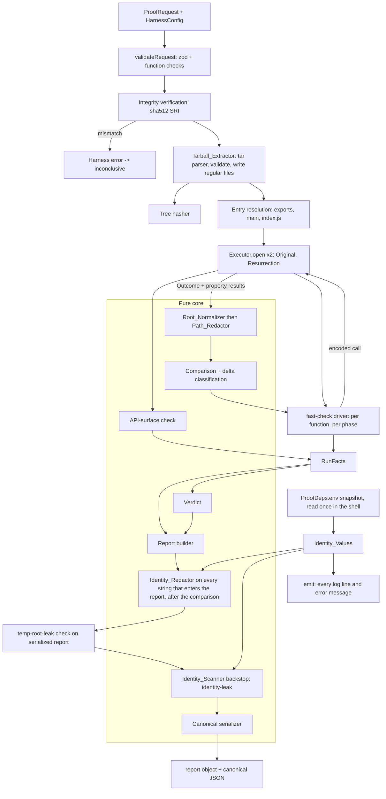
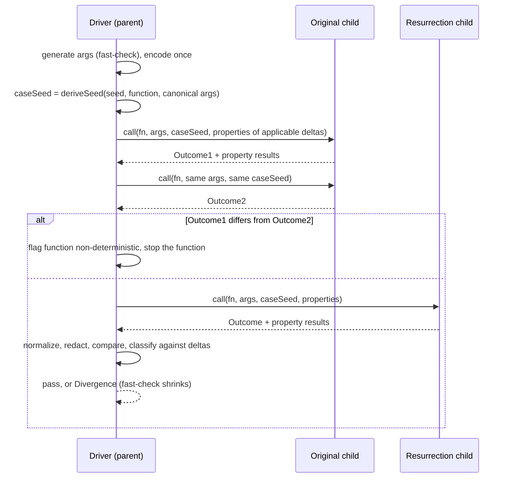
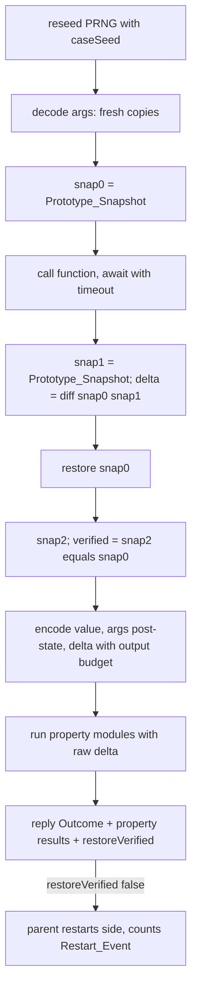

# Design Document

## Overview

The Proof of Life Engine is a TypeScript library in `src/proof/`, next to the finished autopsy engine in `src/engine/`. It takes an Original (an integrity-pinned npm tarball) and a Resurrection (a directory or tarball) and produces a Proof_Report: a deterministic JSON document with a Verdict of `alive`, `restless` or `inconclusive`. It runs differential property tests with fast-check. Each side runs in its own child process under the Node permission model. The engine compares return values, thrown errors, argument mutations, async outcomes and prototype changes. Only Declared_Deltas may explain a difference. The engine makes no LLM calls and no network requests.

The design mirrors the autopsy engine:

- **Pure core** (`core/`, `serialize/`, `child/codec/`): the Value_Codec, deep comparison, Root_Normalizer, Path_Redactor, Identity_Scanner and Identity_Redactor (`core/identity.ts`), delta classification, API-surface check, verdict, report builder, canonical serializer, zod schema and deserializer. These functions read no clock, no random source and no environment: **the pure core never reads `process.env`**. The parent's environment is read once, in the I/O shell, into a snapshot (`ProofDeps.env`), and the snapshot (or the Identity_Values derived from it) is passed to the pure functions as an argument. The ESLint determinism rules (no `Date.now`, no argument-less `new Date()`, no `Math.random`) are extended to these directories.
- **I/O shell** (`shell/`, `child/` outside `codec/`): the Tarball_Extractor (the only importer of `tar`), integrity check, tree hasher, entry resolution, temp directories, the Executor interface with the Sandbox_Executor and the InProcess_Executor, the child runner script, the fast-check driver, the orchestrator `runProofOfLife`, the single output function `emit`, a thin CLI and the manual tarball recorder.

The engine never decides "alive" from silence. A report is `alive` only when every tested function produced comparable evidence, no divergence was found, every Declared_Delta was demonstrated, and no harness error occurred. A harness failure is `inconclusive`. A found divergence is `restless` and is never hidden.

### Key design decisions

| Decision | Rationale |
|---|---|
| One shared per-call implementation (`child/sideRuntime.ts`) used by both the child runner and the InProcess_Executor | The engine-level property tests then exercise the same snapshot, delta, restore and encode code that the real sandbox runs. Only transport differs. |
| Encoded nodes are canonical (object props sorted by code point, Map entries and Set items sorted by canonical JSON), so equality is structural | Deep equality needs no order-insensitive matching. Insertion order is ignored (R7.2) because it is erased at encoding time. The Root_Normalizer re-canonicalizes after replacing strings. |
| Generators, predicates and shrinking run in the parent; only encoded values cross the process boundary | fast-check shrinks parent-side values. Each shrink candidate is encoded and sent to the children. Closures never cross the boundary (A3). |
| Per-function `fc.check` that stops at the first failing case, shrinks, and collects the result as a Divergence | One run reports every function instead of aborting on the first failing function. At most one shrunk counterexample per function and phase is reported (limitation L7). |
| Counting is done from executed attempts: attempts up to and including the first failing attempt of a phase count; later attempts are shrink calls | Does not depend on fast-check internals, and makes `cases` a measured number (R8.6, R8.11, R13.9). |
| The child enforces the per-call timeout for async code and the parent adds a hard kill after a grace period | An async hang still returns a Prototype_Delta from a live child (R5.10). A synchronous infinite loop is killed by the parent. |
| Prototype restoration is verified by a second snapshot, and failure forces a child restart | R5.12. The restart is counted as a Restart_Event. |
| Encoding and property modules run after restoration | A package that pollutes `Object.prototype.then` or `toJSON` cannot disturb the runner's own encoding. Property modules receive the captured delta data, not live prototypes. |
| Copy the small generic ordering helpers into `src/proof/child/codec/order.ts` instead of importing from `src/engine/serialize` | The sandbox side must be self-contained under one read grant. The engine stays untouched and its lint scope unaffected. A parity test checks `compareCodePoints` against the engine's. |
| Sandbox-side files are plain TypeScript with erasable syntax only, run by Node's native type stripping | The same codec file is imported by the parent (through vitest/tsx) and executed in the child (through `node`). No build step. Verified in the spike on Node v26.13.1 / Windows 11: `.ts` files and a sibling `.ts` import ran under `--permission` with one directory grant and printed no experimental warning (docs/kiro-journal.md, "Risk 1: native type stripping under `--permission` (task 1.2)"). Rules that follow from the observations: only erasable syntax (an `enum` and a constructor parameter property fail at load with `ERR_UNSUPPORTED_TYPESCRIPT_SYNTAX`); every import inside `child/` is relative, ends in `.ts`, and stays inside `child/` (an import outside the granted directory fails with `ERR_ACCESS_DENIED`); the repository `tsconfig.json` must keep `allowImportingTsExtensions: true`, which the spike added and the design now depends on. The esbuild fallback was not needed and is kept only as the documented fallback. |
| Identity values are redacted AFTER the comparison, never before (D10, R13.25 to R13.30) | The Verdict and the set of Divergences are then identical to those computed without redaction: redaction creates no Divergence and hides none, and a divergence that involves an Identity_Value stays `restless`. The cost is that the rendering in the report differs from the real value (L14) and that two different values can render alike, which the flag `redactionMaskedDifference` states. |
| One output function `emit` for every log line and error message (R13.28) | A single place applies the Identity_Redactor and then the Identity_Scanner, so no message can reach a log, the CLI or an exception text without the same treatment as the report. |

### Research summary

- **Node permission model** (https://nodejs.org/api/permissions.html, read for this design). `--permission` denies file system write, network, child process, worker threads, native addons, WASI, FFI and the inspector unless allowed. `--allow-fs-read` takes absolute paths. An existing directory gets an implicit wildcard (read access to everything below it). The entrypoint is added to the read list automatically, but modules it imports from other directories need a grant. A `*` in a path is a wildcard and everything after it is ignored. The documentation states that the model does not guarantee protection through other routes such as `node:sqlite`. It does not scrub `process.env`. **Statement used in this design: the permission model is a seat belt against accidental access, not a security boundary against malicious code.**
- **Verified on this machine** (requirements.md, Node v26.13.1, Windows): denied read outside the allowed directory, denied `child_process.execSync`, denied Worker creation, denied TCP connect, and `process.permission.has('fs.write' | 'net' | 'child' | 'worker')` is `false`. A plain child inherits parent environment variables.
- **Spike results** (docs/kiro-journal.md, section "Proof of Life: sandbox spike", Node v26.13.1, Windows 11, one machine, POSIX not tested): native type stripping under `--permission`, CommonJS loading under a package-directory grant, a package directory with spaces and other special characters, and the child `cwd` equal to the package directory were observed to work as described in the sections below. A package directory on another drive was **not tested** (only drive `C:` exists). The result for each item is listed under "Risks to verify", and the section "Spike results" near the end of this document summarizes every item with its design consequence.
- **fast-check 4.x** (observed on 4.10.2). `fc.check(property, params)` returns run details instead of throwing. The `RunDetails` types are bundled in `lib/fast-check.d.ts`. Failed runs carry `failed`, `interrupted`, `numRuns`, `numSkips`, `numShrinks`, `seed`, `counterexample` (a tuple of the property's arguments, so `[args]` for this driver), `counterexamplePath`, `errorInstance` (the thrown value, any type) and `failures`, `executionSummary`, `verbose`, `runConfiguration`. There is no declared `error` field. `params.seed` and `params.path` replay a shrunk counterexample. `fc.asyncProperty` accepts an async predicate. An arbitrary-level `.filter` that never accepts does not terminate and does not raise `numSkips` (see "Fast-check driver").
- **Subresource Integrity** `sha512-<base64>` is the registry `dist.integrity` format. The digest is computed with `node:crypto` and compared as strings.
- **tar 7.5.23** (BlueOak-1.0.0) is the planned dependency (D1). Only the Tarball_Extractor imports it. The extractor uses tar's parser (`tar.Parser`, confirmed in the spike) to read entries into memory and writes files itself, so the engine controls every path it writes. Licenses read from `node_modules` in the spike: `tar`, `chownr`, `minipass` and `yallist` are BlueOak-1.0.0, `@isaacs/fs-minipass` is ISC, `minizlib` is MIT. The license list MIT, ISC, BSD and Apache-2.0 of the product rule applies to the packages that Graveyard Shift resurrects and publishes under `@graveyard-shift/<name>`, not to the project's own dependencies. The user has **APPROVED** BlueOak-1.0.0 for `tar`, `chownr`, `minipass` and `yallist` (requirements D1 and D9), so no license decision is pending. Every dependency is listed in PREEXISTING.md with its license, and `.kiro/steering/necromancy-laws.md` states the distinction (R14.11).

## Architecture



### One Case



### Per-call protocol inside a side (shared by child and in-process)



### Module layout

```
src/proof/
  index.ts                  public API: runProofOfLife, deserializeReport, canonicalReportJson, types
  types.ts                  zod schemas and TS types: Proof_Report, request, harness config, Outcome, errors
  child/                    SANDBOX SIDE. Self-contained, readable by the child with one --allow-fs-read grant.
    package.json            {"type":"module"} so the .ts files are ESM. Kept although the spike loaded the child without it
                            (journal "Risk 1", case 3, no package.json in that directory or the ancestors checked); that case does not
                            cover ancestors with another `type`, so the file stays as the safe choice
    codec/                  PURE (lint scope). No imports outside this directory.
      nodes.ts              EncodedNode types, NODE_KEY_ORDER, unencodable reasons
      order.ts              compareCodePoints, sortBy, ordered (copied generic helpers)
      encode.ts decode.ts   Value_Codec
      canonical.ts          canonicalizeNode (sort props, Map entries, Set items), nodeJson
    prototypes.ts           Prototype_Snapshot, diff, restore, verify (injectable prototype set)
    stubs.ts                frozen Date, seeded Math.random (mulberry32)
    sideRuntime.ts          load package, list exports, per-call protocol (used by runner and in-process)
    protocol.ts             message types, line parser (pure), constants
    runner.ts               child entry script: stdin NDJSON loop over SideRuntime
  core/                     PURE (lint scope)
    seeds.ts                deriveSeed
    equal.ts                deepEqualNodes, compareOutcomes, firstDifference
    normalize.ts            Root_Normalizer
    redact.ts               Path_Redactor, redactIdentityDeep (Identity_Redactor over an Outcome or report node), redactionMaskedDifference
    identity.ts             Identity_Values from an env snapshot, Identity_Scanner (findIdentity), redactIdentity; one shared matcher
    delta.ts                classifyCase, pickDemonstration
    apiSurface.ts           compareExports
    verdict.ts              computeVerdict
    report.ts               buildReport, fallbackReport
  serialize/                PURE (lint scope)
    canonicalReport.ts      REPORT_KEY_ORDER, canonicalizeReport, canonicalReportJson
    deserialize.ts          deserializeReport (zod)
  shell/
    tarball/tarballExtractor.ts   ONLY importer of `tar`
    integrity.ts            sha512 SRI computation and verification
    treeHash.ts             Tree_Hash over {path, bytes} entries
    workDir.ts              temp work root creation, copy, cleanup
    entry.ts                CommonJS entry resolution
    executor/types.ts       Executor, SideHandle, SideSpec, CallRequest, errors
    executor/sandboxCommand.ts   buildSandboxArgv, buildSandboxEnv (pure functions, tested alone)
    executor/sandboxExecutor.ts  Sandbox_Executor
    executor/inProcessExecutor.ts  InProcess_Executor (tests only)
    driver.ts               fast-check driver: runFunction, runPhase, runCase
    emit.ts                 createEmitter: the single path for log lines and error messages (R13.28)
    orchestrator.ts         runProofOfLife
    cli.ts                  thin CLI
  harnesses/lodash.set/
    config.ts               Harness_Config for lodash.set (parent side)
    sandbox/pollution.cjs   delta property module (sandbox side, plain CommonJS)
scripts/recordTarball.ts    manual, network-gated (npm run fixtures:record-tarball)
docs/proof-of-life-ordering.md
tests/proof/{unit,property,integration,fixtures,helpers}/
```

`src/proof/child/` is the only directory the child may read besides the package directory and the harness files. `child/codec/` imports nothing outside itself. `core/` and `serialize/` import `child/codec/` and `types.ts` only (types.ts imports zod). The lint determinism scope becomes `src/engine/core`, `src/engine/serialize`, `src/proof/core`, `src/proof/serialize` and `src/proof/child/codec`. `child/stubs.ts` is outside the scope because it replaces `Date` and `Math.random` by design.

## Components and Interfaces

### Request and library API

```ts
interface ProofRequest {
  original: { name: string; version: string; tarballPath: string; integrity: string };
  resurrection: { kind: 'directory' | 'tarball'; path: string };
  haunting?: readonly string[];                 // default: every exported function of the Original
  harness: HarnessConfig;
  executorFactory?: ExecutorFactory;            // default: Sandbox_Executor
  // Reserved for D4 (read-only dependency root). The schema is strict, so a `dependencyRoot` key is rejected today.
}

interface ProofDeps {                           // I/O seams; defaults come from defaultProofDeps()
  tempRoot: string;                             // default os.tmpdir()
  toolVersions: { node: string; fastCheck: string };   // read from the running installation
  platform: 'win32' | 'posix';                  // selects case-insensitive path matching
  knownPaths: { nodeDir: string; tmpDir: string };  // for the Path_Redactor; the home directory is an Identity_Value, handled by the Identity_Redactor
  env: Readonly<Record<string, string | undefined>>;   // snapshot of the parent environment; default: a copy of process.env taken once in defaultProofDeps()
  sink: (line: string) => void;                 // where emit writes; default writes to process.stderr, tests inject a collector
}

interface ProofRun { report: ProofReport; json: string }

function runProofOfLife(request: ProofRequest, deps?: ProofDeps): Promise<ProofRun>;
class RequestValidationError extends Error { readonly field: string }
```

`runProofOfLife` rejects with `RequestValidationError` before any child starts when `original`, `resurrection` or `harness` is missing, `caseCount < 1`, `perCallTimeoutMs < 1`, or `seed` is not a 32-bit integer (R1.5). Every other failure is a harness error inside a returned report (Verdict `inconclusive`). The function never returns `alive` after a harness error. `ProofRun.json` is `canonicalReportJson(report)`. The library exports no function that touches the network (R1.6).

**Environment snapshot (R13.25).** `defaultProofDeps()` is the only place in `src/proof` that reads `process.env`. It takes one snapshot, and the orchestrator derives the Identity_Values from it once, at the start of the run, with `identityValuesFromEnv(deps.env, deps.platform)` (the variables `USERNAME`, `USERPROFILE`, `HOMEPATH` and `HOME`; empty values and values that consist only of path separators are ignored). The Identity_Values, never the environment, are then passed as arguments to the report builder, the Identity_Redactor, the Identity_Scanner and `emit`. Tests inject `env` to get fixed synthetic values (R13.29). `buildSandboxEnv` receives the parent environment as a parameter only so that a test can show that it copies nothing from it (R5.3, R5.18).

**One output function (R13.28).** `createEmitter(identity, platform, sink)` returns `emit(text): string`. `emit` applies the Identity_Redactor (`<user-home>`, `<user>`), then searches the result with the Identity_Scanner and replaces any remaining match with `<user>` (a message is never withheld), writes the final text to `sink`, and returns it. The engine writes a log line, a CLI message, a harness error message, a `RequestValidationError` message and the message of any exception that it throws only through `emit`: the exception is constructed with the returned text. No file in `src/proof` calls `console.*` or uses `process.stdout` or `process.stderr`, with two exceptions, and the `sourceScan` test checks that its allowed list is exactly these two files. (1) `shell/emit.ts` holds the default `sink`. (2) `child/runner.ts` is the sandbox-side protocol channel. It writes the NDJSON protocol to the child's own stdout, and it replaces the write methods of stdout and stderr and the `console` methods with no-ops, so package code cannot corrupt the protocol. Its output is not an engine log line or error message: it is data for the parent, which the parent parses and never prints, and the parent's own messages still go through `emit`. The identity values for the emitter of a run that fails validation come from the same snapshot, so a validation message is redacted too.

### Harness_Config

Generators and predicates are parent-side closures. Property, setup and stub modules are sandbox-side file paths.

```ts
interface HarnessConfig {
  package: string;                              // for the report only
  seed: number;                                 // int32
  caseCount: number;                            // default 100, per function and phase
  perCallTimeoutMs: number;                     // default 1000
  heapLimitMb: number;                          // default 256
  outputLimitBytes: number;                     // default 1_048_576
  maxRestarts: number;                          // default 20, shared by both sides
  shrinkBudget: number;                         // default 500 attempts per failing phase
  functions: Readonly<Record<string, FunctionHarness | ExcludedFunction>>;
  deltas: readonly DeclaredDelta[];
  setupModule?: string;                         // absolute path, sandbox side, applied to both sides
  setupModules?: { original?: string; resurrection?: string };   // per-side override (R8.9)
  readPaths?: readonly string[];                // extra sandbox-side files/dirs the modules above may require
}

interface FunctionHarness {
  args: fc.Arbitrary<readonly unknown[]>;       // tuple of arguments, no function-typed values (A7); no unbounded .filter (see "Avoiding filter exhaustion")
  accept?: (args: readonly unknown[]) => boolean;   // bounded rejection through fc.pre, high-acceptance predicates only
  explicitCases?: readonly (readonly unknown[])[];
  caseCount?: number;                           // overrides the default
  stubs?: { date?: boolean; random?: boolean }; // default both true (A6)
}
interface ExcludedFunction { excluded: true; reason: string }

interface DeclaredDelta {
  id: string;
  function: string;
  predicate: (args: readonly unknown[]) => boolean;   // parent side, on decoded copies only (R11.9)
  propertyModule: string;                       // absolute path, sandbox side
  explicitCases: readonly (readonly unknown[])[];
  generator?: fc.Arbitrary<readonly unknown[]>; // constrained arbitrary of in-predicate arguments, built by construction, no .filter
  caseCount?: number;
}
```

Nothing here mentions lodash.set. The ip harness later supplies explicit cases (127.1, 01200034567, ...), a setup module that stubs `os.networkInterfaces`, and a delta, without engine changes (R14.10). `ProofRequest` can gain `dependencyRoot` in a later spec: the orchestrator passes it into `SideSpec.readPaths`, and the Proof_Report gains a hash key at the end of the key-order table. This spec implements none of it (R16.6).

Config validation (`validateRequest`) uses zod for the serializable fields and `typeof` checks for functions and arbitraries. A harness path that is not absolute is a validation error.

### Executor interface

```ts
type Side = 'original' | 'resurrection';
type ExecutorMechanism = 'node-permission' | 'in-process';

interface ExecutorFactory { create(options: ExecutorOptions): Executor }
interface ExecutorOptions { restartBudget: RestartBudget }          // shared by both sides, counts restarts toward R16.4
interface RestartBudget { readonly max: number; used(): number; consume(): boolean }  // false when exhausted

interface Executor {
  readonly mechanism: ExecutorMechanism;
  probe(): Promise<Result<void, ExecutorError>>;                    // 'sandbox-unavailable' when flags cannot start
  open(spec: SideSpec): Promise<Result<SideHandle, ExecutorError>>; // spawn/load module
  dispose(): Promise<void>;                                         // closes every open side
}

interface SideSpec {
  side: Side;
  packageDir: string;            // the copy under the work root (R4.6); the only package-readable directory
  entryFile: string;             // absolute, resolved by entry.ts
  setupModule?: string;
  readPaths: readonly string[];  // sandbox-side module files/dirs to grant read access to
  limits: { callTimeoutMs: number; heapLimitMb: number; outputLimitBytes: number };
}

interface SideHandle {
  listExports(): Promise<Result<ExportsInfo, ExecutorError>>;
  call(request: CallRequest): Promise<Result<CallResult, ExecutorError>>;
  restart(): Promise<Result<void, ExecutorError>>;    // explicit restart, counted
  counters(): SideCounters;
  close(): Promise<void>;
}

interface CallRequest {
  fn: string;                                // export name, or 'default'
  args: readonly EncodedNode[];
  caseSeed: number;                          // int32, seeds Math.random for this call
  stubs: { date: boolean; random: boolean };
  properties: readonly { id: string; modulePath: string }[];   // delta properties to run after this call
}
interface CallResult { outcome: Outcome; properties: readonly PropertyResult[]; }
interface PropertyResult { id: string; ok: boolean; detail?: EncodedNode }
interface SideCounters { restartEvents: number; otherRestarts: number }  // otherRestarts: timeout or crash respawns
type ExecutorError = { kind: 'sandbox-unavailable' | 'unloadable-module' | 'too-many-crashes' | 'runner-protocol-error' | 'property-error'; message: string };

interface ExportsInfo { entries: readonly ExportEntry[] }       // sorted by name (code point)
interface ExportEntry { name: string; type: string; fnName?: string; arity?: number; primitive?: EncodedNode }
```

Requirement 5.1 lists "run a delta property" as an Executor operation. It is realized as `CallRequest.properties`, because Requirement 11.7 demands that the property run in the same child, on the Prototype_Delta of the call it checks. A separate method would need a second round trip and could not use the same snapshot data. Both executors run the property inside `SideRuntime.call`.

**Exports.** `listExports` returns the own enumerable string keys of the export object whose values are functions or primitives, plus `typeof` for the rest. When `module.exports` is itself a function, it is listed as `default`, and its own enumerable function-valued properties are listed under their own names. A call to `default` has `this === undefined`. A call to any other name has `this` bound to the export object.

**Why `default`.** The engine names an export by its export key, never by `fn.name`. `fn.name` is unreliable (minified, anonymous or re-assigned functions have no stable name), so for `module.exports = fn` the key is `default`. Harness keys, `Declared_Delta.function` and the CLI `--radius` option use `default` for such a package.

### Sandbox_Executor

The Sandbox_Executor starts one child per side. A run therefore costs two process starts plus respawns after timeouts, crashes and Restart_Events. **Cost of a start.** One measurement of 10 consecutive starts per block, on one machine, under normal load with the antivirus state unknown, not a benchmark (docs/kiro-journal.md, "Extra measurement: cost of one child process start (task 1.13)"): spawn to the `ready` line under `--permission` took 198.9 to 466.9 ms (median 375.1 ms); the same runner without `--permission` took 170.0 to 283.9 ms (median 233.3 ms); `node -e ""` to process close took 140.8 to 188.4 ms (median 160.2 ms). The spread between runs was large and the order of the blocks was not stable across development runs, so from this data no difference between the permission and the no-permission start can be stated. Time budgets are therefore not derived from these numbers; the integration suite logs the cost again. One child per call would multiply the cost by the number of calls, which is why the design keeps a child alive and verifies restoration instead.

**Command line** (`buildSandboxArgv(spec, runnerDir)`, a pure function that is tested without a child, as is the environment builder `buildSandboxEnv`; R5.2, R5.16, R5.17, R5.18):

```
process.execPath
  --permission
  --allow-fs-read=<abs src/proof/child directory>
  --allow-fs-read=<abs realpath of spec.packageDir>
  --allow-fs-read=<each abs spec.readPaths entry and spec.setupModule>
  --max-old-space-size=<heapLimitMb>
  <abs src/proof/child/runner.ts>
```

There is no `--allow-net`, `--allow-child-process`, `--allow-worker`, `--allow-addons`, `--allow-fs-write`, `--allow-inspector`, `--allow-wasi`, `--allow-ffi` or `--allow-openssl-store`. The spawn options are `{ shell: false, windowsHide: true, cwd: <packageDir>, stdio: ['pipe','pipe','pipe'], env: buildSandboxEnv(...) }`. Each path is its own argv element (`--allow-fs-read=<path>` as one string), so spaces need no quoting by the engine. **Path resolution.** `buildSandboxArgv` takes an optional injected `realpath` function and applies it to the runner directory, the package directory and every extra grant before validation; the returned `cwd` is the resolved package directory. The default is identity (the builder stays pure); the Sandbox_Executor passes `fs.realpathSync.native`, and a path for which it throws (for example `ENOENT`) is used unchanged. A created short (8.3) form of the package directory therefore resolves to the same long string as the real form, so a duplicate grant is emitted once. **Repeated flags only.** The engine never joins paths with a comma into one flag: in the spike the comma-separated single flag granted nothing in the tested cases, while repeated flags granted every listed path, and a directory literally named `a,b` was granted correctly as its own flag (journal, "Extra risk: `--allow-fs-read` syntax for `,` and `*` in paths (task 1.12)"). **Path rules.** `buildSandboxArgv` rejects with `sandbox-unavailable` any path that contains `*`, `?`, `[`, `]`, `{` or `}`. `*` is rejected because it acted as a glob that widened the grant to siblings (`pk*` granted `pkg2`). `?`, `[`, `]`, `{` and `}` were not tested and are rejected conservatively. `,` is allowed. The message names the problem without the path (R5.16), and the builder returns a `Result` so that the Sandbox_Executor starts no child when it fails. A directory grant did not grant its parent or prefix siblings (`pkg` did not grant `pkg2`), and a file grant granted only that file. Windows forbids `*` in names (creating a directory with `*` failed with `EINVAL`), so the `*` rule could be exercised on Windows only through the argument builder, not with a real directory. POSIX was not tested.

**Current directory and path form (Risk 4, journal "Risk 4: child current directory equal to the package directory (task 1.5)").** Node started with `cwd` equal to the granted package directory, and `process.cwd()` equalled that path. `cwd` need not be granted for Node to start, but relative reads and `realpath` of the `cwd` then fail with `ERR_ACCESS_DENIED`, so the package directory is both the `cwd` and a grant. The `cwd` string and the granted path must be the same form: with a junction or an 8.3 short path as `cwd`, a grant on the real path alone did not cover relative reads, and a grant on the link or short form alone did (short name) or partly did (junction: loading the package by the junction path failed with `ERR_ACCESS_DENIED`). Granting both forms worked in both cases. The design therefore uses the real path (`fs.realpathSync.native`) for the grant, the `cwd`, the `entryFile` and the load path, and additionally grants the created path when it differs (R5.17). A symbolic link was not tested (`EPERM`, no privilege). The fallback of a granted `cwd` plus `process.chdir` was not tried.

**Rule: always grant the `fs.realpathSync.native` path.** The engine takes a path as input (the temp root, or any path it is given), resolves it once with `fs.realpathSync.native`, and uses only that resolved string for `cwd`, the `--allow-fs-read` grant, the `entryFile`, the load path and the Root_Normalizer's real root. The created (user-supplied) form is kept only as an additional root for the Root_Normalizer (R13.19) and as an additional grant (R5.17). Observed in the reopened 1.14 check (journal, "Spike results and design alignment (task 1.14 reopened)", item 4): with a directory junction as input and with an 8.3 short path as input, `fs.realpathSync.native` returned the long real path in both cases, and a child started with `cwd`, grant and load path all equal to that string gave a working relative read, a working `createRequire` load and a working `require` of a sibling file (junction input, short-name input and a plain real-path input all behaved the same). The reason for the rule is the next paragraph.

**Why a junction grant failed `createRequire` and an 8.3 grant did not (observed, journal item 1).** With a junction as `cwd` and as the only grant, `fs.readFileSync`, `fs.statSync` and `fs.realpathSync.native` on a file below the junction worked, but loading the package with `createRequire` failed with `ERR_ACCESS_DENIED`, and the error's `resource` property was the path of `index.js` **below the junction target** (`\\?\...\a-long-package-directory-name\index.js`), which was not granted. The JS `fs.realpathSync` returned that target path for the junction, so the CommonJS loader read the file under the target. With an 8.3 short path as the only grant, the same `fs.realpathSync` returned the short path unchanged, the loader read under the short path, and the load worked. With only the real path granted and the link or short path as `cwd` and load path, every access was denied and the `resource` field carried the link or short form. So the permission check saw the path in the form in which the access was made: direct accesses used the junction or short form as given, and the loader's access used the form that `fs.realpathSync` returned. These observations support this explanation for the tested cases. Whether Node's loader uses `fs.realpathSync` internally was not read from Node's source; the explanation rests on the `resource` field and on the return values of the two `realpath` variants. A symbolic link was not tested.

**How files become readable.** The runner script is the entrypoint, so Node adds it automatically. Its imports (`sideRuntime.ts`, `codec/*`, and so on) sit in the same directory, which is granted whole. The package directory is granted whole. Setup, property and stub modules live outside both, so each is granted by exact path (a file grant, or a directory grant for a harness directory). A module may only `require` Node built-ins, files in its own grant, or the package. The child's current directory is the package directory, so relative paths inside the package behave as with a normal run.

**Observed loading behavior** (journal, "Risk 2: CommonJS loading under `--allow-fs-read=<package dir>` (task 1.3)"). With the runner directory and the package directory granted, `createRequire(<packageDir>/package.json)(entry)` found the package scope, resolved `main` as `entry.js`, `entry`, `lib`, `./lib/index.js` and `lib/`, and loaded a second file through `require('./lib/x.js')`. A `require` of a file outside every grant threw `ERR_ACCESS_DENIED` and worked after that directory was granted. Node built-ins (`node:os`, `path`) needed no grant. Not tested: `exports` maps, bare-specifier dependencies in `node_modules`, a symlinked package directory.

**`unloadable-module` detection.** The observations show that a load error code is not enough:

- A `"type": "module"` package using `export` syntax **loaded without error** through `require` and returned a namespace-like object (`__esModule: true`, `default`, named exports). A file with `export` syntax in a package with no `type` also loaded through `require` (`{esm: 'yes'}`), without `__esModule`. Only CommonJS syntax (`module.exports`) inside a `type: "module"` package failed, with a plain `ReferenceError` (`module is not defined in ES module scope`) that has **no `code`**. Top-level await in an ES module package was not tested.
- Therefore detection has three parts. (1) Before any child starts, entry resolution reads `package.json` and reports `unloadable-module` when `type` is `"module"`, so the ES module case never relies on a load error. (2) In `SideRuntime.load`, any exception thrown while the setup module or the package loads is caught and returned as `loaded { ok: false, error }`, whatever its name or `code` (`ReferenceError`, `SyntaxError`, `ERR_ACCESS_DENIED`, `MODULE_NOT_FOUND`, `ERR_REQUIRE_ESM`, and others), and the executor maps it to `unloadable-module` with the message after the Root_Normalizer and Path_Redactor. (3) A package without `type: "module"` whose entry file uses ES module syntax loads through `require` and is **not detected**: the engine compares what the namespace-like object exports. This is recorded as a known gap, limitation L12, and is not handled here.
- The `type: "module"` pre-check implements R3.5, the catch-all load mapping implements R3.9 (the message goes through the Root_Normalizer, the Path_Redactor and later the Identity_Redactor like any harness error message), and R3.11 forbids claiming ES module support: neither the Proof_Report nor the documentation says that ESM is supported, and the documentation states the undetected case of L12. The pre-check also covers a `package.json` that is missing or unparsable (`unloadable-module`).

**Environment** (`buildSandboxEnv(platform, parentEnv)`, pure). The object starts empty and no variable is copied from the parent. The only entry the engine passes is a fixed value:

| Platform | Entries passed by the engine |
|---|---|
| win32 | fixed `TZ=UTC` |
| other | fixed `TZ=UTC` (POSIX not tested) |

`NODE_OPTIONS` is never passed. Observed on Windows 11 / Node v26.13.1 (journal, "Risk 3: minimum Windows environment (`env-minimum`, task 1.4)"):

- **`env: {}` does not give an empty child environment on Windows.** The child's `Object.keys(process.env)` held 11 names: `HOMEDRIVE`, `HOMEPATH`, `LOGONSERVER`, `PATH`, `SYSTEMDRIVE`, `SYSTEMROOT`, `TEMP`, `USERDOMAIN`, `USERNAME`, `USERPROFILE`, `WINDIR`. Whether Windows or libuv supplies them was not determined, and whether the values of `PATH`, `TEMP` and `USERNAME` come from the parent or from Windows defaults is **unsettled** (they equalled the parent's in a one-off check, which cannot tell the two apart). The design must not rely on either: the engine does not read these names, and the tests below do not use them as the secret probe.
- The smallest set that started, loaded a package, read a granted file and answered a message was `{}`. `SystemRoot` was not needed (with or without `TEMP`/`TMP`). The earlier candidate (`SystemRoot` copied from the parent plus `TZ=UTC`) also worked but copied a parent variable, so it is dropped. Not tested: POSIX, a `PATH` without the Node directory, non-ASCII profile paths, other machines.
- `TZ=UTC` changed `new Date().getTimezoneOffset()` from -60 (machine zone) to 0. Only these two values were observed. It is kept so that time-zone-dependent output is stable; it is not needed to start the child.
- The sentinel `GS_TEST_SECRET`, set in the parent, never appeared in the child (8 of 8 cases).

**Documented platform behavior (R5.19).** On Windows the process launcher adds OS-supplied variables to the child although the engine passes only `TZ=UTC`: 11 names were observed (`HOMEDRIVE`, `HOMEPATH`, `LOGONSERVER`, `PATH`, `SYSTEMDRIVE`, `SYSTEMROOT`, `TEMP`, `USERDOMAIN`, `USERNAME`, `USERPROFILE`, `WINDIR`). The engine does not rely on any of them and never asserts that the child environment is empty or equals an allowlist. Two of the names, `USERNAME` and `USERPROFILE`, are Identity_Values. A package function in the child can therefore return them, and such a return value is exactly the case that the Identity_Redactor handles (see "Identity redaction"): the child's environment is not scrubbed of these two names by the engine, and the report is protected by redaction after the comparison, not by the child's environment.

**Tests.** `env-minimum` starts the child with the engine's environment and shows that it starts, loads a package and answers a message. It asserts nothing about the OS-supplied names, and does not require an empty key set. `env-scrubbed` sets the sentinel `GS_TEST_SECRET` in the parent and, for good measure, a second parent-only variable with a random name, and shows that a package function returning `Object.keys(process.env)` sees neither. The general assertion is: every parent variable **name** that is not in the documented allowed set (`TZ`, plus on Windows the 11 OS-supplied names above, listed as "not relied on") is absent from the child. The test must not assert that `Object.keys(process.env)` equals the allowlist or is empty on Windows. A leak is judged by the sentinel and the random-name variable, never by `PATH`, `TEMP` or `USERNAME`.

**Package directory addressing.** The work root is created with `mkdtemp` under the real path of `os.tmpdir()` (`fs.realpath.native`), and the engine uses that real path for the flag, `cwd` and the Root_Normalizer. The created path is kept as well when it differs (short names such as `OWNER~1`, or a link), and then **both forms are granted** (see "Current directory and path form"). What is tested and what is not (journal entries "Risk 4", "Risk 5a: package path that contains spaces (`paths-spaces`, task 1.6)" and "Risk 5b: package path on another drive (`other-drive`, task 1.7)"):

| Case | Status |
|---|---|
| Package directory on the system drive, no spaces | observed to work; also covered by every integration test |
| Directory name with a space (`gs space/pkg`) | observed to work in the spike; the `paths-spaces` test creates its own directory |
| Directory names with `#`, `%`, a literal `%20`, and non-ASCII (`gs#hash`, `gs%pct`, `gs%20pct`, `gs-ünï-é`) | observed to start the child and load the package (spike). Not run: `?`, a trailing space or dot, very long paths |
| Package directory as a junction, or as an 8.3 short path | observed: works when `cwd` and the grant use the same form or both forms are granted; fails with `ERR_ACCESS_DENIED` when only the real path is granted and the `cwd` is the link or short form. A symbolic link could not be created (`EPERM`) and is not tested |
| Package directory and runner directory on different drives | **not tested**. Only drive `C:` exists on the spike machine and the user could not provide another. A `subst X:` mapping onto a directory of the same volume loaded the package but is not a second drive. The `other-drive` integration test is conditional: it runs only when the repository drive differs from the temp drive, or when `PROOF_TEST_OTHER_DRIVE` names a writable directory on another drive. Otherwise it reports `skipped: other drive not available`. It is not claimed as verified locally. Update: not verified locally; exercised on the GitHub Windows runner (checkout D:, temp C:), pending CI confirmation of the next run (journal, "Proof of Life: CI run 1") |
| UNC path or `\\?\` path as the temp root | not tested, not supported |

**Forms of a root in text (input to the Root_Normalizer).** From the spike with the five special directory names: most Node error text carries the **native** path with special characters unencoded (`Cannot find module 'C:\...\gs space\pkg\missing.mjs'`, `ENOENT ... open 'C:\...\gs space\...'`, `Unknown file extension ".foo" for C:\...`, and the `Require stack:` lines). The `file://` form appeared in `pathToFileURL(...)` and in an `ERR_IMPORT_ATTRIBUTE_MISSING` message, as `file:///C:/Users/.../gs%20space/pkg/data.json`, with segment encoding: space `%20`, `#` `%23`, `%` `%25`, non-ASCII as UTF-8 bytes with uppercase hex (`ü` as `%C3%BC`). Only uppercase hex was observed. A denied read (`ERR_ACCESS_DENIED`) carried no path in its message; the `resource` property carried the path in the 1.2 run and was not printed in the 1.6 run. Messages also contain the runner path (`...\child\runner.ts`) as a native path outside the package root. **Decoding caution:** a root with a literal `%20` in its name appears as `%2520` in a URL and as `%20` in native text, so the matcher must build each form by encoding the root and must never percent-decode the text before matching.

**Protocol.** Newline-delimited JSON. Every message is one line with the field `gs: 1`.

| Direction | Message | Fields |
|---|---|---|
| child to parent | `ready` | `node` (version) |
| parent to child | `load` | `id`, `entryFile`, `setupModule?`, `outputLimitBytes`, `stubs` |
| child to parent | `loaded` | `id`, `ok`, `error?` (message without paths) |
| parent to child | `exports` | `id` |
| child to parent | `exports` | `id`, `entries` |
| parent to child | `call` | `id`, `fn`, `args`, `caseSeed`, `stubs`, `properties`, `timeoutMs` |
| child to parent | `result` | `id`, `outcome`, `properties`, `restoreVerified` |
| parent to child | `shutdown` | none |
| child to parent | `fatal` | `id?`, `message` |

`parseProtocolLine(line)` is pure. It returns `undefined` for any line that is not valid JSON with `gs: 1` and a known `t`, and the parent discards such lines (R5.8). The runner saves the original `process.stdout.write` in a closure for its own messages, then replaces `process.stdout.write`, `process.stderr.write` and `console` methods with no-ops before the package loads, so ordinary package logging cannot corrupt the stream. A package that writes to file descriptor 1 directly can still interleave a line. The result is a discarded line and, for the call in flight, a `timeout`. This is accepted and documented (limitation L8).

**Limits per call.**

- The child starts a timer of `callTimeoutMs` around the awaited result. On expiry it answers with Outcome `timeout`, with the Prototype_Delta of the call, and continues.
- The parent starts a hard timer of `callTimeoutMs + graceMs` (default 500 ms). On expiry it kills the child and records Outcome `timeout` without a delta. Only a synchronous hang reaches this path.
- A child that exits unexpectedly or runs out of heap yields Outcome `crash` for the call in flight.
- The parent counts stdout bytes. A line longer than `outputLimitBytes + 64 KiB` makes it kill the child and record `output-too-large`. The child's own limit (below) normally triggers first.
- After `timeout` (hard kill), `crash`, `output-too-large` (kill) or `restoreVerified: false`, the parent respawns the child and loads the package again before the next call. Module-level state of the package therefore resets, on that side only. A timeout answered by the child itself does not restart it.

**Restart policy.** `RestartBudget.max` defaults to 20 for the whole run, shared by both sides. A Restart_Event (restoration not verified) increments `SideCounters.restartEvents`. A respawn after a hard timeout, crash or output kill increments `otherRestarts`. Every respawn consumes the budget (R5.14, R16.4). When `consume()` returns false, the executor returns `too-many-crashes`, the driver stops, and the run ends with that harness error. The Proof_Report records both counters for each side (R5.13).

**Limitations of the sandbox.** The permission model is a seat belt against accidental access. It is not a security boundary against deliberately malicious code (Node documents that it does not cover every route). The engine targets non-malicious packages that passed the autopsy and license gates, and the report records only the mechanism name. No UI or report text may call the sandbox "secure" or "isolated" without this qualification. The child can still read Node's own files, the package directory, the runner directory and granted harness files, and can use CPU up to the hard timeout.

### InProcess_Executor

Implements the same `Executor` interface by calling `SideRuntime` directly in the test process. It exists only for engine-level property tests. It requires `new InProcessExecutor({ acknowledgeUnsandboxed: true })`, is never the default, and is never used by the CLI. It reports mechanism `in-process`. Per-call stubs of `Date` and `Math.random` are installed on `globalThis` for the duration of a call and removed afterwards. Timeouts use `Promise.race`, so the synthetic package menu contains no synchronous hang. The Prototype_Snapshot of the six real prototypes is taken in the test process, which is safe because `SideRuntime` restores and verifies after each call. The property tests that mutate prototypes use an injected fake prototype set (see below).

### SideRuntime (`child/sideRuntime.ts`)

```ts
interface SideRuntimeOptions {
  packageDir: string; entryFile: string; setupModule?: string;
  outputLimitBytes: number;
  prototypes?: PrototypeSet;                  // default: the six real prototypes; tests inject fakes
  installStubsGlobally: boolean;              // true in the child, false in-process (installed per call)
}
interface SideRuntime {
  load(): Result<void, { message: string }>;
  exports(): ExportsInfo;
  call(request: CallRequest & { timeoutMs: number }): Promise<{ result: CallResult; restoreVerified: boolean }>;
}
```

`load` runs in this order: capture the intrinsics the runtime needs (`Reflect`, `Object.keys`, `JSON`, `setTimeout`, `clearTimeout`, `util.types`), install the `Date` and `Math.random` stubs, run the setup module, then load the package with `createRequire(<packageDir>/package.json)(entryFile)`. Stubs and setup are therefore in place before any package code runs (R9.1, R8.9).

Per-call steps follow the diagram above. Details:

- `Date` is frozen to 2000-01-01T00:00:00.000Z: `Date.now()` and `new Date()` return that instant, `Date()` returns its string form, `new Date(x)` behaves as usual, and `Date.prototype` is unchanged. `Math.random` becomes a mulberry32 generator reseeded from `caseSeed` at the start of every call, so the repeat call of the self-consistency check sees the same sequence. `crypto.randomUUID`, `performance.now` and `process.hrtime` are not stubbed. A function that uses them is detected as non-deterministic and the run is `inconclusive` unless the function is excluded (A9).
- `async` is true when the returned value is thenable (checked once, right after the call, using captured intrinsics). The value is awaited with the timeout. A rejection yields kind `rejected`, a synchronous throw yields `threw`.
- Delta property modules: `require(modulePath).check(ctx)` where `ctx = { functionName, kind, prototypeDelta, result }`. `prototypeDelta` is the raw delta (not encoded) that produced the Outcome's encoded delta. `result` holds the raw returned or thrown value. The module returns `{ ok: boolean, detail?: JSON-safe }`. It never snapshots or restores prototypes (R11.7). A module that throws or returns a malformed result produces the executor error `property-error`, which becomes the harness error of the same kind.
- If the encoder exhausts its budget, the Outcome is `{ kind: 'output-too-large' }` (R5.6, R6.9).

### Prototype isolation (`child/prototypes.ts`)

```ts
type ProtoName = 'Object.prototype' | 'Array.prototype' | 'Function.prototype'
               | 'String.prototype' | 'Number.prototype' | 'Boolean.prototype';
type PrototypeSet = Readonly<Record<ProtoName, object>>;   // default: the real six, in this order

interface PrototypeSnapshot { readonly entries: ReadonlyMap<ProtoName, ReadonlyMap<PropKey, PropertyDescriptor>> }
type PropKey = string | symbol;

function snapshotPrototypes(set: PrototypeSet): PrototypeSnapshot;     // Reflect.ownKeys + getOwnPropertyDescriptor
function diffPrototypes(before: PrototypeSnapshot, after: PrototypeSnapshot): RawDeltaEntry[];
function restorePrototypes(set: PrototypeSet, snapshot: PrototypeSnapshot): void;
function snapshotsEqual(a: PrototypeSnapshot, b: PrototypeSnapshot): boolean;
function isRestorable(set: PrototypeSet): boolean;                      // false when frozen or sealed

interface RawDeltaEntry {
  prototype: ProtoName; key: PropKey;
  change: 'added' | 'changed' | 'removed';
  before?: PropertyDescriptor; after?: PropertyDescriptor;
}
```

Descriptors are compared field by field with `Object.is` on `value`, `get` and `set`, and by value on the flags. `restorePrototypes` deletes added keys, redefines changed and removed keys from the saved descriptors, and ignores errors for properties it cannot touch. `snapshotsEqual(before, afterRestore)` is the verification. If the set is frozen or sealed, or a non-configurable property differs, verification fails, the reply carries `restoreVerified: false`, and the parent restarts the side before the next call (R5.12). The delta is sorted by fixed prototype order, then string keys by code point, then symbol keys by description, so it is canonical before encoding. This isolates only the six prototypes. Other global state (for example a static property added to `Object`, or `process` properties) persists across calls in one child and is not detected (limitation L9).

### Value_Codec (`child/codec/`)

```ts
type ReasonUnencodable = 'cycle' | 'depth' | 'getter' | 'proxy';

type EncodedNode =
  | { t: 'undefined' } | { t: 'null' }
  | { t: 'bool'; v: boolean }
  | { t: 'str'; v: string }
  | { t: 'num'; v: number | 'NaN' | 'Infinity' | '-Infinity' | '-0' }
  | { t: 'bigint'; v: string }                       // decimal
  | { t: 'symbol'; v: string | null }                // description; null when absent
  | { t: 'date'; v: number | 'invalid' }             // time value
  | { t: 'regexp'; source: string; flags: string }
  | { t: 'map'; entries: [EncodedNode, EncodedNode][] }     // sorted by canonical JSON of [key, value]
  | { t: 'set'; items: EncodedNode[] }                      // sorted by canonical JSON
  | { t: 'arraybuffer'; b64: string }
  | { t: 'typed'; kind: TypedKind; b64: string }            // includes 'Buffer'
  | { t: 'error'; cls: string; message: string; props: [string, EncodedNode][] }
  | { t: 'array'; length: number; items: { i: number; n: EncodedNode }[]; props: [string, EncodedNode][] }
  | { t: 'object'; ctor: string | null; props: [string, EncodedNode][] }   // plain object: ctor 'Object'; null prototype: null
  | { t: 'function'; name: string; arity: number }
  | { t: 'unencodable'; reason: ReasonUnencodable };

type EncodeResult = { ok: true; node: EncodedNode } | { ok: false; reason: 'output-too-large' };
function encodeValue(value: unknown, options: { budget: number; maxDepth?: number }): EncodeResult;  // maxDepth 1000
function decodeNode(node: EncodedNode): unknown;          // throws on 'unencodable'
function canonicalizeNode(node: EncodedNode): EncodedNode;
function nodeJson(node: EncodedNode): string;             // canonical JSON using NODE_KEY_ORDER
```

Encoding rules:

- **Holes.** `array.items` lists only present indices, so a hole and `undefined` differ (R7.1). `array.props` holds own enumerable non-index string keys (for example `index` on a regex match array).
- **Objects.** Own enumerable string keys in code point order, read with the descriptor API (so accessors can be detected). Class instances record the constructor name in `ctor`. Symbol keys are not encoded. Other built-ins that have no listed type (Promise, WeakMap, boxed primitives) are encoded as `object` with their constructor name and own enumerable string keys. Whether a Promise has resolved is therefore not compared.
- **Errors.** `cls` is the constructor name, falling back to `err.name`. `message` and own enumerable properties other than `stack` are encoded. `stack` never appears (R13.11).
- **Cycles (R6.2, R6.7).** The encoder keeps the ancestor path in a `Set`: an object is added when its encoding starts and removed when it ends. When an object about to be encoded is already on the path, the node that would close the cycle is `unencodable` with reason `cycle`. An object seen earlier on a different branch is not on the path, so it is encoded again by value. The encoder never keeps a global visited set. `[o, o]` becomes two independent copies. `o.self = o` becomes `{self: unencodable(cycle)}`.
- **Depth.** A node at nesting level 1001 or deeper is `unencodable` with reason `depth` (R6.3). The nesting level counts container nodes on the path. The recursion uses at most two frames per level, which fits in the default Node stack at the limit of 1,000 levels. A unit test encodes depth 1000 and 1001.
- **Getter and proxy.** The encoder reads each own property through `Reflect.getOwnPropertyDescriptor` and, for accessors, calls the getter inside `try`. A throwing getter makes that property's node `unencodable` with reason `getter`. A trap that throws on a Proxy (detected with `util.types.isProxy`) makes the proxy's node `unencodable` with reason `proxy`.
- **Budget (R6.9).** The encoder subtracts a cost per emitted node (string length plus a constant) from `options.budget`. When it reaches zero, encoding stops and returns `{ ok: false, reason: 'output-too-large' }`. The estimate counts UTF-16 units. The parent additionally limits the received line length in bytes. A DAG with many shared paths expands into a tree, so its encoding reaches the budget quickly and is reported as `output-too-large` (L2).
- **Realm independence.** Type tests use `Object.prototype.toString` tags and `util.types.*`, never `instanceof`, so values from another realm are encoded the same way.

Decoding builds fresh values for every call, so each side receives independent copies (R7.7). Constructor names that are not built-ins are recreated with a stand-in class made with that name (`{[name]: class {}}[name]`, cached per name), and error subclasses with a stand-in extending `Error`. A function node decodes to a stand-in function with the recorded `name` and `length`. This keeps `encode(decode(e))` canonically equal to `e` (R6.6).

### Comparison (`core/equal.ts`)

```ts
type OutcomePart = 'kind' | 'async' | 'value' | 'args' | 'prototypeDelta';
interface Difference { part: OutcomePart; path: string }   // types.ts (DifferenceSchema, strict). path in the encoded tree, '/'-separated, e.g. 'value/props/2/1'. This is the only shape in the report.
interface PartDifference { part: OutcomePart; path: string }   // equal.ts: the same shape as Difference, returned by compareOutcomes

// Richer result of firstDifference, NOT part of the report:
type DifferenceKind = 'type-mismatch' | 'value-mismatch' | 'missing-key' | 'extra-key' | 'length-mismatch';
interface NodeDifference { path: string; kind: DifferenceKind; original: string; resurrection: string }   // each side rendered short (200 characters, then '...'); '<absent>' marks a side without a node

function firstDifference(a: EncodedNode, b: EncodedNode, path?: string): NodeDifference | null;   // first difference in canonical traversal order
function deepEqualNodes(a: EncodedNode, b: EncodedNode): boolean;                                 // firstDifference(a, b) === null
function compareOutcomes(original: Outcome, resurrection: Outcome): PartDifference[];            // at most one per part
```

The report carries only `Difference` (`part` and `path`, in that key order). `compareOutcomes` keeps only the `path` of `firstDifference`. The `kind` and the two rendered sides of a `NodeDifference` are for tests and diagnostics, and they are not written to the report: the report shows both complete Outcomes of a Divergence, so the rendered sides would repeat them, and they would add strings that the Identity_Redactor would have to handle separately.

`deepEqualNodes` is structural equality over canonical nodes. It follows Requirements 7.1 to 7.4 without extra code: `NaN` is encoded as `'NaN'` and equals itself, `-0` is `'-0'` and differs from `0`, `undefined` is a node and a missing property is an absent key, a hole is an absent item, Dates compare by time value, typed arrays by kind and bytes, functions by `name` and `arity`, unencodable nodes by reason (R6.4). Errors compare by class, message and encoded properties (stricter than R7.5, which names class and message only, because R6.1 encodes the properties and R7.2 compares nested objects the same way).

`compareOutcomes`: if the kinds differ, one `kind` difference. If both are `timeout`, both `crash` or both `output-too-large`, there is none (R7.9). Otherwise it compares `async`, `value`, `args` (the post-call state of each argument) and `prototypeDelta`, and reports the first difference in canonical traversal order for each part. Return vs throw is a `kind` difference (R7.6). The functions are pure and read neither clock nor file system (R7.10).

### Root_Normalizer and Path_Redactor

Both are pure and take every machine-dependent input as an argument.

```ts
interface SideRoots { created: string; real?: string }                 // real only when different
interface PathContext {                   // as implemented in core/redact.ts
  caseInsensitive: boolean;               // parent platform is win32
  knownPaths: { work: string; nodeDir: string; tmpDir: string; tempNames: readonly string[] };
  identityPaths: readonly string[];       // path-valued Identity_Values (USERPROFILE, HOMEPATH, HOME) from the env snapshot; only used to recognize a path that begins with one of them and leave it alone (R13.12)
}
function normalizeOutcome(outcome: Outcome, roots: SideRoots, caseInsensitive: boolean):
  Result<Outcome, { kind: 'normalization-collision'; where: 'value' | 'args' | 'prototypeDelta' | 'property' }>;
function normalizeText(text: string, matcher: RootMatcher): string;
function redactErrorText(text: string, context: PathContext): string;
function redactOutcome(outcome: Outcome, context: PathContext): Outcome;     // error text only
```

**Order of operations for every Outcome and every property result of a side:**

1. **Normalize (parent, per side, own roots only).** `normalizeOutcome` replaces the side's roots in every string field of every node (R13.18): `str.v`, `error.message`, `error.cls`, `regexp.source`, `symbol.v`, `function.name`, every property key, every Map or Set string, and the strings in the Prototype_Delta (keys and values). It then re-canonicalizes (the sort order may change) and fails with `normalization-collision` when two keys of one object became identical (R13.21). Collisions inside Maps are not errors because Map keys are values.
2. **Redact error text (R13.10).** Error text means `error.message`, every string-valued property of an `error` node, and a thrown or rejected value that is a `str` node. `redactErrorText` runs on it. No other string is redacted (R13.20).
3. **Compare** the normalized and redacted Outcomes, classify every Divergence and decide the Verdict. No Identity_Redactor has run at this point (R13.30).
4. **Identity redaction** happens later, only on the strings that are written to the report, a log line or an error message (see "Identity redaction"). The comparison and classification code never calls it.

**Matcher construction.** For each root, the candidate forms are: the native form, the forward-slash form, the back-slash form, the back-slash form with doubled backslashes (as it appears in a JSON-escaped message; an addition to R13.19), the `\\?\` form (for drive-letter roots), and the `file://` URL form (`pathToFileURL(root).href` with percent-encoded segments: space `%20`, `#` `%23`, `%` `%25`, non-ASCII as UTF-8 bytes; Node produced uppercase hex in every observed case, and hexadecimal digits are still matched case-insensitively as a conservative choice that was not observed to matter). The native form is built from the unencoded root, because Node error text mostly carries native paths with special characters unencoded (see "Forms of a root in text"). Forms are built by encoding the root, never by decoding the text, so a root with a literal `%20` (URL form `%2520`) is not confused with a space. When `real` differs from `created`, the forms of both are included. The forms are deduplicated and sorted longest first, ties by code point, and joined into one alternation `RegExp`. A single pass replaces every match with `<package>`, so replaced text is never rescanned. On Windows (`caseInsensitive`) the expression has the `i` flag. On other platforms hexadecimal letters in the URL form are matched through `[aA]`-style classes. A match must be followed by the end of the string or by a character outside `[A-Za-z0-9._~-]` (a negative lookahead), so `pkg2` and `pkg-x` are not matched. For the URL form `%` also counts as a continuing character. UNC roots are not supported for the `\\?\` form.

**Redaction passes** on text already normalized:

1. `<package>` followed by a run of path characters starting with `/` or `\` (up to whitespace, a quote, or one of `<>|*?`) has its remainder rewritten with forward slashes, giving `<package>/lib/a.js`. The remainder is then not treated as an absolute path (R13.12).
2. The temporary root of the Proof_Engine (the work root and `os.tmpdir()`) and the Node installation directory, in all forms and with the same boundary rule, are replaced together with the rest of their path by `<redacted-path>`, **also when either lies under an Identity_Value path** (on Windows the work root is normally below the home directory, so the order matters: this pass runs before the identity exception of pass 3). This pass handles roots that contain spaces, such as `C:\Users\John Smith`.
3. Every other absolute path is replaced by `<redacted-path>`: POSIX paths starting at a token boundary, drive-letter paths with either slash, `file://` URLs with percent-decoding, `\\?\` paths including `\\?\UNC\`, and `\\server\share` paths. A trailing `:line:column` is kept out of the match. **Exception (R13.12): an absolute path that begins with an Identity_Value path (for example `C:\Users\alice\notes.txt` when `USERPROFILE` is `C:\Users\alice`) and is not the temporary root or the Node directory is left unchanged by this pass**, so that the Identity_Redactor replaces its Identity_Value prefix after the comparison and the report shows `<user-home>\notes.txt`. Before this change the Path_Redactor turned such a path into `<redacted-path>` before the comparison, which made two different paths below the home directory compare equal; now they stay distinguishable until the comparison is done. The Path_Redactor receives the Identity_Values as an argument (they are part of `PathContext`) and reads no environment.
4. Names in `tempNames` (the work root directory name and the side directory names) are replaced by `<redacted-path>` when they appear without a parent path.

**Why `PathContext` differs from the first sketch.** The sketch had `roots: SideRoots` and `identity: IdentityValues`. The implementation drops both. `roots` is not needed because the Path_Redactor runs on text that the Root_Normalizer already processed (it only sees the `<package>` placeholder, never the side's root), so the side roots stay an argument of `normalizeOutcome` and the redactor depends on neither side. `identityPaths` replaces `identity` because the only use of the Identity_Values here is to recognize a path that begins with a home directory, so the user name is not needed. The field holds plain strings, which keeps the redactor free of the `IdentityValues` shape, and the caller derives them from the environment snapshot (`identityValuesFromEnv(...).pathValues`). `redactErrorText`, `redactOutcome` and `buildPathRedactor` (one compiled redactor per context, reused for many texts) take this context.

Because step 1 of the first list ran before, a package root is never turned into `<redacted-path>` (R13.22). Both functions apply identically to the Original and the Resurrection. Examples that must hold are the lists in R13.16 and R13.24.

### Identity redaction (`core/identity.ts`, `core/redact.ts`, `shell/emit.ts`)

Decision D10: no Proof_Report, log line or error message contains the value of `USERNAME`, `USERPROFILE`, `HOMEPATH` or `HOME` of the parent environment. The design resolves the tension with D6 and L4 (a returned value is compared and reported as is) by redacting **after** the comparison.

```ts
interface IdentityValues {
  pathValues: readonly string[];        // USERPROFILE, HOMEPATH, HOME: non-empty, not only path separators, deduplicated
  userName: string | undefined;         // USERNAME, non-empty
}
function identityValuesFromEnv(env: Readonly<Record<string, string | undefined>>, platform: 'win32' | 'posix'): IdentityValues;
function findIdentity(text: string, identity: IdentityValues, platform: Platform): boolean;     // Identity_Scanner (backstop)
function redactIdentity(text: string, identity: IdentityValues, platform: Platform): string;    // Identity_Redactor on one string; idempotent
function redactIdentityDeep<T>(value: T, identity: IdentityValues, platform: Platform):
  Result<T, { kind: 'normalization-collision'; where: string }>;                                // every string and every object key
function redactionMaskedDifference(rawPair: RawPair, identity: IdentityValues, platform: Platform): boolean;
```

`findIdentity` and `redactIdentity` share one matcher, so the scanner finds exactly what the redactor replaces. The module reads no environment, no clock and no file system. The matching rules are those of R13.27:

- **Path-valued values** (`USERPROFILE`, `HOMEPATH`, `HOME`) are matched in the forms of R13.19 (native, forward-slash, back-slash, `\\?\`, percent-encoded `file://`) and in the escaped (doubled) back-slash form that appears in serialized JSON, longest form first (ties by Unicode code point), case-insensitively while the parent runs on Windows. A match must be followed by the end of the string, `/`, `\`, or a character that cannot continue a directory name (a character other than a letter, digit, `.`, `_`, `-` or `~`), as for the Root_Normalizer, so a home directory is not matched inside a longer sibling name. A value that consists only of separators is ignored. A match becomes `<user-home>`.
- **`USERNAME`** is matched case-insensitively on Windows and case-sensitively elsewhere. A value of at least 4 characters that is not in the fixed generic list (`admin`, `administrator`, `default`, `guest`, `owner`, `public`, `root`, `system`, `test`, `user`, a constant of the module covered by tests) is matched as a whole word (the characters before and after are not a letter, digit, `_` or `-`) and also in path context. A value of fewer than 4 characters, or a value from the generic list, is matched only in path context: a complete path segment preceded by `/`, `\`, `%2F` or `%5C` and followed by the end of the string, `/`, `\`, `%2F`, `%5C` or a character that cannot continue a directory name. A match becomes `<user>`. Path-valued matches are applied first, so the user name inside a home directory is not replaced separately.
- **What is not matched** (L14): a bare short or generic name outside a path (accepted to avoid false positives), and any form the rules do not cover, such as a base64 copy or a value split across two strings. Neither the redactor nor the backstop sees these, so they can remain in the report.
- **Idempotence.** The placeholders `<user-home>` and `<user>` must not be matched again. Under the rules above a placeholder is not a whole path segment of a generic or short name and its internal words are bounded by `-`, `<` and `>`, so `redactIdentity(redactIdentity(s)) === redactIdentity(s)` is expected. The optional Property 29 checks it over generated strings; it is not claimed beyond what that test exercises.

**Order inside a run (R13.30).**

1. Per side: Root_Normalizer, then Path_Redactor on error text (unchanged, see above).
2. Compare, classify Divergences, compute Declared_Delta results and the Verdict. **No identity redaction has happened.** A Divergence that involves an Identity_Value therefore stays a Divergence and the Verdict stays `restless`; it never becomes `inconclusive` because of an Identity_Value. For all strings a and b, equal strings redact to equal text because the same pure function runs on both sides, so redaction creates no Divergence and hides none.
3. `buildReport` receives the raw Divergences (raw pair of Outcomes, or the two `api-surface` values) and computes `redactionMaskedDifference` for each from the raw pair.
4. `buildReport` applies `redactIdentityDeep` to every string and every object key that enters the report: return values, thrown or rejected values, counterexample arguments, argument post-states, Prototype_Delta strings, property results and details, error text, object keys, harness error messages, and the other strings of the report (function names, delta identifiers, exclusion reasons). If two keys of one encoded object become identical, the result is `normalization-collision` (the function named, no path, no Identity_Value). The builder then returns the fallback report with that harness error and Verdict `inconclusive` (the redacted Divergence cannot be rendered); this reuse of the fallback is a design choice where R12.4 and R13.25 do not say whether the Divergence list is kept (see "Open disagreements with the requirements").
5. `buildReport` serializes and runs the temp-root-leak check (R13.23), then the Identity_Scanner backstop (R13.26) over the serialized report.
6. Only if the backstop still finds an Identity_Value, the harness error is `identity-leak`: Verdict `inconclusive`, and the fallback report that omits `divergences` and `deltas` (and the cases of `nonDeterministicFunctions`), states the error without any path and any Identity_Value, and is searched again by both checks, so the value is not written to disk. The CLI writes no report that failed either check. `identity-leak` means that the redaction missed something (a form the rules do not cover, a transformed or split copy, or a string that did not pass through the redactor). It is never raised only because a returned value contained an Identity_Value: such a value is redacted in step 4.

**The flag `redactionMaskedDifference` (R13.30).** It is `true` exactly when the Original Outcome and the Resurrection Outcome recorded in the Divergence (for `api-surface`, the two recorded `ExportSummary` values) differ before identity redaction and have the same canonical JSON after it, and `false` otherwise. Example: two Outcomes that differ only in the case of a home-directory path on Windows (`C:\Users\alice` against `c:\users\ALICE`, with that path as USERPROFILE) are a Divergence, both render as `<user-home>`, and the flag is `true`. Two Outcomes that return `C:\Users\alice\x` and `C:\Users\bob\x` with only `USERNAME=alice` in the snapshot are a Divergence, render as `C:\Users\<user>\x` and `C:\Users\bob\x`, and the flag is `false`. The flag is the last key of a Divergence object (R13.2), it is present on every Divergence, and the schema rejects an entry without it or with a non-boolean value (R13.6). The Divergences are sorted by function, kind, and the canonical JSON of the counterexample **as rendered in the report, after the Identity_Redactor** (R13.3), ties broken by `deltaId` (absent first), then `function` (absent first), then the entry's canonical JSON by code point. docs/proof-of-life-ordering.md states the position and meaning of the flag and this sort rule (R13.8).

**Counterexample and replay.** The counterexample in the report is the redacted rendering. When redaction changed it, it differs from the real argument and cannot be pasted back as an explicit Case (L14). The Replay_Parameters (`seed` and `path`) do not use the report text: `fc.check(sameProperty, { seed, path })` regenerates the shrunk case from the parent's generators, so replay stays exact. The replay test compares the reproduced counterexample with the recorded one **before** identity redaction, using the raw value that the driver kept in memory, not the report text (R8.8).

**`emit`.** `createEmitter(identity, platform, sink)` returns `emit(text)`. It runs `redactIdentity`, then `findIdentity` on the result, and replaces every remaining match with `<user>`; an emitted message is never withheld, and `emit` has no failure mode that suppresses output. Every log line, CLI message, harness error message, `RequestValidationError` message and message of an exception thrown by the engine goes through it (R13.28). Because `emit` is the only output path, the end-to-end test of R13.29 can capture all output through the injected `sink`.

### Delta classification (`core/delta.ts`)

```ts
interface CaseObservation {
  args: EncodedNode[];
  original: CallResult;                // normalized and redacted
  resurrection: CallResult;
  applicable: readonly { id: string }[];    // deltas whose predicate held on the decoded args
}
type DivergenceKind = 'unexplained' | 'delta-violation' | 'api-surface';
interface CaseClassification {
  divergences: { kind: 'unexplained' | 'delta-violation'; deltaId?: string; differences: Difference[] }[];
  demonstrated: readonly string[];     // delta ids this case demonstrates (property fails on Original, passes on Resurrection)
  checked: readonly string[];          // delta ids whose property ran on the Resurrection for this case
}
function classifyCase(observation: CaseObservation): CaseClassification;
function pickDemonstration(cases: Iterable<{ id: string; ... }>): ...   // first in execution order
```

Rules, in this order:

1. `differences = compareOutcomes(original.outcome, resurrection.outcome)`.
2. For each applicable delta `d`: the property result on the Resurrection is recorded as `checked`. If it is not `ok`, add a `delta-violation` (even when `differences` is empty, R11.3). If the property on the Original is not `ok` and on the Resurrection is `ok`, add `d` to `demonstrated`.
3. If `differences` is non-empty and no delta is applicable, add an `unexplained` divergence carrying the differences (R11.4). If deltas are applicable, the differences are accepted when at least one applicable property is `ok` on the Resurrection (R11.2, R11.10). Otherwise the `delta-violation` from rule 2 already reports the case, and no `unexplained` divergence is added.

A Declared_Delta accepts every difference in its predicate region as long as its property holds. The property is therefore the contract, and a weak property hides differences (limitation L7). The lodash.set property is as strong as R14.6 requires and no stronger.

The Demonstration is the first Case in execution order (explicit cases, then generated cases, then delta-phase cases) where the property fails on the Original and passes on the Resurrection (R11.5). The driver records the first and ignores later ones. A Declared_Delta without a Demonstration is `not-demonstrated`.

### Seeds

```ts
function deriveSeed(seed: number, ...parts: readonly string[]): number;   // FNV-1a 32-bit over UTF-8 of `${seed}\0${parts.join('\0')}`, result | 0
```

- fast-check seed for a phase: `deriveSeed(seed, functionName, phase)` with `phase` one of `generated`, `delta:<id>`. The order of functions does not change another function's Cases (R8.5).
- Stub seed for one call: `deriveSeed(seed, functionName, nodeJson(argsAsArrayNode))`. It depends on the arguments, not on the position in the run, so a shrunk candidate and a replay see the same `Math.random` sequence.

### Fast-check driver (`shell/driver.ts`)

Observed fast-check 4.10.2 behavior the driver is built on (journal, "Risk 6a: fast-check 4.10 `RunDetails` field names (task 1.8)" and "Risk 6b: `path` replay with `numRuns` smaller than the recorded run index (task 1.9)"):

- `details.counterexample` is the tuple of the property's arguments. For `fc.asyncProperty(phase.arbitrary, ...)` with one arbitrary it is `[args]`, so the shrunk arguments are `details.counterexample[0]`.
- The thrown or recorded failure value is `details.errorInstance` (type `unknown`: an `Error`, a string or any thrown value). A property that returns `false` yields an `Error` with the message `Property failed by returning false`. `details.error` is not a declared field and is `null` or absent at run time: the driver never reads it.
- `failed: true` has three shapes: a property failure (`counterexample` not null), an interrupt (`interrupted: true`, `counterexample` null) and too many skips (`interrupted: false`, `counterexample` null, `errorInstance` null).
- `endOnFailure: true` leaves `numShrinks` at 0 and returns the unshrunk value, so the driver does not set it. The deprecated options `interruptAfterTimeLimit`, `markInterruptAsFailure`, `timeout`, `skipAllAfterTimeLimit`, `reporter` and `asyncReporter` are not used (they are deprecated in favor of `plugins`, which was not run, and the time limit relies on `Date.now()`).

Per function (not excluded) the driver runs up to three kinds of phases, each its own `fc.check`:

| Phase | Source of arguments | Shrinks | Seed |
|---|---|---|---|
| `explicit` | `explicitCases` of the function and of its deltas, in order | no | none |
| `generated` | `FunctionHarness.args`, `caseCount` runs | yes | `deriveSeed(seed, fn, 'generated')` |
| `delta:<id>` | `DeclaredDelta.generator`, if present, `caseCount` runs | yes | `deriveSeed(seed, fn, 'delta:<id>')` |

```ts
async function runCase(args: readonly unknown[], ctx: DriverContext): Promise<CaseOutcome>;
// CaseOutcome: { status: 'pass' | 'diverged' | 'flaky' | 'aborted'; pair?: ComparedPair; classification?: CaseClassification }

function makeProperty(phase: PhaseState, ctx: DriverContext): fc.IAsyncPropertyWithHooks<[readonly unknown[]]> {
  return fc.asyncProperty(phase.arbitrary, async (args) => {
    if (phase.stop) return true;                    // flaky or harness error: no more calls, no shrinking
    if (phase.accept) fc.pre(phase.accept(args));   // bounded rejection (see "Avoiding filter exhaustion"); skipped candidates are not attempts
    const index = phase.attempts.length;
    const outcome = await runCase(args, ctx);       // never throws; harness errors set phase.stop
    phase.attempts.push({ index, outcome });
    if (phase.shrinkBudgetUsed(index) >= ctx.shrinkBudget) return true;   // ends shrinking, keeps the best so far
    return outcome.status !== 'diverged';
  });
}

const details = await fc.check(makeProperty(phase, ctx), {
  seed: phase.seed, numRuns: phase.caseCount, maxSkipsPerRun: MAX_SKIPS_PER_RUN, verbose: fc.VerbosityLevel.None,
});   // MAX_SKIPS_PER_RUN is a named constant of the driver; fast-check's observed default is 100
```

`runCase` does, in order: encode the arguments (a value that encodes with an `unencodable` node is a harness-config error), decode a fresh copy for each predicate and run it (a predicate that throws is a harness-config error), call the Original twice and compare for self-consistency, call the Resurrection, normalize and redact all three Outcomes, `classifyCase`, and update the delta bookkeeping. Calls go to the Original with the `properties` of the applicable deltas on the first call only. The repeat call carries no properties.

**Counting.** A phase has no explicit "shrinking" flag, because fast-check does not expose one inside the predicate. Instead, attempts are numbered in execution order. fast-check runs generated cases first and stops at the first failing attempt, and every later attempt in the same phase is a shrink attempt. So:

- `firstFail = index of the first attempt with status 'diverged'` (or `+infinity`).
- Attempts with `index <= firstFail` count toward `cases`, `casesWithUnencodable`, `total`, reasons, `predicateCasesChecked` and the demonstration search.
- Attempts after `firstFail` are shrink attempts. They are not counted, and their number is reported as `shrink.attempts`.
- The self-consistency repeat call and the final confirmation run (below) are never counted (R8.11).

**Shrinking budget.** The shrink loop is bounded by attempts, not by wall-clock time, so the result stays deterministic. After `shrinkBudget` attempts past `firstFail` the property returns `true`, which ends shrinking at the best counterexample so far, and the Divergence records `shrink.budgetExhausted: true`.

**Collecting the divergence.** The driver classifies the `RunDetails` in this order:

1. `details.failed && details.counterexample !== null`: a property failure. The shrunk arguments are `details.counterexample[0]` (the tuple holds the single property argument). The driver re-runs `runCase` once more on them (the confirmation run, not counted), and records that fresh classification, the Original and Resurrection Outcomes, `replay = { phase, seed: derivedSeed, path: details.counterexamplePath }` and `shrink`. If the confirmation run does not diverge, the driver records the harness error `irreproducible-divergence` (the package or harness is not stable). If `details.errorInstance` is an `Error` other than the one fast-check creates for a `false` return (`Property failed by returning false`), the property itself threw, which `runCase` is designed never to do. The driver then records `harness-config-error` with that message (after the Path_Redactor).
2. `details.failed && details.interrupted`: not expected, because the driver sets no time-limit option. The driver records `harness-config-error` ("fast-check run interrupted").
3. `details.failed && !details.interrupted && details.counterexample === null`: too many skips from `fc.pre`. The driver records the harness error `generator-exhausted` with **its own message text** (function, phase, and `details.numSkips`). The text of fast-check's too-many-skips error exists only in `fc.defaultReportMessage(details)`, not in `RunDetails`, and the driver does not use it.

A phase for a function stops at the first divergence (one counterexample per function and phase, L7). Explicit cases never shrink: the divergence records `replay = { phase: 'explicit', index }`.

**Replay (R8.8).** `fc.check(sameProperty, { seed: replay.seed, path: replay.path })` re-runs only the shrunk case. Observed on three properties (integer, three-argument and tuple arbitraries): with `seed` and `path`, the same shrunk counterexample and the same path were returned for `numRuns` of 0, 1, 100, 1000, the failing index, one less than it, and with `numRuns` omitted; the replay ran one case and did not shrink. The Replay_Parameters `seed` and `path` are therefore sufficient and need no `numRuns`, and the `Replay` type does not change. A seed without a path reproduced the failure only when `numRuns` was at least the failing run index (with a smaller `numRuns` the run passed). Not tested: a replay after the predicate or arbitraries changed, `fc.assert`, and `fc.pre` combined with a path (the `accept` option below uses `fc.pre`; the replay test of a divergence in a phase with `accept` must establish this). A test does the replay for synthetic divergences and compares the counterexample with the one the driver recorded **before identity redaction**: the report text is the redacted rendering and is not used for replay (R8.8, L14).

**Avoiding filter exhaustion.** **An arbitrary-level `.filter` (and any chain of rejections inside an arbitrary) that never accepts does not terminate in fast-check 4.10.2:** with `fc.integer().filter(() => false)` and `numRuns: 100` the call did not return and the process was killed after 15 s; it did not raise `numSkips` either (journal, "Risk 6a"; the hang was not re-run to measure its length, and whether it is a synchronous spin was not examined). A `.filter` with low acceptance likewise never counts as a skip. A detection of exhaustion through `RunDetails` is therefore impossible for that case, and the earlier design that read it from a null counterexample for a filtering arbitrary was wrong. The rules are:

- **The driver never calls an unbounded filter.** Arbitraries in `FunctionHarness.args`, `DeclaredDelta.generator` and `explicitCases` generators must not use `.filter`, `.chain`-based rejection or any retry loop of unbounded length. This is a rule for harness authors and a code review check. The engine cannot detect a violation: a never-accepting filter hangs in-process and cannot be guarded by a wall-clock timer in the driver, because a synchronous loop cannot be interrupted from the same thread. The tests run under the vitest per-test timeout, which makes such a hang visible as a test failure, not as a report. The Harness_Config documentation states this rule (R8.14), and the engine does not claim to detect a violation (R8.15): a harness that breaks the rule can hang a run, and no Proof_Report is produced in that case (limitation L13). The rule is enforced by code review and by the per-test timeout only.
- **Constructed arguments.** Where a region of the argument space is needed, the harness builds it by construction (`DeclaredDelta.generator`, for lodash.set: a path from segments with at least one dangerous segment inserted at a random index). The driver asserts `predicate(decode(args))` for each generated delta case and reports the harness error `generator-violates-predicate` otherwise (R8.14).
- **Bounded rejection through `fc.pre` (R8.12, R8.13).** `FunctionHarness` gains an optional `accept?: (args: readonly unknown[]) => boolean`, evaluated on a fresh decoded copy. The driver applies it with `fc.pre(...)` inside the property and passes `maxSkipsPerRun: MAX_SKIPS_PER_RUN` (a named constant of `driver.ts`) in **every** `fc.check` call, so the skip budget is explicit and never fast-check's implicit default. The `delta:<id>` phase does not use `fc.pre`: it builds its region by construction with `DeclaredDelta.generator` and asserts the predicate on every generated Case (`generator-violates-predicate`, R8.14). Any other predicate-constrained region that the driver gains later uses `fc.pre` with the same budget. R8.12 names Declared_Delta Cases among the regions that use `fc.pre`; this design reaches them by construction plus assertion instead, and the difference is listed under "Open disagreements with the requirements". `fc.pre` skips are counted, so a never-accepting `accept` ends the run with `failed: true, interrupted: false, counterexample: null` (observed: `numRuns: 0`, `numSkips: 101` for `maxSkipsPerRun: 1`; `numSkips: 10001` for the default of 100 skips per run and `numRuns: 100`), which the driver reports as `generator-exhausted` (R8.13: the function and the phase named, the engine's own message text, Verdict `inconclusive`, never `alive`). A skipped candidate is not an executed attempt: it is not counted in `cases`. `accept` is for high-acceptance predicates only.
- The main generator still produces some in-predicate cases by chance, and all of them are classified. If fast-check gives up through `fc.pre`, the result is the harness error above, never a silent skip.

**Self-consistency and the Prototype_Delta (resolution of an interaction).** The repeat call runs after the first call's restoration, on a clean prototype set, with the same `caseSeed`. The two Outcomes are compared including their Prototype_Deltas. A package that pollutes on every call yields equal deltas and passes. A package whose behavior depends on earlier pollution is detected because restoration happens between calls. Property results are not part of the repeat call.

**Timeouts and the driver.** Executor calls are sequential: original, repeat, resurrection. A call that returns `too-many-crashes` or `runner-protocol-error` sets `phase.stop`, records the harness error and ends all remaining work for the run.

### Orchestrator (`shell/orchestrator.ts`)

`runProofOfLife` runs these steps and always ends in `finally` with work-root cleanup (R3.6):

1. `validateRequest` (throws `RequestValidationError`).
2. Create the work root `gs-<random>` under the real temp directory. `<work>/o` and `<work>/r` hold the two sides.
3. Read the Original tarball, verify `sha512` against `original.integrity` before extracting (R2.1 to R2.3). Mismatch gives `integrity-mismatch` (both strings in the message), a malformed SRI gives `invalid-integrity`. No child starts.
4. Extract the Original into `<work>/o`. Resurrection tarball: extract into `<work>/r`. Resurrection directory: reject symbolic links (`unsafe-archive`), copy regular files except `node_modules` and `.git` into `<work>/r`. Compute the Tree_Hash from the same file list.
5. Resolve both entry files (`entry.ts`). `"type": "module"` or a missing `package.json` gives `unloadable-module`, decided from `package.json` before any child starts, because an ES module package can load through `require` without an error (see "`unloadable-module` detection"). Load-time exceptions are mapped to the same kind later, in step 7.
6. `executor.probe()`. Failure gives `sandbox-unavailable`. The package is never run unsandboxed.
7. `open` both sides, `listExports`, run the API-surface check, compute the Haunting_Radius (R8.1 to R8.3), check generators (R8.4).
8. For each function in code point order: run the phases, collecting `FunctionResult`.
9. Build `RunFacts`, compute the Verdict, build the report, run the leak check, serialize, `dispose`, clean up.

An early harness error skips later steps. Fields that were not reached carry their honest "not computed" value: `resurrection.treeHash` is `null` when the Resurrection was not hashed, and functions that were not run do not appear under `functionsTested`.

**Tarball_Extractor** (`shell/tarball/tarballExtractor.ts`, the only module that imports `tar`):

```ts
interface ExtractLimits { maxCompressedBytes: number; maxUncompressedBytes: number; maxEntries: number }   // 5 MiB, 20 MiB, 2000 (A4)
interface ExtractedFile { path: string; bytes: Uint8Array }          // POSIX relative path, `package/` removed
type ExtractError =
  | { kind: 'unsafe-archive'; reason: UnsafeArchiveReason; entry: string }   // entry: name as in the archive, absolute paths reduced to `<absolute>/<last segment>`
  | { kind: 'archive-too-large'; limit: 'compressed' | 'uncompressed' | 'entries' }
  | { kind: 'invalid-archive'; reason: 'corrupt' | 'not-an-archive' };   // added after the spike, see below
function extractTarball(bytes: Uint8Array, destDir: string, limits: ExtractLimits): Promise<Result<ExtractedFile[], ExtractError>>;
```

**Decompression.** The extractor gunzips the input itself with `node:zlib` (`gunzip` with `maxOutputLength`) before the parser sees any byte, and creates the parser with `{ zstd: false, brotli: false }`, so the parser never decompresses anything. An input longer than `maxCompressedBytes` is `archive-too-large` (`compressed`) before any decompression. The cap on the decompressed tar stream is `maxUncompressedBytes` plus 1536 bytes per allowed entry (the code uses `(maxEntries + 2) * 1536`, which includes the two end-of-archive blocks); the 1536 bytes cover a header, a pax header and padding. A `maxOutputLength` overrun (a `RangeError` or `ERR_BUFFER_TOO_LARGE`) is `archive-too-large` (`uncompressed`). Any other zlib error is `invalid-archive` (`corrupt`). After decompression, a stream that still starts with gzip or zstd magic bytes (a nested compression layer) is `invalid-archive` (`not-an-archive`). Input that does not start with the gzip magic bytes is passed to the parser as a tar stream. The real uncompressed limit is enforced on entry sizes in the parser (declared header sizes and bytes actually read). Consequently tar's own `maxDecompressionRatio` guard is no longer the bomb defence (see the observation below). A truncated or damaged gzip now gives `corrupt` without parsing any earlier entry, because decompression fails before parsing starts.

**Parsing and writing.** It parses the decompressed stream with `tar.Parser` and reads every entry into memory under the limits, so nothing is written before the whole archive is validated. It then writes regular files itself with `fs`, under `destDir`. It rejects: an entry type other than file or directory (symbolic link, hard link, device, FIFO), an absolute path, a drive prefix, a `..` segment, a path outside `package/`, a segment containing `:` or `\`, a duplicate path after case folding (a collision on case-insensitive file systems), and a path that resolves outside `destDir` after joining. The message names the entry as it appears in the archive. File modes are ignored.

**Observed `tar` 7.5.23 API and what the extractor must do about it** (journal, "Extra risk: `tar` 7.5.23 API and licenses (task 1.11)"; Node v26.13.1, Windows; POSIX not tested except for one run with `TESTING_TAR_FAKE_PLATFORM=linux`):

- The class is `tar.Parser` (`tar.Parse` does not exist). It is an `EventEmitter` with `write(bytes)`, `end()` and `abort(error)`, not a stream (no `destroy`). Events: `entry`, `warn`, `error`, `abort`, `finish`, `end`, `close`. A `ReadEntry` has `type` (`File`, `Directory`, `SymbolicLink`, `Link`, `CharacterDevice`, `FIFO` and others), `path`, `size` and `linkpath`. An entry body must be consumed (`entry.resume()`) for parsing to continue.
- The parser has **no size, entry-count or compressed-size limits** (the only limit is `maxDecompressionRatio`, default 1000, which aborted a 30 MiB zero-filled archive of 30,673 compressed bytes). That ratio guard is slow on a zero-filled bomb (the extractor's journal note records an abort of an 8 MiB zero-filled archive in about 2.4 s), so the extractor does not rely on it: it gunzips with `maxOutputLength` itself (see "Decompression" above). The extractor keeps its own limits: the input length (compressed limit), the number of `entry` events, and the sum of header `size` values, which is visible on the `entry` event before the body is read (uncompressed limit), plus a count of the bytes actually read. On a limit it calls `parser.abort(err)` and stops writing. After an abort, further `write` calls emitted no entries. An `error` listener must always be installed: `abort` emits `abort` then `error` (`TAR_ABORT`) without throwing when a listener exists, while a zlib error without a listener was thrown to the caller; `abort()` without a listener was not observed. An exception thrown inside an `entry` handler propagated out of `write()`.
- The parser reports `../x`, `/abs/x` and `C:/x` **exactly as written**, with no sanitizing, and emitted no warning for them, for case-only duplicates (`Dup.txt` and `dup.txt`), or for symbolic and hard links. `preservePaths` and `strict` changed nothing. The extractor therefore does every path check itself on `entry.path`, and the case-folded duplicate check too.
- **Backslashes.** The parser converts `\` to `/` only on Windows. On Windows an entry named `C:\evil\x` is reported as `C:/evil/x` and `package\back\slash.txt` as `package/back/slash.txt`; the raw name is not exposed. On POSIX the backslash is kept. The extractor checks `\` on the reported path (effective on POSIX) and applies the `..`, absolute-path and `:` checks after treating `\` as a separator, so a traversal written with backslashes is rejected on both platforms. A name that contains `\` and is otherwise safe is rejected on POSIX but, on Windows, accepted as a nested path. This platform difference is a known limitation, not hidden.
- **Corrupt, truncated and non-archive input.** Observed with the parser alone: a truncated or damaged gzip emitted the entries that came before the damage, then `abort` and `error` (`Z_BUF_ERROR` or `Z_DATA_ERROR`). With the extractor's own gunzip step, a truncated or damaged gzip fails in `gunzip` and gives `corrupt` before any entry is parsed. Text that is neither gzip nor tar, and empty input, produced **no entries, only `warn` events** (`TAR_ENTRY_INVALID`, `TAR_BAD_ARCHIVE`), then `finish`, with no `error`. An extractor that listens only to `entry` and `error` would accept random bytes as an empty archive. The extractor therefore returns `invalid-archive` (`reason: 'corrupt'`) on any `error`/`abort` that is not its own limit abort, and `invalid-archive` (`reason: 'not-an-archive'`) when a `TAR_BAD_ARCHIVE` warning occurred or the archive produced no entries. `invalid-archive` is a harness error kind (R3.10, listed in R12.3); it gives Verdict `inconclusive`, never `alive`. **Boundaries between the three archive errors (R3.10):** an entry rejected by the path and type checks is `unsafe-archive`, never `invalid-archive`; a limit overrun is `archive-too-large`; `invalid-archive` is reserved for a corrupt or truncated gzip stream, a parser `error` or `abort` that is not the extractor's own abort, a `TAR_BAD_ARCHIVE` warning, and an archive with zero entries. The extractor attributes the result to the first cause that it observes: once it has aborted on an unsafe entry or a limit, the `abort` and `error` events that its own `abort` call produces are not reported as `invalid-archive`. The result carries the `reason` `corrupt` for a parser error or abort and `not-an-archive` for a warning or an empty archive.

**Tree_Hash** (`shell/treeHash.ts`): `computeTreeHash(files: {path, bytes}[])` sorts by `compareCodePoints` on the POSIX path and hashes, for each file, `utf8(path) 0x00 decimal(length) 0x00 bytes 0x00` with sha512, rendered `sha512-<base64>` (R4.3). Enumeration order, tarball vs directory, and excluded directories cannot change the result (R4.4).

**Entry resolution** (`shell/entry.ts`): `exports` first, using the conditions `require`, `node`, `default` in key order, for the `"."` entry or a plain string or array form. Then `main` (tried as given, with `.js`, with `/index.js`), then `index.js`. A resolved file outside the package root is `unloadable-module`.

### CLI

`npm run proof:run -- <options>` runs `tsx src/proof/cli.ts`. Options (parsed with `node:util` `parseArgs`, strict, no positionals):

- `--original <tgz>` (required): the Original tarball.
- `--integrity <sha512-SRI>` with `--version <v>` and optionally `--name <n>`, or `--meta <file>` (JSON with string fields `name`, `version`, `integrity`). One of `--integrity` or `--meta` is required; giving both is a usage error. `--name` defaults to the harness package name.
- `--resurrection <dir|tgz>` (required): a directory or a tarball.
- `--harness <name|path>` (required): a built-in registry name (`BUILT_IN_HARNESSES`, currently `lodash.set`) or the path of a module that exports a `HarnessConfig` as `harness` or as its default export.
- `--seed <int>` (32-bit), `--cases <n>` (1 to 1,000,000) and `--timeout <ms>` (1 to 3,600,000) override the harness values.
- `--radius <fn,fn>`: comma-separated function names for the Haunting_Radius.
- `--out <file>`: where to write the canonical JSON; without it the report goes to stdout.
- `--help`: prints the usage to stderr and exits 0.

The CLI calls `runProofOfLife` with the Sandbox_Executor and exits 0 for `alive`, 1 for `restless`, 2 for `inconclusive` (also for a failed run, a failed report write, or a report that failed the leak check) and 64 for a usage error or an invalid request. It never writes a report that failed the leak check (R13.23).

Requirement 1.4 and task 17.5 now match the implemented options: the CLI builds the `ProofRequest` from the options above and takes the Harness_Config from `--harness`.

**CLI exception to the single-output rule (R13.28).** Only `src/proof/cli.ts`, and only the final report, may write to stdout (when `--out` is not given). All logs, summaries and errors go to stderr through `emit`. `runCli` returns `{ exitCode, stdout, stderr }` and only `main` touches the process streams; the exit codes are 0 alive, 1 restless, 2 inconclusive and 64 usage error. `tests/proof/unit/sourceScan.test.ts` documents the exception as `CLI_EXCEPTION`.

### lodash.set harness and delta (`harnesses/lodash.set/config.ts`)

```ts
const dangerous = ['__proto__', 'constructor', 'prototype'] as const;
```

- **Object argument.** `fc.oneof` of: arrays of small values, objects with keys from `a`, `b`, `c`, `0`, `1`, `length`, `x` and nested values (depth at most 2), and a few non-objects (`null`, `undefined`, a number, a string), because `set` returns non-objects unchanged. Objects never contain `__proto__` as an own key.
- **Path argument.** Segments are drawn from safe keys, small integers and the dangerous names. Each path is rendered as a dotted string (`a.b.0`), a bracket string (`a[0].b`, `a["b"]`), or an array of strings and integers. About a quarter of generated paths contain a dangerous segment.
- **Value argument.** Integers, strings, booleans, `null`, small arrays and objects.
- **Predicate.** `pathHasDangerousSegment(path)`: for an array path, any element whose string form is one of the three names. For a string path, a match of `(^|[.\[\]'"])(__proto__|constructor|prototype)($|[.\[\]'"])`. The predicate over-approximates what lodash parses as a segment, which only means that more cases are treated as in-predicate.
- **Delta generator.** Builds a path from 1 to 4 ordinary segments, inserts one dangerous segment at a random index, and renders it in one of the three forms, so every generated case satisfies the predicate by construction (no `filter`).
- **Explicit cases for the delta.** `[{}, '__proto__.polluted', 'yes']`, `[{}, ['constructor','prototype','polluted'], 1]`, `[{}, 'a.__proto__.polluted', true]`. These are the first Cases in execution order, so the Demonstration is stable and visible.
- **Property module** `sandbox/pollution.cjs`: `exports.check = ({ prototypeDelta }) => ({ ok: prototypeDelta.length === 0, detail: [...changes] })`. The property is only that Object.prototype and the other five tracked prototypes are not modified (Prototype_Delta empty). A resurrection that stops at the offending segment and returns the object (lodash 4.17.20 `baseSet` behavior, earlier-segment assignments stay) satisfies it; the property does not constrain the returned value. The module reads only the delta it is given (R14.6, R11.7).
- **Settings.** `caseCount` 100 for the function and 100 for the delta phase, default seed and timeouts of A4. Because every call runs under the isolation of R5.10, pollution from a `__proto__` path on the Original does not leak into the next call.

`pollution.cjs` is plain CommonJS under `src/proof/harnesses/lodash.set/sandbox/` and is granted by exact path.

**Export name.** `lodash.set` sets `module.exports = set`, so the engine tests it under the export key `default` (see "Why `default`" under Exports): the harness `functions` key, `Declared_Delta.function` and `--radius` all use `default`. The function's `name` is not used because it is unreliable.

The ip harness hook (design only, not implemented): explicit cases are the seven CVE-2024-29415 inputs from docs/demo-packages.md for `isPublic`, `isPrivate` and `isLoopback`. A setup module that replaces `os.networkInterfaces` with a fixed table is passed as `setupModule` and runs before the package loads on both sides, so `ip.address()` is comparable. A package with runtime dependencies needs the read-only dependency root of D4. The extension point is `SideSpec.readPaths` (already granted by exact path) and a future `ProofRequest.dependencyRoot`.

## Data Models

### Outcome

```ts
type Outcome =
  | { kind: 'returned'; async: boolean; value: EncodedNode; args: EncodedNode[]; prototypeDelta: DeltaEntry[] }
  | { kind: 'threw';    async: false;   value: EncodedNode; args: EncodedNode[]; prototypeDelta: DeltaEntry[] }
  | { kind: 'rejected'; async: true;    value: EncodedNode; args: EncodedNode[]; prototypeDelta: DeltaEntry[] }
  | { kind: 'timeout'; prototypeDelta?: DeltaEntry[] }        // delta present only when the child answered
  | { kind: 'crash' }
  | { kind: 'output-too-large' };

interface DeltaEntry {
  prototype: ProtoName;
  key: { s: string } | { sym: string | null };
  change: 'added' | 'changed' | 'removed';
  before?: EncodedDescriptor; after?: EncodedDescriptor;
}
interface EncodedDescriptor { value?: EncodedNode; get?: EncodedNode; set?: EncodedNode;
                              writable?: boolean; enumerable: boolean; configurable: boolean }
```

### Proof_Report

```ts
type Verdict = 'alive' | 'restless' | 'inconclusive';
type HarnessErrorKind =
  | 'integrity-mismatch' | 'invalid-integrity' | 'unsafe-archive' | 'archive-too-large' | 'invalid-archive' | 'unloadable-module'
  | 'sandbox-unavailable' | 'unknown-function' | 'missing-generator' | 'normalization-collision'
  | 'temp-root-leak' | 'identity-leak' | 'runner-protocol-error' | 'too-many-crashes'
  | 'harness-config-error' | 'property-error' | 'generator-exhausted' | 'generator-violates-predicate'
  | 'irreproducible-divergence' | 'no-functions-tested';

interface ProofReport {
  schemaVersion: 1;
  package: { name: string; version: string };
  original: { integrity: string; verified: boolean };
  resurrection: { source: 'directory' | 'tarball'; treeHash: string | null };
  sandbox: {
    mechanism: 'node-permission' | 'in-process';
    restartEvents: { original: number; resurrection: number };     // Restart_Events (R5.13)
    otherRestarts: { original: number; resurrection: number };     // respawns after timeout, crash, output kill
    limits: { callTimeoutMs: number; heapLimitMb: number; outputLimitBytes: number;
              maxRestarts: number; casesRequested: number; shrinkBudget: number };   // configured, not measured
  };
  functionsTested: string[];
  casesPerFunction: { function: string; cases: number }[];
  unencodableValues: UnencodableCount[];
  excludedFunctions: { function: string; reason: string }[];
  nonDeterministicFunctions: { function: string; args: EncodedNode[]; differences: Difference[] }[];
  divergences: Divergence[];
  deltas: DeltaReport[];
  harnessErrors: { kind: HarnessErrorKind; function?: string; message: string }[];
  verdict: Verdict;
  seed: number;
  toolVersions: { node: string; fastCheck: string; reportSchema: 1 };
}

interface UnencodableCount {
  function: string; cases: number; casesWithUnencodable: number; total: number;
  reasons: { cycle: number; depth: number; getter: number; proxy: number };
}

type Divergence =
  | { function: string; kind: 'unexplained' | 'delta-violation'; deltaId?: string;
      args: EncodedNode[]; replay: Replay; differences: Difference[];
      original: Outcome; resurrection: Outcome; shrink: { attempts: number; budgetExhausted: boolean };
      redactionMaskedDifference: boolean }     // last key; required on every Divergence (R13.2, R13.6, R13.30)
  | { function: string; kind: 'api-surface';
      apiSurface: { export: string; original: ExportSummary | null; resurrection: ExportSummary | null };
      redactionMaskedDifference: boolean };
type Replay = { phase: 'generated' | `delta:${string}`; seed: number; path: string } | { phase: 'explicit'; index: number };
interface ExportSummary { type: string; fnName?: string; arity?: number; primitive?: EncodedNode }

interface DeltaReport {
  id: string; function: string; status: 'demonstrated' | 'not-demonstrated';
  predicateCasesChecked: number;                          // predicate-satisfying Cases checked on the Resurrection
  demonstration: { args: EncodedNode[]; original: PropertyResultReport; resurrection: PropertyResultReport } | null;
}
interface PropertyResultReport { ok: boolean; detail?: EncodedNode }
```

Every string in the report, including the `args` and the Outcomes of a Divergence, is the identity-redacted rendering (see "Identity redaction"). `redactionMaskedDifference` is computed from the raw pair before that rendering. For an `api-surface` divergence `function` holds the export name. The `deltas` array lists each Declared_Delta. The zod schema in `types.ts` is `.strict()` for every object and encodes the cross-field rules of R13.6: `casesWithUnencodable <= cases`, `total` equals the sum of `reasons`, and `reasons` has exactly the four keys. It also requires the boolean `redactionMaskedDifference` on every Divergence entry (present on every entry, `false` when not masked) and rejects an entry that lacks it or has a non-boolean value. The schema for `EncodedNode` is a recursive `z.lazy` discriminated union on `t`. The deserializer returns `Result<ProofReport, { issues: string[] }>` and names the failing path in each issue, like the autopsy deserializer.

### Verdict logic (`core/verdict.ts`)

```ts
interface RunFacts {
  harnessErrors: readonly HarnessError[];
  divergences: readonly Divergence[];
  deltas: readonly DeltaReport[];
  nonDeterministic: readonly string[];            // not excluded
  functionsTested: readonly string[];
  unencodable: readonly UnencodableCount[];       // tested functions only
}
function computeVerdict(facts: RunFacts): Verdict;
function functionsLackingEvidence(unencodable: readonly UnencodableCount[]): string[];   // cases === 0 || casesWithUnencodable === cases
```

Precedence, first match wins:

1. Any harness error: `inconclusive` (R12.3, R12.4). The report still lists the divergences found before the error.
2. Any divergence (including `api-surface`) or any `not-demonstrated` delta: `restless` (R10.4, R11.6, R12.2).
3. Any function flagged non-deterministic and not excluded: `inconclusive` (R9.4).
4. No function tested: `inconclusive` (harness error `no-functions-tested` is added, so rule 1 applies).
5. Any function lacking evidence (D7: every Case had an `unencodable` node, or no Case ran): `inconclusive` (R12.7).
6. Otherwise `alive`.

Rule 2 before rule 3 resolves the clash between R9.4 and R12.2 (see Resolved ambiguities).

### Serialization and ordering

`serialize/canonicalReport.ts` follows `src/engine/serialize/canonicalJson.ts`: a single exported `REPORT_KEY_ORDER` table, an `ordered(obj, keys, map)` helper that skips undefined, and `sortBy`, which orders by the documented keys and then by the content tie-breakers of the sort table below (`deltaId`, `function`, canonical JSON of the entry), never by input position. The generic helpers come from `child/codec/order.ts`.

| Object | Key order |
|---|---|
| report | `schemaVersion`, `package`, `original`, `resurrection`, `sandbox`, `functionsTested`, `casesPerFunction`, `unencodableValues`, `excludedFunctions`, `nonDeterministicFunctions`, `divergences`, `deltas`, `harnessErrors`, `verdict`, `seed`, `toolVersions` |
| package | `name`, `version` |
| original | `integrity`, `verified` |
| resurrection | `source`, `treeHash` |
| sandbox | `mechanism`, `restartEvents`, `otherRestarts`, `limits` |
| restartEvents, otherRestarts | `original`, `resurrection` |
| limits | `callTimeoutMs`, `heapLimitMb`, `outputLimitBytes`, `maxRestarts`, `casesRequested`, `shrinkBudget` |
| casesPerFunction entry | `function`, `cases` |
| unencodableValues entry | `function`, `cases`, `casesWithUnencodable`, `total`, `reasons` |
| reasons | `cycle`, `depth`, `getter`, `proxy` (code point order) |
| excludedFunctions entry | `function`, `reason` |
| nonDeterministicFunctions entry | `function`, `args`, `differences` |
| divergence | `function`, `kind`, `deltaId`, `args`, `replay`, `differences`, `original`, `resurrection`, `shrink`, `apiSurface`, `redactionMaskedDifference` (always last, R13.2) |
| replay | `phase`, `seed`, `path`, `index` |
| shrink | `attempts`, `budgetExhausted` |
| difference | `part`, `path` |
| delta entry | `id`, `function`, `status`, `predicateCasesChecked`, `demonstration` |
| demonstration | `args`, `original`, `resurrection` |
| harnessError | `kind`, `function`, `message` |
| toolVersions | `node`, `fastCheck`, `reportSchema` |
| Outcome | `kind`, `async`, `value`, `args`, `prototypeDelta` |
| EncodedNode | per `t` table in `child/codec/nodes.ts` (`t` first) |

Sorting rules (all by `compareCodePoints`). Ties on the keys below are broken by three tie-breakers, in order: `deltaId` (absent first), `function` (absent first), then the canonical JSON of the whole rendered entry (code point order). The output is therefore byte-identical for any permutation of any list. The column "Tie-breaker" says "content" for these three:

| List | Order | Tie-breaker |
|---|---|---|
| functionsTested, casesPerFunction, unencodableValues, excludedFunctions, nonDeterministicFunctions | function name | content |
| divergences | function, then kind, then canonical JSON of the shrunk `args` as rendered in the report, that is after the Identity_Redactor (for `api-surface`: of `apiSurface`, also as rendered) (R13.3) | content |
| deltas | id | content |
| harnessErrors | kind, then message | content |
| differences | part (fixed order `kind`, `async`, `value`, `args`, `prototypeDelta`), then path | content |
| prototypeDelta in an Outcome | prototype in the fixed six-name order, then kind of key (string keys before symbol keys), then key text: the string, or the symbol description (a `null` description counts as the empty string) | content |
| `props` of nodes, Map entries, Set items | key; canonical JSON of the entry or item | original index (stable sort). Equal `props` keys cannot occur in one object, and equal Map entries or Set items are identical in content, so the bytes do not depend on it |

Details that the code fixes and the design adopts (the code is reasonable in each case; `docs/proof-of-life-ordering.md` lists the same rules):

- **`api-surface` sort key.** The key is `JSON.stringify({ export, original, resurrection })` where each side is `null` or its summary with `primitive` replaced by its canonical node JSON text. The summary keys keep the input object's own key order inside the key text. Two summaries with equal content but another key order give different key texts, which can change the order only between Divergences that are otherwise identical, so the bytes do not change. `buildReport` uses its own earlier sort key (`JSON.stringify` of the rendered `apiSurface`); the serializer's sort is the final one.
- **Harness error and delta pre-sort.** `buildReport` sorts harness errors by `kind`, then `function` (a missing function counts as the empty string), then `message`, and deltas by `id`, then `function`. The serializer does not depend on it: it sorts harness errors by `kind`, `message` and deltas by `id`, then applies the content tie-breakers (`function` is the second one), so the pre-sort is not part of the contract.
- **Ties in the serializer.** Entries that tie on every documented key are ordered by `deltaId`, `function` and the canonical JSON of the entry, so Property 23 holds even when tied entries differ in content (for example Divergences with equal function, kind and rendered counterexample but different `deltaId`, `replay`, Outcomes or `shrink`, or harness errors with equal kind and message but different `function`). Entries with equal canonical JSON are identical, so the input position never decides the bytes. This applies to report lists only; the codec's node lists (`props`, Map entries, Set items) use a stable sort, and their ties are identical in content.

The report has no wall-clock field. `docs/proof-of-life-ordering.md` documents: the key-order table above, the sort table above, the position and `reasons` order of `unencodableValues`, the canonical node order, the rule that undefined keys are omitted, the position and meaning of `redactionMaskedDifference` in a Divergence, the rule that the Divergence sort uses the redacted counterexample, and the replay recipe (seed and path, not the report text).

**Canonical-code reuse decision.** The proof report serializer copies `compareCodePoints`, `ordered` and `sortBy` into `child/codec/order.ts` (about 40 lines) and does not import from `src/engine/serialize`. Reasons: the child must not depend on engine files (single read grant, no `zod`/`semver` pulled in), the engine's lint scope and tests stay untouched, and the helpers are tiny and stable. The unit test `orderParity.test.ts` checks `compareCodePoints` against the engine's on generated strings, so drift is caught.

### Fixtures

```
tests/proof/fixtures/
  lodash.set-4.3.2.tgz              committed tarball (MIT)
  lodash.set-4.3.2.meta.json        { name, version, tarballUrl, integrity, sourceUrl, fetchDate, license: 'MIT', author, contributors }
  lodash.set-alive/                 hand-written resurrection
  lodash.set-broken/                deliberately broken resurrection
  sandbox/                          sandbox-side helper packages and modules for integration tests
```

- `scripts/recordTarball.ts` (`npm run fixtures:record-tarball`, network, manual) downloads the `dist.tarball` URL of lodash.set@4.3.2, verifies it against the recorded `dist.integrity`, writes the `.tgz` and the metadata file. Author credits are read from the tarball's own `package.json`, not typed by hand.
- **Alive.** A copy of the Original with the `LICENSE` text and the `package.json` author and contributors preserved, the same export (`module.exports = set`, `name` `set`, `length` 3), and a guard in `baseSet`: when a path segment (after key conversion) equals `__proto__`, `constructor` or `prototype`, `set` returns the object unchanged at that point. Assignments for earlier segments of the path stay, as in the guard that lodash 4.17.20 added to `baseSet`. This is confirmed against the lodash source when the fixture is written. If the source differs, the fixture documents its own rule. The only differences from the Original are inside the delta region (paths with a dangerous segment).
- **Broken.** The same guard, plus one behavior change outside the delta: when creating an intermediate container, it always creates `{}` and never `[]` for a numeric next segment. `set({}, 'a[0]', 1)` returns `{ a: { '0': 1 } }` instead of `{ a: [1] }`. The export surface is unchanged. The expected verdict is `restless` with an `unexplained` divergence (a node of type `object` where the Original has `array`). Whether 100 cases at the default seed find it is measured, not assumed, and logged in docs/kiro-journal.md.
- **Expected verdicts.** Original vs `lodash.set-alive`: `alive`, with a Demonstration (the explicit case `[{}, '__proto__.polluted', 'yes']`, property false on the Original, true on the Resurrection). Original vs `lodash.set-broken`: `restless`.
- **Extraction for tests.** The Original tarball is extracted by the same Tarball_Extractor into a temp directory by the orchestrator. Unit tests that need the tree call `extractTarball` directly.
- **Offline.** The existing network guard (`tests/setup/networkGuard.ts`) stays active for every test. Fixture tests read only committed files. A source scan test fails if any file in `src/proof/` imports `node:http`, `node:https`, `node:net`, `node:tls`, `node:dgram` or calls `fetch`. The sandbox tests that prove network denial listen on a local port in the test process and assert that the child never connects.

## Known limitations

- **L1 (reference identity).** The Value_Codec encodes shared references by value as independent copies and never compares reference identity. `[o, o]` and `[o, copy(o)]` compare equal. A function that returns its argument and one that returns a copy compare equal. Generated arguments lose their aliasing too, because each side receives independent decoded copies, so a bug that depends on argument aliasing cannot be found by this engine. (R6.8)
- **L2 (encoding size).** A value with many shared paths (a DAG) expands into a tree and can grow exponentially. The encoder stops at the output budget and the Outcome is `output-too-large`. Two sides that both exceed it compare equal (R7.9), which hides differences in such values.
- **L3 (unencodable values hide comparisons).** At an `unencodable` node only the reason is compared. The report shows per-function counts (`unencodableValues`) and a function whose every Case had such a node cannot support `alive` (D7). This engine never claims evidence for content it could not encode.
- **L4 (machine-specific paths in returned values).** Only the sandbox's own package roots are normalized. Any other absolute path in a returned value, argument post-state or Prototype_Delta is compared as is and, in a counterexample, appears in the report, with two renderings applied: the sandbox root becomes `<package>`, and each Identity_Value becomes `<user-home>` or `<user>` after the comparison (L14). Any other absolute path stays as is. Error text is redacted by the Path_Redactor before the comparison.
- **L5 (normalization blind spot).** A package that returns its own `__dirname` is normalized to `<package>` on both sides, so a difference that depends only on where the root is cannot be detected. A string that contains the literal `<package>` is indistinguishable from a normalized one.
- **L6 (key collisions).** When normalization makes two keys of one object identical, the object cannot be represented and the run ends with `normalization-collision`. The same holds when identity redaction makes two keys identical (R13.25).
- **L7 (one counterexample per phase, delta regions).** The driver reports at most one shrunk counterexample per function and phase, so two different bugs in one function surface one at a time. A Declared_Delta accepts every difference in its predicate region while its property holds, so the property decides how much is tolerated.
- **L8 (output channel).** A package that writes to file descriptor 1 directly can corrupt a protocol line, which shows up as a `timeout` for the call in flight.
- **L9 (isolation scope).** Only six prototypes are snapshotted and restored. Other global state a package changes (static properties on built-ins, `process`, module-level caches) persists across calls in one child. Module-level state is exposed by the self-consistency check only when it changes a function's result.
- **L10 (stubs).** `Date` and `Math.random` are stubbed. Other sources of non-determinism (`crypto`, `performance.now`, `process.hrtime`, timers racing) are not, and such functions end as `non-deterministic` or must be excluded by the harness.
- **L11 (sandbox strength).** The Node permission model is a seat belt, not a security boundary against malicious code (see Sandbox_Executor).
- **L12 (ES module syntax without a `type` field, known gap).** A package whose `package.json` has no `type` field but whose entry file uses ES module syntax loads through `require` without an error, and the engine does not detect it: it compares what the namespace-like object exports. Only `"type": "module"` is detected, before any child starts (R3.5). The Proof_Report and the documentation do not claim ESM support (R3.11), and ESM stays out of scope (R16.5).
- **L13 (an unbounded generator filter cannot be detected).** An arbitrary built with an unbounded `.filter(...)` (or a rejection chain) that never accepts does not terminate in fast-check 4.10.2 and does not raise the skip counter. The engine cannot detect or interrupt it from the same thread. The protection is the rule for harness authors (R8.14) together with the bounded `accept` mechanism (R8.12, R8.13), and the test runner's per-test timeout makes the hang visible as a test failure. A harness that breaks the rule can hang a run, and no Proof_Report is produced in that case.
- **L14 (redacted counterexample, short names).** The counterexample in the report is the redacted rendering. When the Identity_Redactor changed it, it differs from the real argument and can no longer be pasted back as an explicit Case. Seed and path do not use the redacted text, so replay stays exact. Two different values can have identical redacted renderings: the Divergence then carries `redactionMaskedDifference: true`. A `USERNAME` of fewer than 4 characters, or one from the generic list, is redacted only as a whole path segment. A bare occurrence of such a name outside a path is neither redacted nor found by the backstop scan, so it can remain in the report, which is accepted to avoid false positives. The same holds for any form that the matching rules do not cover (for example a transformed copy such as base64, or a value split across two strings).

## Correctness Properties

*A property is a characteristic or behavior that should hold true across all valid executions of a system-essentially, a formal statement about what the system should do. Properties serve as the bridge between human-readable specifications and machine-verifiable correctness guarantees.*

Reflection results: the prework found about 110 testable criteria. They were merged where one property implies another. R2.1 to R2.3 share one integrity property. R3.1 to R3.3 share one extraction property. R4.1, R4.3 and R4.4 share the tree-hash properties. R6.1, R6.5, R6.6 and R13.11 share the codec round trip. R6.2 and R6.7 share the sharing-versus-cycle property. R5.6 and R6.9 share the output-budget property. R7.1 to R7.4 and R6.4 share one comparator property, and R7.6, R7.9 share the outcome comparison property. R8.6, R8.11, R9.2 and R13.9 share the counting property. R9.3 and R9.5 share the flaky property. R10.1 to R10.3 share the API-surface property. R11.2 to R11.5 and R11.10 share the delta-classification property. R12.1 to R12.4, R12.6, R12.7, R9.4, R10.4 and R11.6 share the verdict property. R13.12 to R13.14 share the redactor properties, R13.18 to R13.22 and R13.24 the normalizer properties.

### Property 1: Invalid requests are rejected before any child starts

*For any* request in which `original` or `resurrection` or `harness` is missing, `caseCount` is below 1, `perCallTimeoutMs` is below 1, or `seed` is not a 32-bit integer, `runProofOfLife` rejects with a `RequestValidationError` that names the invalid field, and the executor factory is never called.

**Validates: Requirements 1.5**

### Property 2: Integrity verification precedes extraction

*For any* tarball bytes, the engine accepts the SRI string computed from those bytes. *For any* single-byte change to the bytes, or any expected string that differs, the run returns Verdict `inconclusive` with an `integrity-mismatch` error containing both strings, writes no file and opens no side. *For any* string that is not `sha512-` followed by valid base64, the error kind is `invalid-integrity`.

**Validates: Requirements 2.1, 2.2, 2.3**

### Property 3: Extraction preserves safe trees and rejects unsafe archives

*For any* tree of regular files and directories packed under `package/`, extraction produces exactly that tree with the `package/` prefix removed. *For any* archive that contains an entry with an absolute path, a `..` segment, a drive prefix, a colon segment, a backslash (on Windows `tar` converts `\` to `/` before the extractor sees it, see the Tarball_Extractor, so the generated backslash names are traversal and drive forms, which are rejected on both platforms), a duplicate path after case folding, a symbolic link, a hard link, a device or a FIFO, extraction returns `unsafe-archive` naming the entry and writes nothing. *For any* input that is corrupt, truncated, empty or not an archive, extraction returns `invalid-archive` and writes nothing. *For any* archive that exceeds a configured compressed-size, uncompressed-size or entry-count limit, extraction returns `archive-too-large`.

**Validates: Requirements 3.1, 3.2, 3.3**

### Property 4: Tree_Hash depends only on paths and bytes

*For any* set of files, the Tree_Hash equals an independent reference implementation of the definition, is identical for every enumeration order, is identical for a directory and a tarball with the same relative paths and bytes, and is unchanged by adding files under `node_modules` or `.git` in a source directory.

**Validates: Requirements 4.1, 4.2, 4.3, 4.4**

### Property 5: Sandbox command and environment builders

*For any* package directory, runner directory, extra read paths and parent environment, `buildSandboxArgv` contains `--permission`, one `--allow-fs-read` per allowed path and a heap limit, and contains none of the forbidden `--allow-*` flags. `buildSandboxEnv` returns an object whose keys are a subset of the allowlist for the platform and whose values come only from the allowlist, never from any other parent variable (including any variable whose value looks like a secret); with the current design the only entry is `TZ=UTC` and no parent value is copied. Paths are always passed as repeated `--allow-fs-read=<path>` elements, never joined with a comma. A path containing `*`, `?`, `[`, `]`, `{` or `}` is refused, and a path containing `,` is accepted. When the created path of the package directory differs from its real path, both forms appear as separate flags and the `cwd` is the real path.

**Validates: Requirements 5.2, 5.3, 5.16, 5.17, 5.18, 16.3**

### Property 6: Protocol parser accepts only well-formed messages

*For any* sequence of lines made of valid protocol messages and arbitrary other lines (non-JSON, JSON without `gs: 1`, unknown `t`), the parser returns exactly the valid messages in order and discards every other line.

**Validates: Requirements 5.8**

### Property 7: Prototype delta and restoration

*For any* sequence of property additions, changes and deletions (string and symbol keys, value and accessor descriptors) applied to an injected prototype set, `diffPrototypes` reports exactly the net changes between the snapshots, `restorePrototypes` followed by a new snapshot is equal to the original snapshot, and `restoreVerified` is false exactly when a non-configurable change or a frozen or sealed prototype prevents equality.

**Validates: Requirements 5.10, 5.12**

### Property 8: Value codec round trip

*For any* encodable value built from the types of Requirement 6.1, decoding the encoded form and comparing the encoding of the result with the first encoding yields equal canonical JSON, deep equality holds between the two encodings, no encoding contains a `stack` property, and re-encoding an encoded value preserves its canonical JSON.

**Validates: Requirements 6.1, 6.5, 6.6, 13.11**

### Property 9: Shared references are encoded by value, cycles are unencodable

*For any* value graph, the encoded value has an `unencodable` node with reason `cycle` exactly at the positions where a path returns to one of its ancestors, and no `unencodable` node otherwise. Every position of a shared non-cyclic object holds an independent copy that equals the others, and an object visited earlier on a different branch is re-encoded by value.

**Validates: Requirements 6.2, 6.7, 15.11**

### Property 10: Encoding respects the output budget

*For any* value and budget, `encodeValue` either returns a node whose estimated size is within the budget or returns `output-too-large`, never a truncated node, and it terminates for a DAG with exponential sharing.

**Validates: Requirements 5.6, 6.9**

### Property 11: Comparison is strict structural equality

*For any* encodable value, `deepEqualNodes` is reflexive and symmetric, is unchanged by reordering insertion order of object keys, Map entries and Set items, and is false after any single atomic mutation: replacing a leaf by its confusable twin (`NaN` stays equal to `NaN`, but `-0` vs `0`, `undefined` vs a missing key, a hole vs `undefined`), changing a Date, RegExp, typed array byte or bigint, or changing a function's name or arity. Two `unencodable` nodes are equal exactly when their reasons are equal.

**Validates: Requirements 7.1, 7.2, 7.3, 7.4, 6.4**

### Property 12: Outcome comparison detects every part

*For any* Outcome, `compareOutcomes(o, o)` is empty. *For any* change to exactly one of `kind`, `async`, `value`, `args` or `prototypeDelta` of a non-terminal Outcome, `compareOutcomes` returns a difference for that part. *For any* pair of kinds, a return against a throw is a difference, and equal `timeout`, `crash` or `output-too-large` kinds are equal while a mismatch is a difference.

**Validates: Requirements 7.5, 7.6, 7.9**

### Property 13: Root normalization is side-symmetric, bounded and complete

*For any* strings and two different roots, normalizing a side's string, in which only that side's root appears at the positions where the other side's string has its root, gives equal strings. *For any* root in each of its forms (native, forward slash, back slash, escaped back slash, `\\?\`, percent-encoded `file://` with any hexadecimal case, real path, and any letter case on Windows), every occurrence in any string field, key, or Prototype_Delta string is replaced by `<package>`. A root followed by a character that continues a directory name (`pkg2`, `pkg-x`) is unchanged. Non-root absolute paths are unchanged. Normalization is idempotent and runs only with the side's own roots. Two keys that become identical produce `normalization-collision`.

**Validates: Requirements 13.18, 13.19, 13.20, 13.21, 13.22, 13.24, 7.5**

### Property 14: Path redaction hides every other path and never creates divergence

*For any* error text that contains absolute paths of every recognized syntax (POSIX, drive letter with either slash, `file://`, `\\?\`, `\\?\UNC\`, `\\server\share`), after normalization and path redaction no absolute path remains except `<package>/...` forms and paths that begin with an Identity_Value path (which the Path_Redactor leaves for the Identity_Redactor, R13.12), the temporary root and the Node directory are gone (also when they lie under an Identity_Value path), and the remainder of a `<package>` path uses forward slashes. *For any* two error texts that differ only in their package roots, the redacted texts are equal. Redaction is applied to error text only, and a non-error string that contains a non-root path is unchanged.

**Validates: Requirements 13.10, 13.12, 13.13, 13.14, 13.16, 13.20**

### Property 15: Reports never contain a temporary root

*For any* run facts whose error messages and returned strings contain the temporary roots, the Node installation directory or any Identity_Value (home directory in each form, or the user name in a form that the matching rules cover), the serialized report contains none of them in any form (including the JSON-escaped form). *For any* report whose serialization still contains a root form, the leak check yields `temp-root-leak`, the fallback report has empty `divergences`, `deltas` and non-deterministic cases, contains no path, and passes the same check. *For any* report whose serialization still contains an Identity_Value after redaction (a redactor that changes nothing, in the test), the backstop yields `identity-leak` with the same fallback behavior, and a returned Identity_Value that the real redactor replaced yields no harness error and leaves the Verdict as the comparison decided.

**Validates: Requirements 13.4, 13.17, 13.23, 13.25, 13.26**

### Property 16: Seeds are independent of function order

*For any* seed and any set of functions, the fast-check seed derived for a function and phase is a pure function of the seed, the function name and the phase, so the Cases generated for a function are identical when the function list is permuted or extended.

**Validates: Requirements 8.5**

### Property 17: Counts come from executed Cases

*For any* synthetic package, harness and seed, including runs with divergences and shrinking, `cases` for each function equals the number of compared Case pairs recorded by an instrumented executor up to and including the first failing attempt, the repeat call and shrink calls are excluded, each non-excluded Case has exactly two Original calls and one Resurrection call, and `unencodableValues` equals the counts computed by the synthetic behaviors' independent oracle (cycles counted, shared references never counted).

**Validates: Requirements 8.6, 8.11, 9.2, 13.9, 15.10**

### Property 18: Non-deterministic functions are flagged, not diverged

*For any* synthetic package with a stateful or random function that is not excluded, the function appears in `nonDeterministicFunctions` with the exposing Case, has no Divergence even when the Resurrection differs, and the Verdict is `inconclusive` unless a Divergence elsewhere makes it `restless`. An excluded function never makes the Verdict `inconclusive`.

**Validates: Requirements 9.3, 9.4, 9.5**

### Property 19: API-surface differences are divergences

*For any* export table and any single change (removed export, added export, changed function arity, changed function name, changed type, changed primitive value), the check returns an `api-surface` Divergence naming the export with both values. Identical tables give none.

**Validates: Requirements 10.1, 10.2, 10.3**

### Property 20: Delta classification

*For any* observation, a difference with no applicable delta is `unexplained`. A difference where an applicable delta exists but no property holds on the Resurrection is reported only as `delta-violation`. A difference in the predicate region is accepted exactly when some applicable property holds on the Resurrection. A property that fails on the Resurrection is a `delta-violation` even when the Outcomes are equal. The Demonstration is the first Case in execution order where the property fails on the Original and passes on the Resurrection. A delta without such a Case is `not-demonstrated`. Predicates receive fresh decoded copies, so a predicate that mutates its input does not change the arguments sent to either side.

**Validates: Requirements 11.2, 11.3, 11.4, 11.5, 11.6, 11.9, 11.10**

### Property 21: Verdict

*For any* run facts, the Verdict is `alive` exactly when there are no harness errors, no divergences, every delta is demonstrated, no non-excluded function is non-deterministic, at least one function was tested, and no tested function lacks evidence. A harness error always gives `inconclusive` and never `alive`, even with divergences, in which case both are listed. Divergences or a `not-demonstrated` delta without a harness error give `restless`, also when a function is non-deterministic. A function with `cases >= 1` and `casesWithUnencodable == cases` prevents `alive`.

**Validates: Requirements 9.4, 10.4, 11.6, 12.1, 12.2, 12.3, 12.4, 12.6, 12.7**

### Property 22: Report serialization round trip and schema validation

*For any* valid Proof_Report, serializing, deserializing and serializing again gives the identical string. *For any* report mutated to violate the schema (`casesWithUnencodable > cases`, `total` different from the sum of `reasons`, a missing or extra key, an unknown verdict), the deserializer rejects it and names the failing path.

**Validates: Requirements 13.6, 13.7, 1.2**

### Property 23: Canonical ordering

*For any* valid Proof_Report and any permutation of its sortable lists, the canonical bytes are identical for every permutation of the sortable lists, including tied entries that differ in content (ties after the documented keys are broken by `deltaId`, then `function`, then the entry's canonical JSON), keys follow the key-order table, and keys with undefined values are omitted.

**Validates: Requirements 13.1, 13.3**

### Property 24: Same seed, same bytes

*For any* synthetic package and seed, two runs of `runProofOfLife` with the same request and the same executor produce byte-identical canonical JSON.

**Validates: Requirements 15.2**

### Property 25: A package is alive against itself

*For any* synthetic package whose compared Outcomes are not all `unencodable` for any function, a Resurrection identical to the Original gives Verdict `alive` with zero Divergences.

**Validates: Requirements 15.3**

### Property 26: Injected behavior changes are detected

*For any* synthetic package and any injected change outside every Declared_Delta (changed return value, changed thrown message or class, added or removed argument mutation, changed async outcome, changed export name or arity, a change inside one copy of a shared object), the Verdict is `restless` with at least one Divergence for the changed function.

**Validates: Requirements 15.4, 15.11, 7.7, 7.8, 10.2**

### Property 27: Shrinking and replay

*For any* synthetic package with an injected divergence, the recorded counterexample is the minimal failing value of the behavior under fast-check's shrinking, and re-running `fc.check` with the recorded seed and path reproduces the same counterexample on unchanged inputs.

**Validates: Requirements 8.7, 8.8**

### Property 28: Delta generators satisfy their predicate

*For any* generated case of a delta generator (lodash.set), the predicate holds on the decoded arguments.

**Validates: Requirements 14.6**

### Property 29: Identity redaction is idempotent and never changes the comparison (optional, supplementary)

*For any* string and any Identity_Values snapshot, `redactIdentity(redactIdentity(s))` equals `redactIdentity(s)`. *For any* two strings a and b, if a equals b then the redacted a equals the redacted b, and the comparison outcome of two Outcomes computed by the engine equals the outcome computed on the raw values, so redaction never changes it. Redaction can only make unequal strings look equal, never the reverse. A Divergence is `redactionMaskedDifference: true` exactly when the raw Outcomes differ and the redacted canonical JSON is equal.

This property is optional (R13.29 says the test suite MAY include it). It was added to this document after the numbered list of 28 as the next free number, and no existing property is renumbered. The supplementary unit tests of R13.29 (e) to (h), the end-to-end identity tests (a) to (d), the backstop tests (g) and the matching-rule tests (h) are required by the requirements and are not properties.

**Validates: Requirements 13.25, 13.29, 13.30**

## Error Handling

| Condition | Behavior | Requirement |
|---|---|---|
| Malformed request | `RequestValidationError` naming the field, no child | R1.5 |
| Integrity mismatch / invalid SRI | Verdict `inconclusive`, error `integrity-mismatch` (both strings) or `invalid-integrity`, no child | R2.2, R2.3 |
| Unsafe or oversized archive | `unsafe-archive` (entry named) or `archive-too-large`, nothing written | R3.2, R3.3 |
| Corrupt, truncated or non-archive tarball (no entries, `TAR_BAD_ARCHIVE`, gzip error) | `invalid-archive` (`corrupt` or `not-an-archive`), nothing written | added after the spike |
| `"type": "module"` (checked from `package.json` before any child starts), any exception while loading (`ReferenceError`, `SyntaxError`, `ERR_ACCESS_DENIED`, missing dependency, whatever the `code`) | `unloadable-module` with the load message (paths redacted) | R3.5 |
| Sandbox cannot start with the permission flags | `sandbox-unavailable`, never runs unsandboxed | R5.7 |
| Unknown function in the Haunting_Radius | `unknown-function` | R8.3 |
| No generator for a non-excluded function | `missing-generator` | R8.4 |
| Predicate or generator throws, argument not encodable | `harness-config-error` | R11.9 |
| `accept` predicate skipped too many candidates (`failed`, not interrupted, null counterexample); the driver's own message text. An unbounded arbitrary `.filter` is forbidden because it hangs and cannot be detected | `generator-exhausted` | R8.5 |
| Delta generator yields an out-of-predicate case | `generator-violates-predicate` | R11.3 |
| Property module throws or returns a malformed result | `property-error` | R11.7 |
| Normalization or identity redaction makes two keys equal | `normalization-collision` (function named, no path, no Identity_Value); after identity redaction the builder returns the fallback report | R13.21, R13.25 |
| Report contains a temporary root | `temp-root-leak`, fallback report, searched again | R13.23 |
| Report still contains an Identity_Value after redaction (the backstop found one) | `identity-leak`, Verdict `inconclusive`, fallback report without `divergences` and `deltas`, searched again by both checks; the CLI writes nothing. It means the redaction missed something, not that a returned value contained an Identity_Value | R13.26 |
| A log line or error message contains an Identity_Value | not an error: `emit` redacts it, replaces any remaining match with `<user>`, and never withholds the message | R13.28 |
| Child protocol failure | `runner-protocol-error` | R12.3 |
| Restart maximum exceeded | `too-many-crashes`, remaining work skipped | R16.4 |
| Divergence does not reproduce on the confirmation run | `irreproducible-divergence` | R8.8 |
| Every function excluded or nothing tested | `no-functions-tested` | R12.7 |
| Child timeout, crash, oversize output | Outcome `timeout`, `crash`, `output-too-large` for that call; child respawned | R5.4 to R5.6 |
| Restoration not verified | `restoreVerified: false`, side restarted, Restart_Event counted | R5.12 |

Errors are values (`Result`), not exceptions, across the pure core. The shell converts every thrown exception into a harness error; only request validation throws, and only before any I/O. The final report never contains stack traces, absolute paths of the engine's own directories or environment values (R13.4, R13.11, R16.3). Messages of harness errors pass through the Root_Normalizer and the Path_Redactor like error text, then through the Identity_Redactor when they enter the report and through `emit` when they are written anywhere else.

## Testing Strategy

### Why property-based testing applies

The pure core (codec, comparison, normalizer, redactor, classification, verdict, serializer) and the engine as a whole over synthetic packages have large input spaces and universal properties: round trips, invariants under reordering, metamorphic checks (one injected change must be detected) and idempotence. Property-based testing fits. It does not apply to process management, the Node permission model and the real lodash.set run, which use integration tests with a few examples.

### Dual approach

**Property tests** (`fast-check`, `vitest`, files in `tests/proof/property/`):

- Properties 1 to 28 above (and the optional, supplementary Property 29), each implemented as a single property test with at least 100 generated cases through the shared `fcParams()` helper (`tests/engine/helpers/fc.ts`): `numRuns >= 100`, `VerbosityLevel.Verbose`, seed reporting, and `FC_SEED` replay (R15.5, R15.9). Each test carries the tag `Feature: proof-of-life-engine, Property {n}: {text}`.
- For properties that run the whole engine (17, 18, 24 to 27) each of the 100 generated cases is one synthetic package plus a seed. Inside a case the harness runs a small number of inner Cases (about 10 per function) to keep the suite within its budget. The 100 is the number of generated packages, not inner Cases.
- The engine under test uses the InProcess_Executor behind the same `Executor` interface as the Sandbox_Executor.

**Synthetic package generator** (`tests/proof/helpers/syntheticPackage.ts`). A package is a list of functions, each built from a menu entry:

| Behavior | Source shape | Notes |
|---|---|---|
| `identity`, `sum`, `sortCopy`, `concat` | pure value functions | basic returns |
| `mutateArg` | pushes to an array argument or sets a key on an object argument | argument post-state |
| `alwaysThrow(Class, message)` | throws | thrown class and message |
| `asyncResolve`, `asyncReject` | returns a resolved or rejected promise | async outcomes |
| `nanZero`, `holes`, `mapSet`, `dateRegex` | return `NaN` or `-0`, a sparse array, Map/Set, Date/RegExp | codec coverage |
| `sharedRefs` | returns `[o, o]` | shared references, oracle count 0 |
| `cyclic` | returns an object with `self = self` | oracle: 1 `cycle` node per Outcome |
| `throwingGetter`, `throwingProxy` | return an object with a throwing getter or proxy | oracle: 1 `getter` or `proxy` node |
| `counter` | module-level counter | flaky, for Property 18 |
| `absOfNegative` | original returns the input, the resurrection returns its absolute value when negative | delta tests with a property module |

Each behavior carries its own argument arbitrary, an oracle for the expected unencodable counts per call, and an unconditional observable mutation (changed return, changed message or class, added or removed mutation, resolve to reject, rename, extra parameter), so a mutation is always visible within the inner Cases. The generator writes the package as a directory (`package.json` plus `index.js`) and builds the Original tarball with a tiny in-test ustar writer, `zlib.gzipSync` and a `sha512` integrity (`tests/proof/helpers/buildTarball.ts`, no `tar` dependency in tests).

**Unit and example tests** (`tests/proof/unit/`): request validation shapes, entry resolution (`exports`, `main`, `index.js`, `type: module`), work-root cleanup after success, harness error and an internal exception, Haunting_Radius rules (R8.1 to R8.4), `[o, o]`, `{a: x, b: x}`, `o.self = o`, a twice-reachable acyclic value, an all-unencodable function giving `inconclusive` (R15.12), the depth boundary at 1,000 and 1,001, the outcome-kind table (R7.9), the redactor and normalizer example lists of R13.16 and R13.24, the leak-check test that fails when a root is left in a serialized report (R13.24), the source scan that only the Tarball_Extractor imports `tar` (R3.8) with a negative test of the scanner, the source scan for network imports, `orderParity.test.ts`, the ordering-document check (the doc lists every key of the table), `.env`-sentinel checks that no environment value appears in a report, the fixtures tests of R14.2 and R14.3 (committed tarball digest equals the metadata `dist.integrity`, which equals the recorded packument's `versions['4.3.2'].dist.integrity`), the fixture content checks (license text and author credits present in `lodash.set-alive`, same export names and arity), and the `too-many-crashes` path with a stub executor that always crashes.

**Identity tests (R13.29).** The end-to-end test runs the engine with the real report builder, Path_Redactor, Identity_Redactor, Identity_Scanner and the InProcess_Executor on a synthetic package. It reads the Identity_Values from the environment at test time (`USERNAME`, `USERPROFILE`, and `HOMEPATH` and `HOME` where set) through the `ProofDeps.env` snapshot; when none is set it injects fixed synthetic values and prints that it did. It captures every log line and error message through the injected `sink` of `emit`. It shows: (a) a function that throws an Error containing the home directory (native, forward-slash and `file://`) and the user name (as a whole word and as a path segment) gives a report, log lines and error messages without any Identity_Value, with `<user-home>` and `<user>` in the error text; (b) the same string containing the home directory returned by both sides gives `alive` and no Identity_Value in the report; (c) a divergent return of a string with the USERPROFILE value and the `USERNAME` value as a path segment gives `restless` (not `inconclusive`), the Divergence listed with the placeholders in the rendering, no `identity-leak`, and no real value anywhere; (d) the same through the Sandbox_Executor with the committed lodash.set@4.3.2 tarball, reported as `skipped: fixture tarball not recorded` when the tarball is absent (a skip is never counted as verified). Unit tests cover (e) comparison before redaction (`C:\Users\alice\x` against `C:\Users\bob\x` with only `USERNAME=alice`: a Divergence rendered `C:\Users\<user>\x` and `C:\Users\bob\x`, flag false), (f) the flag (`C:\Users\alice` against `c:\users\ALICE` as USERPROFILE on Windows: a Divergence, both `<user-home>`, flag true), (g) the backstop wiring (a scanner double that never matches makes the safety test fail, and a redactor double that changes nothing makes a returned Identity_Value reach the backstop and give `identity-leak`), and (h) the matching rules (a short user name, a name from the generic list, a name inside a longer word, the path forms). The scan test for output paths asserts that no file in `src/proof` calls `console.*` or writes to `process.stdout` or `process.stderr` outside `emit`'s default sink, and that `process.env` appears in no file under `src/proof/core`, `src/proof/serialize` or `src/proof/child/codec` (the environment snapshot is read only in `defaultProofDeps()`).

**Determinism lint test** (`determinismLint.test.ts`, as in the engine): ESLint reports `Date.now`, `new Date()` and `Math.random` in a probe file under each of `src/proof/core`, `src/proof/serialize` and `src/proof/child/codec`, and finds none in the real files. `eslint.config.mjs` adds those directories to `deterministicFiles`.

**Sandbox integration suite** (`tests/proof/integration/`, real child processes, `Sandbox_Executor`):

- `smoke`: the runner starts under `--permission`, prints `ready`, loads a package, native type stripping works (first test; the spike observed it once on one machine).
- `network-denied`: a local TCP server in the test process never receives a connection from a package function that tries to connect.
- `fs-denied`: a package function reading a file outside the package directory fails with `ERR_ACCESS_DENIED`. A read inside the package succeeds. `process.permission.has` returns `false` for write, net, child and worker.
- `child-and-worker-denied`: spawning a process and creating a worker fail.
- `env-scrubbed` and `env-minimum`: described above.
- `timeout`: a function that never returns async is answered by the child as `timeout`, and a synchronous infinite loop is killed by the parent. The next call works on a fresh child.
- `crash`: a function calling `process.exit` or exhausting the heap gives `crash`, then recovery.
- `output-too-large`: a function returning a large string yields the Outcome and the child survives.
- `prototype-isolation` (R5.15): lodash.set on the Original with `__proto__.polluted` lists the added `Object.prototype` property in the Prototype_Delta, and the next call on the same child sees a clean `Object.prototype` and an empty delta. A function that freezes `Object.prototype` forces a Restart_Event, counted in `restartEvents`.
- `paths-spaces`, `other-drive` (conditional): see the table above.
- `lodash-alive` and `lodash-broken` (R14.7, R14.8): the real runs with the expected verdicts, and `lodash-self` (R14.9): the parent's `Object.prototype` is unchanged afterwards.
- `restart-budget`: `maxRestarts` exceeded gives `too-many-crashes`.

**Time budgets.** The targets are 60 s for the property suite and 120 s for the integration suite. `vitest.config.mts` defines `test.projects` (inline `defineProject` entries): `engine` (existing tests), `proof-property` (`tests/proof/property` and `tests/proof/unit`) and `proof-integration` (`tests/proof/integration`). Each proof project has a `globalSetup` (`tests/proof/helpers/budgetGlobalSetup.ts`) that measures the wall-clock time of the project in its teardown, prints it, fails the run when the target is exceeded (set `PROOF_BUDGET_MODE=warn` to downgrade to a warning), and appends the measured value to docs/kiro-journal.md when `PROOF_LOG_TIMINGS=1` (R15.7, R15.8). The budgets equal the targets and are not revised without a recorded measurement; the budgets are still set only after the first full measurement of the suites (D3), and the spike's child start cost (see "Cost of a start") is not a basis for them.

**vitest 5.1.0 configuration, observed** (journal, "Extra risk: vitest 5 `projects`, `globalSetup` and per-project timing (task 1.10)"):

- The key is `test.projects`, with each inline project built by `defineProject` (from `vitest/config`) and given `name`, `include` and `globalSetup`. `test.workspace` was removed in Vitest 4 and is rejected at startup. `npm test` (`vitest --run`) runs every project, and `--project <name>` selects one (`--project nope` fails at startup).
- A project's `globalSetup` has `setup(project)` and `teardown()`; `teardown()` receives **no arguments**, so the budget file stores its start time and project name at `setup` in module state (each project got its own module instance). Setup and teardown run in the main process, so the interval includes worker start-up, not only test time.
- **Projects run in parallel.** Two projects with 500 ms tests gave per-project intervals of 1222 ms and 1233 ms inside a 1.28 s run, so the intervals overlap. Per-project times are compared against their own target and must **not be summed** into a total.
- A throwing teardown set the process exit code to 1 while the test summary still said "passed".
- Inline projects inherit the root `test` options by default. With `setupFiles: ["tests/setup/networkGuard.ts"]` in the root config and none in the projects, every project had the network guard. A project with `extends: false` lost it. The network guard therefore stays in the root `setupFiles`, and no project sets `extends: false`. Not tested: how root and project `setupFiles` merge when both are set, and `globalSetup` inheritance from the root.

**Deliberately not tested.**

- Isolation against malicious code (L11).
- Fine-grained behavior of `tar` itself (third-party library). Only our extractor's validation is tested.
- The registry download in `recordTarball.ts` (manual, network).
- ESM, native addons, WASM, packages with runtime dependencies (out of scope, A2).
- Reference identity and argument aliasing (L1).
- The ip harness (design hook only).
- The Windows environment minimum on other platforms, and UNC temp roots.
- Wall-clock performance beyond the two budgets.

## Compliance notes

- **Honesty rules.** Every number in the report is counted from executed calls (`cases`, `casesWithUnencodable`, restart counters, `predicateCasesChecked`, `shrink.attempts`). The `limits` object holds configuration and is labeled as such. The report has no timestamp. Defaults in A4 are limits, not measurements. Timings and the "does the broken fixture diverge within 100 cases" result are logged in docs/kiro-journal.md after they are measured, and no design text states them as facts. A failed resurrection is reported as `restless` with its counterexample. A harness failure is `inconclusive` and is listed, never hidden and never `alive`.
- **Necromancy laws.** The engine is the check that a resurrection keeps its public API (the `api-surface` divergence, R10), preserves behavior outside declared deltas, and ships under MIT. The alive fixture keeps the license text and author credits (tested). The engine does not publish anything and does not decide semver. A property that cannot be stated stops the harness author: the engine has no default property for a Declared_Delta.
- **Cited sources.** The report itself states facts from the run. It carries no upstream facts and so needs no source citations. The fixture metadata cites the registry URL and fetch date of the tarball.
- **Steering updates when code is added.** `structure.md` (the `src/proof/`, `tests/proof/`, `scripts/recordTarball.ts` and `docs/proof-of-life-ordering.md` layout), `README.md` quick start (`npm run proof:run`, `npm run fixtures:record-tarball`), `package.json` scripts, `.env.example` (no new variables), and `PREEXISTING.md`.
- **PREEXISTING.md additions.** `tar` 7.5.23, BlueOak-1.0.0, https://github.com/isaacs/node-tar, with its transitive dependencies `chownr`, `yallist`, `minipass`, `minizlib` and `@isaacs/fs-minipass`: the licenses read in the spike are BlueOak-1.0.0 for `tar`, `chownr`, `minipass` and `yallist`, ISC for `@isaacs/fs-minipass` and MIT for `minizlib`. BlueOak-1.0.0 is **APPROVED** by the user for `tar`, `chownr`, `minipass` and `yallist` (D1, D9): the product rule's list (MIT, ISC, BSD, Apache-2.0) applies to the packages that Graveyard Shift resurrects and publishes, not to the project's own dependencies, and `.kiro/steering/necromancy-laws.md` states the distinction (R14.11). `tar` is added to `package.json` in task 3.1 and every entry is added to PREEXISTING.md with its license and source URL. The `lodash.set@4.3.2` tarball (MIT), https://registry.npmjs.org/lodash.set/-/lodash.set-4.3.2.tgz. fast-check, zod, semver and vitest are already listed.

## Risks to verify

These were unverified assumptions that the sandbox spike (task 1) settled. Status per item: **verified** (held as designed), **differed** (held in part, design edited), **failed** (did not hold, design edited) or **not tested**. All observations come from one machine: Windows 11 (10.0.26300), Node v26.13.1, drive `C:` only, POSIX not tested. Evidence is in docs/kiro-journal.md, section "Proof of Life: sandbox spike".

1. Native type stripping runs `child/runner.ts` and its imports under `--permission` with the `package.json` `{"type":"module"}` in `child/`. **Verified** (see docs/kiro-journal.md, "Risk 1: native type stripping under `--permission` (task 1.2)"). Conditions: erasable syntax only, imports stay inside the granted directory, `tsconfig.json` has `allowImportingTsExtensions: true`. The esbuild fallback was not needed. The child also loaded without `child/package.json` in the tested directory, but the file is kept.
2. The CommonJS loader finds the package's `package.json` scope and loads `main` under `--allow-fs-read=<package dir>`. **Verified** for CommonJS, **differed** for `unloadable-module` detection (see docs/kiro-journal.md, "Risk 2: CommonJS loading under `--allow-fs-read=<package dir>` (task 1.3)"): ES module packages mostly load through `require`, and the one failing case has no error `code`. Design edited under "`unloadable-module` detection".
3. The minimum Windows environment (the `env-minimum` test). **Differed** (see docs/kiro-journal.md, "Risk 3: minimum Windows environment (`env-minimum`, task 1.4)"): `env: {}` does not give an empty environment on Windows (11 OS-supplied names), `SystemRoot` was not needed, `TZ=UTC` is the only entry with an observed effect. Design edited under "Environment". POSIX not tested.
4. The child's current directory equal to the package directory is accepted by Node without an extra grant. **Differed** (see docs/kiro-journal.md, "Risk 4: child current directory equal to the package directory (task 1.5)"): Node starts without a grant on the `cwd`, but relative reads need it, and the `cwd` and the grant must use the same path form (or both forms granted). Design edited under "Current directory and path form". The cause of the junction failure and the rule "always grant the `fs.realpathSync.native` path" were examined in the reopened task 1.14 (see "Spike results", loose ends 1 and 4).
5. `--allow-fs-read` with a package directory path that contains spaces or lives on another drive. Spaces and `#`, `%`, `%20`, non-ASCII: **verified** (see docs/kiro-journal.md, "Risk 5a: package path that contains spaces (`paths-spaces`, task 1.6)"). Another drive: **not tested**, only drive `C:` exists and the user cannot provide another (see docs/kiro-journal.md, "Risk 5b: package path on another drive (`other-drive`, task 1.7)"); the `other-drive` integration test is conditional and reports "skipped". Update: not verified locally; exercised on the GitHub Windows runner (checkout D:, temp C:), pending CI confirmation of the next run.
6. fast-check 4.10 `RunDetails` field names and the behavior of `path` replay with `numRuns` smaller than the recorded run index. Field names: **differed** (see docs/kiro-journal.md, "Risk 6a: fast-check 4.10 `RunDetails` field names (task 1.8)"): types are bundled in `fast-check.d.ts`, `counterexample` is the argument tuple, the thrown value is `errorInstance`, and an arbitrary-level `.filter` that never accepts hangs, so the earlier `generator-exhausted` detection was **wrong** and is redesigned under "Avoiding filter exhaustion". Replay: **verified** (see docs/kiro-journal.md, "Risk 6b: `path` replay with `numRuns` smaller than the recorded run index (task 1.9)"): `seed` and `path` reproduce the shrunk counterexample for every `numRuns` tried, so `Replay` is unchanged.

Extra items checked in the spike:

7. vitest 5 `projects`, `globalSetup` and per-project timing. **Differed** from the open wording (see docs/kiro-journal.md, "Extra risk: vitest 5 `projects`, `globalSetup` and per-project timing (task 1.10)"): key `test.projects` with `defineProject`; `teardown()` has no arguments; projects run in parallel. Edited under "Time budgets".
8. `tar` 7.5.23 API and licenses. **Differed** (see docs/kiro-journal.md, "Extra risk: `tar` 7.5.23 API and licenses (task 1.11)"): `tar.Parser` event API without limits or path sanitizing; non-archive input yields only warnings. Edited under "Tarball_Extractor". The BlueOak-1.0.0 license is APPROVED (D1, D9), so no license decision is pending.
9. `--allow-fs-read` syntax for `,` and `*`. **Differed** (see docs/kiro-journal.md, "Extra risk: `--allow-fs-read` syntax for `,` and `*` in paths (task 1.12)"): repeated flags work, the comma form granted nothing, `*` is a widening glob. Edited under "Command line". `?`, `[`, `]`, `{`, `}` not tested; POSIX not tested.
10. Cost of one child start. **Measured once, noisy** (see docs/kiro-journal.md, "Extra measurement: cost of one child process start (task 1.13)"). Recorded under "Cost of a start" with the caveat; not a benchmark.

## Spike results

All observations are from docs/kiro-journal.md, section "Proof of Life: sandbox spike". They come from one machine: Windows 11 (10.0.26300), Node v26.13.1, npm 11.20.0, drive `C:` only, POSIX not tested. "Risks to verify" gives the status of each item; this section gives the observed result and the design consequence together, and records the four loose ends that the first design pass left open.

### Per item

| Item (journal entry) | Observed result | Design consequence |
|---|---|---|
| Type stripping under `--permission` (Risk 1, task 1.2) | `.ts` files and a sibling `.ts` import ran with one directory grant and no experimental warning. An import outside the granted directory failed with `ERR_ACCESS_DENIED`. An `enum` and a parameter property failed with `ERR_UNSUPPORTED_TYPESCRIPT_SYNTAX`. | Erasable syntax only in `child/`; imports stay inside `child/` and end in `.ts`; `tsconfig.json` keeps `allowImportingTsExtensions: true`; esbuild fallback not needed. |
| CommonJS loading (Risk 2, task 1.3) | `createRequire(<dir>/package.json)(entry)` resolved `main` in five spellings and loaded a sibling file. A file outside the grant gave `ERR_ACCESS_DENIED`. A `type: "module"` package with `export` syntax and a no-`type` package with `export` syntax loaded without error. `module.exports` in a `type: "module"` package gave a `ReferenceError` with no `code`. | `unloadable-module` is decided by a `package.json` pre-check (R3.5), any load exception maps to it (R3.9), and ES syntax without `type` is not detected (L12, R3.11). |
| Minimum Windows environment (Risk 3, task 1.4) | `env: {}` still gave the child 11 OS-supplied names. Nothing was needed to start. `TZ=UTC` changed the time zone offset from -60 to 0. The sentinel never reached the child (8 of 8). | The engine passes only `TZ=UTC` and copies nothing (R5.3). It documents the 11 names, does not rely on them and never asserts an empty environment (R5.19). |
| Child `cwd` (Risk 4, task 1.5) | `cwd` equal to the granted package directory worked. A `cwd` outside every grant started Node but relative reads failed. With a junction or an 8.3 name, `cwd` and grant had to be the same form, or both forms granted. | `cwd`, grant and load path use the `fs.realpathSync.native` form, and the created form is granted as well when it differs (R5.17). See "Loose end 1" and "Loose end 4". |
| Spaces and special characters (Risk 5a, task 1.6) | `gs space`, `gs-ünï-é`, `gs#hash`, `gs%pct`, `gs%20pct` all loaded. Most error text carries the native path unencoded. Only one tested message had a `file://` URL (`%20`, `%23`, `%25`, UTF-8 percent bytes, uppercase hex). | The Root_Normalizer builds each form by encoding the root and never decodes the text. |
| Another drive (Risk 5b, task 1.7) | Not available: drive `C:` only. A `subst` drive on the same volume loaded the package, which is not a second volume. | `other-drive` integration test is conditional and reports `skipped`. Not claimed as verified locally; not verified locally; exercised on the GitHub Windows runner (checkout D:, temp C:), pending CI confirmation of the next run. |
| fast-check `RunDetails` (Risk 6a, task 1.8) | Fields as in the design except `error` is not declared and `counterexample` is the argument tuple. A never-accepting arbitrary `.filter` did not return and did not raise `numSkips`. Too-many-skips comes only from `fc.pre`. | The driver reads `errorInstance` and `counterexample[0]`; `generator-exhausted` is raised only from the `fc.pre` skip budget (R8.12, R8.13); an unbounded filter is a rule for harness authors (R8.14, R8.15, L13). |
| Replay (Risk 6b, task 1.9) | `seed` and `path` reproduced the shrunk counterexample for every `numRuns` tried, including 0, 1 and omitted. | `Replay` is `seed` and `path`; `numRuns` is not needed. |
| vitest 5 projects (task 1.10) | `test.projects` with `defineProject`; `test.workspace` rejected; `teardown()` has no arguments; projects run in parallel; inline projects inherit root `setupFiles`. | Time budgets section: one measurement per project, not summed. |
| `tar` 7.5.23 (task 1.11) | `tar.Parser` event API; no size, entry or compressed limits; paths reported as written; non-archive input gives only warnings; `\` converted to `/` on Windows only. | Extractor keeps its own counters and path checks, listens for `error`, and returns `invalid-archive` for corrupt or non-archive input (R3.10). Licenses: BlueOak-1.0.0 (four packages), ISC, MIT; BlueOak is APPROVED (D1, D9). |
| `--allow-fs-read` syntax (task 1.12) | Repeated flags granted every path; a comma-joined flag granted nothing in the tested cases; `*` acted as a wildcard (`pk*` granted `pkg2`); a directory `a,b` was granted correctly; a grant of `pkg` did not grant `pkg2`. | Repeated flags only; reject `*` and, untested, `? [ ] { }`; allow `,` (R5.2, R5.16). |
| Child start cost (task 1.13) | One run of 10 starts per block: 198.9 to 466.9 ms (median 375.1) with `--permission`, 170.0 to 283.9 ms (median 233.3) without, large spread. | No budget is derived from these numbers; the integration suite measures again (R15.7). |

### Loose end 1: why a junction grant failed `createRequire` and an 8.3 short-name grant worked

Observed (journal, "Spike results and design alignment (task 1.14 reopened)", item 1): the permission check reported, in the `resource` property of `ERR_ACCESS_DENIED`, the path in the form in which the access was made. Direct accesses (`readFileSync`, `statSync`, `realpathSync.native`) used the junction or short form as given and were allowed by a grant on that same form. The `createRequire` load of a package through a junction failed with a `resource` equal to `index.js` **below the junction target**, because the JS `fs.realpathSync` returned the target path for a junction, and the target was not granted. For an 8.3 short path `fs.realpathSync` returned the short path unchanged (`fs.realpathSync.native` returned the long path), so the load read under the short form that was granted. Granting both forms worked in both cases. This explains the 1.5 observation for the tested cases. It was not checked against Node's source whether the loader calls `fs.realpathSync` internally; the explanation rests on the `resource` values and the two `realpath` return values. A symbolic link was not tested.

### Loose end 2: the `esbuild@0.28.2` install-scripts warning

Observed (journal, same entry, item 2; npm 11.20.0): `npm install --no-save tar@7.5.23` printed `npm warn install-scripts 1 package has install scripts not yet covered by allowScripts:`, then `esbuild@0.28.2 (postinstall: node install.js)`, then a line to run `npm install-scripts ls` to review or `npm install-scripts approve <pkg>` to allow. In this npm version, install scripts of dependencies are blocked by default unless covered by an `allowScripts` entry in `package.json` (or the `allow-scripts` setting); the npm documentation says that install commands skip them and list the skipped packages. esbuild is in the tree through `tsx@4.23.15` and, deduplicated, through `vite@8.3.8` under `vitest@5.1.0` (`npm ls esbuild`). `package.json` has no `allowScripts` field and was not changed (`git hash-object` before and after was identical). Effect observed: none. `npx esbuild --version` printed `0.28.2`, `esbuild.transformSync` compiled a TypeScript snippet, and `npx tsx -e` ran. What the skipped `install.js` would have changed was not examined. The documented esbuild fallback of Risk 1 therefore still works with the script skipped, in the sense tested here.

### Loose end 3: why `npm ls tar --all` printed no nested tree under `tar`

Observed (same entry, item 3): `npm ls tar --all`, `npm ls tar --all --depth=Infinity` and `npm ls tar` each printed only `tar@7.5.23 extraneous`; `--json` showed one dependency entry with the problem `extraneous`. `tar` is installed with `--no-save`, so it is not in `package.json` or the lock file. `node_modules/tar/node_modules` does not exist, so nothing is nested under `tar`: its five dependencies are at the top level of `node_modules`. `npm ls chownr minipass yallist minizlib @isaacs/fs-minipass --all` printed those five as top-level extraneous packages and listed them under `tar@7.5.23` as `deduped`. From the contrast between the two queries, a query by name shows only the paths that lead to a package of that name, so the dependencies of `tar` are not printed under `npm ls tar`. That this is npm's filter rule was not checked in npm's source.

### Loose end 4: the rule "always grant the `fs.realpathSync.native` path"

Observed (same entry, item 4): with a junction as input and with an 8.3 short path as input, `fs.realpathSync.native` returned the same long real path. A child started with `cwd`, `--allow-fs-read` and the load path all equal to that string started, read `./x.js` relatively, loaded the package with `createRequire` and loaded a sibling. The result was identical to the plain real-path case. The rule is therefore: resolve the input once with `fs.realpathSync.native`, and use only that string for `cwd`, the grant and the Root_Normalizer's real root, and add the created form as an extra grant (R5.17) and an extra root form for the Root_Normalizer (R13.19). Whether a message from the child ever contains the user-supplied form was not observed (the child never receives it), so the normalizer's matching of the created form is defensive and untested by this spike.

## Resolved ambiguities

| Topic | Resolution |
|---|---|
| "Run a delta property" as an Executor operation (R5.1) versus "same child, same snapshot data" (R11.7) | Realized as `CallRequest.properties` evaluated inside `SideRuntime.call` |
| Self-consistency check versus Prototype_Delta recording (R9.2, R5.10) | The repeat call runs after restoration on clean prototypes, with the same `caseSeed`. Outcomes including deltas must be equal. Property results are not part of the repeat |
| Can parent-side generators shrink across processes? (R8.7) | Yes. Generators and shrinking live in the parent. Every candidate is encoded and sent. Cost: each shrink attempt is three calls, bounded by `shrinkBudget` |
| Cost of one child per side | Two starts per run plus respawns, measured and logged. One child per call was rejected as too slow |
| R9.4 (non-deterministic gives `inconclusive`) versus R12.2 (divergence gives `restless`) | A real divergence outranks non-determinism of another function: `restless`. Non-determinism alone is `inconclusive` |
| Verdict with no function tested (every function excluded) | `inconclusive` with `no-functions-tested`, a harness error kind not listed in R12.3 |
| Harness error kinds beyond R12.3 | R12.3 now names `invalid-archive`, `generator-exhausted`, `generator-violates-predicate`, `normalization-collision`, `temp-root-leak` and `identity-leak`. Four kinds that the design uses are still **missing from the R12.3 list and should be added to it**: `harness-config-error`, `property-error`, `irreproducible-divergence` and `no-functions-tested`. (`invalid-integrity` and `too-many-crashes` are defined in R2.3 and R16.4 and `unknown-function`, `missing-generator`, `sandbox-unavailable`, `unloadable-module` are named in R12.3.) All give `inconclusive` |
| Divergence list when identity redaction hits a key collision | R13.25 gives `normalization-collision` and Verdict `inconclusive` but R12.4 says harness errors and Divergences are both listed. The Divergence that holds the colliding object cannot be rendered, so the builder returns the fallback report (no `divergences`, no `deltas`) with the harness error. The requirements do not say; flagged in "Open disagreements with the requirements" |
| R7.5 compares Error class and message only | The comparison also covers own enumerable error properties, because R6.1 encodes them and nested errors are compared that way. Stricter, never laxer |
| R10.2 names length only for function differences, R10.1 compares `name` too | A name difference is also an `api-surface` divergence |
| R8.5 "number of Cases set by the Harness_Config" versus explicit and delta-phase cases | `cases` counts every executed compared Case across explicit, generated and delta phases. `caseCount` applies per generated phase |
| R5.13 counts Restart_Events only, R16.4 bounds all restarts | The report has both `restartEvents` and `otherRestarts`. The budget counts both |
| R13.19 form list | Added the escaped back-slash form (JSON-escaped messages), and the leak check also searches JSON-escaped forms |
| R13.23 fallback "omits divergences and deltas" | The fallback also drops the cases of `nonDeterministicFunctions`, since they carry the same package strings |
| Treehash `null` when not computed | `resurrection.treeHash` is `string | null`. It is `null` only after an early harness error |
| At most one shrunk counterexample per function and phase | Documented as L7. R12.2 lists every Divergence found, not every possible one |

## Open disagreements with the requirements

These are the places where this design and requirements.md (or tasks.md) still differ after the alignment of task 1.14 (reopened). None is resolved by editing requirements.md or tasks.md here; each needs a decision or a text update by the user.

1. **R12.3 lacks four harness error kinds** that the design uses: `harness-config-error`, `property-error`, `irreproducible-divergence`, `no-functions-tested`. They should be added to the list of R12.3.
2. **R5.1 and R11.7** name "run a delta property" as an Executor operation, while the design runs the property inside the call (`CallRequest.properties`), so that it sees the same snapshot data. Behavior is the same; the wording differs.
3. **R8.12** names Declared_Delta Cases among the regions applied through `fc.pre`. The design builds the delta region by construction (`DeclaredDelta.generator`) and asserts the predicate (R8.14), and uses `fc.pre` with `MAX_SKIPS_PER_RUN` only for `accept`.
4. **R7.5** compares error class and message. The design also compares the own enumerable properties of an Error, because R6.1 encodes them (stricter, never laxer).
5. **R13.19** does not list the escaped (doubled) back-slash form for roots; the design adds it to the Root_Normalizer (R13.25 lists it for identity values) and searches it in the leak check.
6. **R13.23 and R13.26** say the fallback report omits `divergences` and `deltas`; the design also omits the cases of `nonDeterministicFunctions`, which carry the same strings.
7. **R12.4 versus R13.25 (key collision after identity redaction).** R12.4 says a harness error and Divergences are both listed. When two keys of one object collide after identity redaction, the Divergence that holds it cannot be rendered, so the design returns the fallback report without `divergences`. The requirements do not say which is intended.
8. **R13.12 and known paths.** R13.12 names the "temporary root of the Proof_Engine" and the Node installation directory. The design replaces the work root and also `os.tmpdir()` (with their paths) as the temporary root. If a package error text names another file under `os.tmpdir()`, it becomes `<redacted-path>`; R13.12 does not say whether that is intended.
9. **tasks.md 8.10** says the optional identity redaction property test carries the tag `Feature: proof-of-life-engine, Supplementary: identity redaction` and no property number, because the design property list was not to change. This design adds it as the optional **Property 29** (next free number, nothing renumbered), so the task text should use `Property 29`.
10. **Source scans not in tasks.md.** The design adds a scan that `process.env` appears in no file under `src/proof/core`, `src/proof/serialize` or `src/proof/child/codec`, and a scan that no file in `src/proof` calls `console.*` or writes to stdout or stderr outside the default `sink` of `emit`. tasks.md 11.x mentions the `emit` function but lists neither scan.
11. **`emit` placement.** The design puts `createEmitter` in `src/proof/shell/emit.ts` and adds `ProofDeps.env` and `ProofDeps.sink`; tasks.md 11.x names `emit` and `ProofDeps.env` but no file and no `sink`.
12. **`ProofDeps.knownPaths.homeDir` removed.** The home directory is an Identity_Value, handled by the Identity_Redactor, so the Path_Redactor no longer replaces it (R13.12); tasks.md 6.2 does not mention `knownPaths`, so nothing there conflicts, but any task text that lists a home directory in the Path_Redactor's known paths would need the same change.
