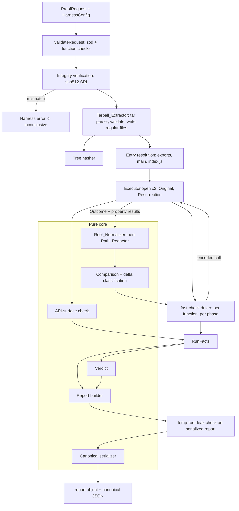
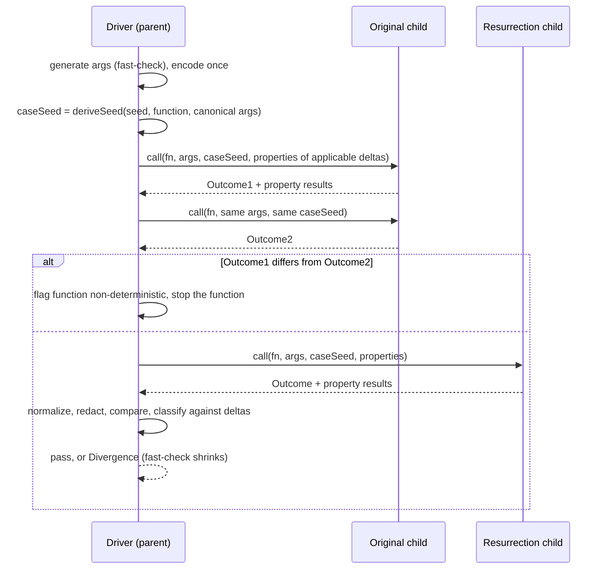
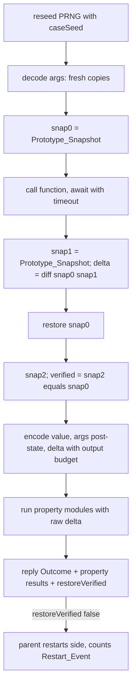

# Design Document

## Overview

The Proof of Life Engine is a TypeScript library in `src/proof/`, next to the finished autopsy engine in `src/engine/`. It takes an Original (an integrity-pinned npm tarball) and a Resurrection (a directory or tarball) and produces a Proof_Report: a deterministic JSON document with a Verdict of `alive`, `restless` or `inconclusive`. It runs differential property tests with fast-check. Each side runs in its own child process under the Node permission model. The engine compares return values, thrown errors, argument mutations, async outcomes and prototype changes. Only Declared_Deltas may explain a difference. The engine makes no LLM calls and no network requests.

The design mirrors the autopsy engine:

- **Pure core** (`core/`, `serialize/`, `child/codec/`): the Value_Codec, deep comparison, Root_Normalizer, Path_Redactor, delta classification, API-surface check, verdict, report builder, canonical serializer, zod schema and deserializer. These functions read no clock, environment or random source. The ESLint determinism rules (no `Date.now`, no argument-less `new Date()`, no `Math.random`) are extended to these directories.
- **I/O shell** (`shell/`, `child/` outside `codec/`): the Tarball_Extractor (the only importer of `tar`), integrity check, tree hasher, entry resolution, temp directories, the Executor interface with the Sandbox_Executor and the InProcess_Executor, the child runner script, the fast-check driver, the orchestrator `runProofOfLife`, a thin CLI and the manual tarball recorder.

The engine never decides "alive" from silence. A report is `alive` only when every tested function produced comparable evidence, no divergence was found, every Declared_Delta was demonstrated, and no harness error occurred. A harness failure is `inconclusive`. A found divergence is `restless` and is never hidden.

### Key design decisions

| Decision | Rationale |
|---|---|
| One shared per-call implementation (`child/sideRuntime.ts`) used by both the child runner and the InProcess_Executor | The engine-level property tests then exercise the same snapshot, delta, restore and encode code that the real sandbox runs. Only transport differs. |
| Encoded nodes are canonical (object props sorted by code point, Map entries and Set items sorted by canonical JSON), so equality is structural | Deep equality needs no order-insensitive matching. Insertion order is ignored (R7.2) because it is erased at encoding time. The Root_Normalizer re-canonicalizes after replacing strings. |
| Generators, predicates and shrinking run in the parent; only encoded values cross the process boundary | fast-check shrinks parent-side values. Each shrink candidate is encoded and sent to the children. Closures never cross the boundary (A3). |
| Per-function `fc.check` that stops at the first failing case, shrinks, and collects the result as a Divergence | One run reports every function instead of aborting on the first failing function. At most one shrunk counterexample per function and phase is reported (limitation L7). |
| Counting is done from executed attempts: attempts up to and including the first failing attempt of a phase count; later attempts are shrink calls | Does not depend on fast-check internals, and makes `cases` a measured number (R8.6, R8.11, R13.9). |
| The child enforces the per-call timeout for async code and the parent adds a hard kill after a grace period | An async hang still returns a Prototype_Delta from a live child (R5.10). A synchronous infinite loop is killed by the parent. |
| Prototype restoration is verified by a second snapshot, and failure forces a child restart | R5.12. The restart is counted as a Restart_Event. |
| Encoding and property modules run after restoration | A package that pollutes `Object.prototype.then` or `toJSON` cannot disturb the runner's own encoding. Property modules receive the captured delta data, not live prototypes. |
| Copy the small generic ordering helpers into `src/proof/child/codec/order.ts` instead of importing from `src/engine/serialize` | The sandbox side must be self-contained under one read grant. The engine stays untouched and its lint scope unaffected. A parity test checks `compareCodePoints` against the engine's. |
| Sandbox-side files are plain TypeScript with erasable syntax only, run by Node's native type stripping | The same codec file is imported by the parent (through vitest/tsx) and executed in the child (through `node`). No build step. Verified by the first integration test (see Risks to verify). |

### Research summary

- **Node permission model** (https://nodejs.org/api/permissions.html, read for this design). `--permission` denies file system write, network, child process, worker threads, native addons, WASI, FFI and the inspector unless allowed. `--allow-fs-read` takes absolute paths. An existing directory gets an implicit wildcard (read access to everything below it). The entrypoint is added to the read list automatically, but modules it imports from other directories need a grant. A `*` in a path is a wildcard and everything after it is ignored. The documentation states that the model does not guarantee protection through other routes such as `node:sqlite`. It does not scrub `process.env`. **Statement used in this design: the permission model is a seat belt against accidental access, not a security boundary against malicious code.**
- **Verified on this machine** (requirements.md, Node v26.13.1, Windows): denied read outside the allowed directory, denied `child_process.execSync`, denied Worker creation, denied TCP connect, and `process.permission.has('fs.write' | 'net' | 'child' | 'worker')` is `false`. A plain child inherits parent environment variables.
- **Not verified yet** (the integration suite must establish each, see Risks to verify): that the CommonJS loader of the package works under `--allow-fs-read=<package dir>` including its `package.json` scope lookup, a package directory on another drive, a path with spaces, the minimum Windows environment, and that native type stripping runs `.ts` files under `--permission`.
- **fast-check 4.x**. `fc.check(property, params)` returns run details (`failed`, `counterexample`, `counterexamplePath`, `seed`, `numShrinks`, `numRuns`) instead of throwing. `params.seed` and `params.path` replay a shrunk counterexample. `fc.asyncProperty` accepts an async predicate. The exact detail field names are re-checked against the installed 4.10.2 types when the driver is written.
- **Subresource Integrity** `sha512-<base64>` is the registry `dist.integrity` format. The digest is computed with `node:crypto` and compared as strings.
- **tar 7.5.23** (BlueOak-1.0.0, permissive) is added as a dependency (D1). Only the Tarball_Extractor imports it. The extractor uses tar's parser to read entries into memory and writes files itself, so the engine controls every path it writes. The exact tar API call is confirmed when the wrapper is written.

## Architecture



### One Case



### Per-call protocol inside a side (shared by child and in-process)



### Module layout

```
src/proof/
  index.ts                  public API: runProofOfLife, deserializeReport, canonicalReportJson, types
  types.ts                  zod schemas and TS types: Proof_Report, request, harness config, Outcome, errors
  child/                    SANDBOX SIDE. Self-contained, readable by the child with one --allow-fs-read grant.
    package.json            {"type":"module"} so native type stripping treats the .ts files as ESM
    codec/                  PURE (lint scope). No imports outside this directory.
      nodes.ts              EncodedNode types, NODE_KEY_ORDER, unencodable reasons
      order.ts              compareCodePoints, sortBy, ordered (copied generic helpers)
      encode.ts decode.ts   Value_Codec
      canonical.ts          canonicalizeNode (sort props, Map entries, Set items), nodeJson
    prototypes.ts           Prototype_Snapshot, diff, restore, verify (injectable prototype set)
    stubs.ts                frozen Date, seeded Math.random (mulberry32)
    sideRuntime.ts          load package, list exports, per-call protocol (used by runner and in-process)
    protocol.ts             message types, line parser (pure), constants
    runner.ts               child entry script: stdin NDJSON loop over SideRuntime
  core/                     PURE (lint scope)
    seeds.ts                deriveSeed
    equal.ts                deepEqualNodes, compareOutcomes, firstDifference
    normalize.ts            Root_Normalizer
    redact.ts               Path_Redactor
    delta.ts                classifyCase, pickDemonstration
    apiSurface.ts           compareExports
    verdict.ts              computeVerdict
    report.ts               buildReport, fallbackReport
  serialize/                PURE (lint scope)
    canonicalReport.ts      REPORT_KEY_ORDER, canonicalizeReport, canonicalReportJson
    deserialize.ts          deserializeReport (zod)
  shell/
    tarball/tarballExtractor.ts   ONLY importer of `tar`
    integrity.ts            sha512 SRI computation and verification
    treeHash.ts             Tree_Hash over {path, bytes} entries
    workDir.ts              temp work root creation, copy, cleanup
    entry.ts                CommonJS entry resolution
    executor/types.ts       Executor, SideHandle, SideSpec, CallRequest, errors
    executor/sandboxCommand.ts   buildSandboxArgv, buildSandboxEnv (pure functions, tested alone)
    executor/sandboxExecutor.ts  Sandbox_Executor
    executor/inProcessExecutor.ts  InProcess_Executor (tests only)
    driver.ts               fast-check driver: runFunction, runPhase, runCase
    orchestrator.ts         runProofOfLife
    cli.ts                  thin CLI
  harnesses/lodash.set/
    config.ts               Harness_Config for lodash.set (parent side)
    sandbox/pollution.cjs   delta property module (sandbox side, plain CommonJS)
scripts/recordTarball.ts    manual, network-gated (npm run fixtures:record-tarball)
docs/proof-of-life-ordering.md
tests/proof/{unit,property,integration,fixtures,helpers}/
```

`src/proof/child/` is the only directory the child may read besides the package directory and the harness files. `child/codec/` imports nothing outside itself. `core/` and `serialize/` import `child/codec/` and `types.ts` only (types.ts imports zod). The lint determinism scope becomes `src/engine/core`, `src/engine/serialize`, `src/proof/core`, `src/proof/serialize` and `src/proof/child/codec`. `child/stubs.ts` is outside the scope because it replaces `Date` and `Math.random` by design.

## Components and Interfaces

### Request and library API

```ts
interface ProofRequest {
  original: { name: string; version: string; tarballPath: string; integrity: string };
  resurrection: { kind: 'directory' | 'tarball'; path: string };
  haunting?: readonly string[];                 // default: every exported function of the Original
  harness: HarnessConfig;
  executorFactory?: ExecutorFactory;            // default: Sandbox_Executor
  // Reserved for D4 (read-only dependency root). The schema is strict, so a `dependencyRoot` key is rejected today.
}

interface ProofDeps {                           // I/O seams; defaults come from defaultProofDeps()
  tempRoot: string;                             // default os.tmpdir()
  toolVersions: { node: string; fastCheck: string };   // read from the running installation
  platform: 'win32' | 'posix';                  // selects case-insensitive path matching
  knownPaths: { nodeDir: string; homeDir: string; tmpDir: string };  // for the Path_Redactor
}

interface ProofRun { report: ProofReport; json: string }

function runProofOfLife(request: ProofRequest, deps?: ProofDeps): Promise<ProofRun>;
class RequestValidationError extends Error { readonly field: string }
```

`runProofOfLife` rejects with `RequestValidationError` before any child starts when `original`, `resurrection` or `harness` is missing, `caseCount < 1`, `perCallTimeoutMs < 1`, or `seed` is not a 32-bit integer (R1.5). Every other failure is a harness error inside a returned report (Verdict `inconclusive`). The function never returns `alive` after a harness error. `ProofRun.json` is `canonicalReportJson(report)`. The library exports no function that touches the network (R1.6).

### Harness_Config

Generators and predicates are parent-side closures. Property, setup and stub modules are sandbox-side file paths.

```ts
interface HarnessConfig {
  package: string;                              // for the report only
  seed: number;                                 // int32
  caseCount: number;                            // default 100, per function and phase
  perCallTimeoutMs: number;                     // default 1000
  heapLimitMb: number;                          // default 256
  outputLimitBytes: number;                     // default 1_048_576
  maxRestarts: number;                          // default 20, shared by both sides
  shrinkBudget: number;                         // default 500 attempts per failing phase
  functions: Readonly<Record<string, FunctionHarness | ExcludedFunction>>;
  deltas: readonly DeclaredDelta[];
  setupModule?: string;                         // absolute path, sandbox side, applied to both sides
  setupModules?: { original?: string; resurrection?: string };   // per-side override (R8.9)
  readPaths?: readonly string[];                // extra sandbox-side files/dirs the modules above may require
}

interface FunctionHarness {
  args: fc.Arbitrary<readonly unknown[]>;       // tuple of arguments, no function-typed values (A7)
  explicitCases?: readonly (readonly unknown[])[];
  caseCount?: number;                           // overrides the default
  stubs?: { date?: boolean; random?: boolean }; // default both true (A6)
}
interface ExcludedFunction { excluded: true; reason: string }

interface DeclaredDelta {
  id: string;
  function: string;
  predicate: (args: readonly unknown[]) => boolean;   // parent side, on decoded copies only (R11.9)
  propertyModule: string;                       // absolute path, sandbox side
  explicitCases: readonly (readonly unknown[])[];
  generator?: fc.Arbitrary<readonly unknown[]>; // constrained arbitrary of in-predicate arguments
  caseCount?: number;
}
```

Nothing here mentions lodash.set. The ip harness later supplies explicit cases (127.1, 01200034567, ...), a setup module that stubs `os.networkInterfaces`, and a delta, without engine changes (R14.10). `ProofRequest` can gain `dependencyRoot` in a later spec: the orchestrator passes it into `SideSpec.readPaths`, and the Proof_Report gains a hash key at the end of the key-order table. This spec implements none of it (R16.6).

Config validation (`validateRequest`) uses zod for the serializable fields and `typeof` checks for functions and arbitraries. A harness path that is not absolute is a validation error.

### Executor interface

```ts
type Side = 'original' | 'resurrection';
type ExecutorMechanism = 'node-permission' | 'in-process';

interface ExecutorFactory { create(options: ExecutorOptions): Executor }
interface ExecutorOptions { restartBudget: RestartBudget }          // shared by both sides, counts restarts toward R16.4
interface RestartBudget { readonly max: number; used(): number; consume(): boolean }  // false when exhausted

interface Executor {
  readonly mechanism: ExecutorMechanism;
  probe(): Promise<Result<void, ExecutorError>>;                    // 'sandbox-unavailable' when flags cannot start
  open(spec: SideSpec): Promise<Result<SideHandle, ExecutorError>>; // spawn/load module
  dispose(): Promise<void>;                                         // closes every open side
}

interface SideSpec {
  side: Side;
  packageDir: string;            // the copy under the work root (R4.6); the only package-readable directory
  entryFile: string;             // absolute, resolved by entry.ts
  setupModule?: string;
  readPaths: readonly string[];  // sandbox-side module files/dirs to grant read access to
  limits: { callTimeoutMs: number; heapLimitMb: number; outputLimitBytes: number };
}

interface SideHandle {
  listExports(): Promise<Result<ExportsInfo, ExecutorError>>;
  call(request: CallRequest): Promise<Result<CallResult, ExecutorError>>;
  restart(): Promise<Result<void, ExecutorError>>;    // explicit restart, counted
  counters(): SideCounters;
  close(): Promise<void>;
}

interface CallRequest {
  fn: string;                                // export name, or 'default'
  args: readonly EncodedNode[];
  caseSeed: number;                          // int32, seeds Math.random for this call
  stubs: { date: boolean; random: boolean };
  properties: readonly { id: string; modulePath: string }[];   // delta properties to run after this call
}
interface CallResult { outcome: Outcome; properties: readonly PropertyResult[]; }
interface PropertyResult { id: string; ok: boolean; detail?: EncodedNode }
interface SideCounters { restartEvents: number; otherRestarts: number }  // otherRestarts: timeout or crash respawns
type ExecutorError = { kind: 'sandbox-unavailable' | 'unloadable-module' | 'too-many-crashes' | 'runner-protocol-error' | 'property-error'; message: string };

interface ExportsInfo { entries: readonly ExportEntry[] }       // sorted by name (code point)
interface ExportEntry { name: string; type: string; fnName?: string; arity?: number; primitive?: EncodedNode }
```

Requirement 5.1 lists "run a delta property" as an Executor operation. It is realized as `CallRequest.properties`, because Requirement 11.7 demands that the property run in the same child, on the Prototype_Delta of the call it checks. A separate method would need a second round trip and could not use the same snapshot data. Both executors run the property inside `SideRuntime.call`.

**Exports.** `listExports` returns the own enumerable string keys of the export object whose values are functions or primitives, plus `typeof` for the rest. When `module.exports` is itself a function, it is listed as `default`, and its own enumerable function-valued properties are listed under their own names. A call to `default` has `this === undefined`. A call to any other name has `this` bound to the export object.

### Sandbox_Executor

The Sandbox_Executor starts one child per side. A run therefore costs two process starts plus respawns after timeouts, crashes and Restart_Events. The cost of a start is not measured yet and is logged in docs/kiro-journal.md by the integration suite. One child per call would multiply it by the number of calls, which is why the design keeps a child alive and verifies restoration instead.

**Command line** (`buildSandboxArgv(spec, runnerDir)`, a pure function that is tested without a child):

```
process.execPath
  --permission
  --allow-fs-read=<abs src/proof/child directory>
  --allow-fs-read=<abs realpath of spec.packageDir>
  --allow-fs-read=<each abs spec.readPaths entry and spec.setupModule>
  --max-old-space-size=<heapLimitMb>
  <abs src/proof/child/runner.ts>
```

There is no `--allow-net`, `--allow-child-process`, `--allow-worker`, `--allow-addons`, `--allow-fs-write`, `--allow-inspector`, `--allow-wasi`, `--allow-ffi` or `--allow-openssl-store`. The spawn options are `{ shell: false, windowsHide: true, cwd: <packageDir>, stdio: ['pipe','pipe','pipe'], env: buildSandboxEnv(...) }`. Each path is its own argv element, so spaces need no quoting by the engine. A path that contains `*` is rejected with `sandbox-unavailable` (a wildcard would widen the grant). The message names the problem without the path. The engine also rejects `,` conservatively, because the documented separator behavior is not verified.

**How files become readable.** The runner script is the entrypoint, so Node adds it automatically. Its imports (`sideRuntime.ts`, `codec/*`, and so on) sit in the same directory, which is granted whole. The package directory is granted whole. Setup, property and stub modules live outside both, so each is granted by exact path (a file grant, or a directory grant for a harness directory). A module may only `require` Node built-ins, files in its own grant, or the package. The child's current directory is the package directory, so relative paths inside the package behave as with a normal run.

**Environment** (`buildSandboxEnv(platform, parentEnv)`, pure). The object starts empty. Only these candidate entries are added, and only these names are ever read from the parent:

| Platform | Entries |
|---|---|
| win32 | `SystemRoot` copied from the parent (Node on Windows may need it), plus fixed `TZ=UTC` |
| other | fixed `TZ=UTC` |

`NODE_OPTIONS` is never passed. This list is a candidate, **not yet verified**: the integration test `env-minimum` starts the child with `{}`, then with the candidate list, and records which is the smallest set that starts and loads a package. The design is revised to the result and the result is logged in docs/kiro-journal.md. The test `env-scrubbed` sets a sentinel variable in the parent (for example `GS_TEST_SECRET`) and shows that a package function returning `Object.keys(process.env)` sees none of the parent's variables beyond the allowlist.

**Package directory addressing.** The work root is created with `mkdtemp` under the real path of `os.tmpdir()` (`fs.realpath.native`), and the engine uses that real path for the flag, `cwd` and the Root_Normalizer. The created path is kept as well when it differs (short names such as `OWNER~1`, or a symbolic link). What is tested and what is not:

| Case | Status |
|---|---|
| Package directory on the system drive, no spaces | tested (every integration test) |
| Directory name with a space (`gs space/pkg`) | tested (`paths-spaces` test creates its own directory) |
| Package directory and runner directory on different drives | tested only when the repository drive differs from the temp drive, or when `PROOF_TEST_OTHER_DRIVE` names a writable directory on another drive. Otherwise the test reports `skipped: other drive not available`. It is not claimed as verified. |
| UNC path or `\\?\` path as the temp root | not tested, not supported |

**Protocol.** Newline-delimited JSON. Every message is one line with the field `gs: 1`.

| Direction | Message | Fields |
|---|---|---|
| child to parent | `ready` | `node` (version) |
| parent to child | `load` | `id`, `entryFile`, `setupModule?`, `outputLimitBytes`, `stubs` |
| child to parent | `loaded` | `id`, `ok`, `error?` (message without paths) |
| parent to child | `exports` | `id` |
| child to parent | `exports` | `id`, `entries` |
| parent to child | `call` | `id`, `fn`, `args`, `caseSeed`, `stubs`, `properties`, `timeoutMs` |
| child to parent | `result` | `id`, `outcome`, `properties`, `restoreVerified` |
| parent to child | `shutdown` | none |
| child to parent | `fatal` | `id?`, `message` |

`parseProtocolLine(line)` is pure. It returns `undefined` for any line that is not valid JSON with `gs: 1` and a known `t`, and the parent discards such lines (R5.8). The runner saves the original `process.stdout.write` in a closure for its own messages, then replaces `process.stdout.write`, `process.stderr.write` and `console` methods with no-ops before the package loads, so ordinary package logging cannot corrupt the stream. A package that writes to file descriptor 1 directly can still interleave a line. The result is a discarded line and, for the call in flight, a `timeout`. This is accepted and documented (limitation L8).

**Limits per call.**

- The child starts a timer of `callTimeoutMs` around the awaited result. On expiry it answers with Outcome `timeout`, with the Prototype_Delta of the call, and continues.
- The parent starts a hard timer of `callTimeoutMs + graceMs` (default 500 ms). On expiry it kills the child and records Outcome `timeout` without a delta. Only a synchronous hang reaches this path.
- A child that exits unexpectedly or runs out of heap yields Outcome `crash` for the call in flight.
- The parent counts stdout bytes. A line longer than `outputLimitBytes + 64 KiB` makes it kill the child and record `output-too-large`. The child's own limit (below) normally triggers first.
- After `timeout` (hard kill), `crash`, `output-too-large` (kill) or `restoreVerified: false`, the parent respawns the child and loads the package again before the next call. Module-level state of the package therefore resets, on that side only. A timeout answered by the child itself does not restart it.

**Restart policy.** `RestartBudget.max` defaults to 20 for the whole run, shared by both sides. A Restart_Event (restoration not verified) increments `SideCounters.restartEvents`. A respawn after a hard timeout, crash or output kill increments `otherRestarts`. Every respawn consumes the budget (R5.14, R16.4). When `consume()` returns false, the executor returns `too-many-crashes`, the driver stops, and the run ends with that harness error. The Proof_Report records both counters for each side (R5.13).

**Limitations of the sandbox.** The permission model is a seat belt against accidental access. It is not a security boundary against deliberately malicious code (Node documents that it does not cover every route). The engine targets non-malicious packages that passed the autopsy and license gates, and the report records only the mechanism name. No UI or report text may call the sandbox "secure" or "isolated" without this qualification. The child can still read Node's own files, the package directory, the runner directory and granted harness files, and can use CPU up to the hard timeout.

### InProcess_Executor

Implements the same `Executor` interface by calling `SideRuntime` directly in the test process. It exists only for engine-level property tests. It requires `new InProcessExecutor({ acknowledgeUnsandboxed: true })`, is never the default, and is never used by the CLI. It reports mechanism `in-process`. Per-call stubs of `Date` and `Math.random` are installed on `globalThis` for the duration of a call and removed afterwards. Timeouts use `Promise.race`, so the synthetic package menu contains no synchronous hang. The Prototype_Snapshot of the six real prototypes is taken in the test process, which is safe because `SideRuntime` restores and verifies after each call. The property tests that mutate prototypes use an injected fake prototype set (see below).

### SideRuntime (`child/sideRuntime.ts`)

```ts
interface SideRuntimeOptions {
  packageDir: string; entryFile: string; setupModule?: string;
  outputLimitBytes: number;
  prototypes?: PrototypeSet;                  // default: the six real prototypes; tests inject fakes
  installStubsGlobally: boolean;              // true in the child, false in-process (installed per call)
}
interface SideRuntime {
  load(): Result<void, { message: string }>;
  exports(): ExportsInfo;
  call(request: CallRequest & { timeoutMs: number }): Promise<{ result: CallResult; restoreVerified: boolean }>;
}
```

`load` runs in this order: capture the intrinsics the runtime needs (`Reflect`, `Object.keys`, `JSON`, `setTimeout`, `clearTimeout`, `util.types`), install the `Date` and `Math.random` stubs, run the setup module, then load the package with `createRequire(<packageDir>/package.json)(entryFile)`. Stubs and setup are therefore in place before any package code runs (R9.1, R8.9).

Per-call steps follow the diagram above. Details:

- `Date` is frozen to 2000-01-01T00:00:00.000Z: `Date.now()` and `new Date()` return that instant, `Date()` returns its string form, `new Date(x)` behaves as usual, and `Date.prototype` is unchanged. `Math.random` becomes a mulberry32 generator reseeded from `caseSeed` at the start of every call, so the repeat call of the self-consistency check sees the same sequence. `crypto.randomUUID`, `performance.now` and `process.hrtime` are not stubbed. A function that uses them is detected as non-deterministic and the run is `inconclusive` unless the function is excluded (A9).
- `async` is true when the returned value is thenable (checked once, right after the call, using captured intrinsics). The value is awaited with the timeout. A rejection yields kind `rejected`, a synchronous throw yields `threw`.
- Delta property modules: `require(modulePath).check(ctx)` where `ctx = { functionName, kind, prototypeDelta, result }`. `prototypeDelta` is the raw delta (not encoded) that produced the Outcome's encoded delta. `result` holds the raw returned or thrown value. The module returns `{ ok: boolean, detail?: JSON-safe }`. It never snapshots or restores prototypes (R11.7). A module that throws or returns a malformed result produces the executor error `property-error`, which becomes the harness error of the same kind.
- If the encoder exhausts its budget, the Outcome is `{ kind: 'output-too-large' }` (R5.6, R6.9).

### Prototype isolation (`child/prototypes.ts`)

```ts
type ProtoName = 'Object.prototype' | 'Array.prototype' | 'Function.prototype'
               | 'String.prototype' | 'Number.prototype' | 'Boolean.prototype';
type PrototypeSet = Readonly<Record<ProtoName, object>>;   // default: the real six, in this order

interface PrototypeSnapshot { readonly entries: ReadonlyMap<ProtoName, ReadonlyMap<PropKey, PropertyDescriptor>> }
type PropKey = string | symbol;

function snapshotPrototypes(set: PrototypeSet): PrototypeSnapshot;     // Reflect.ownKeys + getOwnPropertyDescriptor
function diffPrototypes(before: PrototypeSnapshot, after: PrototypeSnapshot): RawDeltaEntry[];
function restorePrototypes(set: PrototypeSet, snapshot: PrototypeSnapshot): void;
function snapshotsEqual(a: PrototypeSnapshot, b: PrototypeSnapshot): boolean;
function isRestorable(set: PrototypeSet): boolean;                      // false when frozen or sealed

interface RawDeltaEntry {
  prototype: ProtoName; key: PropKey;
  change: 'added' | 'changed' | 'removed';
  before?: PropertyDescriptor; after?: PropertyDescriptor;
}
```

Descriptors are compared field by field with `Object.is` on `value`, `get` and `set`, and by value on the flags. `restorePrototypes` deletes added keys, redefines changed and removed keys from the saved descriptors, and ignores errors for properties it cannot touch. `snapshotsEqual(before, afterRestore)` is the verification. If the set is frozen or sealed, or a non-configurable property differs, verification fails, the reply carries `restoreVerified: false`, and the parent restarts the side before the next call (R5.12). The delta is sorted by fixed prototype order, then string keys by code point, then symbol keys by description, so it is canonical before encoding. This isolates only the six prototypes. Other global state (for example a static property added to `Object`, or `process` properties) persists across calls in one child and is not detected (limitation L9).

### Value_Codec (`child/codec/`)

```ts
type ReasonUnencodable = 'cycle' | 'depth' | 'getter' | 'proxy';

type EncodedNode =
  | { t: 'undefined' } | { t: 'null' }
  | { t: 'bool'; v: boolean }
  | { t: 'str'; v: string }
  | { t: 'num'; v: number | 'NaN' | 'Infinity' | '-Infinity' | '-0' }
  | { t: 'bigint'; v: string }                       // decimal
  | { t: 'symbol'; v: string | null }                // description; null when absent
  | { t: 'date'; v: number | 'invalid' }             // time value
  | { t: 'regexp'; source: string; flags: string }
  | { t: 'map'; entries: [EncodedNode, EncodedNode][] }     // sorted by canonical JSON of [key, value]
  | { t: 'set'; items: EncodedNode[] }                      // sorted by canonical JSON
  | { t: 'arraybuffer'; b64: string }
  | { t: 'typed'; kind: TypedKind; b64: string }            // includes 'Buffer'
  | { t: 'error'; cls: string; message: string; props: [string, EncodedNode][] }
  | { t: 'array'; length: number; items: { i: number; n: EncodedNode }[]; props: [string, EncodedNode][] }
  | { t: 'object'; ctor: string | null; props: [string, EncodedNode][] }   // plain object: ctor 'Object'; null prototype: null
  | { t: 'function'; name: string; arity: number }
  | { t: 'unencodable'; reason: ReasonUnencodable };

type EncodeResult = { ok: true; node: EncodedNode } | { ok: false; reason: 'output-too-large' };
function encodeValue(value: unknown, options: { budget: number; maxDepth?: number }): EncodeResult;  // maxDepth 1000
function decodeNode(node: EncodedNode): unknown;          // throws on 'unencodable'
function canonicalizeNode(node: EncodedNode): EncodedNode;
function nodeJson(node: EncodedNode): string;             // canonical JSON using NODE_KEY_ORDER
```

Encoding rules:

- **Holes.** `array.items` lists only present indices, so a hole and `undefined` differ (R7.1). `array.props` holds own enumerable non-index string keys (for example `index` on a regex match array).
- **Objects.** Own enumerable string keys in code point order, read with the descriptor API (so accessors can be detected). Class instances record the constructor name in `ctor`. Symbol keys are not encoded. Other built-ins that have no listed type (Promise, WeakMap, boxed primitives) are encoded as `object` with their constructor name and own enumerable string keys. Whether a Promise has resolved is therefore not compared.
- **Errors.** `cls` is the constructor name, falling back to `err.name`. `message` and own enumerable properties other than `stack` are encoded. `stack` never appears (R13.11).
- **Cycles (R6.2, R6.7).** The encoder keeps the ancestor path in a `Set`: an object is added when its encoding starts and removed when it ends. When an object about to be encoded is already on the path, the node that would close the cycle is `unencodable` with reason `cycle`. An object seen earlier on a different branch is not on the path, so it is encoded again by value. The encoder never keeps a global visited set. `[o, o]` becomes two independent copies. `o.self = o` becomes `{self: unencodable(cycle)}`.
- **Depth.** A node at nesting level 1001 or deeper is `unencodable` with reason `depth` (R6.3). The nesting level counts container nodes on the path. The recursion uses at most two frames per level, which fits in the default Node stack at the limit of 1,000 levels. A unit test encodes depth 1000 and 1001.
- **Getter and proxy.** The encoder reads each own property through `Reflect.getOwnPropertyDescriptor` and, for accessors, calls the getter inside `try`. A throwing getter makes that property's node `unencodable` with reason `getter`. A trap that throws on a Proxy (detected with `util.types.isProxy`) makes the proxy's node `unencodable` with reason `proxy`.
- **Budget (R6.9).** The encoder subtracts a cost per emitted node (string length plus a constant) from `options.budget`. When it reaches zero, encoding stops and returns `{ ok: false, reason: 'output-too-large' }`. The estimate counts UTF-16 units. The parent additionally limits the received line length in bytes. A DAG with many shared paths expands into a tree, so its encoding reaches the budget quickly and is reported as `output-too-large` (L2).
- **Realm independence.** Type tests use `Object.prototype.toString` tags and `util.types.*`, never `instanceof`, so values from another realm are encoded the same way.

Decoding builds fresh values for every call, so each side receives independent copies (R7.7). Constructor names that are not built-ins are recreated with a stand-in class made with that name (`{[name]: class {}}[name]`, cached per name), and error subclasses with a stand-in extending `Error`. A function node decodes to a stand-in function with the recorded `name` and `length`. This keeps `encode(decode(e))` canonically equal to `e` (R6.6).

### Comparison (`core/equal.ts`)

```ts
type OutcomePart = 'kind' | 'async' | 'value' | 'args' | 'prototypeDelta';
interface Difference { part: OutcomePart; path: string }   // path in the encoded tree, '/'-separated, e.g. 'value/props/2/1'

function deepEqualNodes(a: EncodedNode, b: EncodedNode): boolean;
function compareOutcomes(original: Outcome, resurrection: Outcome): Difference[];   // at most one per part
```

`deepEqualNodes` is structural equality over canonical nodes. It follows Requirements 7.1 to 7.4 without extra code: `NaN` is encoded as `'NaN'` and equals itself, `-0` is `'-0'` and differs from `0`, `undefined` is a node and a missing property is an absent key, a hole is an absent item, Dates compare by time value, typed arrays by kind and bytes, functions by `name` and `arity`, unencodable nodes by reason (R6.4). Errors compare by class, message and encoded properties (stricter than R7.5, which names class and message only, because R6.1 encodes the properties and R7.2 compares nested objects the same way).

`compareOutcomes`: if the kinds differ, one `kind` difference. If both are `timeout`, both `crash` or both `output-too-large`, there is none (R7.9). Otherwise it compares `async`, `value`, `args` (the post-call state of each argument) and `prototypeDelta`, and reports the first difference in canonical traversal order for each part. Return vs throw is a `kind` difference (R7.6). The functions are pure and read neither clock nor file system (R7.10).

### Root_Normalizer and Path_Redactor

Both are pure and take every machine-dependent input as an argument.

```ts
interface SideRoots { created: string; real?: string }                 // real only when different
interface PathContext {
  roots: SideRoots;                       // this side's own roots
  caseInsensitive: boolean;               // parent platform is win32
  knownPaths: { work: string; nodeDir: string; homeDir: string; tmpDir: string; tempNames: readonly string[] };
}
function normalizeOutcome(outcome: Outcome, roots: SideRoots, caseInsensitive: boolean):
  Result<Outcome, { kind: 'normalization-collision'; where: 'value' | 'args' | 'prototypeDelta' | 'property' }>;
function normalizeText(text: string, matcher: RootMatcher): string;
function redactErrorText(text: string, context: PathContext): string;
function redactOutcome(outcome: Outcome, context: PathContext): Outcome;     // error text only
```

**Order of operations for every Outcome and every property result of a side:**

1. **Normalize (parent, per side, own roots only).** `normalizeOutcome` replaces the side's roots in every string field of every node (R13.18): `str.v`, `error.message`, `error.cls`, `regexp.source`, `symbol.v`, `function.name`, every property key, every Map or Set string, and the strings in the Prototype_Delta (keys and values). It then re-canonicalizes (the sort order may change) and fails with `normalization-collision` when two keys of one object became identical (R13.21). Collisions inside Maps are not errors because Map keys are values.
2. **Redact error text (R13.10).** Error text means `error.message`, every string-valued property of an `error` node, and a thrown or rejected value that is a `str` node. `redactErrorText` runs on it. No other string is redacted (R13.20).
3. **Compare** the normalized and redacted Outcomes.

**Matcher construction.** For each root, the candidate forms are: the native form, the forward-slash form, the back-slash form, the back-slash form with doubled backslashes (as it appears in a JSON-escaped message; an addition to R13.19), the `\\?\` form (for drive-letter roots), and the `file://` URL form (`pathToFileURL(root).href` with percent-encoded segments, hexadecimal digits matched case-insensitively). When `real` differs from `created`, the forms of both are included. The forms are deduplicated and sorted longest first, ties by code point, and joined into one alternation `RegExp`. A single pass replaces every match with `<package>`, so replaced text is never rescanned. On Windows (`caseInsensitive`) the expression has the `i` flag. On other platforms hexadecimal letters in the URL form are matched through `[aA]`-style classes. A match must be followed by the end of the string or by a character outside `[A-Za-z0-9._~-]` (a negative lookahead), so `pkg2` and `pkg-x` are not matched. For the URL form `%` also counts as a continuing character. UNC roots are not supported for the `\\?\` form.

**Redaction passes** on text already normalized:

1. `<package>` followed by a run of path characters starting with `/` or `\` (up to whitespace, a quote, or one of `<>|*?`) has its remainder rewritten with forward slashes, giving `<package>/lib/a.js`. The remainder is then not treated as an absolute path (R13.12).
2. Known roots from `knownPaths` (work root, Node installation directory, home directory, `os.tmpdir()`), in all forms and with the same boundary rule, are replaced together with the rest of their path by `<redacted-path>`. This pass handles roots that contain spaces, such as `C:\Users\John Smith`.
3. Every other absolute path is replaced by `<redacted-path>`: POSIX paths starting at a token boundary, drive-letter paths with either slash, `file://` URLs with percent-decoding, `\\?\` paths including `\\?\UNC\`, and `\\server\share` paths. A trailing `:line:column` is kept out of the match.
4. Names in `tempNames` (the work root directory name and the side directory names) are replaced by `<redacted-path>` when they appear without a parent path.

Because step 1 of the first list ran before, a package root is never turned into `<redacted-path>` (R13.22). Both functions apply identically to the Original and the Resurrection. Examples that must hold are the lists in R13.16 and R13.24.

### Delta classification (`core/delta.ts`)

```ts
interface CaseObservation {
  args: EncodedNode[];
  original: CallResult;                // normalized and redacted
  resurrection: CallResult;
  applicable: readonly { id: string }[];    // deltas whose predicate held on the decoded args
}
type DivergenceKind = 'unexplained' | 'delta-violation' | 'api-surface';
interface CaseClassification {
  divergences: { kind: 'unexplained' | 'delta-violation'; deltaId?: string; differences: Difference[] }[];
  demonstrated: readonly string[];     // delta ids this case demonstrates (property fails on Original, passes on Resurrection)
  checked: readonly string[];          // delta ids whose property ran on the Resurrection for this case
}
function classifyCase(observation: CaseObservation): CaseClassification;
function pickDemonstration(cases: Iterable<{ id: string; ... }>): ...   // first in execution order
```

Rules, in this order:

1. `differences = compareOutcomes(original.outcome, resurrection.outcome)`.
2. For each applicable delta `d`: the property result on the Resurrection is recorded as `checked`. If it is not `ok`, add a `delta-violation` (even when `differences` is empty, R11.3). If the property on the Original is not `ok` and on the Resurrection is `ok`, add `d` to `demonstrated`.
3. If `differences` is non-empty: accepted only when at least one applicable delta has `ok` on the Resurrection (R11.2, R11.10). Otherwise add an `unexplained` divergence carrying the differences (R11.4).

A Declared_Delta accepts every difference in its predicate region as long as its property holds. The property is therefore the contract, and a weak property hides differences (limitation L7). The lodash.set property is as strong as R14.6 requires and no stronger.

The Demonstration is the first Case in execution order (explicit cases, then generated cases, then delta-phase cases) where the property fails on the Original and passes on the Resurrection (R11.5). The driver records the first and ignores later ones. A Declared_Delta without a Demonstration is `not-demonstrated`.

### Seeds

```ts
function deriveSeed(seed: number, ...parts: readonly string[]): number;   // FNV-1a 32-bit over UTF-8 of `${seed}\0${parts.join('\0')}`, result | 0
```

- fast-check seed for a phase: `deriveSeed(seed, functionName, phase)` with `phase` one of `generated`, `delta:<id>`. The order of functions does not change another function's Cases (R8.5).
- Stub seed for one call: `deriveSeed(seed, functionName, nodeJson(argsAsArrayNode))`. It depends on the arguments, not on the position in the run, so a shrunk candidate and a replay see the same `Math.random` sequence.

### Fast-check driver (`shell/driver.ts`)

Per function (not excluded) the driver runs up to three kinds of phases, each its own `fc.check`:

| Phase | Source of arguments | Shrinks | Seed |
|---|---|---|---|
| `explicit` | `explicitCases` of the function and of its deltas, in order | no | none |
| `generated` | `FunctionHarness.args`, `caseCount` runs | yes | `deriveSeed(seed, fn, 'generated')` |
| `delta:<id>` | `DeclaredDelta.generator`, if present, `caseCount` runs | yes | `deriveSeed(seed, fn, 'delta:<id>')` |

```ts
async function runCase(args: readonly unknown[], ctx: DriverContext): Promise<CaseOutcome>;
// CaseOutcome: { status: 'pass' | 'diverged' | 'flaky' | 'aborted'; pair?: ComparedPair; classification?: CaseClassification }

function makeProperty(phase: PhaseState, ctx: DriverContext): fc.IAsyncPropertyWithHooks<[readonly unknown[]]> {
  return fc.asyncProperty(phase.arbitrary, async (args) => {
    if (phase.stop) return true;                    // flaky or harness error: no more calls, no shrinking
    const index = phase.attempts.length;
    const outcome = await runCase(args, ctx);       // never throws; harness errors set phase.stop
    phase.attempts.push({ index, outcome });
    if (phase.shrinkBudgetUsed(index) >= ctx.shrinkBudget) return true;   // ends shrinking, keeps the best so far
    return outcome.status !== 'diverged';
  });
}

const details = await fc.check(makeProperty(phase, ctx), { seed: phase.seed, numRuns: phase.caseCount, verbose: fc.VerbosityLevel.None });
```

`runCase` does, in order: encode the arguments (a value that encodes with an `unencodable` node is a harness-config error), decode a fresh copy for each predicate and run it (a predicate that throws is a harness-config error), call the Original twice and compare for self-consistency, call the Resurrection, normalize and redact all three Outcomes, `classifyCase`, and update the delta bookkeeping. Calls go to the Original with the `properties` of the applicable deltas on the first call only. The repeat call carries no properties.

**Counting.** A phase has no explicit "shrinking" flag, because fast-check does not expose one inside the predicate. Instead, attempts are numbered in execution order. fast-check runs generated cases first and stops at the first failing attempt, and every later attempt in the same phase is a shrink attempt. So:

- `firstFail = index of the first attempt with status 'diverged'` (or `+infinity`).
- Attempts with `index <= firstFail` count toward `cases`, `casesWithUnencodable`, `total`, reasons, `predicateCasesChecked` and the demonstration search.
- Attempts after `firstFail` are shrink attempts. They are not counted, and their number is reported as `shrink.attempts`.
- The self-consistency repeat call and the final confirmation run (below) are never counted (R8.11).

**Shrinking budget.** The shrink loop is bounded by attempts, not by wall-clock time, so the result stays deterministic. After `shrinkBudget` attempts past `firstFail` the property returns `true`, which ends shrinking at the best counterexample so far, and the Divergence records `shrink.budgetExhausted: true`.

**Collecting the divergence.** When `details.failed` and `details.counterexample` is not null, the driver takes the shrunk arguments, re-runs `runCase` once more on them (the confirmation run, not counted), and records that fresh classification, the Original and Resurrection Outcomes, `replay = { phase, seed: derivedSeed, path: details.counterexamplePath }` and `shrink`. If the confirmation run does not diverge, the driver records the harness error `irreproducible-divergence` (the package or harness is not stable). A failed `fc.check` with a null counterexample means the arbitrary exhausted its filter (`too many pre-condition failures`): the driver records the harness error `generator-exhausted`. A phase for a function stops at the first divergence (one counterexample per function and phase, L7). Explicit cases never shrink: the divergence records `replay = { phase: 'explicit', index }`.

**Replay (R8.8).** `fc.check(sameProperty, { seed: replay.seed, path: replay.path })` re-runs only the shrunk case. A test does this for synthetic divergences and compares the counterexample.

**Avoiding filter exhaustion for delta predicates.** The harness gives a constrained arbitrary (`DeclaredDelta.generator`) that builds in-predicate arguments by construction (for lodash.set: a path from segments with at least one dangerous segment inserted at a random index). The driver asserts `predicate(decode(args))` for each generated delta case and reports the harness error `generator-violates-predicate` otherwise. Rejection sampling with `.filter` on the main generator is allowed only where the acceptance rate is high. If fast-check gives up, the result is the harness error above, never a silent skip. The main generator still produces some in-predicate cases by chance, and all of them are classified.

**Self-consistency and the Prototype_Delta (resolution of an interaction).** The repeat call runs after the first call's restoration, on a clean prototype set, with the same `caseSeed`. The two Outcomes are compared including their Prototype_Deltas. A package that pollutes on every call yields equal deltas and passes. A package whose behavior depends on earlier pollution is detected because restoration happens between calls. Property results are not part of the repeat call.

**Timeouts and the driver.** Executor calls are sequential: original, repeat, resurrection. A call that returns `too-many-crashes` or `runner-protocol-error` sets `phase.stop`, records the harness error and ends all remaining work for the run.

### Orchestrator (`shell/orchestrator.ts`)

`runProofOfLife` runs these steps and always ends in `finally` with work-root cleanup (R3.6):

1. `validateRequest` (throws `RequestValidationError`).
2. Create the work root `gs-<random>` under the real temp directory. `<work>/o` and `<work>/r` hold the two sides.
3. Read the Original tarball, verify `sha512` against `original.integrity` before extracting (R2.1 to R2.3). Mismatch gives `integrity-mismatch` (both strings in the message), a malformed SRI gives `invalid-integrity`. No child starts.
4. Extract the Original into `<work>/o`. Resurrection tarball: extract into `<work>/r`. Resurrection directory: reject symbolic links (`unsafe-archive`), copy regular files except `node_modules` and `.git` into `<work>/r`. Compute the Tree_Hash from the same file list.
5. Resolve both entry files (`entry.ts`). `"type": "module"` or a missing `package.json` gives `unloadable-module`.
6. `executor.probe()`. Failure gives `sandbox-unavailable`. The package is never run unsandboxed.
7. `open` both sides, `listExports`, run the API-surface check, compute the Haunting_Radius (R8.1 to R8.3), check generators (R8.4).
8. For each function in code point order: run the phases, collecting `FunctionResult`.
9. Build `RunFacts`, compute the Verdict, build the report, run the leak check, serialize, `dispose`, clean up.

An early harness error skips later steps. Fields that were not reached carry their honest "not computed" value: `resurrection.treeHash` is `null` when the Resurrection was not hashed, and functions that were not run do not appear under `functionsTested`.

**Tarball_Extractor** (`shell/tarball/tarballExtractor.ts`, the only module that imports `tar`):

```ts
interface ExtractLimits { maxCompressedBytes: number; maxUncompressedBytes: number; maxEntries: number }   // 5 MiB, 20 MiB, 2000 (A4)
interface ExtractedFile { path: string; bytes: Uint8Array }          // POSIX relative path, `package/` removed
type ExtractError =
  | { kind: 'unsafe-archive'; entry: string }
  | { kind: 'archive-too-large'; limit: 'compressed' | 'uncompressed' | 'entries' };
function extractTarball(bytes: Uint8Array, destDir: string, limits: ExtractLimits): Promise<Result<ExtractedFile[], ExtractError>>;
```

It parses with `tar`'s parser and reads every entry into memory under the limits, so nothing is written before the whole archive is validated. It then writes regular files itself with `fs`, under `destDir`. It rejects: an entry type other than file or directory (symbolic link, hard link, device, FIFO), an absolute path, a drive prefix, a `..` segment, a path outside `package/`, a segment containing `:` or `\`, a duplicate path after case folding (a collision on case-insensitive file systems), and a path that resolves outside `destDir` after joining. The message names the entry as it appears in the archive. File modes are ignored.

**Tree_Hash** (`shell/treeHash.ts`): `computeTreeHash(files: {path, bytes}[])` sorts by `compareCodePoints` on the POSIX path and hashes, for each file, `utf8(path) 0x00 decimal(length) 0x00 bytes 0x00` with sha512, rendered `sha512-<base64>` (R4.3). Enumeration order, tarball vs directory, and excluded directories cannot change the result (R4.4).

**Entry resolution** (`shell/entry.ts`): `exports` first, using the conditions `require`, `node`, `default` in key order, for the `"."` entry or a plain string or array form. Then `main` (tried as given, with `.js`, with `/index.js`), then `index.js`. A resolved file outside the package root is `unloadable-module`.

### CLI

`npm run proof:run -- --config <file> --out <file>` runs `tsx src/proof/cli.ts`. The config file is a TypeScript module whose default export is a `ProofRequest` without `executorFactory`. The CLI calls `runProofOfLife` with the Sandbox_Executor, writes `json` to `--out`, and exits 0 for `alive`, 1 for `restless`, 2 for `inconclusive`. It never writes a report that failed the leak check (R13.23).

### lodash.set harness and delta (`harnesses/lodash.set/config.ts`)

```ts
const dangerous = ['__proto__', 'constructor', 'prototype'] as const;
```

- **Object argument.** `fc.oneof` of: arrays of small values, objects with keys from `a`, `b`, `c`, `0`, `1`, `length`, `x` and nested values (depth at most 2), and a few non-objects (`null`, `undefined`, a number, a string), because `set` returns non-objects unchanged. Objects never contain `__proto__` as an own key.
- **Path argument.** Segments are drawn from safe keys, small integers and the dangerous names. Each path is rendered as a dotted string (`a.b.0`), a bracket string (`a[0].b`, `a["b"]`), or an array of strings and integers. About a quarter of generated paths contain a dangerous segment.
- **Value argument.** Integers, strings, booleans, `null`, small arrays and objects.
- **Predicate.** `pathHasDangerousSegment(path)`: for an array path, any element whose string form is one of the three names. For a string path, a match of `(^|[.\[\]'"])(__proto__|constructor|prototype)($|[.\[\]'"])`. The predicate over-approximates what lodash parses as a segment, which only means that more cases are treated as in-predicate.
- **Delta generator.** Builds a path from 1 to 4 ordinary segments, inserts one dangerous segment at a random index, and renders it in one of the three forms, so every generated case satisfies the predicate by construction (no `filter`).
- **Explicit cases for the delta.** `[{}, '__proto__.polluted', 'yes']`, `[{}, ['constructor','prototype','polluted'], 1]`, `[{}, 'a.__proto__.polluted', true]`. These are the first Cases in execution order, so the Demonstration is stable and visible.
- **Property module** `sandbox/pollution.cjs`: `exports.check = ({ prototypeDelta }) => ({ ok: !prototypeDelta.some(e => e.prototype === 'Object.prototype' && e.change === 'added'), detail: { addedKeys: [...] } })`. It reads only the delta it is given (R14.6, R11.7).
- **Settings.** `caseCount` 100 for the function and 100 for the delta phase, default seed and timeouts of A4. Because every call runs under the isolation of R5.10, pollution from a `__proto__` path on the Original does not leak into the next call.

`pollution.cjs` is plain CommonJS under `src/proof/harnesses/lodash.set/sandbox/` and is granted by exact path.

The ip harness hook (design only, not implemented): explicit cases are the seven CVE-2024-29415 inputs from docs/demo-packages.md for `isPublic`, `isPrivate` and `isLoopback`. A setup module that replaces `os.networkInterfaces` with a fixed table is passed as `setupModule` and runs before the package loads on both sides, so `ip.address()` is comparable. A package with runtime dependencies needs the read-only dependency root of D4. The extension point is `SideSpec.readPaths` (already granted by exact path) and a future `ProofRequest.dependencyRoot`.

## Data Models

### Outcome

```ts
type Outcome =
  | { kind: 'returned'; async: boolean; value: EncodedNode; args: EncodedNode[]; prototypeDelta: DeltaEntry[] }
  | { kind: 'threw';    async: false;   value: EncodedNode; args: EncodedNode[]; prototypeDelta: DeltaEntry[] }
  | { kind: 'rejected'; async: true;    value: EncodedNode; args: EncodedNode[]; prototypeDelta: DeltaEntry[] }
  | { kind: 'timeout'; prototypeDelta?: DeltaEntry[] }        // delta present only when the child answered
  | { kind: 'crash' }
  | { kind: 'output-too-large' };

interface DeltaEntry {
  prototype: ProtoName;
  key: { s: string } | { sym: string | null };
  change: 'added' | 'changed' | 'removed';
  before?: EncodedDescriptor; after?: EncodedDescriptor;
}
interface EncodedDescriptor { value?: EncodedNode; get?: EncodedNode; set?: EncodedNode;
                              writable?: boolean; enumerable: boolean; configurable: boolean }
```

### Proof_Report

```ts
type Verdict = 'alive' | 'restless' | 'inconclusive';
type HarnessErrorKind =
  | 'integrity-mismatch' | 'invalid-integrity' | 'unsafe-archive' | 'archive-too-large' | 'unloadable-module'
  | 'sandbox-unavailable' | 'unknown-function' | 'missing-generator' | 'normalization-collision'
  | 'temp-root-leak' | 'runner-protocol-error' | 'too-many-crashes'
  | 'harness-config-error' | 'property-error' | 'generator-exhausted' | 'generator-violates-predicate'
  | 'irreproducible-divergence' | 'no-functions-tested';

interface ProofReport {
  schemaVersion: 1;
  package: { name: string; version: string };
  original: { integrity: string; verified: boolean };
  resurrection: { source: 'directory' | 'tarball'; treeHash: string | null };
  sandbox: {
    mechanism: 'node-permission' | 'in-process';
    restartEvents: { original: number; resurrection: number };     // Restart_Events (R5.13)
    otherRestarts: { original: number; resurrection: number };     // respawns after timeout, crash, output kill
    limits: { callTimeoutMs: number; heapLimitMb: number; outputLimitBytes: number;
              maxRestarts: number; casesRequested: number; shrinkBudget: number };   // configured, not measured
  };
  functionsTested: string[];
  casesPerFunction: { function: string; cases: number }[];
  unencodableValues: UnencodableCount[];
  excludedFunctions: { function: string; reason: string }[];
  nonDeterministicFunctions: { function: string; args: EncodedNode[]; differences: Difference[] }[];
  divergences: Divergence[];
  deltas: DeltaReport[];
  harnessErrors: { kind: HarnessErrorKind; function?: string; message: string }[];
  verdict: Verdict;
  seed: number;
  toolVersions: { node: string; fastCheck: string; reportSchema: 1 };
}

interface UnencodableCount {
  function: string; cases: number; casesWithUnencodable: number; total: number;
  reasons: { cycle: number; depth: number; getter: number; proxy: number };
}

type Divergence =
  | { function: string; kind: 'unexplained' | 'delta-violation'; deltaId?: string;
      args: EncodedNode[]; replay: Replay; differences: Difference[];
      original: Outcome; resurrection: Outcome; shrink: { attempts: number; budgetExhausted: boolean } }
  | { function: string; kind: 'api-surface';
      apiSurface: { export: string; original: ExportSummary | null; resurrection: ExportSummary | null } };
type Replay = { phase: 'generated' | `delta:${string}`; seed: number; path: string } | { phase: 'explicit'; index: number };
interface ExportSummary { type: string; fnName?: string; arity?: number; primitive?: EncodedNode }

interface DeltaReport {
  id: string; function: string; status: 'demonstrated' | 'not-demonstrated';
  predicateCasesChecked: number;                          // predicate-satisfying Cases checked on the Resurrection
  demonstration: { args: EncodedNode[]; original: PropertyResultReport; resurrection: PropertyResultReport } | null;
}
interface PropertyResultReport { ok: boolean; detail?: EncodedNode }
```

For an `api-surface` divergence `function` holds the export name. The `deltas` array lists each Declared_Delta. The zod schema in `types.ts` is `.strict()` for every object and encodes the cross-field rules of R13.6: `casesWithUnencodable <= cases`, `total` equals the sum of `reasons`, and `reasons` has exactly the four keys. The schema for `EncodedNode` is a recursive `z.lazy` discriminated union on `t`. The deserializer returns `Result<ProofReport, { issues: string[] }>` and names the failing path in each issue, like the autopsy deserializer.

### Verdict logic (`core/verdict.ts`)

```ts
interface RunFacts {
  harnessErrors: readonly HarnessError[];
  divergences: readonly Divergence[];
  deltas: readonly DeltaReport[];
  nonDeterministic: readonly string[];            // not excluded
  functionsTested: readonly string[];
  unencodable: readonly UnencodableCount[];       // tested functions only
}
function computeVerdict(facts: RunFacts): Verdict;
function functionsLackingEvidence(unencodable: readonly UnencodableCount[]): string[];   // cases === 0 || casesWithUnencodable === cases
```

Precedence, first match wins:

1. Any harness error: `inconclusive` (R12.3, R12.4). The report still lists the divergences found before the error.
2. Any divergence (including `api-surface`) or any `not-demonstrated` delta: `restless` (R10.4, R11.6, R12.2).
3. Any function flagged non-deterministic and not excluded: `inconclusive` (R9.4).
4. No function tested: `inconclusive` (harness error `no-functions-tested` is added, so rule 1 applies).
5. Any function lacking evidence (D7: every Case had an `unencodable` node, or no Case ran): `inconclusive` (R12.7).
6. Otherwise `alive`.

Rule 2 before rule 3 resolves the clash between R9.4 and R12.2 (see Resolved ambiguities).

### Serialization and ordering

`serialize/canonicalReport.ts` follows `src/engine/serialize/canonicalJson.ts`: a single exported `REPORT_KEY_ORDER` table, an `ordered(obj, keys, map)` helper that skips undefined, and `sortBy` with an index tie-breaker. The generic helpers come from `child/codec/order.ts`.

| Object | Key order |
|---|---|
| report | `schemaVersion`, `package`, `original`, `resurrection`, `sandbox`, `functionsTested`, `casesPerFunction`, `unencodableValues`, `excludedFunctions`, `nonDeterministicFunctions`, `divergences`, `deltas`, `harnessErrors`, `verdict`, `seed`, `toolVersions` |
| package | `name`, `version` |
| original | `integrity`, `verified` |
| resurrection | `source`, `treeHash` |
| sandbox | `mechanism`, `restartEvents`, `otherRestarts`, `limits` |
| restartEvents, otherRestarts | `original`, `resurrection` |
| limits | `callTimeoutMs`, `heapLimitMb`, `outputLimitBytes`, `maxRestarts`, `casesRequested`, `shrinkBudget` |
| casesPerFunction entry | `function`, `cases` |
| unencodableValues entry | `function`, `cases`, `casesWithUnencodable`, `total`, `reasons` |
| reasons | `cycle`, `depth`, `getter`, `proxy` (code point order) |
| excludedFunctions entry | `function`, `reason` |
| nonDeterministicFunctions entry | `function`, `args`, `differences` |
| divergence | `function`, `kind`, `deltaId`, `args`, `replay`, `differences`, `original`, `resurrection`, `shrink`, `apiSurface` |
| replay | `phase`, `seed`, `path`, `index` |
| shrink | `attempts`, `budgetExhausted` |
| difference | `part`, `path` |
| delta entry | `id`, `function`, `status`, `predicateCasesChecked`, `demonstration` |
| demonstration | `args`, `original`, `resurrection` |
| harnessError | `kind`, `function`, `message` |
| toolVersions | `node`, `fastCheck`, `reportSchema` |
| Outcome | `kind`, `async`, `value`, `args`, `prototypeDelta` |
| EncodedNode | per `t` table in `child/codec/nodes.ts` (`t` first) |

Sorting rules (all by `compareCodePoints`, ties broken by original index):

| List | Order | Tie-breaker |
|---|---|---|
| functionsTested, casesPerFunction, unencodableValues, excludedFunctions, nonDeterministicFunctions | function name | original index |
| divergences | function, then kind, then canonical JSON of the shrunk `args` (for `api-surface`: of `apiSurface`) | original index |
| deltas | id | original index |
| harnessErrors | kind, then message | original index |
| differences | part (fixed order `kind`, `async`, `value`, `args`, `prototypeDelta`), then path | original index |
| prototypeDelta in an Outcome | prototype in the fixed six-name order, string keys by code point, then symbol keys by description | none |
| `props` of nodes, Map entries, Set items | key; canonical JSON of the entry or item | none |

The report has no wall-clock field. `docs/proof-of-life-ordering.md` documents: the key-order table above, the sort table above, the position and `reasons` order of `unencodableValues`, the canonical node order, the rule that undefined keys are omitted, and the replay recipe.

**Canonical-code reuse decision.** The proof report serializer copies `compareCodePoints`, `ordered` and `sortBy` into `child/codec/order.ts` (about 40 lines) and does not import from `src/engine/serialize`. Reasons: the child must not depend on engine files (single read grant, no `zod`/`semver` pulled in), the engine's lint scope and tests stay untouched, and the helpers are tiny and stable. The unit test `orderParity.test.ts` checks `compareCodePoints` against the engine's on generated strings, so drift is caught.

### Fixtures

```
tests/proof/fixtures/
  lodash.set-4.3.2.tgz              committed tarball (MIT)
  lodash.set-4.3.2.meta.json        { name, version, tarballUrl, integrity, sourceUrl, fetchDate, license: 'MIT', author, contributors }
  lodash.set-alive/                 hand-written resurrection
  lodash.set-broken/                deliberately broken resurrection
  sandbox/                          sandbox-side helper packages and modules for integration tests
```

- `scripts/recordTarball.ts` (`npm run fixtures:record-tarball`, network, manual) downloads the `dist.tarball` URL of lodash.set@4.3.2, verifies it against the recorded `dist.integrity`, writes the `.tgz` and the metadata file. Author credits are read from the tarball's own `package.json`, not typed by hand.
- **Alive.** A copy of the Original with the `LICENSE` text and the `package.json` author and contributors preserved, the same export (`module.exports = set`, `name` `set`, `length` 3), and a guard in `baseSet`: when a path segment (after key conversion) equals `__proto__`, `constructor` or `prototype`, `set` returns the object unchanged at that point. Assignments for earlier segments of the path stay, as in the guard that lodash 4.17.20 added to `baseSet`. This is confirmed against the lodash source when the fixture is written. If the source differs, the fixture documents its own rule. The only differences from the Original are inside the delta region (paths with a dangerous segment).
- **Broken.** The same guard, plus one behavior change outside the delta: when creating an intermediate container, it always creates `{}` and never `[]` for a numeric next segment. `set({}, 'a[0]', 1)` returns `{ a: { '0': 1 } }` instead of `{ a: [1] }`. The export surface is unchanged. The expected verdict is `restless` with an `unexplained` divergence (a node of type `object` where the Original has `array`). Whether 100 cases at the default seed find it is measured, not assumed, and logged in docs/kiro-journal.md.
- **Expected verdicts.** Original vs `lodash.set-alive`: `alive`, with a Demonstration (the explicit case `[{}, '__proto__.polluted', 'yes']`, property false on the Original, true on the Resurrection). Original vs `lodash.set-broken`: `restless`.
- **Extraction for tests.** The Original tarball is extracted by the same Tarball_Extractor into a temp directory by the orchestrator. Unit tests that need the tree call `extractTarball` directly.
- **Offline.** The existing network guard (`tests/setup/networkGuard.ts`) stays active for every test. Fixture tests read only committed files. A source scan test fails if any file in `src/proof/` imports `node:http`, `node:https`, `node:net`, `node:tls`, `node:dgram` or calls `fetch`. The sandbox tests that prove network denial listen on a local port in the test process and assert that the child never connects.

## Known limitations

- **L1 (reference identity).** The Value_Codec encodes shared references by value as independent copies and never compares reference identity. `[o, o]` and `[o, copy(o)]` compare equal. A function that returns its argument and one that returns a copy compare equal. Generated arguments lose their aliasing too, because each side receives independent decoded copies, so a bug that depends on argument aliasing cannot be found by this engine. (R6.8)
- **L2 (encoding size).** A value with many shared paths (a DAG) expands into a tree and can grow exponentially. The encoder stops at the output budget and the Outcome is `output-too-large`. Two sides that both exceed it compare equal (R7.9), which hides differences in such values.
- **L3 (unencodable values hide comparisons).** At an `unencodable` node only the reason is compared. The report shows per-function counts (`unencodableValues`) and a function whose every Case had such a node cannot support `alive` (D7). This engine never claims evidence for content it could not encode.
- **L4 (machine-specific paths in returned values).** Only the sandbox's own package roots are normalized. Any other absolute path in a returned value, argument post-state or Prototype_Delta is compared as is and, in a counterexample, appears in the report. Error text is redacted.
- **L5 (normalization blind spot).** A package that returns its own `__dirname` is normalized to `<package>` on both sides, so a difference that depends only on where the root is cannot be detected. A string that contains the literal `<package>` is indistinguishable from a normalized one.
- **L6 (key collisions).** When normalization makes two keys of one object identical, the object cannot be represented and the run ends with `normalization-collision`.
- **L7 (one counterexample per phase, delta regions).** The driver reports at most one shrunk counterexample per function and phase, so two different bugs in one function surface one at a time. A Declared_Delta accepts every difference in its predicate region while its property holds, so the property decides how much is tolerated.
- **L8 (output channel).** A package that writes to file descriptor 1 directly can corrupt a protocol line, which shows up as a `timeout` for the call in flight.
- **L9 (isolation scope).** Only six prototypes are snapshotted and restored. Other global state a package changes (static properties on built-ins, `process`, module-level caches) persists across calls in one child. Module-level state is exposed by the self-consistency check only when it changes a function's result.
- **L10 (stubs).** `Date` and `Math.random` are stubbed. Other sources of non-determinism (`crypto`, `performance.now`, `process.hrtime`, timers racing) are not, and such functions end as `non-deterministic` or must be excluded by the harness.
- **L11 (sandbox strength).** The Node permission model is a seat belt, not a security boundary against malicious code (see Sandbox_Executor).

## Correctness Properties

*A property is a characteristic or behavior that should hold true across all valid executions of a system-essentially, a formal statement about what the system should do. Properties serve as the bridge between human-readable specifications and machine-verifiable correctness guarantees.*

Reflection results: the prework found about 110 testable criteria. They were merged where one property implies another. R2.1 to R2.3 share one integrity property. R3.1 to R3.3 share one extraction property. R4.1, R4.3 and R4.4 share the tree-hash properties. R6.1, R6.5, R6.6 and R13.11 share the codec round trip. R6.2 and R6.7 share the sharing-versus-cycle property. R5.6 and R6.9 share the output-budget property. R7.1 to R7.4 and R6.4 share one comparator property, and R7.6, R7.9 share the outcome comparison property. R8.6, R8.11, R9.2 and R13.9 share the counting property. R9.3 and R9.5 share the flaky property. R10.1 to R10.3 share the API-surface property. R11.2 to R11.5 and R11.10 share the delta-classification property. R12.1 to R12.4, R12.6, R12.7, R9.4, R10.4 and R11.6 share the verdict property. R13.12 to R13.14 share the redactor properties, R13.18 to R13.22 and R13.24 the normalizer properties.

### Property 1: Invalid requests are rejected before any child starts

*For any* request in which `original` or `resurrection` or `harness` is missing, `caseCount` is below 1, `perCallTimeoutMs` is below 1, or `seed` is not a 32-bit integer, `runProofOfLife` rejects with a `RequestValidationError` that names the invalid field, and the executor factory is never called.

**Validates: Requirements 1.5**

### Property 2: Integrity verification precedes extraction

*For any* tarball bytes, the engine accepts the SRI string computed from those bytes. *For any* single-byte change to the bytes, or any expected string that differs, the run returns Verdict `inconclusive` with an `integrity-mismatch` error containing both strings, writes no file and opens no side. *For any* string that is not `sha512-` followed by valid base64, the error kind is `invalid-integrity`.

**Validates: Requirements 2.1, 2.2, 2.3**

### Property 3: Extraction preserves safe trees and rejects unsafe archives

*For any* tree of regular files and directories packed under `package/`, extraction produces exactly that tree with the `package/` prefix removed. *For any* archive that contains an entry with an absolute path, a `..` segment, a drive prefix, a colon or backslash segment, a duplicate path after case folding, a symbolic link, a hard link, a device or a FIFO, extraction returns `unsafe-archive` naming the entry and writes nothing. *For any* archive that exceeds a configured compressed-size, uncompressed-size or entry-count limit, extraction returns `archive-too-large`.

**Validates: Requirements 3.1, 3.2, 3.3**

### Property 4: Tree_Hash depends only on paths and bytes

*For any* set of files, the Tree_Hash equals an independent reference implementation of the definition, is identical for every enumeration order, is identical for a directory and a tarball with the same relative paths and bytes, and is unchanged by adding files under `node_modules` or `.git` in a source directory.

**Validates: Requirements 4.1, 4.2, 4.3, 4.4**

### Property 5: Sandbox command and environment builders

*For any* package directory, runner directory, extra read paths and parent environment, `buildSandboxArgv` contains `--permission`, one `--allow-fs-read` per allowed path and a heap limit, and contains none of the forbidden `--allow-*` flags. `buildSandboxEnv` returns an object whose keys are a subset of the allowlist for the platform and whose values come only from the allowlist, never from any other parent variable (including any variable whose value looks like a secret). A path containing `*` is refused.

**Validates: Requirements 5.2, 5.3, 16.3**

### Property 6: Protocol parser accepts only well-formed messages

*For any* sequence of lines made of valid protocol messages and arbitrary other lines (non-JSON, JSON without `gs: 1`, unknown `t`), the parser returns exactly the valid messages in order and discards every other line.

**Validates: Requirements 5.8**

### Property 7: Prototype delta and restoration

*For any* sequence of property additions, changes and deletions (string and symbol keys, value and accessor descriptors) applied to an injected prototype set, `diffPrototypes` reports exactly the net changes between the snapshots, `restorePrototypes` followed by a new snapshot is equal to the original snapshot, and `restoreVerified` is false exactly when a non-configurable change or a frozen or sealed prototype prevents equality.

**Validates: Requirements 5.10, 5.12**

### Property 8: Value codec round trip

*For any* encodable value built from the types of Requirement 6.1, decoding the encoded form and comparing the encoding of the result with the first encoding yields equal canonical JSON, deep equality holds between the two encodings, no encoding contains a `stack` property, and re-encoding an encoded value preserves its canonical JSON.

**Validates: Requirements 6.1, 6.5, 6.6, 13.11**

### Property 9: Shared references are encoded by value, cycles are unencodable

*For any* value graph, the encoded value has an `unencodable` node with reason `cycle` exactly at the positions where a path returns to one of its ancestors, and no `unencodable` node otherwise. Every position of a shared non-cyclic object holds an independent copy that equals the others, and an object visited earlier on a different branch is re-encoded by value.

**Validates: Requirements 6.2, 6.7, 15.11**

### Property 10: Encoding respects the output budget

*For any* value and budget, `encodeValue` either returns a node whose estimated size is within the budget or returns `output-too-large`, never a truncated node, and it terminates for a DAG with exponential sharing.

**Validates: Requirements 5.6, 6.9**

### Property 11: Comparison is strict structural equality

*For any* encodable value, `deepEqualNodes` is reflexive and symmetric, is unchanged by reordering insertion order of object keys, Map entries and Set items, and is false after any single atomic mutation: replacing a leaf by its confusable twin (`NaN` stays equal to `NaN`, but `-0` vs `0`, `undefined` vs a missing key, a hole vs `undefined`), changing a Date, RegExp, typed array byte or bigint, or changing a function's name or arity. Two `unencodable` nodes are equal exactly when their reasons are equal.

**Validates: Requirements 7.1, 7.2, 7.3, 7.4, 6.4**

### Property 12: Outcome comparison detects every part

*For any* Outcome, `compareOutcomes(o, o)` is empty. *For any* change to exactly one of `kind`, `async`, `value`, `args` or `prototypeDelta` of a non-terminal Outcome, `compareOutcomes` returns a difference for that part. *For any* pair of kinds, a return against a throw is a difference, and equal `timeout`, `crash` or `output-too-large` kinds are equal while a mismatch is a difference.

**Validates: Requirements 7.5, 7.6, 7.9**

### Property 13: Root normalization is side-symmetric, bounded and complete

*For any* strings and two different roots, normalizing a side's string, in which only that side's root appears at the positions where the other side's string has its root, gives equal strings. *For any* root in each of its forms (native, forward slash, back slash, escaped back slash, `\\?\`, percent-encoded `file://` with any hexadecimal case, real path, and any letter case on Windows), every occurrence in any string field, key, or Prototype_Delta string is replaced by `<package>`. A root followed by a character that continues a directory name (`pkg2`, `pkg-x`) is unchanged. Non-root absolute paths are unchanged. Normalization is idempotent and runs only with the side's own roots. Two keys that become identical produce `normalization-collision`.

**Validates: Requirements 13.18, 13.19, 13.20, 13.21, 13.22, 13.24, 7.5**

### Property 14: Path redaction hides every other path and never creates divergence

*For any* error text that contains absolute paths of every recognized syntax (POSIX, drive letter with either slash, `file://`, `\\?\`, `\\?\UNC\`, `\\server\share`), after normalization and redaction no absolute path remains except `<package>/...` forms, the temporary root, the Node directory and the home directory are gone, and the remainder of a `<package>` path uses forward slashes. *For any* two error texts that differ only in their package roots, the redacted texts are equal. Redaction is applied to error text only, and a non-error string that contains a non-root path is unchanged.

**Validates: Requirements 13.10, 13.12, 13.13, 13.14, 13.16, 13.20**

### Property 15: Reports never contain a temporary root

*For any* run facts whose error messages and returned strings contain the temporary roots, the Node installation directory or the home directory, the serialized report contains none of them in any form (including the JSON-escaped form). *For any* report whose serialization still contains a root form, the leak check yields `temp-root-leak`, the fallback report has empty `divergences`, `deltas` and non-deterministic cases, contains no path, and passes the same check.

**Validates: Requirements 13.4, 13.17, 13.23**

### Property 16: Seeds are independent of function order

*For any* seed and any set of functions, the fast-check seed derived for a function and phase is a pure function of the seed, the function name and the phase, so the Cases generated for a function are identical when the function list is permuted or extended.

**Validates: Requirements 8.5**

### Property 17: Counts come from executed Cases

*For any* synthetic package, harness and seed, including runs with divergences and shrinking, `cases` for each function equals the number of compared Case pairs recorded by an instrumented executor up to and including the first failing attempt, the repeat call and shrink calls are excluded, each non-excluded Case has exactly two Original calls and one Resurrection call, and `unencodableValues` equals the counts computed by the synthetic behaviors' independent oracle (cycles counted, shared references never counted).

**Validates: Requirements 8.6, 8.11, 9.2, 13.9, 15.10**

### Property 18: Non-deterministic functions are flagged, not diverged

*For any* synthetic package with a stateful or random function that is not excluded, the function appears in `nonDeterministicFunctions` with the exposing Case, has no Divergence even when the Resurrection differs, and the Verdict is `inconclusive` unless a Divergence elsewhere makes it `restless`. An excluded function never makes the Verdict `inconclusive`.

**Validates: Requirements 9.3, 9.4, 9.5**

### Property 19: API-surface differences are divergences

*For any* export table and any single change (removed export, added export, changed function arity, changed function name, changed type, changed primitive value), the check returns an `api-surface` Divergence naming the export with both values. Identical tables give none.

**Validates: Requirements 10.1, 10.2, 10.3**

### Property 20: Delta classification

*For any* observation, a difference with no applicable delta is `unexplained`. A difference in the predicate region is accepted exactly when some applicable property holds on the Resurrection. A property that fails on the Resurrection is a `delta-violation` even when the Outcomes are equal. The Demonstration is the first Case in execution order where the property fails on the Original and passes on the Resurrection. A delta without such a Case is `not-demonstrated`. Predicates receive fresh decoded copies, so a predicate that mutates its input does not change the arguments sent to either side.

**Validates: Requirements 11.2, 11.3, 11.4, 11.5, 11.6, 11.9, 11.10**

### Property 21: Verdict

*For any* run facts, the Verdict is `alive` exactly when there are no harness errors, no divergences, every delta is demonstrated, no non-excluded function is non-deterministic, at least one function was tested, and no tested function lacks evidence. A harness error always gives `inconclusive` and never `alive`, even with divergences, in which case both are listed. Divergences or a `not-demonstrated` delta without a harness error give `restless`, also when a function is non-deterministic. A function with `cases >= 1` and `casesWithUnencodable == cases` prevents `alive`.

**Validates: Requirements 9.4, 10.4, 11.6, 12.1, 12.2, 12.3, 12.4, 12.6, 12.7**

### Property 22: Report serialization round trip and schema validation

*For any* valid Proof_Report, serializing, deserializing and serializing again gives the identical string. *For any* report mutated to violate the schema (`casesWithUnencodable > cases`, `total` different from the sum of `reasons`, a missing or extra key, an unknown verdict), the deserializer rejects it and names the failing path.

**Validates: Requirements 13.6, 13.7, 1.2**

### Property 23: Canonical ordering

*For any* valid Proof_Report and any permutation of its sortable lists, the canonical JSON is identical (entries that tie on every key differ only in original index and are identical in content), keys follow the key-order table, and keys with undefined values are omitted.

**Validates: Requirements 13.1, 13.3**

### Property 24: Same seed, same bytes

*For any* synthetic package and seed, two runs of `runProofOfLife` with the same request and the same executor produce byte-identical canonical JSON.

**Validates: Requirements 15.2**

### Property 25: A package is alive against itself

*For any* synthetic package whose compared Outcomes are not all `unencodable` for any function, a Resurrection identical to the Original gives Verdict `alive` with zero Divergences.

**Validates: Requirements 15.3**

### Property 26: Injected behavior changes are detected

*For any* synthetic package and any injected change outside every Declared_Delta (changed return value, changed thrown message or class, added or removed argument mutation, changed async outcome, changed export name or arity, a change inside one copy of a shared object), the Verdict is `restless` with at least one Divergence for the changed function.

**Validates: Requirements 15.4, 15.11, 7.7, 7.8, 10.2**

### Property 27: Shrinking and replay

*For any* synthetic package with an injected divergence, the recorded counterexample is the minimal failing value of the behavior under fast-check's shrinking, and re-running `fc.check` with the recorded seed and path reproduces the same counterexample on unchanged inputs.

**Validates: Requirements 8.7, 8.8**

### Property 28: Delta generators satisfy their predicate

*For any* generated case of a delta generator (lodash.set), the predicate holds on the decoded arguments.

**Validates: Requirements 14.6**

## Error Handling

| Condition | Behavior | Requirement |
|---|---|---|
| Malformed request | `RequestValidationError` naming the field, no child | R1.5 |
| Integrity mismatch / invalid SRI | Verdict `inconclusive`, error `integrity-mismatch` (both strings) or `invalid-integrity`, no child | R2.2, R2.3 |
| Unsafe or oversized archive | `unsafe-archive` (entry named) or `archive-too-large`, nothing written | R3.2, R3.3 |
| `"type": "module"`, load error, missing dependency | `unloadable-module` with the load message (paths redacted) | R3.5 |
| Sandbox cannot start with the permission flags | `sandbox-unavailable`, never runs unsandboxed | R5.7 |
| Unknown function in the Haunting_Radius | `unknown-function` | R8.3 |
| No generator for a non-excluded function | `missing-generator` | R8.4 |
| Predicate or generator throws, argument not encodable | `harness-config-error` | R11.9 |
| Generator exhausted its filter | `generator-exhausted` | R8.5 |
| Delta generator yields an out-of-predicate case | `generator-violates-predicate` | R11.3 |
| Property module throws or returns a malformed result | `property-error` | R11.7 |
| Normalization makes two keys equal | `normalization-collision` (function named, no path) | R13.21 |
| Report contains a temporary root | `temp-root-leak`, fallback report, searched again | R13.23 |
| Child protocol failure | `runner-protocol-error` | R12.3 |
| Restart maximum exceeded | `too-many-crashes`, remaining work skipped | R16.4 |
| Divergence does not reproduce on the confirmation run | `irreproducible-divergence` | R8.8 |
| Every function excluded or nothing tested | `no-functions-tested` | R12.7 |
| Child timeout, crash, oversize output | Outcome `timeout`, `crash`, `output-too-large` for that call; child respawned | R5.4 to R5.6 |
| Restoration not verified | `restoreVerified: false`, side restarted, Restart_Event counted | R5.12 |

Errors are values (`Result`), not exceptions, across the pure core. The shell converts every thrown exception into a harness error; only request validation throws, and only before any I/O. The final report never contains stack traces, absolute paths of the engine's own directories or environment values (R13.4, R13.11, R16.3). Messages of harness errors pass through the Root_Normalizer and the Path_Redactor like error text.

## Testing Strategy

### Why property-based testing applies

The pure core (codec, comparison, normalizer, redactor, classification, verdict, serializer) and the engine as a whole over synthetic packages have large input spaces and universal properties: round trips, invariants under reordering, metamorphic checks (one injected change must be detected) and idempotence. Property-based testing fits. It does not apply to process management, the Node permission model and the real lodash.set run, which use integration tests with a few examples.

### Dual approach

**Property tests** (`fast-check`, `vitest`, files in `tests/proof/property/`):

- Properties 1 to 28 above, each implemented as a single property test with at least 100 generated cases through the shared `fcParams()` helper (`tests/engine/helpers/fc.ts`): `numRuns >= 100`, `VerbosityLevel.Verbose`, seed reporting, and `FC_SEED` replay (R15.5, R15.9). Each test carries the tag `Feature: proof-of-life-engine, Property {n}: {text}`.
- For properties that run the whole engine (17, 18, 24 to 27) each of the 100 generated cases is one synthetic package plus a seed. Inside a case the harness runs a small number of inner Cases (about 10 per function) to keep the suite within its budget. The 100 is the number of generated packages, not inner Cases.
- The engine under test uses the InProcess_Executor behind the same `Executor` interface as the Sandbox_Executor.

**Synthetic package generator** (`tests/proof/helpers/syntheticPackage.ts`). A package is a list of functions, each built from a menu entry:

| Behavior | Source shape | Notes |
|---|---|---|
| `identity`, `sum`, `sortCopy`, `concat` | pure value functions | basic returns |
| `mutateArg` | pushes to an array argument or sets a key on an object argument | argument post-state |
| `alwaysThrow(Class, message)` | throws | thrown class and message |
| `asyncResolve`, `asyncReject` | returns a resolved or rejected promise | async outcomes |
| `nanZero`, `holes`, `mapSet`, `dateRegex` | return `NaN` or `-0`, a sparse array, Map/Set, Date/RegExp | codec coverage |
| `sharedRefs` | returns `[o, o]` | shared references, oracle count 0 |
| `cyclic` | returns an object with `self = self` | oracle: 1 `cycle` node per Outcome |
| `throwingGetter`, `throwingProxy` | return an object with a throwing getter or proxy | oracle: 1 `getter` or `proxy` node |
| `counter` | module-level counter | flaky, for Property 18 |
| `absOfNegative` | original returns the input, the resurrection returns its absolute value when negative | delta tests with a property module |

Each behavior carries its own argument arbitrary, an oracle for the expected unencodable counts per call, and an unconditional observable mutation (changed return, changed message or class, added or removed mutation, resolve to reject, rename, extra parameter), so a mutation is always visible within the inner Cases. The generator writes the package as a directory (`package.json` plus `index.js`) and builds the Original tarball with a tiny in-test ustar writer, `zlib.gzipSync` and a `sha512` integrity (`tests/proof/helpers/buildTarball.ts`, no `tar` dependency in tests).

**Unit and example tests** (`tests/proof/unit/`): request validation shapes, entry resolution (`exports`, `main`, `index.js`, `type: module`), work-root cleanup after success, harness error and an internal exception, Haunting_Radius rules (R8.1 to R8.4), `[o, o]`, `{a: x, b: x}`, `o.self = o`, a twice-reachable acyclic value, an all-unencodable function giving `inconclusive` (R15.12), the depth boundary at 1,000 and 1,001, the outcome-kind table (R7.9), the redactor and normalizer example lists of R13.16 and R13.24, the leak-check test that fails when a root is left in a serialized report (R13.24), the source scan that only the Tarball_Extractor imports `tar` (R3.8) with a negative test of the scanner, the source scan for network imports, `orderParity.test.ts`, the ordering-document check (the doc lists every key of the table), `.env`-sentinel checks that no environment value appears in a report, the fixtures tests of R14.2 and R14.3 (committed tarball digest equals the metadata `dist.integrity`, which equals the recorded packument's `versions['4.3.2'].dist.integrity`), the fixture content checks (license text and author credits present in `lodash.set-alive`, same export names and arity), and the `too-many-crashes` path with a stub executor that always crashes.

**Determinism lint test** (`determinismLint.test.ts`, as in the engine): ESLint reports `Date.now`, `new Date()` and `Math.random` in a probe file under each of `src/proof/core`, `src/proof/serialize` and `src/proof/child/codec`, and finds none in the real files. `eslint.config.mjs` adds those directories to `deterministicFiles`.

**Sandbox integration suite** (`tests/proof/integration/`, real child processes, `Sandbox_Executor`):

- `smoke`: the runner starts under `--permission`, prints `ready`, loads a package, native type stripping works (first test, because it is unverified).
- `network-denied`: a local TCP server in the test process never receives a connection from a package function that tries to connect.
- `fs-denied`: a package function reading a file outside the package directory fails with `ERR_ACCESS_DENIED`. A read inside the package succeeds. `process.permission.has` returns `false` for write, net, child and worker.
- `child-and-worker-denied`: spawning a process and creating a worker fail.
- `env-scrubbed` and `env-minimum`: described above.
- `timeout`: a function that never returns async is answered by the child as `timeout`, and a synchronous infinite loop is killed by the parent. The next call works on a fresh child.
- `crash`: a function calling `process.exit` or exhausting the heap gives `crash`, then recovery.
- `output-too-large`: a function returning a large string yields the Outcome and the child survives.
- `prototype-isolation` (R5.15): lodash.set on the Original with `__proto__.polluted` lists the added `Object.prototype` property in the Prototype_Delta, and the next call on the same child sees a clean `Object.prototype` and an empty delta. A function that freezes `Object.prototype` forces a Restart_Event, counted in `restartEvents`.
- `paths-spaces`, `other-drive` (conditional): see the table above.
- `lodash-alive` and `lodash-broken` (R14.7, R14.8): the real runs with the expected verdicts, and `lodash-self` (R14.9): the parent's `Object.prototype` is unchanged afterwards.
- `restart-budget`: `maxRestarts` exceeded gives `too-many-crashes`.

**Time budgets.** The targets are 60 s for the property suite and 120 s for the integration suite. `vitest.config.ts` defines `test.projects`: `engine` (existing tests), `proof-property` (`tests/proof/property` and `tests/proof/unit`) and `proof-integration` (`tests/proof/integration`). Each proof project has a `globalSetup` (`tests/proof/helpers/budgetGlobalSetup.ts`) that measures the wall-clock time of the project in its teardown, prints it, fails the run when the target is exceeded (set `PROOF_BUDGET_MODE=warn` to downgrade to a warning), and appends the measured value to docs/kiro-journal.md when `PROOF_LOG_TIMINGS=1` (R15.7, R15.8). The budgets equal the targets and are not revised without a recorded measurement. The exact vitest 5 configuration key is confirmed when the config is written.

**Deliberately not tested.**

- Isolation against malicious code (L11).
- Fine-grained behavior of `tar` itself (third-party library). Only our extractor's validation is tested.
- The registry download in `recordTarball.ts` (manual, network).
- ESM, native addons, WASM, packages with runtime dependencies (out of scope, A2).
- Reference identity and argument aliasing (L1).
- The ip harness (design hook only).
- The Windows environment minimum on other platforms, and UNC temp roots.
- Wall-clock performance beyond the two budgets.

## Compliance notes

- **Honesty rules.** Every number in the report is counted from executed calls (`cases`, `casesWithUnencodable`, restart counters, `predicateCasesChecked`, `shrink.attempts`). The `limits` object holds configuration and is labeled as such. The report has no timestamp. Defaults in A4 are limits, not measurements. Timings and the "does the broken fixture diverge within 100 cases" result are logged in docs/kiro-journal.md after they are measured, and no design text states them as facts. A failed resurrection is reported as `restless` with its counterexample. A harness failure is `inconclusive` and is listed, never hidden and never `alive`.
- **Necromancy laws.** The engine is the check that a resurrection keeps its public API (the `api-surface` divergence, R10), preserves behavior outside declared deltas, and ships under MIT. The alive fixture keeps the license text and author credits (tested). The engine does not publish anything and does not decide semver. A property that cannot be stated stops the harness author: the engine has no default property for a Declared_Delta.
- **Cited sources.** The report itself states facts from the run. It carries no upstream facts and so needs no source citations. The fixture metadata cites the registry URL and fetch date of the tarball.
- **Steering updates when code is added.** `structure.md` (the `src/proof/`, `tests/proof/`, `scripts/recordTarball.ts` and `docs/proof-of-life-ordering.md` layout), `README.md` quick start (`npm run proof:run`, `npm run fixtures:record-tarball`), `package.json` scripts, `.env.example` (no new variables), and `PREEXISTING.md`.
- **PREEXISTING.md additions.** `tar` 7.5.23, BlueOak-1.0.0, https://github.com/isaacs/node-tar, with its transitive dependencies `chownr`, `yallist`, `minipass`, `minizlib` and `@isaacs/fs-minipass`: the license of each is re-checked against the MIT-compatibility rule when the dependency is added. The `lodash.set@4.3.2` tarball (MIT), https://registry.npmjs.org/lodash.set/-/lodash.set-4.3.2.tgz. fast-check, zod, semver and vitest are already listed.

## Risks to verify

These are unverified assumptions that the first integration tests settle. Any failure changes this design before more code is written.

1. Native type stripping runs `child/runner.ts` and its imports under `--permission` with the `package.json` `{"type":"module"}` in `child/`. Fallback: compile the child directory to `.mjs` with esbuild (already installed as a dependency of `tsx`) into a build directory that is granted instead.
2. The CommonJS loader finds the package's `package.json` scope and loads `main` under `--allow-fs-read=<package dir>`.
3. The minimum Windows environment (the `env-minimum` test).
4. The child's current directory equal to the package directory is accepted by Node without an extra grant.
5. `--allow-fs-read` with a package directory path that contains spaces or lives on another drive.
6. fast-check 4.10 `RunDetails` field names (`counterexample`, `counterexamplePath`, `failed`, `numShrinks`) and the behavior of `path` replay with `numRuns` smaller than the recorded run index.

## Resolved ambiguities

| Topic | Resolution |
|---|---|
| "Run a delta property" as an Executor operation (R5.1) versus "same child, same snapshot data" (R11.7) | Realized as `CallRequest.properties` evaluated inside `SideRuntime.call` |
| Self-consistency check versus Prototype_Delta recording (R9.2, R5.10) | The repeat call runs after restoration on clean prototypes, with the same `caseSeed`. Outcomes including deltas must be equal. Property results are not part of the repeat |
| Can parent-side generators shrink across processes? (R8.7) | Yes. Generators and shrinking live in the parent. Every candidate is encoded and sent. Cost: each shrink attempt is three calls, bounded by `shrinkBudget` |
| Cost of one child per side | Two starts per run plus respawns, measured and logged. One child per call was rejected as too slow |
| R9.4 (non-deterministic gives `inconclusive`) versus R12.2 (divergence gives `restless`) | A real divergence outranks non-determinism of another function: `restless`. Non-determinism alone is `inconclusive` |
| Verdict with no function tested (every function excluded) | `inconclusive` with `no-functions-tested`, a harness error kind not listed in R12.3 |
| Harness error kinds beyond R12.3 | Added `harness-config-error`, `property-error`, `generator-exhausted`, `generator-violates-predicate`, `irreproducible-divergence`, `no-functions-tested`. All give `inconclusive` |
| R7.5 compares Error class and message only | The comparison also covers own enumerable error properties, because R6.1 encodes them and nested errors are compared that way. Stricter, never laxer |
| R10.2 names length only for function differences, R10.1 compares `name` too | A name difference is also an `api-surface` divergence |
| R8.5 "number of Cases set by the Harness_Config" versus explicit and delta-phase cases | `cases` counts every executed compared Case across explicit, generated and delta phases. `caseCount` applies per generated phase |
| R5.13 counts Restart_Events only, R16.4 bounds all restarts | The report has both `restartEvents` and `otherRestarts`. The budget counts both |
| R13.19 form list | Added the escaped back-slash form (JSON-escaped messages), and the leak check also searches JSON-escaped forms |
| R13.23 fallback "omits divergences and deltas" | The fallback also drops the cases of `nonDeterministicFunctions`, since they carry the same package strings |
| Treehash `null` when not computed | `resurrection.treeHash` is `string | null`. It is `null` only after an early harness error |
| At most one shrunk counterexample per function and phase | Documented as L7. R12.2 lists every Divergence found, not every possible one |
