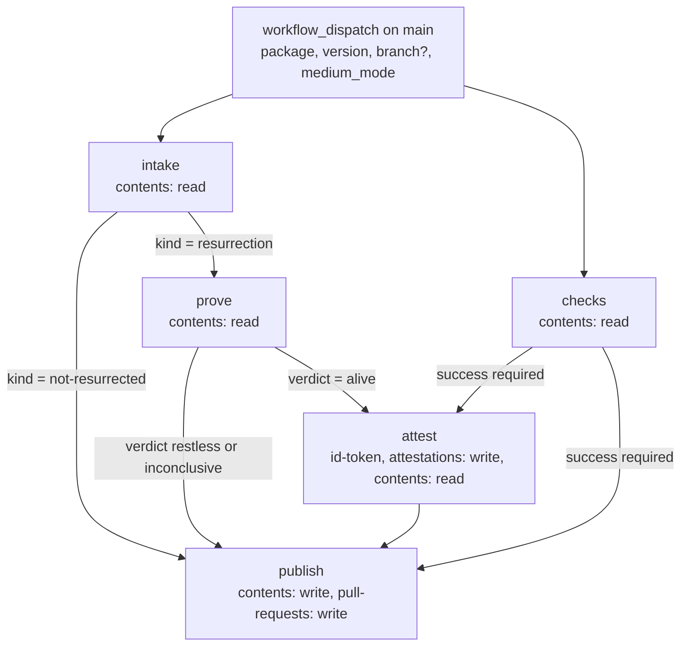
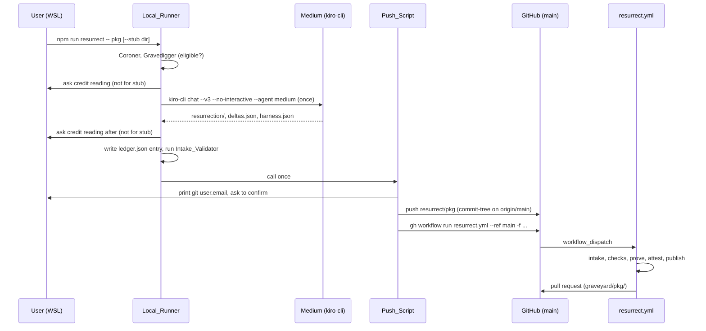

# Design Document

## Overview

The Resurrection Pipeline connects the Autopsy_Engine (`src/engine/`) and the Proof_Engine (`src/proof/`) to the Medium and publishes the result as a pull request with a signed Proof of Life. This design covers everything between a Death_Certificate and a committed Graveyard_Entry, plus the nightly re-verification. It follows `requirements.md` (requirement numbers are cited as `R<n>.<m>`) and the user's journal decisions J1 to J10, which are fixed.

Four facts shape the design:

1. **Only the Medium calls an LLM, and only on the user's machine.** The Local_Runner starts it once, records the user's credit meter readings, and hands over three paths (`resurrection/`, `deltas.json`, `harness.json`) through a temporary branch. Everything else is deterministic code.
2. **CI trusts nothing from the branch except those three paths, and treats them as data.** CI re-runs the Coroner and the Gravedigger, validates the paths (Intake_Validator), checks the necromancy laws, compiles the harness from declarative JSON, and only then runs the Resurrection, inside the Sandbox_Executor, in a job that holds no write permission.
3. **A signature exists only for the verdict `alive` and only after typecheck, lint and the full suite passed.** The `attest` job and the `publish` job both depend on the `checks` job. A failing check stops the run with no attestation, no pull request and no entry.
4. **An ineligible package is a valid outcome.** A dispatch without a branch runs the Coroner and the Gravedigger in CI and, when the three checks pass, proposes a Not_Resurrected_Entry. The inflight rest-in-peace card is produced this way.

### Key design decisions

| Decision | Rationale |
|---|---|
| Pure `core/` and I/O `shell/` directories under each role, as in `src/engine` and `src/proof` | The determinism lint scope (no `Date.now`, no `Math.random`) extends to `src/pipeline/**/core/**` with one glob. Tests inject fakes for the shell. |
| Intake reads the branch through git plumbing (`ls-tree`, `cat-file --batch`) and never checks the branch out | Hostile paths (case collisions, `..`, symlinks, `.github/`) never touch a working tree. The validator is a pure function of (path, type, size, bytes) entries (R9.12). |
| The Push_Script builds its commit with a temporary index on top of `origin/main` | The commit contains `origin/main`'s tree plus three paths, by construction. The user's working tree, index and branch are untouched, and `ledger.json` cannot be included (R8.2, R8.11). |
| The harness is compiled from data inside a trusted shim that the proof CLI loads (`runCli` with an injected `loadHarness`) | No code from the Medium is ever imported. Presets are reviewed repository code (R5). |
| `publish` has a minimal YAML `if` and an authoritative pure `publishGate` evaluated in its first step | The gate logic is unit-tested as a pure function. The YAML condition only guarantees the `checks` and `intake` precondition even if the script were skipped (R11.17). |
| One entry-layout module defines file names, kinds and the single `deriveEntryKind` function | Writer, nightly reader, tests and docs cannot drift (R14.12, R14.15). |
| Nightly classification returns a list of results with a fixed precedence, and the run fails if any listed result is a failing kind | R16.18 makes `tool-versions-changed` the primary result whenever the Tool_Versions differ. The list stops that from hiding a failed attestation. This refines R16 and is flagged in "Design decisions beyond the requirements". |
| `fast-check` for property tests, `vitest` project `pipeline` | Same tooling as the engine and the proof engine (R21.5, R21.9). |

### Research summary

- **Pinned Node version.** The manifest `actions/node-versions` (`versions-manifest.json`, the source `actions/setup-node` downloads from) lists `26.13.1` first, with `stable: true`, `lts: "Lithium"`, release tag `26.13.1-43134154182`, a `node-26.13.1-linux-x64.tar.gz` asset, and a release published on 2026-11-12T01:26:03Z ([manifest](https://raw.githubusercontent.com/actions/node-versions/main/versions-manifest.json), [release](https://api.github.com/repos/actions/node-versions/releases/tags/26.13.1-43134154182), both fetched 2026-11-15). Decision D1 below.
- **`GITHUB_TOKEN` and triggers (A5).** Content was rephrased for compliance with licensing restrictions. The GitHub page "Triggering a workflow" ([source](https://docs.github.com/en/actions/using-workflows/triggering-a-workflow), fetched 2026-11-15) says events caused by the repository's `GITHUB_TOKEN` do not create new workflow runs, with two exceptions. First, `workflow_dispatch` and `repository_dispatch` always create runs. Second, `pull_request` events with the activity types `opened`, `synchronize` or `reopened` create runs in an approval-required state when a workflow using `GITHUB_TOKEN` creates or updates a pull request, and a user with write access can start them from the merge box. This is newer than the wording of assumption A5 ("does not start `ci.yml`"). Decision D3 below adapts the pull request wording. **Observed 2026-11-16 (user-run, first stub pull request):** the `push` of the publish branch started no `ci.yml` run; the `pull_request` event created a `ci.yml` run with conclusion `action_required` (waiting for approval); the pull request showed "No checks". The wording of A5 ("does not start `ci.yml`") is therefore not what happens: the run is created and waits for approval.
- **Pull request creation by Actions** is a repository setting, "Allow GitHub Actions to create and approve pull requests" ([source](https://docs.github.com/en/repositories/managing-your-repositorys-settings-and-features/enabling-features-for-your-repository/managing-github-actions-settings-for-a-repository), fetched 2026-11-15). For a personal-account repository it is off by default.
- **Attestation.** Spike 4 (`spikes/attest/DECISION.md`, `spikes/attest/README.md`, user-run 2026-11-15) confirmed `actions/attest` at `1e69f48acb82d1966a394da916b4c1698aa569d6` (v4.2.2) with `id-token: write`, `attestations: write`, `contents: read`, a custom predicate, and `gh attestation verify --predicate-type --signer-workflow` (gh 2.104.0). Not confirmed: JSON field names, the exit code of the failing case, offline verification.
- **Existing workflows.** `ci.yml` and `spike-attest.yml` already pin `actions/checkout@3d3c42e5aac5ba805825da76410c181273ba90b1` (v7.0.1), `actions/setup-node@949feb2413d6458794dcd2491c4babbbce0c15c1` (v7.1.0), `actions/upload-artifact@cf430e030ddbb5b0abf93d22962f4752f3646cd9` (v7.0.2) and `actions/download-artifact@9000827ccba6bdab643e8b6fd33ac0654aef8333` (v8.0.2), on `ubuntu-24.04`. The new workflows reuse these SHAs. `ci.yml` uses `node-version: 26`, a major alias.
- **Proof engine seams used here.** `runCli(argv, deps)` in `src/proof/cli.ts` takes an injected `loadHarness`; `ProofReportSchema` records `seed`, `toolVersions` (`node`, `fastCheck`, `reportSchema`), `sandbox.limits.casesRequested` and `functionsTested`; `src/proof/harnesses/lodash.set/config.ts` exports `prototypePollutionDelta`, `pathHasDangerousSegment` and `POLLUTION_MODULE_PATH`; `fallbackReport` in `src/proof/core/report.ts` builds the inconclusive report for a harness error.

## Decisions that settle the open points

### D1: Pinned_Node_Version

**Decision: `26.13.1`**, written as an exact `major.minor.patch` string in `actions/setup-node` in `resurrect.yml` and `nightly.yml`, and as `PINNED_NODE_VERSION` in `src/pipeline/common/constants.ts`.

How it was chosen (R12.6, A13, U2):

1. The candidate list is the set of versions that `actions/setup-node` can install, which is the `actions/node-versions` manifest. The local Node versions (Windows 26.13.1, WSL 26.8.2) played no part. It is a coincidence that the first manifest entry equals the Windows version; the choice would be the same with any local version.
2. Rule: the newest manifest entry with `stable: true` and a `lts` label that has a `linux-x64` file (the runner is `ubuntu-24.04`, x64). On 2026-11-15 that is `26.13.1`. The proof engine needs the permission model, so the version must stay at 26 or newer (`ci.yml` header comment).
3. The previous entries in the manifest are `26.13.0` and `26.12.1`. `ci.yml` already resolves the alias `26` to the newest manifest entry on every run, so the existing suite ran on that line.

Consequences: `toolVersions.node` of every committed Proof_Report is `26.13.1` (the Proof_Engine reads it from the running installation, R12.7). A step `node --version` in each job compares the running version with `PINNED_NODE_VERSION` and fails the job on a difference, so a silent fallback of the setup action cannot change a report. A bump needs one commit that changes the constant and both workflows (lint test, R12.8) and a Journal entry (R12.9). After a bump the nightly run reports `tool-versions-changed` for every committed entry until its proof is re-run.

Date of the research: 2026-11-15. **To verify (user, CI run):** (a) `actions/setup-node` installs exactly `26.13.1` on `ubuntu-24.04` (the `node --version` step prints it); (b) the full suite passes on exactly that version in the `checks` job (it has only been run on the alias `26` and locally). Not confirmable from here: whether the hosted image already has this version in its tool cache. It does not matter, because setup-node downloads it from the manifest when missing.

### D2: Branch name of the publish job

**Decision:** `publish/<slug>-run<run_id>-a<run_attempt>`, used on both paths (with and without a Resurrection_Branch). `<slug>` is the package name with every character outside `[a-z0-9-]` replaced by `-`. Example: `publish/lodash-set-run43760001234-a1`.

- It never starts with `resurrect/`, so it cannot collide with the user's branch `resurrect/<package>`, and `git push origin --delete resurrect/<package>` never touches it.
- `github.run_id` is unique per dispatch, and `github.run_attempt` increases on every re-run of the same run. A new dispatch therefore never collides, and neither does a re-run (R14.7: a second dispatch for the same package opens a second pull request that replaces the entry's files relative to `main`; the earlier version stays in git history).
- Pure function `publishBranchName({ package, runId, runAttempt })` validates `runId` and `runAttempt` as positive integers and returns a `Result`. The output always matches `^publish/[a-z0-9-]+-run[0-9]+-a[0-9]+$`, which is a valid git ref name. Replacing characters is not injective, but the run id makes the name unique.
- **Re-run and collision behaviour.** The check runs twice, through one shared function (`checkPublishCollision`): first in `intake` (step `check-publish-branch`, before `prove` and `attest` exist in the run, so a re-run signs nothing when a branch is left over; found in the step (c) re-run, where `attest` had signed new attestations before `publish` failed), then again in `publish` before pushing (it closes the window between the two). The glob has no attempt number, so it matches every earlier attempt of the same run. Before pushing, the job runs `git ls-remote --heads origin "publish/<slug>-run<run_id>-*"`. If any branch matches (an earlier attempt of this run got as far as the push), the job fails with a message that names the branch and prints the command `git push origin --delete <branch>`. It never force-pushes, never deletes a branch itself, and never reuses a branch. If the earlier attempt already opened a pull request, the user closes it first. This is the same policy as R8.3 for the user's branch.
- Open pull requests of earlier dispatches stay open. The job lists them in the job summary (`gh pr list --search "head:publish/<slug>-" --state open`) so that the user can close them. It does not close or modify them.
- **To verify (user, first stub run and a re-run of it):** the `ls-remote` glob matches as expected, and the failure message appears on a re-run after a successful publish.

Scoped package names (`@scope/name`) are outside the three demo packages. `isSupportedPackageName` in `common/packageNames.ts` rejects them with the reason "scoped packages are not supported by this pipeline", because the paths `graveyard/<package>/` and `resurrect/<package>` would nest. This restriction is not in the requirements. See "Design decisions beyond the requirements".

### D3: `GITHUB_TOKEN` trigger behaviour (A5)

What the design relies on, from the GitHub page cited in the research summary:

| Event | Created with `GITHUB_TOKEN` | Consequence in this design |
|---|---|---|
| `push` of the `publish/...` branch | No new run | `ci.yml` does not run on the push. |
| `pull_request` `opened` of the pull request | A run is created, approval-required, shown with an "Approve workflows to run" banner for a user with write access | `ci.yml` may appear as waiting, not as passed. The pull request body lists the checks of the dispatch run, which passed before the pull request exists (R15.10). It also says the Existing_CI may wait for approval and can be run with `workflow_dispatch` on the branch (R15.12). |
| `workflow_dispatch` | Always creates a run | `ci.yml` gets a `workflow_dispatch` trigger. The design never dispatches it from a workflow (R15.13). |
| `issues` (nightly issue) | No new run | No workflow listens to issues. |

Design response: the `checks` job of `resurrect.yml` runs `npm run typecheck`, `npm run lint` and `npm test` on `main` and gates `attest` and `publish`. The pull request is not the place where checking happens. No personal access token and no GitHub App are used.

The wording of R15.12 ("not started automatically") is replaced in the pull request body by the sentence in `prText.ts`: "The existing CI workflow may not run for this pull request, or may wait for approval, because the pull request was opened with the workflow token. The checks listed above ran in the dispatch run." This keeps the claim true under both readings.

**Observed 2026-11-16 (user-run, first stub run):** (1) the `push` started no `ci.yml` run; (2) the `pull_request` event created `ci.yml` run 43847801159, `action_required`; (3) the pull request showed "No checks"; (4) the setting was on and `gh pr create` worked. Original checklist: (1) the `push` of the `publish/...` branch starts no `ci.yml` run; (2) the `pull_request` event creates an approval-required `ci.yml` run, or none (record which); (3) the merge box shows what the user expects; (4) the repository setting "Allow GitHub Actions to create and approve pull requests" is on, otherwise `gh pr create` fails and the job prints the setting name (R15.8). All four are user-run, because they need the repository and its settings.

### D4: Job layout, including the path without a branch

Jobs of `resurrect.yml`: `intake`, `checks`, `prove`, `attest`, `publish` (R11.4). They exchange data only through artifacts (R11.4) and job outputs that carry validated, enumerated or numeric values only.



| Job | With a branch, eligible | With a branch, not eligible | No branch, not eligible | No branch, eligible |
|---|---|---|---|---|
| `intake` | runs, `kind=resurrection` | runs, reads no branch, `kind=not-resurrected` | runs, `kind=not-resurrected` | runs, **fails** with "a Resurrection_Branch is required" (A14) |
| `checks` | runs | runs | runs | runs (result irrelevant, nothing follows) |
| `prove` | runs | skipped | skipped | skipped (intake failed) |
| `attest` | runs only when `checks` succeeded and verdict is `alive` | skipped | skipped | skipped |
| `publish` | runs when `checks` succeeded and (verdict is not `alive` or `attest` succeeded) | runs when `checks` succeeded | runs when `checks` succeeded | skipped |

`needs` and `if` (exact text in "Workflow YAML"):

- `checks`: no `needs`. It reads no input and no Medium_Output, so it runs in parallel with `intake`.
- `prove`: `needs: intake`, `if: needs.intake.outputs.kind == 'resurrection'`. Implicit `success()` skips it when `intake` failed.
- `attest`: `needs: [intake, checks, prove]`, `if: needs.prove.outputs.verdict == 'alive'`. Implicit `success()` means `intake`, `checks` and `prove` all succeeded. A skipped need skips this job.
- `publish`: `needs: [intake, checks, prove, attest]`, `if: ${{ !cancelled() && needs.intake.result == 'success' && needs.checks.result == 'success' }}`. Because `prove` and `attest` are skipped on some paths, `!cancelled()` replaces the implicit `success()`. The first step runs `publishGate` with the four results and the verdict; when it answers "no" (for example `prove` or `attest` failed), the later steps are skipped and the job ends green with the reason in the job summary. The run is already red because of the failed job, and no pull request is opened.

Permissions per job (least privilege, R11.5 to R11.8). Workflow default `permissions: {}`.

| Job | Permissions | Runs package code? | Token use |
|---|---|---|---|
| `intake` | `contents: read` | No. It parses and packs data. It runs only Coroner, Gravedigger, validator, necromancy gate and the packer from `main`. | `GITHUB_TOKEN` is passed only to the Coroner and Gravedigger step and to the step that resolves the Branch_Commit, never to a step that reads branch content (R11.3). |
| `checks` | `contents: read` | Repository tests only (`main`). | none |
| `prove` | `contents: read` | Yes: Original and Resurrection, only through the Sandbox_Executor. | none |
| `attest` | `id-token: write`, `attestations: write`, `contents: read` | No. | `actions/attest` uses its own token input default. |
| `publish` | `contents: write`, `pull-requests: write` | No. | `GH_TOKEN` only on the push and `gh pr create` steps. |

In `attest` and `publish`, `npm ci --ignore-scripts` is used, so that no dependency lifecycle script runs in a job that holds a write or OIDC capability. **To verify (agent, at task time, then confirmed by the user's first CI run):** the scripts run with `tsx` without install scripts.

## Architecture

### The four roles and where they run

| Role | Code or configuration | Runs where | LLM |
|---|---|---|---|
| Coroner | `src/engine/` (unchanged) | Local_Runner (for the Medium's certificate), `intake` job, nightly job | no |
| Gravedigger | `src/pipeline/gravedigger/` | Local_Runner, `intake` job | no |
| Medium | Agent definition and MCP server belong to spec (b). In this spec only `src/pipeline/medium/` exists: the fixed prompt and the argument list for `kiro-cli` | the user's WSL clone `~/graveyard-shift` | yes |
| Undertaker | `src/pipeline/undertaker/`, `scripts/ci/*`, `.github/workflows/resurrect.yml` (`attest`, `publish`), `.github/workflows/nightly.yml` | CI | no |

`src/pipeline/local/` (Local_Runner, Push_Script logic, Ledger) and `src/pipeline/intake/`, `harness/`, `necromancy/` are shared deterministic units, not roles. No module imports from two role directories except through `common/`.

### End-to-end flow



### Module layout

```
src/pipeline/
  common/            constants.ts (PREDICATE_TYPE, REPO, SIGNER_WORKFLOW, PINNED_NODE_VERSION, GH_MIN_VERSION, CREDIT_CEILING, INTAKE_LIMITS),
                     packageNames.ts (wraps src/engine/parse/packageName.ts; unscoped only), branchNames.ts (resurrectBranchName, publishBranchName),
                     canonical.ts (key-order table helper over canonical JSON), result.ts (re-export of the engine Result)
    shell/system.ts  the single entry for the real clock, secure random seed and process environment (injectable, R1.6)
  gravedigger/
    core/            rules.ts (7 rules, line counter), eligibility.ts (schema, canonical JSON, deserialize), record.ts (buildEligibilityRecord)
    shell/           gravedigger.ts (fetch packument and tarball, sha512, read package.json from the tarball bytes through the proof tarball extractor)
  medium/
    core/            prompt.ts (fixed text with the package name), kiroArgs.ts (argv list)
    shell/           kiroRunner.ts (spawn without shell, scrubbed env)
  local/
    core/            cliArgs.ts, ledger.ts (schema, build, append, canonical JSON), stubPlan.ts, pushPlan.ts (commit paths, dispatch argv), usage.ts
    shell/           resurrect.ts (orchestration with injected deps), push.ts, prompt.ts (readline), atomicWrite.ts, gitPlumbing.ts
  intake/
    core/            validator.ts, limits.ts, types.ts
    shell/           gitEntries.ts (ls-tree, cat-file reading of one commit), fsEntries.ts (lstat reading for the local runner)
  necromancy/
    core/            gate.ts, authors.ts (credit normalization)
  harness/
    core/            deltas.ts, harnessFile.ts, compiler.ts, ipMeasurement.ts (schema, deriveIpDeltas), presets/{index,lodashSet,ipAddress}.ts
    sandbox/         returnsExpected.cjs (sandbox-side property module), ipSetup.cjs (replaces os.networkInterfaces identically on both sides)
  undertaker/
    core/            layout.ts (file names, EntryKind, deriveEntryKind, planEntryFiles), predicate.ts, gates.ts (attestDecision, publishGate),
                     prText.ts, verifyCommands.ts, nightlyClassify.ts, nightlyReport.ts, dispatchInputs.ts (validateDispatchInputs)
    shell/           ghCli.ts (argv builders and JSON parsing for gh), publish.ts (entry writer, git push, gh pr create), replay.ts, nightly.ts
scripts/
  resurrect.ts                 npm run resurrect (thin: builds deps, calls src/pipeline/local/shell/resurrect.ts)
  push-resurrection.ts         Push_Script entry (thin)
  measureIp.ts                 ip measurement (R3), runs the Original in the Sandbox_Executor, offline
  recordTarball.ts, lib/recordTarball.ts   generalized: --package <name> --version <v>, default lodash.set@4.3.2 (R3.9)
  ci/intake.ts prove.ts checks-summary.ts attest.ts publish.ts nightly.ts nightly-notify.sh   workflow step entries (thin)
tests/pipeline/{unit,property,integration,fixtures,helpers}/
  fixtures/stub/lodash.set/    the Stub_Fixture, exactly three entries, mirroring the Medium_Output (R23.2, R23.18 to R23.20; see "Stub_Fixture layout"):
                                 resurrection/   the package files (copy of tests/proof/fixtures/lodash.set-alive with name @graveyard-shift/lodash.set, version 4.3.3)
                                 deltas.json
                                 harness.json
docs/measurements/ip-2.0.1.json   committed result of the ip measurement (written by scripts/measureIp.ts)
graveyard/<package>/         committed entries (created only by the publish pull request)
ledger.json                  written in the WSL clone; committed and pushed to main from there by the user, then pulled into the Windows clone
.github/workflows/resurrect.yml, nightly.yml; ci.yml gets workflow_dispatch
```

Scope rules:

- `eslint.config.mjs` adds `src/pipeline/**/core/**/*.ts` to `deterministicFiles`. `common/shell/system.ts` is the only reader of the clock, the random source and `process.env` outside the other `shell/` directories (R1.6).
- `npm run lint` is `eslint src tests`, so `scripts/` is not linted. A source-scan test (`tests/pipeline/unit/sourceScan.test.ts`) covers `src/pipeline/` and `scripts/` for LLM client imports (R1.5), `shell: true`, `exec(` with a string, and `console.` outside the documented entries.
- `src/pipeline` imports `src/engine` and `src/proof` only through their public `index.ts` and the two named internals: `src/proof/cli.ts` (`runCli`) and `src/proof/core/report.ts` (`fallbackReport`). `src/engine` and `src/proof` import nothing from `src/pipeline`.
- The vitest project `pipeline` (`tests/pipeline/**/*.test.ts`) is the one new project (R21.9). The target is 90 s as a target, not a measurement. `budgetReporter.ts` gets one table entry.

## Components and Interfaces

### Common

```ts
export const PREDICATE_TYPE = "https://github.com/subair99/graveyard-shift/attestation/resurrection/v1";
export const REPO = "subair99/graveyard-shift";
export const SIGNER_WORKFLOW = "subair99/graveyard-shift/.github/workflows/resurrect.yml"; // no ref (spike 4)
export const PINNED_NODE_VERSION = "26.13.1";
export const GH_MIN_VERSION = "2.67.0";
export const CREDIT_CEILING = 150;
export const INTAKE_LIMITS = { maxFiles: 200, maxFileBytes: 1_048_576, maxTotalBytes: 5_242_880, maxDepth: 8, maxControlFileBytes: 65_536 } as const; // chosen upper bounds, A2
export const ALLOWED_MEDIUM_PATHS = ["resurrection/", "deltas.json", "harness.json"] as const;
```

`PREDICATE_TYPE` is the only place with the string (R13.8). The workflow YAML does not contain it: the `attest` step reads it from the output of `scripts/ci/attest.ts prepare`. The workflow file names and the Signer_Workflow path are working names (A3).

`resurrectBranchName(pkg)` returns `resurrect/<pkg>`. `publishBranchName` is D2.

### Gravedigger

```ts
type RuleId = "license" | "dependencies" | "module-type" | "line-count" | "status" | "causes" | "open-vulnerability";
interface GravediggerDeps { fetch: typeof fetch; clock: Clock }   // clock read once, for every Fetch_Date
function runGravedigger(cert: DeathCertificate, deps: GravediggerDeps):
  Promise<Result<{ record: EligibilityRecord; tarball: Uint8Array | null }, GravediggerError>>;
function evaluateRules(input: { pkg: PackageJsonLike | null; lineCount: number | null; cert: DeathCertificate }): RuleResult[]; // pure
function countLines(files: readonly { path: string; bytes: Uint8Array }[]): number;                                   // pure
```

- Steps (R2.1, R2.2): fetch the packument `https://registry.npmjs.org/<name>` and the tarball URL from `versions[version].dist.tarball` (the registry host is checked; redirects are refused as in `recordTarball`), compute sha512 SRI of the bytes, compare with `dist.integrity`. On a mismatch the record has `eligible: false`, `reason: "integrity-mismatch"` with both strings, and `tarball` is `null`.
- Rules (R2.3): (a) license is a plain SPDX id in the set; (b) `dependencies` absent or empty; (c) `type` is not `module`; (d) `countLines` at most 5,000; (e) `cert.status` is `dead` or `dying`; (f) `cert.causes` non-empty; (g) `cert.openVulnerabilityIds` non-empty. A rule whose field cannot be read has `holds: false`, `reason: "unverified"` and `missingField` (R2.6). `retired-with-successor` fails (e) and records `cert.successor` (R2.8). If `cert.status` is absent because of `statusError`, rule (e) is `unverified` with `missingField: "status"`. If `cert.vitalSigns.openVulnerabilities` is unavailable, rule (g) is `unverified` with `missingField: "openVulnerabilities"` (R2.6), never "holds false, observed 0".
- `countLines` (R2.4): a text file is a file whose bytes contain no NUL and decode as strict UTF-8. Its lines are the number of `\n` plus one if the last byte is not `\n` and the file is not empty. The sum is taken over all text files of the tarball bytes. `dist.unpackedSize` is never read. (The exact definition of "text file" and "line" is a design choice; the 5,000 limit is the product rule.)
- Every Fact carries `{ sourceUrl, fetchedAt }` (R2.7). The tarball-derived rule facts (`license`, `dependencies`, `module-type`, `line-count`) cite the tarball URL, and `integrity.expected` cites the packument URL, each with the Gravedigger's single `clock.now()` read. The certificate-derived facts `rule.status`, `rule.causes` and `rule.open-vulnerability` carry the union of the provenance of the contributing certificate facts, with the Coroner's own fetch dates (no Gravedigger date), deduplicated, ordered by `sourceUrl` then `fetchedAt` (the autopsy-engine order), stale if any contributor is stale, and capped at the first 20 entries (autopsy-engine R3.4). Such a fact is omitted when no contributing certificate fact exists. Contributing keys: `rule.causes` = `maintainers`, `githubRepo`, `openVulnerabilities`, `timeOfDeath`; `rule.status` = `successor`, every `successorLookup:*`, `deprecation`, plus the cause keys and the risk keys (`maintainers`, `openVulnerabilities`, `scorecard`, `dependents`, `weeklyDownloads`); `rule.open-vulnerability` = `openVulnerabilities`. No absolute local path enters the record: the tarball is referred to by name only.

### Intake_Validator

```ts
type EntryType = "file" | "symlink" | "hardlink" | "submodule" | "device" | "other";   // directories are not entries
interface IntakeEntry { path: string; type: EntryType; size: number; bytes?: Uint8Array } // bytes present for regular files under the allowlist
interface Violation { path: string; code: ViolationCode; message: string }
function validateIntake(entries: readonly IntakeEntry[]): { ok: true; files: readonly IntakeEntry[] } | { ok: false; violations: readonly Violation[] };
```

Pure function of its input and the same code in the Local_Runner (`fsEntries.ts`, `lstat`), the Push_Script (again, R8.1) and CI (`gitEntries.ts`) (R9.12). Order of checks, each producing its own violation codes (all violations are listed, sorted by path then code):

1. `bad-path`: absolute path, `..` segment, backslash, NUL, drive prefix (`^[A-Za-z]:`), empty segment, a segment `.git`, `.github` or `.kiro` (R9.6).
2. `outside-allowlist`: path not under `resurrection/` and not exactly `deltas.json` or `harness.json` (R9.5).
3. `link`: type `symlink`, `hardlink`, `submodule`, `device` or `other` (R9.6).
4. `case-collision`: two paths equal under `toLowerCase()` (R9.6).
5. Limits (R9.7): more than 200 files under `resurrection/` (`too-many-files`), a file above 1 MiB (`file-too-large`), a total above 5 MiB (`total-too-large`), a path of more than 8 segments (`too-deep`), `deltas.json` or `harness.json` above 64 KiB (`control-file-too-large`). A value at the limit is accepted; one above it is rejected.
6. Required (R9.8): `resurrection/`, `deltas.json` and `harness.json` present; `resurrection/package.json` present (`missing-required`).
7. Content (R9.9): extension in `.js .cjs .json .md .txt` or the file is named `LICENSE`, otherwise `bad-extension`; text extensions must be strict UTF-8 (`bad-encoding`).

How `gitEntries.ts` fills the entries in CI (R9.3, R9.4): resolve the branch once (`gh api repos/<repo>/git/ref/heads/resurrect/<pkg> --jq .object.sha`), fetch the ref, verify the fetched tip equals the resolved SHA (if the branch moved, fail with "branch changed during intake"), compute the merge base with `main`, list the changed paths with `git diff --raw -z --no-renames <merge-base> <sha>` (mode and blob id per path), read blob sizes with `git cat-file --batch-check`, and read bytes with `git cat-file --batch` only for allowlisted regular files that pass the size limits. Git modes map to types: `100644` and `100755` to `file`, `120000` to `symlink`, `160000` to `submodule`, everything else to `other`. A changed path outside the allowlist is a violation, which makes R9.5 meaningful for a branch that carries all of `main`. Nothing is checked out. The validated files are then written to `work/medium/` by the packer, not by git.

**To verify (user, first stub run):** an anonymous `git fetch` of `refs/heads/resurrect/<pkg>` works in the `intake` job after `actions/checkout` with `persist-credentials: false` (the repository is public); the merge base is found with `fetch-depth: 0`. If the fetch needs a token, the fetch step gets `GH_TOKEN` and nothing else changes, because it reads no file content itself.

### Necromancy gate

```ts
interface NecromancyInput { original: PackageJson; resurrection: PackageJson; originalLicense: LicenseFile | null; resurrectionLicense: LicenseFile | null }
interface NecromancyResult { ok: boolean; checks: { id: NecromancyCheckId; ok: boolean; message: string }[] }
function checkNecromancy(input: NecromancyInput): NecromancyResult;   // pure (R10.9)
```

Checks (R10.1 to R10.6): `license` equal to the Original's; `license-file` present with identical bytes when the Original has one (a root file named `LICENSE`, `LICENCE`, with or without an extension, case-insensitive); `author-credits`: every author of the Original (`author` plus `contributors`, string or object form, normalized to lowercase trimmed name, email, url) appears in the Resurrection; `version`: `semver.gt(res, orig)`, same major, no prerelease (a patch or minor increase); `name` equals `@graveyard-shift/<original name>`; `forbidden-fields`: no new dependency name (a name in the Resurrection's `dependencies` that the Original lacks; `dependencies: {}` passes), no `scripts` entry named `preinstall`, `install`, `postinstall` or `prepare`, no `bin`, `type` not `module`. All checks run and all failures are listed. API-surface checks stay in the Proof_Engine (R10.7). `intake` runs the gate after the validator and before packing; a failure ends the job (R10.8).

### Harness: Deltas_File, Harness_File, presets and compiler

```ts
function parseDeltasFile(json: string): Result<DeltasFile, ParseError>;     // ParseError names the failing path
function canonicalDeltasJson(f: DeltasFile): string;
function parseHarnessFile(json: string): Result<HarnessFile, ParseError>;
function canonicalHarnessJson(f: HarnessFile): string;
function compileHarness(input: {
  deltas: DeltasFile; harness: HarnessFile; certificate: DeathCertificate;
  measurement?: IpMeasurement;                      // required when package is "ip"
}): Result<CompiledHarness, CompileError[]>;        // never throws (R5.11)
interface CompiledHarness { config: HarnessConfig; presetsUsed: string[] }   // no radius field: CI always passes the full radius (R12.12, "ip coverage")
```

- **Preset menu** (`presets/index.ts`): `lodash-set` (functions: `default`) reuses `ordinaryArgs`, `ordinaryExplicitCases` from `src/proof/harnesses/lodash.set/config.ts`. `ip-address` (functions: one entry per exported function of ip@2.0.1, see "ip coverage") uses the form table of `spikes/candidates/IP-SKETCH.md` with explicit cases for the five Advisory_Addresses, and `setupModule: ipSetup.cjs` for both sides (R5.8). Each preset declares `functions`, `deltaFunctions` (the allowlist of functions that may carry a delta: `ip-address` `["isPublic"]`, `lodash-set` `["default"]`; R4.20), `inputClasses` (the class menu: name to a pure parent-side predicate over the argument array; `ip-address` has `non-public-address`, `lodash-set` has none; R4.16), an options schema (strict zod), and `build(options)` returning a `FunctionHarness`. The Harness_File selects a preset per function and may give only declared options (R5.1).
- **Forbidden content** (R5.2 to R5.4, R4.8): both files are parsed with strict schemas. A key from the list `functions`-level `excluded`, `radius`, `caseCount`, `seed`, `perCallTimeoutMs`, `stubs`, `accept`, `args`, `setupModule`, `propertyModule`, `generator`, `predicate`, any value that is a function or code string, or an unknown preset gives a `CompileError` with the key or preset name and, for the CI-owned keys, the words "belongs to CI" (A11). The compiled `HarnessConfig` takes `seed`, `caseCount` (100), and timeouts from the CI caller (`prove.ts`), never from the files.
- **Delta rules** (R4.2 to R4.7): kind in `{prototype-unchanged, returns-expected, returns-expected-class}` (R4.2); `function` in the `deltaFunctions` allowlist of the preset that tests it, else `CompileError` naming the delta and the function (R4.13, R4.20, closes the gap of R4.13); for `returns-expected-class`, `class` in the `inputClasses` menu of that preset, else `CompileError` naming the delta and the class (R4.16); `advisory` in `certificate.openVulnerabilityIds` or in an alias list of `certificate.vitalSigns.openVulnerabilities` (CompileError names the delta id and the identifier); `function` in the `functions` list of a preset the Harness_File selects (this is the compile-time form of "exported by the Original"; the Proof_Engine's own check that a delta's function is tested, `orchestrator.ts` "names function ... which is not tested", is the run-time form); each `returns-expected` and `returns-expected-class` case carries `source: { url, fetchedAt }`; the `ip` measurement rule: every `returns-expected` input and every explicit `returns-expected-class` case must be listed as `true` in `measurement` (A10, R3.6, R3.7); the informational inputs `0` and `017700000001` are rejected as explicit cases (they may still fall in the class by predicate).
- **Compilation** (R4.3, R4.4): `prototype-unchanged` becomes a `DeclaredDelta` that reuses `pathHasDangerousSegment`, `dangerousArgs`, `deltaExplicitCases` and `POLLUTION_MODULE_PATH` with the delta's `id` and function. `returns-expected` becomes a `DeclaredDelta` with `predicate` an equality test on the listed inputs (deep equality on the argument arrays), `explicitCases` the listed inputs, and `propertyModule` = `sandbox/returnsExpected.cjs`, which reads the expected value from the harness data the compiler passes in the delta's explicit-case metadata and checks that the Resurrection returned it. Decided (V14, read from the code): the engine offers no data channel (`ctx` carries `functionName`, `kind`, `prototypeDelta` and `result`, no arguments), so the compiler generates one property module file per delta from a template in the work directory (data, not Medium code) and passes its absolute path, with the expected value embedded. Because the module sees only `result`, every case of one `returns-expected` delta must have the same expected value. The compiler rejects a delta whose cases differ, with an error that names the delta and says to split it (error code `delta-expected-differs`). For ip the old per-case form (one `returns-expected` delta with the five addresses) is replaced by the class kind below.
- **Compilation of `returns-expected-class`** (R4.15): the compiler looks up the class in the preset's `inputClasses` and lowers the delta to a `DeclaredDelta` whose `predicate` is that class predicate (parent side, repository code, evaluated on the argument array of each generated call), whose `explicitCases` are the listed `cases` inputs (so the Demonstration must fail on the Original for at least one of them, as for the other kinds), and whose `propertyModule` is a generated `returnsExpected.cjs` with the single `expected` value embedded, the same template as `returns-expected`. A call selected by the class whose Resurrection result differs from `expected` is a Divergence; a call outside the class is compared against the Original. One expected value per delta, so `delta-expected-differs` does not apply (there is only one `expected` field). The Verdict stays `alive` only if every divergence falls in the declared class and equals `expected`; a divergence of a call that the predicate does not select is not covered by the delta (declared-delta semantics of the proof-of-life-engine spec, as for the other kinds), so the Verdict is `restless` for it. Task 12.13 measures this on `ip-alive`.
- The compiler is a pure function of its inputs. `ordered` helpers sort deltas by `id` code point so that two compilations give equal results (R5.5).

### ip measurement and delta derivation

```ts
const IpMeasurementSchema = z.object({
  schemaVersion: z.literal(1), package: z.literal("ip"), version: z.literal("2.0.1"),
  integrity: Sri512, node: z.string(), measuredAt: UtcTimestampSchema,
  advisory: z.object({ id: z.literal("GHSA-2p57-rm9w-gvfp"), aliases: z.tuple([z.literal("CVE-2024-29415")]),
    sources: z.array(z.object({ url: SourceUrl, checkedOn: IsoDate })) }),
  results: z.array(MeasuredInput).length(5),          // the five Advisory_Addresses, fixed order
  informational: z.array(MeasuredInput),              // "0", "017700000001" (R3.11)
});
type MeasuredInput = { input: string; outcome: { kind: "returned"; value: JsonValue } | { kind: "threw"; error: string } };
function deriveIpDeltas(m: IpMeasurement): { addresses: string[]; ipInDemo: boolean };   // pure
```

`addresses` holds exactly the `results` whose outcome is `returned` with the value `true` (A10); `ipInDemo` is `addresses.length > 0`. A thrown error or any other value yields no delta for that address (R3.8). `informational` never influences the result (R3.11) and never becomes an explicit case, although the class predicate may cover those inputs (A10, A18). `checkedOn` is the date the user checked the advisory text (2026-11-15, as in IP-SKETCH.md), not a Fetch_Date, because the agent did not fetch the pages. `scripts/measureIp.ts` runs the Original through the `Executor` interface of the proof engine (`createSandboxExecutorFactory`, open side, call) on the recorded tarball `tests/proof/fixtures/ip/ip-2.0.1.tgz`, with no network, and writes `docs/measurements/ip-2.0.1.json`. Recording the tarball (`npm run fixtures:record-tarball -- --package ip --version 2.0.1`) needs network and is a Manual_Task. The Journal entry is written by the user from the printed result (R3.4).

### ip coverage (exports, generators, radius, verdicts)

**Source of the export list: read from the recorded tarball (V16 answered on 2026-11-16).** The export list is the 20 function exports printed by `scripts/measureIp.ts` on the recorded tarball `tests/proof/fixtures/ip/ip-2.0.1.tgz` (Journal, 2026-11-16, user-run M2). The agent then extracted that tarball to a temp directory and read `lib/ip.js` (the only code file; `main` is `lib/ip`) to confirm the argument shapes below. Every name, argument and `this` use in the table is read from that source, not from memory. The generator column is a design choice and is not a tarball fact. Arity as printed: address 2, cidr 1, cidrSubnet 1, fromLong 1, fromPrefixLen 2, isEqual 2, isLoopback 1, isPrivate 1, isPublic 1, isV4Format 1, isV6Format 1, loopback 1, mask 2, normalizeToLong 1, not 1, or 2, subnet 2, toBuffer 3, toLong 1, toString 3 (20 exports).

| Export (all 20 read from the tarball) | Arguments (read from `lib/ip.js`) | Preset generator | Honestly testable? |
|---|---|---|---|
| `isPublic`, `isPrivate`, `isLoopback` (only `isPublic` may carry a delta, R4.20) | one address string. `isPublic` is `!isPrivate`; `isPrivate` throws `invalid ipv4 address` for some inputs; `isLoopback` converts a string with no `.` and no `:` through `Number` | `ipString`: the forms of the IP-SKETCH table, explicit cases for the five Advisory_Addresses, plus `0` and `017700000001` | yes |
| `isV4Format`, `isV6Format`, `normalizeToLong`, `toLong` | one address string (`normalizeToLong` returns `-1` for a bad form; `toLong` returns a number via `>>> 0`) | `ipString` | yes |
| `not` | one address string; throws `Invalid ip address` for a bad one | `ipString` | yes |
| `or`, `isEqual` | two address strings (IPv4/IPv6 may be mixed) | `ipPair` | yes |
| `mask`, `subnet` | `mask(addr, mask)`, `subnet(addr, mask)`, both address-shaped strings. `subnet` returns an object whose `contains` is a function (the codec encodes a function result as a `function` node with name and arity) | `ipMaskPair` (mask strings built from prefix lengths, plus non-mask strings) | yes |
| `cidr`, `cidrSubnet` | one `a.b.c.d/n` string; anything without exactly one `/` throws | `cidrString` (prefix 0 to 32, plus out-of-range and malformed values) | yes |
| `fromPrefixLen` | `(prefixlen: number, family?: 4 \| 6 \| string)`; a prefix above 32 forces `ipv6`; a truthy non-string, non-4/6 family throws | `prefixLen` (integers around 0 to 32 and 0 to 128, `4`, `6`, `ipv4`, `ipv6`, other strings, absent) | yes |
| `fromLong` | one number (`>>>` and `>>` coercion) | `longInt` (0 to 2^32, plus out-of-range and negative) | yes |
| `toBuffer` | `(ip: string, buff?: Buffer, offset?: number)`; writes into `buff` in place from `offset` (`~~offset`); allocates `offset + 4` or `offset + 16` bytes when `buff` is absent; throws for a bad address. It calls `this.isV4Format`, `this.isV6Format` and `this.toBuffer`, so it must be called on the module object | `bufferArgs`: address string, absent or `Buffer` of 0 to 64 bytes, offsets around the buffer bounds | yes (see below) |
| `toString` | `(buff: Buffer, offset?: number, length?: number)`; length 4 gives an IPv4 string, 16 an IPv6 string, any other length gives `[]`; reads beyond the buffer give `undefined` octets or throw (`readUInt16BE`) | `bufferArgs` (Buffers of 0 to 64 bytes, lengths 0, 4, 16 and others, offsets around the bounds) | yes (see below) |
| `loopback` | `(family?: 4 \| 6 \| string)`; returns `127.0.0.1` or `fe80::1`; other families throw | `familyArg` (absent, `4`, `6`, `ipv4`, `ipv6`, case variants, other strings) | yes |
| `address` | `(name?: string, family?: 4 \| 6 \| string)`; reads `os.networkInterfaces()`; an interface name not in the map throws a `TypeError`; the function writes `details.family` into the interface objects | `familyArg` extended with interface names (absent, `public`, `private`, names present and absent in the stub, family values) with `ipSetup.cjs` supplying a fresh, identical `os.networkInterfaces()` on both sides (R5.8) | yes, with the setup module |

- **`this` binding.** `toBuffer` needs `this` to be the module object. `src/proof/child/sideRuntime.ts` calls an export with `Reflect.apply(fn, target.self, args)`; task 12.1 confirms that `self` is the module for these exports (not read yet) before the preset is written.
- **Buffers are encodable.** The Value_Codec has a `Buffer` kind (`src/proof/child/codec/nodes.ts`, `encode.ts`, `decode.ts`), and the engine compares argument post-state, so the in-place write of `toBuffer(ip, buffer, offset)` is compared. Small buffers (at most 64 bytes) stay under the codec's size budget. The earlier assumption that Buffer arguments cannot be tested honestly does not hold for this codec. No ip export takes a function argument (read from the source), so the codec's lack of function arguments (A7 of the proof-of-life-engine spec) does not matter here.
- **Every export needs a generator (R5.12).** The ip Preset provides a generator for every one of the 20 exports above. A test compares the Preset's list of covered exports with the export list of the recorded tarball, read through the Sandbox_Executor (one integration example, so a drift or a wrong table cannot leave an export uncovered).
- **Uncoverable exports (R5.13, R5.14): none.** Every one of the 20 exports takes strings, numbers, absent values or Buffers, all of which the codec carries; `subnet` returns a function-valued property, which the codec encodes as a `function` node. The list was read on 2026-11-16 from `tests/proof/fixtures/ip/ip-2.0.1.tgz` (Journal), and `tests/pipeline/integration/ipExports.integration.test.ts` (task 12.1) confirmed that the preset covers all 20 exports and that every generated value encodes within the codec budget. A Harness_File that omits a function does not fail to compile unless a delta names that function; the engine then ends the run `inconclusive` with `missing-generator` before any call (`tests/pipeline/unit/missingGenerator.test.ts`, task 12.5). If an export later has no honest generator, the run for ip ends with the Verdict `inconclusive` and the harness error `missing-generator` naming it. The Pipeline shows that outcome as such in the Proof_Report, the Graveyard_Entry and the pull request, never excludes the export through the Harness_File (R5.4), never narrows the radius, and never presents the entry as `alive`.

**Which radius the `prove` job passes: always the full radius (R12.12).**

| Package | `--radius` | Decided by |
|---|---|---|
| lodash.set | none (the proof engine default: every exported function; the module is one function, tested as `default`, R8.1 and R8.2 of the proof-of-life-engine spec) | `prove.ts` |
| ip | none, so the radius is every exported function of the Original | `prove.ts` |

CI never narrows the radius: there is no fallback radius, no radius constant in a preset, and no radius option from the Medium_Output, the dispatch inputs or the environment. The Harness_File has no radius field (its schema is strict, and `radius` is on the forbidden-key list with `excluded`, R5.4), so the Medium cannot narrow it either. The radius reaches the report as `functionsTested`, and the nightly Replay passes `--radius report.functionsTested`, which is the full radius recorded by the run. The API-surface check covers every export of both sides (`compareApiSurface`, R10.1 of the proof-of-life-engine spec).

**Verdict for a function without a generator** (proof-of-life-engine spec): R8.4 gives the Verdict `inconclusive` with the harness error `missing-generator` naming the function, when a function is in the radius, has no generator and is not excluded. A function flagged non-deterministic and not excluded gives `inconclusive` (assumption A9 of that spec). So a gap in the preset can never produce `alive`; it produces `inconclusive`, no attestation, and the entry shows the harness error. A Harness_File that omits a function gets the same result: the compiler reports the omission, or the engine reports `missing-generator`, both `inconclusive`.

**Scope.** Complete coverage of the function exports is eight generator shapes and a table-driven test, which fits as one task group in step (d) of the work order. If full coverage is not reached, the radius is not reduced to make ip pass: ip is shown as `inconclusive` with `missing-generator` for each uncovered export (R5.13).

**Tests added for this section** (all offline): the preset's function list equals the function exports of the recorded ip tarball (R5.12); each generator produces values the codec encodes (example per generator); a compile example where the Harness_File omits one function gives an error or `missing-generator`, never `alive`; the argument list built by `prove.ts` never contains `--radius` (R12.12, example test, plus a workflow lint that the YAML passes no radius).

**ip delta as a class (A18, R4.12 to R4.20).** The ip Deltas_File has one `returns-expected-class` delta: function `isPublic`, advisory `GHSA-2p57-rm9w-gvfp`, class `non-public-address`, expected `false`, `cases` the five Advisory_Addresses that the Original returned `true` for. The class `non-public-address` is defined in `src/pipeline/harness/core/presets/ipNonPublicAddress.ts` as a pure reference classifier written by us, not by the Medium: it parses dotted, short (`127.1`), octal (`012.1.2.3`), hexadecimal, long-integer (`01200034567`, `017700000001`) and IPv6 forms (including `::`, zero-padded groups and IPv4-mapped `::ffff:a.b.c.d` and `::ffff:7f00:1`), and returns `true` for an input that it can canonicalize and whose canonical form falls in a range that the `isPrivate` function of ip@2.0.1 treats as private or loopback (decision of 2026-11-16, replacing an earlier definition based on the IANA special-purpose registries). Source: the recorded tarball `tests/proof/fixtures/ip/ip-2.0.1.tgz`, member `package/lib/ip.js`, read from the extracted file and cited in a code comment of the module: `isPrivate` at lines 308-334 (the loopback call at 310, the eight regexes at 325-333), `isPublic` at 336-338 (`!isPrivate`) and `isLoopback` at 340-353 (the regexes at 346-352). RFC 1918, RFC 3927 and RFC 4291 are supporting references only. The ranges in the class are: IPv4 127.0.0.0/8 (346; 348 and 349 are octal and hex text forms of the same range), 10.0.0.0/8 (325), 192.168.0.0/16 (326), 172.16.0.0/12 (327-328) and 169.254.0.0/16 (329); IPv6 `::1` (332, 351), `::` (333, 352), fc00::/7 (330, first group fc00 to fdff) and fe80::/16 (331, first group exactly fe80; `fe80::1` at 350 lies inside it). ip does not cover the rest of fe80::/10, so the class does not either. IPv4-mapped IPv6 forms (`::ffff:a.b.c.d` and `::ffff:7f00:1`) are classified by the embedded IPv4 address against the IPv4 ranges. Everything that `isPrivate` does not cover is outside the class, including 0.0.0.0/8 (so `0`, `0x0` and `0.0.0.0`), 100.64.0.0/10 and 198.18.0.0/15. These ranges are what the regexes select for canonical dotted or IPv6 text. The Original applies some of its regexes to the string as given, and that is the flaw of the advisory (for example `isV6Format` at line 86 also matches a plain dotted quad, so the normalization at 315-321 is skipped for it); the class is defined on the canonical form, not on what the Original returns. An input the classifier cannot parse is not in the class, so a parse failure never widens the delta. The Medium can only write the class name `non-public-address` in `deltas.json`; it cannot supply a predicate. Unit tests (`tests/pipeline/unit/nonPublicAddress.test.ts`): the five Advisory_Addresses, `017700000001`, `::ffff:7f00:1`, canonical public examples (for example `8.8.8.8`, `1.1.1.1`) and canonical private and loopback examples inside the covered ranges (`10.0.0.1`, `192.168.1.1`, `127.0.0.1`, `169.254.1.1`, `::1`, `fe80::1`), `0`, `0x0`, `0.0.0.0`, `100.64.0.1` and `198.18.0.1` as inputs that are not in the class, unparseable inputs, and purity (same input, same output). Informational inputs `0` and `017700000001` never become explicit cases (R3.11, A10); `017700000001` is in the class by predicate, `0` is not.

**Requirement check.** R3 (measurement) needs only `isPublic`; R4.13 and R4.20 forbid deltas for other functions and the compiler enforces it through the preset allowlist; R5.12 to R5.14 require a generator for every export and an honest `inconclusive` otherwise; R5.4 and R12.12 forbid narrowing the radius. There is no conflict.

### Local_Runner (`npm run resurrect`)

```ts
function parseResurrectArgs(argv: readonly string[]): Result<{ package: string; stubDir?: string }, UsageError>;   // exit 64 on error
interface RunnerDeps { fs; git; kiro: KiroRunner; prompt: Prompt; gravedigger; coroner; clock; env; out; err; }
function runResurrect(args, deps): Promise<{ exitCode: number }>;
```

Flow (R6, R7, R23), each numbered step stops the run when it fails:

1. Parse arguments. Package must pass `isSupportedPackageName`. `--stub` must name a directory under `tests/pipeline/fixtures/` or `tests/proof/fixtures/`, with no absolute path and no `..` (R23.3). Failure: usage to stderr, nothing written, exit 64.
2. Read `ledger.json` if it exists and parse it. A malformed file stops here, names the failing path, changes nothing (R7.9).
3. Refuse if `resurrection/`, `deltas.json` or `harness.json` already exist at the repository root, and ask the user to remove them (an earlier attempt must not mix with this one). This is a design addition.
4. Run the Coroner (`runAutopsy` for the package, latest version) and the Gravedigger. The exact version of the certificate is used from here on. `eligible: false`: print failed rules and the dispatch command without a branch, exit non-zero, no Ledger entry (R6.4).
5. `ip` only: `docs/measurements/ip-2.0.1.json` must exist and `deriveIpDeltas(...).ipInDemo` must be true (R6.5).
6. Write the certificate to `.graveyard-work/certificate.json` (gitignored) for the Medium's read-only tool. The contract with spec (b): the environment variable `GRAVEYARD_CERTIFICATE_PATH`. Spec (b) may change it. The certificate is never pushed (R6.11).
7. Without `--stub`: print the Credit_Ceiling statement ("a documented rule that this command does not enforce", R7.6), ask for the reading before (R7.1), run `kiro-cli chat --v3 --no-interactive --agent medium "<prompt>"` once with `env` minus `GITHUB_TOKEN`, with an argument list (R6.6, R6.7, R6.12), then ask for the reading after (R7.2). With `--stub`: copy the three entries of the fixture directory (`resurrection/`, `deltas.json`, `harness.json`) unchanged to the repository root, a plain recursive copy with no renaming and no filtering (R23.2), print "A stub run uses no credit", ask nothing. The copy plan (`stubPlan.ts`) first checks that the fixture directory holds exactly those three entries and nothing else; any other entry is a usage error before anything is copied.
8. Append the Ledger entry (R7.3, R23.4) and write the file atomically (temp file in the same directory, then rename). Print the reminder that the user commits `ledger.json` (R6.15): the file is written in the WSL clone `~/graveyard-shift`, and the user commits and pushes it to `main` from there, then runs `git pull origin main` in the Windows clone. No script or workflow commits it. This happens even when the Medium exited non-zero (R6.9).
9. Run `validateIntake` on the three paths read with `fsEntries.ts`. On violations: list them, call no push, exit non-zero, delete nothing (R6.8, R6.9).
10. Call `push` once (R6.10).

Missing `kiro-cli` or a "usage limit" outcome: name the cause, point to `spikes/kiro-agent/README.md` "Setup note", exit non-zero (R6.13). How the CLI signals no credits (exit code or text) is not known beyond the observed `UsageLimitReachedError` in the spike README. **To verify (user, first real Medium run):** the exit code and output of that case, and whether the CLI prints usage for R7.3 (the Journal already lists it as open).

### Ledger

```ts
const LedgerEntrySchema = z.discriminatedUnion("mode", [
  z.object({ mode: z.literal("local"), package: z.string(), version: z.string(), date: UtcTimestampSchema,
    creditBefore: z.string(), creditAfter: z.string(), exitCode: z.number().int(), kiroCliVersion: z.string(), cliUsage: z.string().optional() }).strict(),
  z.object({ mode: z.literal("stub"), package: z.string(), version: z.string(), date: UtcTimestampSchema, fixture: RelativePath }).strict(),
]);
const LedgerSchema = z.object({ schemaVersion: z.literal(1), entries: z.array(LedgerEntrySchema) }).strict();
```

`creditBefore` and `creditAfter` are the typed text, or the literal `not provided` (R7.4). No field holds a computed number (R7.5): `buildLocalEntry` copies the strings and never parses them. `RelativePath` rejects absolute paths and drive prefixes (R7.10). `appendEntry(ledger, entry)` returns a new ledger whose first `n` entries equal the old ones (R7.8). Canonical JSON uses `LEDGER_KEY_ORDER` (R7.7). The `mode` key is an addition to the fields listed in R7.3 for local entries, so that one union covers both kinds.

### Push_Script

```ts
function planPush(input: { package: string; version: string; mode: "local" | "stub"; files: readonly IntakeEntry[] }): PushPlan; // pure
interface PushPlan { branch: string; commitPaths: string[]; dispatchArgv: string[]; deleteCommand: string }
```

1. `validateIntake` again on the three paths (R8.1).
2. `git config user.email` (the only git command before the confirmation, A17). Print it to the terminal only, ask the user to confirm. No email or a "no" stops with exit non-zero and no further git command (R8.9, R8.12).
3. `git fetch origin main`, then `git ls-remote --heads origin resurrect/<pkg>`. If the branch exists: print its name and `git push origin --delete resurrect/<pkg>` and stop (R8.3).
4. Build the commit with plumbing and a temporary index, without touching the working tree: `GIT_INDEX_FILE=<tmp> git read-tree origin/main`; for each file `git hash-object -w --stdin` then `git update-index --add --cacheinfo 100644,<blob>,<path>`; `git write-tree`; `git commit-tree <tree> -p origin/main -m "resurrect: <pkg>@<version>"`. Paths are exactly the validated entries, so `commitPaths` is a subset of the allowlist (R8.2) and `ledger.json` and the certificate are not in it (R8.11, R6.11).
5. `git push origin <commit>:refs/heads/resurrect/<pkg>` without force (R8.3).
6. `gh workflow run resurrect.yml --repo subair99/graveyard-shift --ref main -f package=<pkg> -f version=<ver> -f branch=resurrect/<pkg> -f medium_mode=<local|stub>` (R8.4, R23.6). Print the command and `https://github.com/subair99/graveyard-shift/actions/workflows/resurrect.yml` (R8.5).

Every child process uses an argument list. The package name passed `isSupportedPackageName` first (R8.7). A failing `git` or `gh` exits non-zero, names the command, leaves local files unchanged (R8.6). The eligibility-only dispatch (R6.4) is the same command without `-f branch=` and with `medium_mode=local`.

**To verify (user):** `gh workflow run` accepts the workflow file on `main` with an empty or omitted `branch`; `gh` and `git` are authenticated in WSL (R8.10, assumption A6), in the separate clone `~/graveyard-shift` (`git clone https://github.com/subair99/graveyard-shift.git ~/graveyard-shift`, `.env` copied from `/mnt/c/dev/graveyard-shift/.env`, `npm ci` run there, `git pull origin main` there when scripts or workflows change, `git user.name` and `user.email` set there). `gh` is installed from GitHub's official apt repository, version 2.67.0 or later. `npm ci` and `npm install` are never run in WSL inside `/mnt/c/...`, because Linux binaries would replace the Windows `node_modules`.

### CI step entries (`scripts/ci/`)

Each entry is thin: it builds deps (real fetch, clock, random seed), calls a tested function, writes files and `$GITHUB_OUTPUT` values, and prints through `emit`-style redaction (R11.12). Workflow inputs reach scripts only as environment variables, never interpolated into shell text.

- `intake.ts validate-inputs`: `validateDispatchInputs({ ref, package, version, branch, mediumMode })` (R9.1, R9.2, R23.7): ref equals `refs/heads/main`, package supported, version exact semver (`semver.valid` and equal to its input), branch empty or exactly `resurrect/<package>`, mode in `{local, stub}`. It also compares `process.version` with `v${PINNED_NODE_VERSION}`.
- `intake.ts check-publish-branch` (added after the step (c) re-run, M7): read-only collision check of D2, right after `validate-inputs` and on both paths. It runs `git ls-remote --heads origin "publish/<slug>-run<run_id>-*"` through an injected `runGit`, with no token (the repository is public and the checkout has `persist-credentials: false`, so the call is anonymous; `GIT_TERMINAL_PROMPT=0` makes a failed authentication an error instead of a prompt). A match fails with the branch name and `git push origin --delete <branch>`; a failing `ls-remote` or a bad `GITHUB_RUN_ID` also fails (fail closed). It shares `checkPublishCollision` (`src/pipeline/undertaker/shell/publishCollision.ts`) with `publish.ts push-pr`, which keeps its own check.
- `intake.ts coroner`: Coroner for `<package>@<version>` with `GITHUB_TOKEN`, then Gravedigger. Writes `certificate.json`, `eligibility.json`, `original.tgz` (if the digest matched). Output `eligible`.
- `intake.ts plan`: decision table `planIntake({ eligible, branch })`: eligible false gives `kind=not-resurrected` and reads no branch (R11.2); eligible true with no branch fails with the message "a Resurrection_Branch is required" (R11.15, A14); eligible true with a branch gives `kind=resurrection`.
- `intake.ts resolve-branch`: resolve the branch tip once; reads no content. Output `branch_commit`.
- `intake.ts fetch-and-validate`: fetch, verify the tip against `GS_BRANCH_COMMIT`, read entries (above), then `validateIntake`, then `checkNecromancy` with the Original tarball's `package.json` and license text; on any failure write the violations and failed checks to the job summary and exit 1 (R9.10, R10.8).
- `intake.ts pack`: write the validated files to `work/medium/`, build `resurrection.tgz` with the repository's `tar` dependency (entries under `package/`, sorted by path, mtime 0, uid and gid 0), and copy `deltas.json` and `harness.json`. Packing is data processing; no Medium code runs.
- `prove.ts`: choose `Run_Seed` once with `randomInt(0, 2**31)` from `node:crypto` (`secureRandomSeed`) in `common/shell/system.ts` (R12.2). Call `runCli` with `--original original.tgz --integrity <from eligibility.json> --version --name --resurrection resurrection.tgz --harness pipeline --seed <seed> --cases 100 --out proof-report.json` (no `--radius` option: the proof engine default is every exported function of the Original, R12.12; the script has no radius variable, reads none from the dispatch inputs, the environment or the Medium_Output, and a test fails if the argument list contains `--radius`; see "ip coverage") and a `loadHarness` that is a closure over the config compiled by `compileHarness` (`runCli` passes it only the spec string, so the closure carries the compiled config; the CLI is used, R12.1). The seed and case count come only from this script (R12.3, A11). Map the exit code with `mapExitCode(code)`: 0 `alive`, 1 `restless`, 2 `inconclusive`, anything else `inconclusive` with the harness error `harness-config-error` (R12.4). Exit code 2 with no report file is handled as a compile or load failure. When `compileHarness` fails or no valid report file exists, `prove.ts` itself writes `fallbackReport(...)` with `harness-config-error` and the compile messages (R5.11). `fallbackReport` is imported from `src/proof/core/report` and `canonicalReportJson` from `src/proof/serialize/canonicalReport`; neither is exported from `src/proof/index.ts`. Upload the report as the `prove-data` artifact whatever the verdict is; the tarball and the eligibility record are already in the `intake-data` artifact (R12.5). Output `verdict`.
- `checks-summary.ts`: reads the `outcome` of the three check steps from environment variables, writes each result and the run URL to the summary, writes `checks-results.json`, exits 1 if any outcome is not `success` (R11.14, R11.16).
- `attest.ts prepare`: described under Attestation. `attest.ts collect`: copies the three `bundle-path` outputs to `attest-bundles/<subject>.sigstore.json`.
- `publish.ts gate`, `publish.ts build-entry`, `publish.ts push-pr`: described under Publishing.
- `nightly.ts`: described under Nightly.

### Attestation (Undertaker)

`attest.ts prepare` (R13.2 to R13.6): parse `proof-report.json` with `ProofReportSchema`; end without signing if parsing fails or `verdict !== "alive"`; extract `resurrection.tgz` and recompute its sha512 Tree_Hash (`src/proof/shell/treeHash.ts`), recompute the sha512 Integrity_Hash of `original.tgz`; end without signing if either differs from the report's `resurrection.treeHash` or `original.integrity`. It then computes sha256 of the three subjects, writes `attest/predicate.json` (canonical JSON of `ResurrectionPredicate`, with `branchCommit` from the intake output, the run id, `medium.mode` from the input) and prints `predicate_type` and the three subject paths as step outputs. The decision to attest is the pure `attestDecision` (below).

The job then has three `actions/attest@1e69f48acb82d1966a394da916b4c1698aa569d6 # v4.2.2` steps, one per subject, each with `subject-path`, `predicate-type: ${{ steps.prepare.outputs.predicate_type }}` and `predicate-path: attest/predicate.json`. Three steps, not one, so that each subject has its own bundle `<subject>.sigstore.json` (R13.9). All three carry the same predicate, which lists the three digests. **To verify (user, first stub run):** each of the three `gh attestation verify` commands finds its own attestation, and `bundle-path` points to a file per step.

```ts
const ResurrectionPredicateSchema = z.object({
  schemaVersion: z.literal(1),
  package: z.object({ name: z.string(), version: z.string() }).strict(),
  original: z.object({ integrity: Sri512 }).strict(),
  resurrection: z.object({ name: z.string(), version: z.string(), treeHash: Sri512 }).strict(),
  digests: z.object({ tarball: Sha256Hex, proofReport: Sha256Hex, certificate: Sha256Hex }).strict(),
  verdict: z.literal("alive"),
  seed: z.number().int().min(-2147483648).max(2147483647),
  toolVersions: z.object({ node: z.string(), fastCheck: z.string(), reportSchema: z.literal(1) }).strict(),
  branchCommit: z.string().regex(/^[0-9a-f]{40}$/),
  run: z.object({ id: z.string().regex(/^[0-9]+$/), attempt: z.string().regex(/^[0-9]+$/) }).strict(),
  medium: z.object({ mode: z.enum(["local", "stub"]) }).strict(),
}).strict();
```

The `verdict` is a literal `alive`: a predicate for another verdict cannot be built or parsed (R13.1). `medium.mode` accepts exactly `local` and `stub` (R23.10) and is a declared label (R13.11). Canonical JSON uses `PREDICATE_KEY_ORDER`.

```ts
function attestDecision(i: { checks: JobResult; prove: JobResult; verdict: Verdict | null; reportParsed: boolean; treeHashEqual: boolean; integrityEqual: boolean }): "attest" | "skip";
// "attest" only when checks and prove are "success", verdict is "alive", the report parsed, and both hashes are equal
function publishGate(i: { intake: JobResult; checks: JobResult; prove: JobResult; attest: JobResult; kind: EntryKind | null; verdict: Verdict | null }): "publish" | "skip";
```

`publishGate` returns `publish` only when `intake` and `checks` succeeded and either `kind` is `not-resurrected`, or `kind` is `resurrection`, `prove` succeeded, `verdict` is not null, and (`verdict` is not `alive` or `attest` succeeded). It fails closed: a resurrection with a null verdict skips. `JobResult` is `success | failure | cancelled | skipped`.

### Entry layout and kinds

```ts
const ENTRY_FILES = { certificate: "certificate.json", eligibility: "eligibility.json", deltas: "deltas.json", harness: "harness.json",
  proofReport: "proof-report.json", stubMarker: "stub-run.json" } as const;
const bundleName = (subject: string) => `${subject}.sigstore.json`;
type EntryKind = "resurrection" | "not-resurrected";
function deriveEntryKind(files: readonly string[], eligibility: { eligible: boolean } | null): Result<EntryKind, EntryKindError>;
function planEntryFiles(i: { kind: EntryKind; verdict: Verdict | null; stub: boolean; tarballName: string | null }): string[]; // sorted
```

`deriveEntryKind` (R14.15): a file list that contains `proof-report.json` is `resurrection`; otherwise `eligibility` must be present with `eligible: false`, giving `not-resurrected`; anything else is a `malformed-entry` error. Every other module (publisher, nightly, tests, the later UI) calls it. `planEntryFiles` returns, for a Resurrection_Entry: the six files of R14.2 (certificate, eligibility, deltas, harness, tarball, proof report), plus the three `.sigstore.json` bundles only for `alive` (R14.3, R14.4), plus `stub-run.json` for a stub run (R23.11); for a Not_Resurrected_Entry exactly `certificate.json` and `eligibility.json` (R14.13).

`stub-run.json` is `{ "schemaVersion": 1, "mode": "stub", "label": "stub run" }`.

### Publishing (Undertaker)

`publish.ts gate` calls `publishGate`. `build-entry` downloads the artifacts into `work/`, replaces `graveyard/<package>/` completely with `planEntryFiles` (R14.7), copies bytes unchanged (the digests in the attestation must match), and, for `alive`, recomputes the sha256 of the three subjects and compares them with `attest/predicate.json`. It then runs `deriveEntryKind` over the written directory and fails if the result differs from the plan. `push-pr`: configure `user.name` `github-actions[bot]` and `user.email` `41898282+github-actions[bot]@users.noreply.github.com` (the bot id 41898282 is in the release API output cited above), run `gh auth setup-git` with `GH_TOKEN`, check the D2 collision glob, create the branch, commit only `graveyard/<package>/`, push, and `gh pr create --base main --head <branch> --title <t> --body-file pr-body.md`. It never merges and never enables auto-merge (R15.6). Title and body come from `prText.ts`.

```ts
function renderPrTitle(i: PrInput): string;   // R15.2, R23.12
function renderPrBody(i: PrInput): string;    // R15.3 to R15.5, R15.9 to R15.12, R23.12
```

Title forms: `<package> <resurrection version>: <verdict>` for a Resurrection_Entry, `<package> <original version>: not resurrected` for a Not_Resurrected_Entry, with ` (stub run)` appended for a stub (the words "stub run" end the title). Body, resurrection entry: first line "stub run" notice when stub; the verdict; seed; Tool_Versions; Branch_Commit; the run link; cases per function; each Declared_Delta with demonstrated or not; for `alive` the verification commands; for other verdicts the sentence that the entry is not attested and not a successful resurrection, plus every Divergence, not-demonstrated delta and harness error of the report; the three Check_Results as passed with the run link; the Existing_CI sentence of D3; the sentence about what an attestation proves (A12). Not_Resurrected_Entry body: the failed rules with observed value, Source_URL and Fetch_Date, the run link, and "nothing was resurrected, proven or attested". Every rendered text passes `redactText` (below).

### Verification commands

```ts
function verifyCommands(i: { subjects: { name: string }[]; prefix?: string }): string[];
// `gh attestation verify <name> --repo subair99/graveyard-shift --predicate-type <PREDICATE_TYPE> --signer-workflow <SIGNER_WORKFLOW> --format json`
```

One function builds the command (R17.1, R18.1); the pull request body, the README text generator, and the nightly use it. The tests check string construction only (R18.6).

### Nightly (Undertaker)

```ts
type NightlyResult = "verified" | "replay-mismatch" | "tool-versions-changed" | "attestation-failed" | "unexpected-attestation" | "new-advisory" | "not-resurrected" | "not-checked";
interface NightlyInput {
  kind: EntryKind; stub: boolean; verdict: Verdict | null;
  committedTools: ToolVersions | null; runningTools: ToolVersions;
  replay: { status: "identical" | "different" | "not-run" | "fetch-failed"; firstDiffPath?: string; reason?: string };
  bundlesPresent: boolean;
  attestations: "not-applicable" | ("ok" | "failed")[];
  newAdvisoryIds: string[];
}
function classifyEntry(i: NightlyInput): { results: NightlyResult[]; fails: boolean };   // pure
```

Rules (R16, R16.18, R16.22, R16.23):

- `not-resurrected` kind: results are `unexpected-attestation` if `bundlesPresent`, `new-advisory` if `newAdvisoryIds` is non-empty, and `not-resurrected` only if neither applies. Never `attestation-failed`, `replay-mismatch`, `tool-versions-changed` or `not-checked`.
- `resurrection` kind: `tool-versions-changed` when any field of the committed and running Tool_Versions differs (and the replay is then not run). Otherwise `replay-mismatch` for `different`, `not-checked` for `fetch-failed`, nothing for `identical`. `unexpected-attestation` when the verdict is not `alive` and `bundlesPresent`. `attestation-failed` when the verdict is `alive` and any attestation is `failed`, or when the number of verification results is not exactly three (one each for `resurrection.tgz`, `proof-report.json` and `certificate.json`, R16.9; fewer or more fails closed). `new-advisory` when new ids exist. `verified` only if no other result applies.
- Order of `results`: `tool-versions-changed`, `unexpected-attestation`, `attestation-failed`, `replay-mismatch`, `not-checked`, `new-advisory`, then `verified` or `not-resurrected`. The first element is the primary result; with differing Tool_Versions it is `tool-versions-changed` whatever the other inputs are (R16.18).
- `fails` is true when any of `replay-mismatch`, `attestation-failed`, `unexpected-attestation` is listed (R16.16). `tool-versions-changed`, `new-advisory`, `not-checked`, `verified` and `not-resurrected` do not fail the run.

`nightly.ts` (shell): lists `graveyard/` directories sorted by code point (R16.3); for each reads the files, calls `deriveEntryKind`, runs the Coroner again (R16.13), compares Tool_Versions (R16.4), runs the Replay when equal, verifies attestations for `alive` with `gh attestation verify ... --format json` and parses the JSON (`statement.subject[].digest.sha256` against the sha256 of the committed file, R16.11). Replay (R16.6, R16.8): fetch the Original by name and version from the committed report and compare its sha512 with `report.original.integrity` (mismatch or fetch failure gives `fetch-failed`); run the proof CLI path of `prove.ts` with the committed tarball, `deltas.json`, `harness.json`, `--seed report.seed`, `--cases report.sandbox.limits.casesRequested`, `--radius report.functionsTested`; compare the canonical JSON of the new report with the committed file byte for byte and record the first differing path. The nightly report (`nightly-report.json` and the job summary, R16.14, R16.15) has one line per package: package, results, reason, committed and running Tool_Versions, `stub run` for a stub (R23.14), the `gh` version (R16.10); facts about the registry or advisories carry Source_URL and Fetch_Date. The job prints `gh --version` and fails with a clear message if it is below `GH_MIN_VERSION`. The job never commits and never deploys (R16.21).

**Empty or missing `graveyard/` (R16.24, 2026-11-16).** Git does not track empty directories, so before the first merged entry `graveyard/` is absent on `main`. That is the normal empty-Crypt state, not a malformed entry. `NightlyFs` has `exists(file)`; when `listDirs` returns null, `nightly.ts` first checks `exists(".github/workflows/nightly.yml")`. If the marker is there, the run continues with zero entries: exit 0, counts all 0 (so `allNotChecked` is false), the summary line "No entries in the graveyard: nothing to verify." and one `::notice::` line with the same text (redacted, then escaped, written through `io.log` like the `::warning::` lines). If the marker is missing, the working directory is wrong: the run fails with a message and no notice. An existing empty `graveyard/` behaves like a missing one. Malformed content inside an existing `graveyard/` still fails the run.

**To verify:** (agent, at task time) that `casesRequested` equals the value passed as `--cases` and that `functionsTested` is accepted by `--radius`; (user, first nightly dispatch) that `gh attestation verify` works with the workflow token of `contents: read` and `attestations: read`, that the runner image's `gh` is 2.67.0 or later, and the JSON field names (still open in `spikes/attest/DECISION.md`).

### Redaction and honesty

`redactText(text, identity)` in `common/canonical.ts` wraps the proof engine's `findIdentity` and `redactIdentity` (`src/proof/core/identity.ts`) plus a scan for absolute paths (`^[A-Za-z]:\\`, a leading `/home/`, `/Users/`, `/mnt/`). All renderers (`prText`, `nightlyReport`, the issue text, the job summaries) and all record builders (`record.ts`, `ledger.ts`) are tested to produce no identity value, no credential-shaped string (`ghp_`, `github_pat_`, `Bearer `, `Authorization`) and no absolute path (R2.7, R7.10, R14.11, R15.9, R16.20, R22.1). No renderer prints a number that is not read from a measured field (report counts, ledger strings); there are no run-time or credit figures in any template (R12.10, R22.8).

## Threat model

**What runs untrusted code.** The `prove` job runs the Resurrection (written by an LLM from a package the user does not control) and the Original (integrity-checked against the registry, but still third-party code). Both run in the Sandbox_Executor: `node --permission` with exact read grants, no network, no child processes, a scrubbed environment. The proof-of-life-engine spec states that this is a seat belt against accidental access and not a security boundary against deliberately malicious code (`.kiro/specs/proof-of-life-engine/requirements.md`, line 16, quoting the Node documentation, not re-verified). `prove` writes `proof-report.json`, which is uploaded and later signed.

**The attack.** A Resurrection that escapes the sandbox can write any bytes to `proof-report.json`, including `"verdict": "alive"`, with any seed, case counts and an empty divergence list. The `attest` job recomputes the Tree_Hash of `resurrection.tgz` and the Integrity_Hash of `original.tgz` and compares them with the hashes in the report, so the report cannot name a different tarball. It does not recompute the verdict, the seed, the case counts or the divergences, because only the Proof_Engine run produces them. A forged report that carries the right hashes therefore passes `attest` and is signed.

**Mitigations in this design.**

1. **Job separation.** Untrusted code runs only in `prove`. `attest` and `publish` run only code from `main` and treat the branch content as data: the Medium_Output is validated and packed in `intake`, a different job and runner. `npm ci --ignore-scripts` is used where a write or OIDC permission exists.
2. **No capability in `prove`.** `permissions: { contents: read }`, no `id-token`, no `attestations`, no secrets, no token in the environment of the proof step, `persist-credentials: false`. An escaped process cannot sign or push by itself, and cannot get a Sigstore identity from `prove`.
3. **Data flow and ordering.** `attest` needs `intake`, so it runs only after the intake checks passed, including the publish-branch collision check; a re-run with a leftover publish branch stops in `intake` and signs nothing. The `attest` job takes the tarballs from the `intake-data` artifact of the `intake` job, which finished before `prove` started, and only the report from `prove-data`. So a forged report can only describe the tarball that the pull request contains.
4. **Hash binding** (above), the **verdict gate** (only `alive`, only after `checks`), and **no auto-merge** (R15.6): the pull request adds the tarball, the report and the attestation, and the user merges it.
5. **The class predicate is parent-side repository code.** The predicate of a `returns-expected-class` delta (for ip, `non-public-address`) runs in the parent process of the Proof_Engine, not in the sandbox, and is reviewed code of this repository. The Medium_Output contributes only the class name, which the compiler checks against the preset menu (R4.16); the Medium cannot supply a predicate, a pattern or code. The sandboxed Resurrection sees neither the predicate nor the expected value. A wrong class definition would widen what a delta covers, so the class is unit-tested and cited to the file and line numbers of ip@2.0.1 `lib/ip.js` that it follows (R4.18, R4.19), and the delta still needs an explicit case measured `true` on the Original (A10).
6. **Nightly replay on a fresh runner** (`nightly.yml`, no write permission): a second run of the Proof_Engine with the committed seed, case count and radius, byte-compared with the committed report, plus `gh attestation verify` of each bundle.

**Residual risk (what is not covered).**

- **The replay does not stop a deterministic forgery.** The replay runs the same Resurrection code in the same sandbox with the same seed. Code that escapes and writes a fixed forged report on the first run does the same on the second, so the new report is byte-identical to the forged one and the replay says `verified`. The replay is an independent check against tool drift, flaky behavior, a report edited after the merge and honest bugs. It is not an independent check against code that controls its own report.
- **The replay detects, it does not prevent.** A mismatch is found at the next nightly run, after the entry is merged and attested. Nothing revokes the attestation automatically.
- **The attestation says less than it appears to.** It says that a run of this repository's `resurrect.yml` signed these digests (A12). It does not say that the predicate content is true.
- **The remaining control is human review.** The user reads the pull request before merging. The tarball contains at most 200 files of `.js`, `.cjs`, `.json`, `.md` and `.txt`, which can be read, but obfuscated code can hide an escape. The design offers no automatic way to detect that.
- **Other paths.** The Original is also third-party code in the same sandbox. A compromised runner process could also try to reach the artifact service with the job's runtime credentials; whether an escaped `prove` process can overwrite the `intake-data` artifact is not known (to verify, V16). The sandbox's behavior on Linux runners beyond what its integration tests exercise, and POSIX in general, is not established.
- **Not defended by this spec:** a stronger boundary for `prove` (a container or a VM per run, or running the proof twice on different runner images with different results as an alarm) and a replay that is independent of the code under test. They are possible later work and not part of the plan.

## Data Models

The schemas shown above are the normative ones: `EligibilityRecord`, `LedgerEntry` and `Ledger`, `ResurrectionPredicate`, `IpMeasurement`, the stub marker. The remaining models:

```ts
const EligibilityRecordSchema = z.object({
  schemaVersion: z.literal(1),
  package: z.object({ name: z.string(), version: z.string() }).strict(),
  eligible: z.boolean(),
  reason: z.literal("integrity-mismatch").optional(),
  integrity: z.object({ expected: z.string(), computed: z.string().nullable(), matches: z.boolean() }).strict(),
  rules: z.array(RuleResultSchema),        // fixed order: license, dependencies, module-type, line-count, status, causes, open-vulnerability
  failedRules: z.array(RuleIdSchema),      // in rule order
  successor: z.string().optional(),
  facts: z.array(FactSchema),              // engine FactSchema: key, value, provenance[] with sourceUrl and fetchedAt
}).strict();
const RuleResultSchema = z.object({ rule: RuleIdSchema, holds: z.boolean(), observed: z.union([z.string(), z.number(), z.boolean(), z.null()]),
  reason: z.literal("unverified").optional(), missingField: z.string().optional() }).strict();

const DeltaSchema = z.discriminatedUnion("kind", [
  z.object({ kind: z.literal("prototype-unchanged"), id: DeltaId, function: z.string(), advisory: AdvisoryId }).strict(),
  z.object({ kind: z.literal("returns-expected"), id: DeltaId, function: z.string(), advisory: AdvisoryId,
    cases: z.array(z.object({ input: z.array(JsonValue).max(8), expected: JsonValue,
      source: z.object({ url: SourceUrl, fetchedAt: UtcTimestampSchema }).strict() }).strict()).min(1) }).strict(),
  z.object({ kind: z.literal("returns-expected-class"), id: DeltaId, function: z.string(), advisory: AdvisoryId,
    class: ClassName, expected: JsonValue,        // ClassName matches ^[a-z0-9][a-z0-9-]{0,63}$; a name from the preset menu, never code
    cases: z.array(z.object({ input: z.array(JsonValue).max(8),
      source: z.object({ url: SourceUrl, fetchedAt: UtcTimestampSchema }).strict() }).strict()).min(1) }).strict(),   // R4.14
]);
const DeltasFileSchema = z.object({ schemaVersion: z.literal(1), package: z.string(), deltas: z.array(DeltaSchema).min(1) }).strict();
const HarnessFileSchema = z.object({ schemaVersion: z.literal(1), package: z.string(),
  functions: z.record(z.string(), z.object({ preset: PresetName, options: z.record(z.string(), JsonPrimitive).optional() }).strict()) }).strict();
```

`DeltaId` matches `^[a-z0-9][a-z0-9-]{0,63}$`, `AdvisoryId` matches `^(GHSA(-[a-z0-9]{4}){3}|CVE-[0-9]{4}-[0-9]{4,})$` (case-sensitive `GHSA` prefix, lower-case groups). `JsonValue` is bounded to depth 4 and 1,000 nodes (the file is under 64 KiB anyway). The canonical key order of each model lives in one `*_KEY_ORDER` table next to its schema, as in the engine and the proof engine. Expected lodash.set Deltas_File: one `prototype-unchanged` delta, function `default`, advisory `GHSA-p6mc-m468-83gw` (R4.11). Expected ip Deltas_File: one `returns-expected-class` delta for `isPublic`, class `non-public-address`, expected `false`, advisory `GHSA-2p57-rm9w-gvfp`, `cases` one per measured-`true` address, each with the advisory URL and the user's check date (R4.12); no delta for `isPrivate` or `isLoopback`, enforced by the preset allowlist (R4.13, R4.20).

### Committed layout of `graveyard/<package>/`

| Kind | Files |
|---|---|
| Resurrection_Entry, `alive` | `certificate.json`, `eligibility.json`, `deltas.json`, `harness.json`, `resurrection.tgz` (fixed name; the predicate records name and version), `proof-report.json`, `certificate.json.sigstore.json`, `proof-report.json.sigstore.json`, `resurrection.tgz.sigstore.json`, plus `stub-run.json` for a stub |
| Resurrection_Entry, `restless` or `inconclusive` | the first six files, no `.sigstore.json`, plus `stub-run.json` for a stub |
| Not_Resurrected_Entry | `certificate.json`, `eligibility.json` |

## Workflow YAML

### `resurrect.yml` (working name, A3)

```yaml
name: resurrect
on:
  workflow_dispatch:
    inputs:
      package:     { description: "npm package name (unscoped)", required: true, type: string }
      version:     { description: "exact version", required: true, type: string }
      branch:      { description: "resurrect/<package>; empty = eligibility-only", required: false, type: string, default: "" }
      medium_mode: { description: "declared label, not verified by CI", required: false, type: choice, options: [local, stub], default: local }
permissions: {}
concurrency:
  group: resurrect-${{ inputs.package }}
  cancel-in-progress: false

jobs:
  intake:
    runs-on: ubuntu-24.04
    timeout-minutes: 15
    permissions: { contents: read }
    outputs:
      package: ${{ steps.validate.outputs.package }}
      version: ${{ steps.validate.outputs.version }}
      medium_mode: ${{ steps.validate.outputs.medium_mode }}
      has_branch: ${{ steps.validate.outputs.has_branch }}
      eligible: ${{ steps.coroner.outputs.eligible }}
      kind: ${{ steps.plan.outputs.kind }}
      branch_commit: ${{ steps.branch.outputs.branch_commit }}
    steps:
      - uses: actions/checkout@3d3c42e5aac5ba805825da76410c181273ba90b1 # v7.0.1
        with: { persist-credentials: false, fetch-depth: 0 }
      - uses: actions/setup-node@949feb2413d6458794dcd2491c4babbbce0c15c1 # v7.1.0
        with: { node-version: 26.13.1 }
      - run: npm ci
      - name: Validate inputs and Node version
        env: { IN_REF: "${{ github.ref }}", IN_PACKAGE: "${{ inputs.package }}", IN_VERSION: "${{ inputs.version }}", IN_BRANCH: "${{ inputs.branch }}", IN_MODE: "${{ inputs.medium_mode }}" }
        run: npx tsx scripts/ci/intake.ts validate-inputs
      - name: Check the publish branch              # read-only, no token (anonymous ls-remote); fails before prove and attest (D2)
        env: { GITHUB_RUN_ID: "${{ github.run_id }}", GITHUB_RUN_ATTEMPT: "${{ github.run_attempt }}" }
        run: npx tsx scripts/ci/intake.ts check-publish-branch
      - name: Coroner and Gravedigger
        env: { GITHUB_TOKEN: "${{ github.token }}", IN_PACKAGE: "${{ inputs.package }}", IN_VERSION: "${{ inputs.version }}" }
        run: npx tsx scripts/ci/intake.ts coroner
      - id: plan
        run: npx tsx scripts/ci/intake.ts plan          # kind, or exit 1 when eligible and no branch
      - id: branch
        if: steps.plan.outputs.kind == 'resurrection'
        env: { GH_TOKEN: "${{ github.token }}", IN_PACKAGE: "${{ inputs.package }}" }
        run: npx tsx scripts/ci/intake.ts resolve-branch   # the only step with a token near the branch; reads no content
      - name: Fetch and validate the branch
        if: steps.plan.outputs.kind == 'resurrection'
        env: { GS_BRANCH_COMMIT: "${{ steps.branch.outputs.branch_commit }}" }
        run: npx tsx scripts/ci/intake.ts fetch-and-validate   # no token; validator, necromancy gate
      - name: Pack the resurrection
        if: steps.plan.outputs.kind == 'resurrection'
        run: npx tsx scripts/ci/intake.ts pack
      - uses: actions/upload-artifact@cf430e030ddbb5b0abf93d22962f4752f3646cd9 # v7.0.2
        with:
          name: intake-data
          path: |
            certificate.json
            eligibility.json
            original.tgz
            resurrection.tgz
            deltas.json
            harness.json
          if-no-files-found: error
          retention-days: 7

  checks:
    runs-on: ubuntu-24.04
    timeout-minutes: 30
    permissions: { contents: read }
    env: { PROOF_BUDGET_MODE: warn }
    steps:
      - uses: actions/checkout@3d3c42e5aac5ba805825da76410c181273ba90b1 # v7.0.1
        with: { persist-credentials: false }
      - uses: actions/setup-node@949feb2413d6458794dcd2491c4babbbce0c15c1 # v7.1.0
        with: { node-version: 26.13.1 }
      - run: npm ci
      - { id: typecheck, run: npm run typecheck, continue-on-error: true }
      - { id: lint, run: npm run lint, continue-on-error: true }
      - { id: test, run: npm test, continue-on-error: true }
      - name: Summarize and gate
        env: { GS_CHECK_TYPECHECK: "${{ steps.typecheck.outcome }}", GS_CHECK_LINT: "${{ steps.lint.outcome }}", GS_CHECK_TEST: "${{ steps.test.outcome }}", GS_RUN_URL: "${{ github.server_url }}/${{ github.repository }}/actions/runs/${{ github.run_id }}" }
        run: npx tsx scripts/ci/checks-summary.ts
      - if: always()
        uses: actions/upload-artifact@cf430e030ddbb5b0abf93d22962f4752f3646cd9 # v7.0.2
        with: { name: checks-results, path: checks-results.json, if-no-files-found: warn }

  prove:
    needs: intake
    if: needs.intake.outputs.kind == 'resurrection'
    runs-on: ubuntu-24.04
    timeout-minutes: 30
    permissions: { contents: read }
    outputs: { verdict: "${{ steps.prove.outputs.verdict }}" }
    steps:
      # checkout main (persist-credentials: false), setup-node 26.13.1, npm ci, download-artifact intake-data
      - id: prove
        run: npx tsx scripts/ci/prove.ts
      # upload-artifact prove-data (proof-report.json, always)

  attest:
    needs: [intake, checks, prove]
    if: needs.prove.outputs.verdict == 'alive'
    runs-on: ubuntu-24.04
    timeout-minutes: 15
    permissions: { id-token: write, attestations: write, contents: read }
    steps:
      # checkout main, setup-node 26.13.1, npm ci --ignore-scripts, download intake-data and prove-data
      - id: prepare
        run: npx tsx scripts/ci/attest.ts prepare       # parse, recompute Tree_Hash and Integrity_Hash, write predicate, print predicate_type
      - id: attest_tarball   # actions/attest@1e69f48acb82d1966a394da916b4c1698aa569d6 # v4.2.2
        uses: actions/attest@1e69f48acb82d1966a394da916b4c1698aa569d6
        with: { subject-path: "${{ steps.prepare.outputs.subject_tarball }}", predicate-type: "${{ steps.prepare.outputs.predicate_type }}", predicate-path: attest/predicate.json }
      # two more steps: attest_report (proof-report.json) and attest_certificate (certificate.json)
      - run: npx tsx scripts/ci/attest.ts collect
      # upload-artifact attest-predicate (attest/predicate.json) and attest-bundles (attest-bundles/)

  publish:
    needs: [intake, checks, prove, attest]
    if: ${{ !cancelled() && needs.intake.result == 'success' && needs.checks.result == 'success' }}
    runs-on: ubuntu-24.04
    timeout-minutes: 15
    permissions: { contents: write, pull-requests: write }
    steps:
      # checkout main (persist-credentials: false), setup-node 26.13.1, npm ci --ignore-scripts, download intake-data, checks-results, and (when the job succeeded) prove-data, attest-predicate, attest-bundles
      - id: gate
        env: { GS_JOB_INTAKE: "${{ needs.intake.result }}", GS_JOB_CHECKS: "${{ needs.checks.result }}", GS_JOB_PROVE: "${{ needs.prove.result }}", GS_JOB_ATTEST: "${{ needs.attest.result }}", GS_KIND: "${{ needs.intake.outputs.kind }}", GS_VERDICT: "${{ needs.prove.outputs.verdict }}" }
        run: npx tsx scripts/ci/publish.ts gate        # output `publish` = 'true' | 'false'
      - if: steps.gate.outputs.publish == 'true'
        run: npx tsx scripts/ci/publish.ts build-entry
      - if: steps.gate.outputs.publish == 'true'
        env: { GH_TOKEN: "${{ github.token }}" }
        run: npx tsx scripts/ci/publish.ts push-pr
```

The `actions/checkout` reference in each job is the same SHA; the elided comments above stand for steps written out in full in the file. The YAML in the file is the source; this skeleton fixes the structure, permissions and conditions. Every `${{ }}` that carries a user input is assigned to an environment variable, never written inside a `run:` string.

### `nightly.yml`

```yaml
name: nightly
on:
  schedule: [{ cron: "17 3 * * *" }]       # UTC; not on the hour
  workflow_dispatch:
permissions: {}
jobs:
  verify:
    runs-on: ubuntu-24.04
    timeout-minutes: 60
    permissions: { contents: read, attestations: read }
    steps:
      # checkout (persist-credentials: false), setup-node 26.13.1, npm ci
      - name: Re-verify graveyard
        env: { GH_TOKEN: "${{ github.token }}" }
        run: npx tsx scripts/ci/nightly.ts
      # upload-artifact nightly-report (if: always())
  notify:                                    # optional (R16.19, R16.20, first to cut)
    needs: verify
    if: ${{ always() && needs.verify.result == 'failure' }}
    runs-on: ubuntu-24.04
    timeout-minutes: 5
    permissions: { issues: write }
    steps:
      # download-artifact nightly-report; shell with gh and jq only; no checkout, no npm
```

**Nightly permissions (decision, 2026-11-16).** Job `verify` holds exactly `contents: read` and `attestations: read`; the workflow level stays `permissions: {}`. Reason: the purpose of the job is `gh attestation verify`, and in a workflow with an explicit `permissions` block every permission that is not listed is `none`, so the attestation read permission has to be listed. This is a reasoned decision, not a measurement: M8 cannot confirm it until an `alive` entry is on `main` (V9). No write permission is added. `notify` is a separate job with `issues: write` only and does not change.

**Not-checked in the nightly (decision, 2026-11-16).** The result `not-checked` stays non-failing (R16.16, Property 28). To keep it visible, the shell prints one `::warning::` line per entry whose results include `not-checked` (package, entry path, reason; redacted with `redactText`, then escaped for workflow commands: `%` to `%25`, CR to `%0D`, LF to `%0A`). `nightly-report.json` has `counts: { total, checkable, notChecked }` after `ghMinVersion` and before `entries`; `checkable` is the number of entries that were to be checked (every entry except a not-resurrected one without `not-checked`). The summary prints the counts, and when `checkable` is at least 1 and equals `notChecked` it says "All N entries not-checked: nothing was verified tonight."

`notify` runs no package code and reads no Medium_Output (A15). It finds an open issue titled "Nightly re-verification failed" with `gh issue list --search`, edits its body or creates one. The schedule is declared on `main`'s copy of the file. GitHub's schedule trigger has documented limits (it runs on the default branch, and scheduled workflows in public repositories can be disabled after a period without repository activity). **To verify (user):** the schedule fires after the first merge of `nightly.yml`, and the inactivity rule against the current GitHub docs (not fetched for this design).

### `ci.yml` change

Add `workflow_dispatch:` to `on:` (R15.12). Nothing else changes in this spec; its `node-version: 26` stays (see "Design decisions beyond the requirements").

### Workflow lint (R11.13, R12.8)

`tests/pipeline/unit/workflowLint.test.ts` parses every `.github/workflows/*.yml` with the repository's YAML parser and fails when: a `uses:` reference of a third-party action lacks a 40-hex SHA; `id-token: write` or `attestations: write` appears in a job that runs `prove` or any step touching `work/medium`; `secrets.` appears other than `secrets.GITHUB_TOKEN` (the files use `github.token`); the `node-version` of `resurrect.yml` and `nightly.yml` differ from each other or from `PINNED_NODE_VERSION`, or is not `major.minor.patch`; a job lacks `timeout-minutes`; `persist-credentials: false` is missing from a checkout; `attest` or `publish` lacks `checks` in `needs`; the string `graveyard-shift.dev` appears outside the allowed files (R13.8). A YAML parser dependency is added if the repository has none; it goes into `PREEXISTING.md`.

## Correctness Properties

*A property is a characteristic or behavior that should hold true across all valid executions of a system-essentially, a formal statement about what the system should do. Properties serve as the bridge between human-readable specifications and machine-verifiable correctness guarantees.*

Task status: only properties 1, 6, 8, 10, 11, 13, 15, 16, 21, 22, 23, 28 and 29 are required tests (R21.5, twelve criteria); all others are optional in the task list (see "Required and optional property tests" in the Testing Strategy).

Reflection results: the prework found one property per pure function or family of rules. These were merged. R2.3, R2.5 and R2.6 share one rule-evaluation property. R3.5, R3.6, R3.8 and R3.11 share one derivation property. R4.5 to R4.8 share one delta-validation property. R5.2 to R5.4 and R5.11 share one forbidden-content property. R7.3 to R7.5, R7.8 and R7.10 share one ledger-append property. R9.5, R9.6 and R9.11 share one path property, and R9.7 to R9.9 share one limits property. R10.1 to R10.3 and R10.6 share one gate property, while R10.9 asks for the version rule and the name rule separately. R11.16, R11.17, R13.1, R13.10 and R14.1 share the two gate properties. R14.2 to R14.4, R14.13 and R23.11 share one entry-plan property. R16.12, R16.13, R16.16 and R16.22 share the nightly property, while R16.18 and R16.23 are stated separately because R21.5 names them. R2.7, R7.10, R14.11, R15.9 and R16.20 share one redaction property. Criteria that are structure, workflow text, manual runs or documentation are covered by example tests, workflow lint, integration tests or manual tasks (see Testing Strategy).

### Property 1: Eligibility record round trip

*For any* valid Eligibility_Record, serializing it to canonical JSON, deserializing, and serializing again produces the identical string. *For any* JSON text that is malformed or lacks a required field, the deserializer returns an error that names the invalid field and no partial record.

**Validates: Requirements 2.9, 2.10**

### Property 2: Eligibility rules decide `eligible`

*For any* generated `package.json`, line count and Death_Certificate (including absent fields and absent `status`), the record has `eligible` true if and only if all seven rules hold. `failedRules` lists exactly the rules that do not hold, in rule order. A rule whose input field is absent has `holds` false, `reason` `unverified` and the field name.

**Validates: Requirements 2.3, 2.5, 2.6, 2.8**

### Property 3: Line count comes from the bytes

*For any* set of files with arbitrary bytes, `countLines` equals a reference model (sum over files that contain no NUL byte and are strict UTF-8 of `\n` count plus one for a non-empty file without a final newline), and it does not change when an unrelated `unpackedSize` value is varied.

**Validates: Requirements 2.4**

### Property 4: Gravedigger is deterministic and rejects a wrong digest

*For any* generated packument and tarball bytes and a fixed injected clock, two runs with the same responses produce byte-identical canonical Eligibility_Records. *For any* tarball whose sha512 differs from `dist.integrity`, the result has `eligible` false, reason `integrity-mismatch`, both integrity strings, and no tarball bytes.

**Validates: Requirements 2.2, 2.11**

### Property 5: ip deltas come only from measured `true` results

*For any* measurement whose five results are each `returned true`, `returned` any other value, or `threw`, `deriveIpDeltas` returns exactly the addresses that returned `true`, `ipInDemo` is true if and only if that set is non-empty, and the `informational` entries never change the result. *For any* `returns-expected` input, and *for any* explicit case of a `returns-expected-class` delta, that is not in that set, `compileHarness` returns an error.

**Validates: Requirements 3.5, 3.6, 3.8, 3.11, 4.12, 4.20**

### Property 6: Deltas_File round trip

*For any* valid Deltas_File, parse, print and parse again produces an equal document, and printing is canonical. *For any* malformed JSON or schema failure, the parser returns an error that names the failing path.

**Validates: Requirements 4.9, 4.10**

### Property 7: Delta validation

*For any* valid Deltas_File and certificate, `compileHarness` succeeds. *For any* single mutation (an advisory id not on the certificate or its aliases, a function name outside the selected presets, a `returns-expected` case without `source`, an unknown kind, an extra field, a function value or code string), it returns an error whose message names the delta id and the offending identifier or key, and it does not throw.

**Validates: Requirements 4.2, 4.5, 4.6, 4.7, 4.8, 5.11**

### Property 8: Harness_File round trip

*For any* valid Harness_File, parse, print and parse again produces an equal document. *For any* malformed JSON or schema failure the parser returns an error that names the failing path.

**Validates: Requirements 5.9, 5.10**

### Property 9: Forbidden harness content is rejected

*For any* valid Harness_File with one added forbidden key (`excluded`, `caseCount`, `seed`, `perCallTimeoutMs`, `stubs`, `accept`, a code string, a file path), or an unknown preset name, `compileHarness` returns an error naming the key or preset and does not throw. *For any* arbitrary JSON value as input, `compileHarness` returns a `Result` and never throws.

**Validates: Requirements 5.1, 5.2, 5.3, 5.4, 5.11**

### Property 10: Compilation is deterministic

*For any* valid Deltas_File, Harness_File and certificate, two compilations produce structurally equal `HarnessConfig` values (same delta order, same ids, same explicit cases, same module paths).

**Validates: Requirements 5.5**

### Property 11: Ledger round trip

*For any* valid Ledger, parse, print and parse again produces an equal document, with keys in `LEDGER_KEY_ORDER`.

**Validates: Requirements 7.7**

### Property 12: Ledger append keeps history and stores readings verbatim

*For any* ledger and any local entry input with arbitrary reading strings (including empty and numeric-looking text) and any stub entry input, `appendEntry` returns a ledger whose first `n` entries equal the old entries, whose new entry holds the reading strings exactly as given (or `not provided` for an absent reading), contains no computed number, and for a stub entry contains no reading, exit code or kiro-cli version.

**Validates: Requirements 7.3, 7.4, 7.5, 7.8, 23.4**

### Property 13: Intake accepts only allowlisted paths

*For any* generated list of entries with paths drawn from valid paths, traversal (`..`), backslashes, drive prefixes, NUL, `.git`, `.github`, `.kiro` segments, mixed-case duplicates, and link types, `validateIntake` accepts the list if and only if every path is under `resurrection/` or is `deltas.json` or `harness.json`, no entry is a link, no two paths differ only by case, and every other rule holds. Every rejected path appears in the violation list.

**Validates: Requirements 9.5, 9.6, 9.11, 8.1**

### Property 14: Intake limits and content rules

*For any* entry list built around the limits, a count of 200 files, a file of 1 MiB, a total of 5 MiB, a depth of 8 and a control file of 64 KiB are accepted, and each of those values plus one is rejected with its own code. A missing `resurrection/`, `deltas.json`, `harness.json` or `resurrection/package.json`, an extension outside `.js .cjs .json .md .txt` (other than `LICENSE`), and invalid UTF-8 in a text file are rejected.

**Validates: Requirements 9.7, 9.8, 9.9**

### Property 15: Necromancy version rule

*For any* Original version and Resurrection version, the check passes if and only if the Resurrection version is greater under semver precedence, has the same major, and has no prerelease part.

**Validates: Requirements 10.4, 10.9**

### Property 16: Necromancy name rule

*For any* Original package name and Resurrection name, the check passes if and only if the Resurrection name equals `@graveyard-shift/` followed by the Original name.

**Validates: Requirements 10.5, 10.9**

### Property 17: Necromancy license, credits and forbidden fields

*For any* pair of `package.json` objects and license texts, the gate result lists exactly the failed checks: a different `license`, a missing or different license file when the Original has one, a missing author or contributor credit, an added dependency, a `preinstall`, `install`, `postinstall` or `prepare` script, a `bin` field, or `type: module`.

**Validates: Requirements 10.1, 10.2, 10.3, 10.6**

### Property 18: Dispatch input validation

*For any* generated ref, package, version, branch and mode strings, `validateDispatchInputs` accepts if and only if the ref is `refs/heads/main`, the package is a supported unscoped name, the version is an exact semver version, the branch is empty or equals `resurrect/<package>`, and the mode is `local` or `stub`.

**Validates: Requirements 9.1, 9.2, 23.7**

### Property 19: Exit codes never produce `alive` by accident

*For any* integer exit code, `mapExitCode` returns `alive` only for 0, `restless` only for 1 and `inconclusive` for 2; every other code (including 64) returns `inconclusive` with the harness error `harness-config-error`.

**Validates: Requirements 12.4**

### Property 20: Node pin lint

*For any* pair of strings used as the Node version of the two workflows, the lint passes if and only if both are equal and match `major.minor.patch` exactly (no alias, no range, no leading `v`).

**Validates: Requirements 12.6, 12.8**

### Property 21: Resurrection_Predicate round trip and mode check

*For any* valid predicate, parse, print and parse again produces an equal document with keys in `PREDICATE_KEY_ORDER`. *For any* `medium.mode` value other than `local` and `stub`, and *for any* `verdict` other than `alive`, parsing fails with an error that names the field.

**Validates: Requirements 13.6, 13.7, 23.9, 23.10**

### Property 22: Attest decision

*For any* combination of job results, verdict, parse outcome and hash equalities, `attestDecision` returns `attest` if and only if `checks` and `prove` are `success`, the verdict is `alive`, the report parsed, and both recomputed hashes equal the report's values.

**Validates: Requirements 1.4, 11.16, 11.17, 13.1, 13.2, 13.3**

### Property 23: Publish gate

*For any* combination of the four job results, the entry kind and the verdict, `publishGate` returns `publish` if and only if `intake` and `checks` succeeded and either the kind is `not-resurrected`, or the kind is `resurrection`, `prove` succeeded, the verdict is not null, and the verdict is not `alive` or `attest` succeeded. A failed `checks` never yields `publish`, and a failed `attest` for an `alive` verdict never yields `publish`.

**Validates: Requirements 11.2, 11.16, 11.17, 13.10, 14.1, 15.1**

### Property 24: Entry file plan and kind derivation

*For any* entry kind, verdict and stub flag, `planEntryFiles` returns exactly the files of the layout: a Resurrection_Entry has the six base files, three bundles if and only if the verdict is `alive`, and `stub-run.json` if and only if the run is a stub; a Not_Resurrected_Entry has exactly `certificate.json` and `eligibility.json`. *For any* such plan, `deriveEntryKind` returns the planned kind. *For any* file list without `proof-report.json` whose `eligibility.json` has `eligible` true, or lacks it, `deriveEntryKind` returns an error.

**Validates: Requirements 14.2, 14.3, 14.4, 14.13, 14.15, 23.11**

### Property 25: Publish branch name

*For any* package name accepted by `isSupportedPackageName` and any positive integers for run id and attempt, `publishBranchName` returns a name that matches `^publish/[a-z0-9-]+-run[0-9]+-a[0-9]+$`, does not start with `resurrect/`, and differs for two different (run id, attempt) pairs of the same package. *For any* other run id or attempt value it returns an error.

**Validates: Requirements 8.3, 14.7, 15.1**

### Property 26: Pull request text

*For any* generated Proof_Report, entry kind, stub flag and check results, the title and body contain the required fields: for a Resurrection_Entry the package, resurrection version, verdict, seed, tool versions, Branch_Commit, run link, case counts and one line per Declared_Delta; the verification commands if and only if the verdict is `alive`; the "not attested" sentence if and only if it is not; every Divergence and harness error of the report; the three checks as passed with the run link; the Existing_CI sentence. For a stub run the title ends with "stub run" and the first body line says so. For a Not_Resurrected_Entry the title has the words "not resurrected" and the body lists the failed rules with Source_URL and Fetch_Date.

**Validates: Requirements 14.5, 15.2, 15.3, 15.4, 15.5, 15.10, 15.11, 15.12, 23.12**

### Property 27: Verification command construction

*For any* list of subject file names, `verifyCommands` returns one command per subject, each containing the subject name, `--repo subair99/graveyard-shift`, `--predicate-type` followed by `PREDICATE_TYPE`, `--signer-workflow` followed by `SIGNER_WORKFLOW` without a ref, and `--format json`.

**Validates: Requirements 17.1, 17.5, 18.1, 18.6**

### Property 28: Nightly classification

*For any* `NightlyInput`, `classifyEntry` satisfies all of these. If the kind is `resurrection` and the committed and running Tool_Versions differ, the first result is `tool-versions-changed` and no replay result is listed. An entry with bundles and a verdict other than `alive` lists `unexpected-attestation`. An `alive` entry with a failed attestation, or with a number of verification results other than exactly three, lists `attestation-failed` even when the Tool_Versions differ. A `different` replay with equal tool versions lists `replay-mismatch`. New advisory ids list `new-advisory` and never set `fails`. `fails` is true if and only if the list contains `replay-mismatch`, `attestation-failed` or `unexpected-attestation`. The list is in the fixed order, without duplicates.

**Validates: Requirements 16.4, 16.5, 16.7, 16.11, 16.12, 16.13, 16.16, 16.18**

### Property 29: Not-resurrected entries are never proof failures

*For any* `NightlyInput` of kind `not-resurrected` without bundles, the results never contain `attestation-failed`, `replay-mismatch`, `tool-versions-changed` or `not-checked`, and the primary result is `not-resurrected` unless new advisory ids are present.

**Validates: Requirements 16.22, 16.23**

### Property 30: Nightly order

*For any* set of package names, the processing order is ascending by code-point comparison and independent of the input order.

**Validates: Requirements 16.3**

### Property 31: Push plan carries only the three paths

*For any* validated file list, mode and package name, `planPush` produces commit paths that are a subset of `resurrection/**`, `deltas.json` and `harness.json`, never `ledger.json`, never the certificate; the dispatch argument list contains `package`, `version`, `branch` equal to `resurrect/<package>` and `medium_mode` equal to the mode; every argument is a separate list element.

**Validates: Requirements 6.11, 8.2, 8.4, 8.7, 8.11, 23.6**

### Property 32: Command-line arguments

*For any* argument vector, `parseResurrectArgs` succeeds if and only if there is exactly one supported package name and either no `--stub` or `--stub` followed by one relative directory under `tests/pipeline/fixtures/` or `tests/proof/fixtures/` without `..` or an absolute path; every other vector gives a usage error that maps to exit code 64.

**Validates: Requirements 6.1, 6.2, 23.3**

### Property 33: Medium process environment

*For any* environment map, the environment passed to the Medium process contains no `GITHUB_TOKEN` and keeps every other variable unchanged, and the argument list equals `chat --v3 --no-interactive --agent medium <prompt>` with the prompt built only from the package name.

**Validates: Requirements 6.6, 6.7**

### Property 34: No identity, credential or absolute path in generated text

*For any* generated identity values (user name, home path) and any record or report content that contains them, every serializer and renderer that writes into a Graveyard_Entry, the Ledger, a pull request body, the nightly report or an issue text produces output in which the redaction scan finds no identity value, no string that looks like a credential, and no absolute local path.

**Validates: Requirements 2.7, 7.10, 14.11, 15.9, 16.20, 22.1**

## Error Handling

All errors in `core/` are `Result` values with a stable code and a message built through `redactText`; `shell/` code converts exceptions at its boundary. Nothing throws across a module boundary except programmer errors.

| Situation | Where | Behaviour |
|---|---|---|
| Bad command-line arguments | Local_Runner | Usage on stderr, no Ledger entry, nothing copied, exit 64 (R6.2, R23.3) |
| Malformed `ledger.json` | Local_Runner | Stop before the Medium, name the failing path, file unchanged (R7.9) |
| Package ineligible | Local_Runner | Print failed rules and the dispatch command without a branch, no Medium, no Ledger entry, non-zero exit (R6.4) |
| `kiro-cli` missing or no credits | Local_Runner | Name the cause, point to the spike README note, non-zero exit (R6.13) |
| Medium exits non-zero or intake violations | Local_Runner | Write the Ledger entry, no push, list violations, delete nothing (R6.9) |
| `git` or `gh` fails, branch already exists, email not confirmed | Push_Script | Name the command or branch, print the delete command, no force push, local files unchanged (R8.3, R8.6, R8.9) |
| Input check fails (ref, package, version, branch, mode) | `intake` | Job fails before any branch read, reason in the summary (R9.2) |
| Eligible and no branch | `intake` | Job fails with "a Resurrection_Branch is required", no entry (R11.15) |
| Not eligible (including `integrity-mismatch`) | `intake` | Success, `kind=not-resurrected`, branch ignored and not read (R11.2) |
| Branch moved between resolve and fetch | `intake` | Job fails, message "branch changed during intake" |
| Intake violation or failed necromancy check | `intake` | Job fails before any package code runs, each violation and failed check in the summary, no entry (R9.10, R10.8) |
| Compile error of deltas or harness | `prove` | `fallbackReport` with `harness-config-error` and the messages, verdict `inconclusive`, no signature; the entry is still proposed (R5.11, R14.1) |
| Unexpected proof exit code or missing report | `prove` | Verdict `inconclusive` with a harness error, never `alive` (R12.4) |
| Any of typecheck, lint, tests fails | `checks` | Job fails, summary names the failing check and the run link, `attest` and `publish` are skipped (R11.16) |
| Report fails the schema or a hash differs | `attest` | No signature, job ends without attestation; `publish` is skipped by the gate (R13.2, R13.3) |
| `actions/attest` fails for one subject | `attest` | Job fails, `publish` does not run, no entry claims an attestation (R13.10) |
| Digest of a copied file differs from the predicate | `publish` | Job fails before any push |
| Publish branch collision (re-run) | `publish` | Job fails, names the branch and the delete command (D2) |
| Actions may not create pull requests | `publish` | `gh pr create` fails; the job prints the setting name "Allow GitHub Actions to create and approve pull requests", artifacts stay available (R15.8) |
| `gh` below 2.67.0 in the nightly job | `nightly` | Job fails with the version message before any verification |
| Replay fetch fails or digest differs | `nightly` | Result `not-checked` with the reason, no failure (R16.8) |
| Attestation verification fails or subject digest differs | `nightly` | Result `attestation-failed`, run fails (R16.11) |
| Unreadable or malformed entry | `nightly` | `deriveEntryKind` error: the line says "malformed entry", run fails with the path named |

## Testing Strategy

The repository's rules apply: the user runs the full suite; agents run `npm run typecheck`, `npm run lint` and one test file at a time with `npx vitest run <path>`; no test calls the network (the network guard in `tests/setup/networkGuard.ts` stays in force); timings in the Journal come from the user's pasted runs (R21).

### Property-based tests

Library: `fast-check` (already a dev dependency). Each property above is implemented by one test, runs at least 100 cases, and is tagged with the comment `// Feature: resurrection-pipeline, Property <n>: <title>` plus the header line `// Requirements: ...` that `npm run trace` reads (R21.5, R21.6). Failures print the shrunk input and the seed to replay with `FC_SEED`. Files live in `tests/pipeline/property/p<nn>-<name>.test.ts`.

**Required and optional property tests.** Only the twelve criteria that R21.5 names are required: R2.9, R4.9, R5.5, R5.9, R7.7, R9.11, R10.9, R11.17, R13.1, R13.7, R16.18 and R16.23. They map to these design properties:

| R21.5 criterion | Design property | Status in the task list |
|---|---|---|
| R2.9 | 1 (Eligibility record round trip) | required |
| R4.9 | 6 (Deltas_File round trip) | required |
| R5.5 | 10 (Compilation is deterministic) | required |
| R5.9 | 8 (Harness_File round trip) | required |
| R7.7 | 11 (Ledger round trip) | required |
| R9.11 | 13 (Intake accepts only allowlisted paths) | required |
| R10.9 | 15 (version rule) and 16 (name rule) | required (one criterion, two properties) |
| R11.17 | 23 (Publish gate) | required |
| R13.1 | 22 (Attest decision) | required |
| R13.7 | 21 (predicate round trip and mode check) | required |
| R16.18 | 28 (Nightly classification) | required |
| R16.23 | 29 (Not-resurrected entries) | required |

The twelve criteria give thirteen required design properties: 1, 6, 8, 10, 11, 13, 15, 16, 21, 22, 23, 28 and 29. Every other property test (2, 3, 4, 5, 7, 9, 12, 14, 17, 18, 19, 20, 24 to 27 and 30 to 34) is **optional** in the task list and is the first to cut, in this order of cutting: 34, 33, 32, 31, 30, 27, 26, 25, 12, 14, 17, 18, 20, 3, 4, 7, 9, 5, 2, 24, 19. Properties 22 and 23 are required and are not in the cut order. The verdict gate is never cut (J10): the gate also keeps example tests (all combinations of the job results and verdicts, a finite table) and the workflow lint. Property 5 (ip deltas) is optional as a property test, but `deriveIpDeltas` keeps its example tests because R3.5, R3.6 and R3.8 are required behavior. "No radius narrowing" (R12.12) is covered by an example test and the workflow lint, not by a property, because the `prove` argument list is one fixed shape.

### Unit and example tests (`tests/pipeline/unit/`)

- Gravedigger with a fake fetch and recorded packument and tarball fixtures (lodash.set, ip, inflight): rule results per package, successor on inflight, integrity mismatch (R2.1, R2.2, R2.8).
- Delta compile examples for the committed lodash.set and ip files (R4.3, R4.4, R4.11 to R4.13) and the preset menu (R5.6).
- Local_Runner flow with fakes for fs, git, kiro and prompts: ineligible stop, ip gate, single Medium start, violation path, ledger-before-push order, reminder text, kiro-cli missing (R6.3 to R6.15, R7.1, R7.2, R7.6, R7.9).
- Push_Script flow with fake git and gh: confirmation before the first other git command, existing branch, non-force push, dispatch argv, no email in any output other than the terminal prompt (R8.x).
- Stub flow: fixture copy plan (a plain copy of exactly `resurrection/`, `deltas.json`, `harness.json`; a fixture directory with any other entry is refused), ledger entry, `medium_mode`, marker, and the check that the Stub_Fixture passes the necromancy gate and the Intake_Validator. The necromancy test reads `resurrection/package.json` and the license file under `resurrection/` of the fixture; the validator test maps the fixture directory's three entries to the Medium_Output paths unchanged (R23.2, R23.17, R23.20, R23.21).
- Source scans: no LLM client import in `src/pipeline/` or `scripts/` (R1.5); no `shell: true` (R6.12); the string `graveyard-shift.dev` appears only in allowed files, and `PREDICATE_TYPE` is defined once (R13.8, R17.2); `ci.yml` has `workflow_dispatch` (R15.12).
- Workflow lint as described above (R11.4 to R11.13, R12.8, R9.13, R13.5, R16.1, R16.2, R16.21).
- Layout and documentation consistency: every file name of `ENTRY_FILES` and the three kinds appear in `README.md` and `structure.md`; `README.md` and `structure.md` list no Pipeline path that does not exist (the optional R20.11 part).
- `gh attestation verify` JSON parsing against a small recorded sample, marked as a sample of unverified field names until the user's first nightly run confirms them (R16.9, R16.11).
- Traceability: `scripts/trace.ts` gets a third section for `resurrection-pipeline` reading `tests/pipeline`, and `docs/traceability-gaps.json` classifies each criterion that only a manual task covers (R21.7).

### Integration tests (`tests/pipeline/integration/`, project `pipeline`)

- R5.7: compile the lodash.set files and run the Proof_Engine with the real Sandbox_Executor against `tests/proof/fixtures/lodash.set-alive` (verdict `alive`) and `lodash.set-broken` (verdict `restless`). One example each, since a property over 100 sandbox runs costs too much.
- R5.8: the ip preset's setup module replaces `os.networkInterfaces()` identically on both sides (one example).
- The `intake` plumbing against a throwaway local git repository created in a temp directory, with a symlink, a submodule entry and a case collision (the symlink case skips where the platform cannot create one, as `treeHash.test.ts` does).

### Test project and targets

One new Vitest project `pipeline` with `tests/pipeline/**/*.test.ts`. Its wall-clock target is 90 s as a target, not a measurement. The user records the first span from a pasted run (R21.9, R21.8). `budgetReporter.ts` gets the project in its table, and `npm test` still runs all projects.

### Manual tasks (the user's)

Every item needs network, `gh`, `kiro-cli`, repository settings or a meter reading (R21.1). The task list gives each its exact command or setting.

| # | Manual task | Why it is the user's |
|---|---|---|
| M1 | Record the ip tarball: `npm run fixtures:record-tarball -- --package ip --version 2.0.1` | network |
| M2 | Run `npx tsx scripts/measureIp.ts` and log the result in the Journal, with the two advisory URLs (R3.4, R3.10) | the Journal entry is the user's record, and the Node version is the user's |
| M3 | Set up WSL (R8.10): install `gh` (version 2.67.0 or later) from GitHub's official apt repository; make a separate clone `~/graveyard-shift` (`git clone https://github.com/subair99/graveyard-shift.git ~/graveyard-shift`); copy `.env` from `/mnt/c/dev/graveyard-shift/.env` into it; run `npm ci` there; set `git config user.name` and `user.email` there. Later, run `git pull origin main` there whenever scripts or workflows change. Never run `npm ci` or `npm install` in WSL inside `/mnt/c/...` | WSL account |
| M4 | Turn on "Allow GitHub Actions to create and approve pull requests" in the repository settings (R15.8) | repository settings |
| M5 | Commit the workflows to `main`, then run the first stub run: `npm run resurrect -- lodash.set --stub tests/pipeline/fixtures/stub/lodash.set` (R23.16) | needs `gh`, network, GitHub |
| M6 | Check the stub pull request: checks listed, `ci.yml` behaviour (D3), three `gh attestation verify` commands, and record what was observed | needs `gh` and the pull request |
| M7 | Re-run the failed or finished run once, to confirm the D2 collision message | needs GitHub |
| M8 | Dispatch `nightly.yml` once and read its report. The first run (before any `alive` entry exists) records "no `alive` entry yet" for `gh attestation verify`. **M8 (second run):** the same dispatch once an `alive` entry from M9 is merged, to confirm `gh attestation verify` on a real entry (V9); after spec (b), blocks nothing | needs GitHub |
| M9 | Real Medium runs for lodash.set and (if the measurement leaves a delta) ip, in the WSL clone `~/graveyard-shift`, with meter readings (after spec (b), not part of step (d)). The user commits and pushes `ledger.json` to `main` from the WSL clone, then pulls it into the Windows clone | needs kiro-cli and the meter |
| M10 | Dispatch `resurrect.yml` without a branch for inflight, `-f package=inflight -f version=1.0.6` (R14.10) | needs `gh` |
| M11 | Run the full suite: "Ready for you to run: `npm test`", and paste the output (R21.2) | testing-workflow rule |
| M12 | ip stub run (task 12.9, after 12.8): `npm run resurrect -- ip --stub tests/pipeline/fixtures/stub/ip` in the WSL clone, check the pull request and the three attestations, record them in the Journal, close the pull request and delete the branches (R23.27) | needs `gh` and WSL |

## Planned work order

`tasks.md` follows this order. **[USER]** marks the user's manual tasks (R21.1); the ids are those of the Manual tasks table in the Testing Strategy (M3 to M7 were checked against that table and match the checkpoint below). Property tests are optional except the ten of R21.5 (see "Required and optional property tests"). Where a step needs the full suite, the task says "Ready for you to run:" with the exact command (M11).

| Step | Work | Required? |
|---|---|---|
| (a) | **ip measurement first (R3.1).** Generalize the tarball recorder (`--package`, `--version`, default lodash.set@4.3.2; R3.9). `IpMeasurementSchema`, `deriveIpDeltas` and `scripts/measureIp.ts`, with their example tests. **[USER] M1** record the ip tarball. **[USER] M2** run `npx tsx scripts/measureIp.ts` and log the result in the Journal with the two advisory URLs. The same step reads the export list of ip@2.0.1 from the tarball and corrects the table in "ip coverage". If the measurement leaves no delta, ip leaves the demo (R3.5) and steps (d) shrink to the docs. | required |
| (b) | Build, in this order: `common` (constants, names, branch names, canonical helpers, `system.ts`); Gravedigger; Intake_Validator and `gitEntries`/`fsEntries`; necromancy gate; Deltas_File, Harness_File, compiler and the lodash.set preset (R5.7 integration test against `lodash.set-alive` and `lodash.set-broken`); the Stub_Fixture (`resurrection/`, `deltas.json`, `harness.json`, "Stub_Fixture layout") with its tests; Local_Runner, Ledger and Push_Script; `scripts/ci/*`, `resurrect.yml`, the `ci.yml` `workflow_dispatch` trigger, workflow lint, `publish`/`attest` code and entry layout; the `pipeline` vitest project and `budgetReporter` entry. The eleven required property tests of this group (1, 6, 8, 10, 11, 13, 15, 16, 21, 22, 23) are written next to their modules; the optional ones are separate tasks marked optional. Ends with a typecheck and lint pass, then **[USER] M11** (full suite). | required |
| (c) | **Checkpoint: the first lodash.set stub run end to end.** **[USER] M3** set up WSL: `gh` from GitHub's official apt repository (2.67.0 or later), the separate clone `~/graveyard-shift` with `.env` copied from `/mnt/c/dev/graveyard-shift/.env`, `npm ci` there, and `git user.name` and `user.email` set there (never `npm ci` or `npm install` in WSL inside `/mnt/c/...`). **[USER] M4** turn on "Allow GitHub Actions to create and approve pull requests". **[USER] M5** commit the workflows to `main` and run `npm run resurrect -- lodash.set --stub tests/pipeline/fixtures/stub/lodash.set`. **[USER] M6** check the stub pull request (checks, `ci.yml` behavior, three `gh attestation verify` commands) and record what was observed. **[USER] M7** re-run once to confirm the D2 collision message. Work stops here until the user reports the observations; fixes to the workflows follow from them. | required |
| (d) | ip preset (eight generators, `ipSetup.cjs`, a generator for every export of the recorded tarball and the list test of R5.12, the uncoverable-export list of R5.13 in the design and the Journal, "ip coverage"), the ip Deltas_File and Harness_File examples, `returnsExpected.cjs`, the R5.8 integration example, the `ip-alive` fixture, the ip integration test with a negative control, the ip Stub_Fixture and its tests (R23.22 to R23.26, "ip-alive fixture and ip Stub_Fixture"). **[USER] M12** the ip stub run, after the ip Stub_Fixture task; the stop before it is intentional. The real runs (M9) come after spec (b), see the last row. | required if ip stays in the demo |
| (e) | Nightly: `nightlyClassify`, `nightlyReport`, `replay.ts`, `nightly.ts`, `nightly.yml`, `verifyCommands`; properties 28 and 29 (required) and the other nightly tests. **[USER] M10** dispatch `resurrect.yml` without a branch for inflight (`-f package=inflight -f version=1.0.6`). **[USER] M8** dispatch `nightly.yml` once and read its report. The `notify` job (R16.19, R16.20) is optional and the first to cut. | required (except `notify`) |
| (f) | Docs and traceability: `README.md` (including the "Known limitations" text of the next section), `tech.md`, `structure.md`, `product.md`, `docs/demo-packages.md`, `PREEXISTING.md`, `.gitignore`, the Journal entries (Node pin, measurement), the `resurrection-pipeline` section of `scripts/trace.ts` and `docs/traceability-gaps.json`. The documentation phrase test (R20.11) is optional. Ends with **[USER] M11** (full suite, `npm run trace`). | required |
| after spec (b) | **[USER] M9** the real Medium runs for lodash.set and, if the measurement left a delta, ip (needs spec (b) and the meter readings; the ip stub fixture of M12 is a stub run and does not replace it), run in the WSL clone `~/graveyard-shift`. The user commits and pushes `ledger.json` to `main` from that clone, then pulls it into the Windows clone. **[USER] M8 (second run)** dispatch `nightly.yml` again once an `alive` M9 entry is merged, to confirm `gh attestation verify` on a real entry (V9). Neither blocks steps (a) to (f). | not blocking |

## Stub_Fixture layout

`tests/pipeline/fixtures/stub/lodash.set/` contains exactly three entries, the same three paths as the Medium_Output, so that `--stub` is a plain copy to the repository root:

```
tests/pipeline/fixtures/stub/lodash.set/
  resurrection/      the package files: package.json (name @graveyard-shift/lodash.set, version 4.3.3), the license file, the author credits, lib files; copy of tests/proof/fixtures/lodash.set-alive
  deltas.json        the committed lodash.set Deltas_File (R23.19)
  harness.json       the committed lodash.set Harness_File (R23.19)
```

The places in this design that rely on it: the module layout, Local_Runner step 7 and the copy plan, the stub-flow unit tests, and M5. Mapping to the criteria of Requirement 23: R23.2 (a plain copy of the fixture directory as-is, no rename, no edit, no regeneration, no kiro-cli), R23.3 (the `--stub` directory rule is unchanged), R23.16 (the path in M5), R23.17 (the copy plan is pure and tested), R23.18 (the package files in `resurrection/`, a copy of `lodash.set-alive` with the renamed `package.json`), R23.19 (`deltas.json` and `harness.json` are the committed files, the same bytes the lodash.set Graveyard_Entry is built from), R23.20 (tests read `resurrection/package.json` and the license under `resurrection/`, and check that the directory holds exactly the three entries), R23.21 (separate copy; `lodash.set-alive` untouched), decision A16(iii) and the Stub_Fixture glossary entry. The design matches these wordings; there is no layout conflict.

### ip-alive fixture and ip Stub_Fixture (R23.22 to R23.27)

Next to the lodash.set fixtures, ip gets two committed test fixtures, both hand-written development data and never Medium output:

```
tests/proof/fixtures/ip-alive/      copy of ip@2.0.1 (from tests/proof/fixtures/ip/ip-2.0.1.tgz), version 2.0.2,
                                    the smallest fix to isPublic (only the code isPublic needs) that canonicalizes the address and so
                                    corrects the whole class non-public-address, not only the five addresses (A18); license and author credits unchanged,
                                    README.md: hand-written development fixture, not Medium output, not a demo entry
tests/pipeline/fixtures/stub/ip/    exactly three entries:
  resurrection/                     ip-alive with name @graveyard-shift/ip, version 2.0.2
  deltas.json, harness.json         the same canonical bytes as the ip files of tasks 12.3 and 12.12 (tests/pipeline/fixtures/ip/), copied again by task 12.14
```

- **Why the delta is a class (A18).** `ip-alive` deliberately fixes the whole class, not only the five addresses: narrowing the fix to leave `017700000001` public would be string-matching, because `01200034567` is the same octal-long form. So the delta is declared as the class `non-public-address` with expected `false`. The Verdict stays `alive` only if every divergence between the Original and `ip-alive` falls in that class and equals `false`.
- **Pinning.** `tests/proof/unit/fixtureIntegrity.test.ts` pins the bytes of `ip-alive` (R23.22), as it does for the lodash.set fixtures.
- **"Only" check (R23.23).** A unit test extracts the recorded ip@2.0.1 tarball and lists both trees. It asserts: the same file list; every file other than `package.json` and the file that holds `isPublic` has equal bytes; `package.json` is equal after the `version` field is removed from both; for the `isPublic` file, the set of lines that differ (a line diff against the Original) is a fixed list named in the test, each entry tied to the `isPublic` fix. A change to any other line fails the test.
- **Integration (R23.24).** `tests/pipeline/integration/ipAlive.integration.test.ts` uses the real Sandbox_Executor with the compiled ip preset and the ip Deltas_File: the Original against `ip-alive` gives `alive` (the `isPublic` delta demonstrated, every divergence in the declared class and equal to `false`, every export covered, no `missing-generator`); the Original against itself is not `alive` and the delta is not demonstrated (negative control).
- **Stub_Fixture tests (R23.25, R23.26).** `tests/pipeline/unit/stubFixtureIp.test.ts` checks the exact three entries, the necromancy gate against the recorded ip@2.0.1 `package.json` and license, the Intake_Validator, and compilation of `deltas.json` and `harness.json` against the ip certificate. `tests/proof/fixtures/ip-alive` is never the `--stub` value: the `--stub` directory is the Stub_Fixture, so the rename to `@graveyard-shift/ip` and the version are in the copy.
- **Manual run (R23.27).** M12: `npm run resurrect -- ip --stub tests/pipeline/fixtures/stub/ip` in the WSL clone, then check the pull request and the three attestations, record them in the Journal, close the pull request and delete the branches. No ip stub entry is merged, so the demo ip entry still comes from a Medium run (M9).

## Design decisions beyond the requirements

These choices fill gaps. Each can be reversed without reopening a requirement.

1. **Scoped package names are rejected** by `isSupportedPackageName` with a stated reason (D2). The demo packages are unscoped.
2. **`nightly` results are a list** with a fixed order (Nightly section). R16.18 stays true (the first element), and a failed attestation cannot be hidden by a version change.
3. **The pull request wording about the Existing_CI** differs from R15.12 and A5 because the current GitHub documentation describes approval-required `pull_request` runs (D3). The three `checks` results in the body are unchanged.
4. **Local_Runner refuses to start when `resurrection/`, `deltas.json` or `harness.json` already exist** at the repository root.
5. **The Push_Script builds its commit with git plumbing on `origin/main`** instead of committing from the working tree.
6. **The `mode` key in local ledger entries** (R7.3 lists none).
7. **`ci.yml` keeps `node-version: 26`.** Only `resurrect.yml` and `nightly.yml` get the exact pin. A later change to `ci.yml` is optional.
8. **`npm ci --ignore-scripts` in `attest` and `publish`**, so that no dependency lifecycle script runs where an OIDC or write capability exists.
9. **The ip measurement result is committed** as `docs/measurements/ip-2.0.1.json` and read by the Local_Runner and the compiler. R3 only asks for the Journal entry.
10. **The `.gitignore` gets** `/.graveyard-work/`, `/resurrection/`, `/deltas.json` and `/harness.json`, anchored at the root, so that the Medium's untracked output is never staged by accident.
11. **Threat model and a residual-risk statement** ("Threat model", README "Known limitations"). No requirement asks for either.
12. **Only the twelve criteria of R21.5 are required property tests** (they map to thirteen design properties, 1, 6, 8, 10, 11, 13, 15, 16, 21, 22, 23, 28 and 29); the rest are optional with a cut order (Testing Strategy).

## Documentation and file updates (R20, R22, planned for the task list)

- `.kiro/steering/product.md`, `README.md`, `.kiro/steering/tech.md`, `.kiro/steering/structure.md`: wording per R20.1 to R20.5, R20.8, R20.12, R20.13. `tech.md` gets `npm run resurrect`, `PINNED_NODE_VERSION`, `gh` at least 2.67.0, no new secret, Proof of Life only in CI. `structure.md` gets: `src/pipeline/` with the subdirectories above, `scripts/resurrect.ts`, `scripts/push-resurrection.ts`, `scripts/measureIp.ts`, `scripts/ci/`, `tests/pipeline/` and its fixtures, `docs/measurements/`, `graveyard/`, `ledger.json`, `.github/workflows/resurrect.yml` and `nightly.yml`, and `ci.yml`'s new `workflow_dispatch`.
- `README.md` "Known limitations" (planned text, plain words, to be written in step (f)):

  > **Known limitations.** The proof runs the package's code on a GitHub runner inside a Node sandbox. That sandbox guards against accidents. It is not a security boundary against code that is written to break out. If a resurrected package did break out, it could write a false proof report that says "alive", and our signing step would sign it, because the signing step checks that the report refers to the right files but cannot re-check the verdict. The proof job has no permission to write to the repository or to sign anything, and a different job does the signing, but that does not stop a forged report. The nightly check runs the proof again on a fresh runner. It catches changed tools, flaky behavior and reports edited after the fact. It does not catch a package that forges the same report every time, because the same code runs again, and it finds problems after a pull request is merged, not before. A signature means that this repository's workflow signed those files. It does not mean the claims inside are true. Before merging, read the resurrected package's code in the pull request. Packages with no generator for one of their functions get the verdict "inconclusive" and are never signed.
- `README.md`: new section "Resurrecting a package" (the commands, the stub run, the verification commands, A12 in plain words, the Ledger statement, the Credit_Ceiling statement), the `pipeline` row in the test projects table (target only), the exact verification command, the `gh` minimum and the CVE-2025-25204 warning with "to be re-checked before release" (R18.2).
- `docs/demo-packages.md`: reconciled with A9 and the ip measurement (R20.7). `docs/proof-of-life-ordering.md` and the proof-of-life-engine spec: references to the predicate type name `PREDICATE_TYPE` (R17.2, R17.4). `docs/kiro-journal.md`: Node pin entry (D1, R12.9), measurement entry (R3.4), later run records.
- `PREEXISTING.md`: `actions/attest`, `actions/checkout`, `actions/setup-node`, `actions/upload-artifact`, `actions/download-artifact`, the GitHub CLI, Sigstore as used by GitHub Artifact Attestations, Kiro CLI (user-side), and a YAML parser if one is added (R22.3).
- `.env.example`: no new variable (R22.2). `package.json`: scripts `resurrect` (`tsx scripts/resurrect.ts`), `measure:ip`, and nothing else.
- `.gitignore`: see decision 10.

## To verify (consolidated)

| # | Item | How | Who |
|---|---|---|---|
| V1 | `actions/setup-node` installs exactly `26.13.1` on `ubuntu-24.04`, and the full suite passes on it (D1) | read the `node --version` step and the `checks` result of the first dispatch run | user. **Verified 2026-11-16 by the user's run:** Node v26.13.1 in CI; the `checks` job was green. |
| V2 | A `push` of the `publish/...` branch starts no `ci.yml` run; the `pull_request` event creates an approval-required `ci.yml` run or none; what the merge box shows (D3, A5) | observe the first stub pull request | user. **Verified 2026-11-16 by the user's run:** the push of the publish branch started no `ci.yml` run; the `pull_request` event created `ci.yml` run 43847801159 with conclusion `action_required` (waiting for approval); the pull request showed "No checks". |
| V3 | "Allow GitHub Actions to create and approve pull requests" is on and `gh pr create` works with the workflow token (R15.8) | settings, then the first stub run | user. **Verified 2026-11-16 by the user's run:** `can_approve_pull_request_reviews` is true and `default_workflow_permissions` is `read`; PR #1 was created by the workflow token. |
| V4 | `ls-remote` collision glob and the re-run message (D2) | re-run the stub run once | user. **Verified 2026-11-16 by the user's run:** the re-run of 43847482329 failed in `publish` at `push-pr` with "branch publish/lodash-set-run43847482329-a1 already exists from an earlier attempt of this run", naming the `git push origin --delete` command. See the Journal entry of 2026-11-16: `attest` had already signed new attestations before `publish` found the collision, and the user decided to move the collision check into `intake` (fix in a following task). |
| V5 | Anonymous `git fetch` of the branch in `intake`; merge base with `fetch-depth: 0` | first stub run | user. **Verified 2026-11-16 by the user's run:** anonymous fetch in `intake` worked (the `intake` job was green). |
| V6 | `gh` (2.67.0 or later, official apt repository) and `git` authenticated in the WSL clone `~/graveyard-shift`; `gh workflow run` with `--ref main` and an omitted or empty `branch` | M3, M5, M10 | user. **Still open (2026-11-16):** `gh` and `git` authentication in WSL was observed (M3), but `gh workflow run` with an empty or omitted `branch` was NOT tested; M5 covered only a dispatch with a branch. |
| V7 | `gh auth setup-git` plus `git push` works in `publish` with `contents: write`; `npm ci --ignore-scripts` is enough for the `tsx` scripts in `attest` and `publish` | first stub run | user. **Verified 2026-11-16 by the user's run:** the `publish` job pushed the branch and opened PR #1, and `attest` and `publish` were green. |
| V8 | Three separate `actions/attest` steps give three bundles, and each `gh attestation verify` finds its own; JSON field names and the exit code of the failing case (open since spike 4) | M6 | user. **Verified 2026-11-16 by the user's run:** each subject has its own attestation; `gh attestation verify` succeeded for `resurrection.tgz`, `proof-report.json` and `certificate.json`, each by `.github/workflows/resurrect.yml@refs/heads/main`. JSON field names and the exit code of the failing case were not part of this observation and stay open. |
| V9 | `gh attestation verify` works in the nightly job with a `contents: read` and `attestations: read` token; `gh` on the runner image is 2.67.0 or later | M8; on a real `alive` entry, M8 (second run) after M9 | user |
| V10 | The schedule fires after the merge, and the inactivity rule for scheduled workflows in public repositories (docs not fetched here) | observe after merge; read the GitHub docs | user |
| V11 | Byte-identical replay holds across days on the runner while the Tool_Versions are equal (A8, U2) | nightly runs after the first alive entry | user |
| V12 | `kiro-cli` exit code and output for "no credits", and whether it prints usage (R6.13, R7.3) | first real Medium run (M9) | user |
| V13 | `casesRequested` equals the `--cases` value, and `functionsTested` is accepted by `--radius` (Replay) | read `src/proof` and test at task time | agent, then M8 |
| V14 | How a sandbox-side property module gets per-delta data; whether `runCli` surfaces a `loadHarness` failure usably; whether `fallbackReport`'s `ReportInput` can be built outside the orchestrator | read `src/proof` and write the test at task time | agent |
| V16 | Whether a process escaped from `prove` could overwrite or replace the `intake-data` artifact (threat model); and the export list of ip@2.0.1 against the table in "ip coverage" | read the artifact service docs and observe; read the tarball after M1 | agent (docs), user (M1). **Second half answered on 2026-11-16 from the recorded tarball** (20 exports, table in "ip coverage" corrected, Journal); the artifact-overwrite half is still open |
| V15 | The one-pending-run behaviour of a `concurrency` group with `cancel-in-progress: false` (a third dispatch for the same package replaces the pending second) | read the GitHub docs, observe | user |
